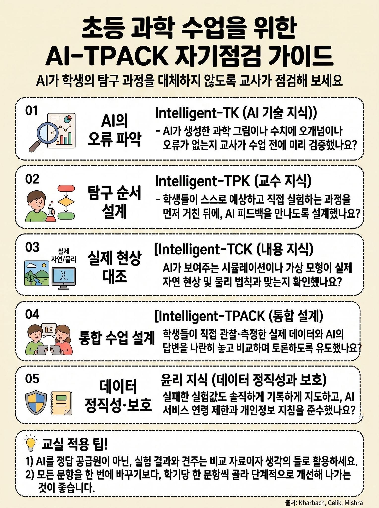

범용 AI-TPACK 가이드를 담당하고 있는 초등 5·6학년 과학 수업 맥락에 맞춰 재구성하면 어떨까?

과학은 관찰과 측정이 핵심이므로 AI가 학생의 탐구 과정을 대체하지 않도록 통제하는 역할이 중요해보인다.

> 전체 글: [AI-TPACK 점검표를 과학실로 가져가면 질문이 달라진다](/post/ai-tpack-elementary-science/)

<figure>

<figcaption>Intelligent-TPACK 다섯 영역을 초등 과학 수업의 점검 질문으로 옮긴 자기점검 가이드.</figcaption>
</figure>

## Intelligent-TPACK 5가지 영역

(1) intelligent-TK: AI의 오류 파악 (과학 그림 및 수치 오류를 교사가 사전에 검증함)

(2) Intelligent-TPK: 탐구 순서 설계 (학생의 예상과 실험 활동 후 AI 피드백을 배치함)

(3) Intelligent-TCK: 실제 현상 대조 (AI 시뮬레이션 및 모형이 물리 법칙과 맞는지 확인함)

(4) Intelligent-TPACK: 통합 수업 설계 (실험 측정값과 AI 답변을 나란히 놓고 비교·토의함)

(5) 윤리 지식: 데이터 정직성 및 보호 (실패한 측정값의 정직한 기록과 이용약관 연령 지침을 준수함)

## 교실 수업에서

(1) AI를 정답 공급원이 아닌 실험 결과와 견주는 하나의 비교 자료이자 생각의 틀을 만드는 소스로 활용한다.

(2) 점검표의 모든 문항을 적용하기보다 학기당 한 문항을 골라 수업 순서나 비교 활동을 단계적으로 개선하는 것이 지속가능성을 높인다.

## 참고문헌

- Kharbach (n.d.), Celik (2023), Mishra et al. (2023), Mishra & Koehler (2006)

## 함께 보기

- [AI-TPACK 점검표를 과학실로 가져가면 질문이 달라진다](/post/ai-tpack-elementary-science/)
