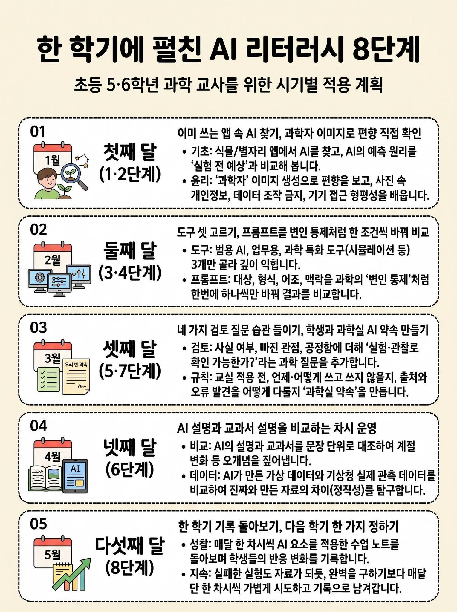
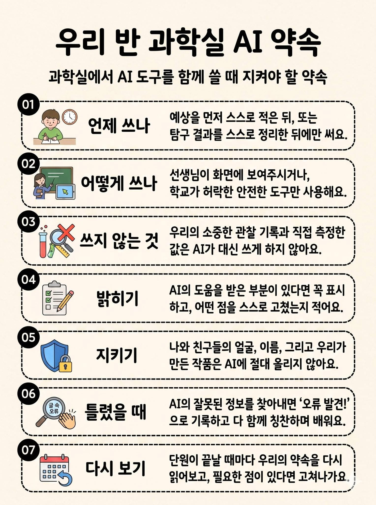

AI 리터러시는 별도 수업이 아닌 기존 과학 교과 맥락 안에서 통합해 지도함이 바람직하다. 7단계(학급 AI 약속)를 6단계(교실 통합)보다 먼저 배치하여 초기 규칙을 확립하는 것이 필요하겠다.

> 전체 글: [과학 교사의 AI 리터러시 8단계, 한 학기 계획으로 다시 짜기](/post/ai-literate-science-teacher/)

## 시기별 단계 적용 체계

(1) 1·2단계 (첫째 달/기초·윤리): 앱 속 AI를 탐색하고 과학자 이미지로 알고리즘 편향과 데이터 정직성을 확인하기

(2) 3·4단계 (둘째 달/도구·프롬프트): 핵심 도구 3가지를 선정하고 변인 통제 원리로 프롬프트 조건을 하나씩 바꿔 비교하기

(3) 5·7단계 (셋째 달/검토·약속): 기본 검토 질문에 실험·관찰 가능성을 추가하고 과학실 AI 약속을 수립하기

(4) 6단계 (넷째 달/교실 통합): AI 답변과 교과서 문장을 대조하여 오개념을 점검하고 실제 데이터와 가상 데이터를 비교하기

(5) 8단계 (다섯째 달/성찰·성장): 매달 한 차시 적용 기록을 바탕으로 수업 노트를 작성하여 다음 학기 계획을 세우기

<figure>

<figcaption>첫째 달(1·2단계)부터 다섯째 달(8단계)까지의 시기별 적용 계획.</figcaption>
</figure>

## 교실 수업에서

(1) 프롬프트 작성 시 대상과 형식 중 한 번에 한 조건만 변경하여 결과를 비교한다.

(2) AI의 오류를 사고가 아닌 탐구적 발견으로 전환하여 오류를 찾은 학생을 칭찬하는 문화를 만든다.

(3) AI의 답변을 깊이 있는 생각을 위한 초점 질문 자료로 활용하고, 반박을 위한 토의를 통해 자신의 이해문장을 만들게 한다.

(4) 만 13세 미만 연령 제한을 고려해 교사 시연 및 학교 승인 도구 위주로 안전하게 활용한다.

<figure>

<figcaption>과학실에서 AI 도구를 함께 쓸 때 지킬 일곱 가지 약속.</figcaption>
</figure>

## 참고문헌

- Kharbach, M. (2026). How to become an AI-literate teacher: A step-by-step guide.

## 함께 보기

- [과학 교사의 AI 리터러시 8단계, 한 학기 계획으로 다시 짜기](/post/ai-literate-science-teacher/)
