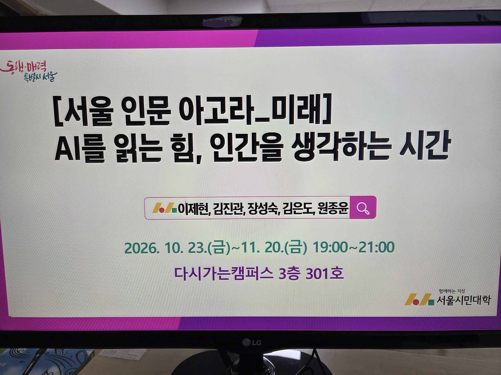
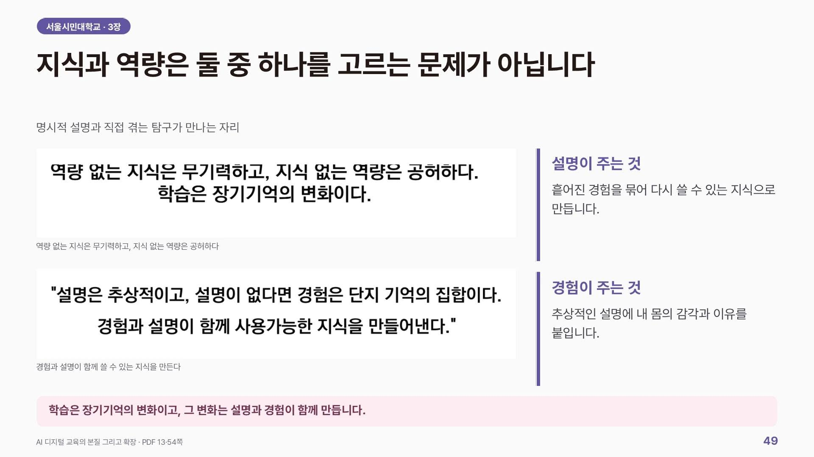
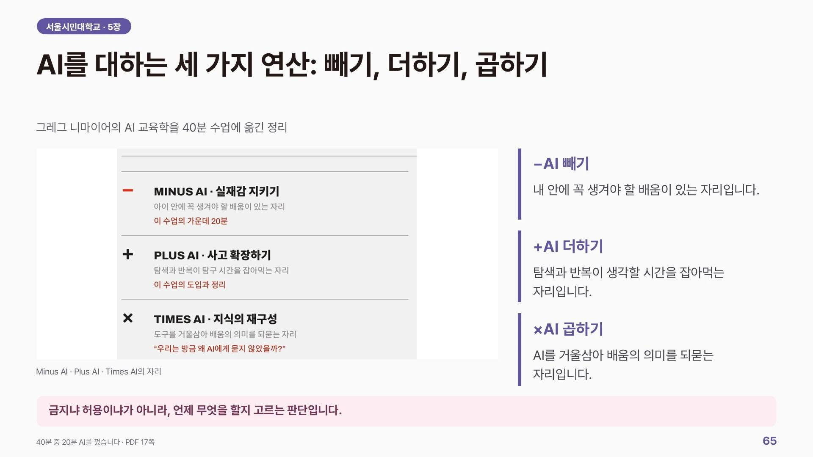
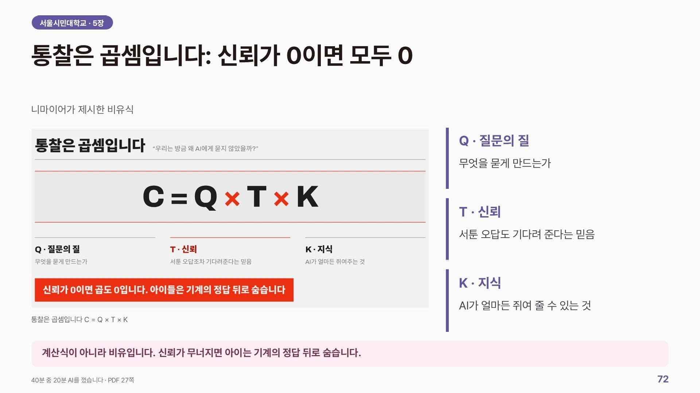
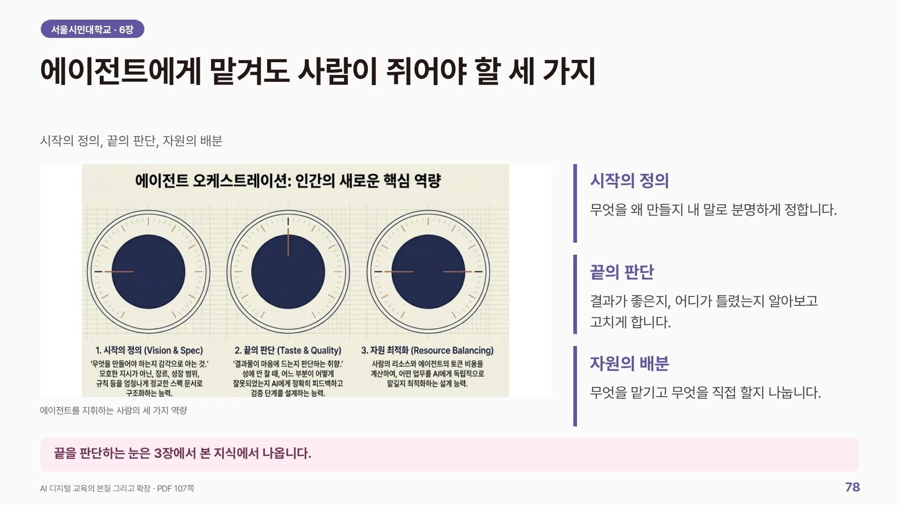
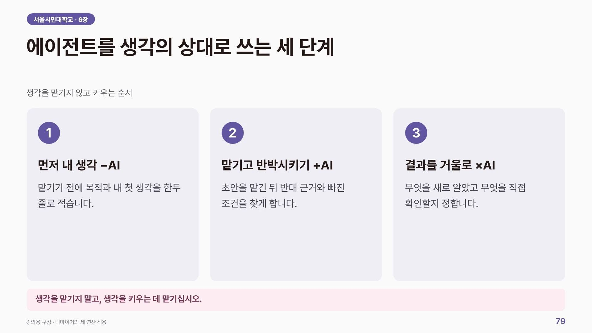
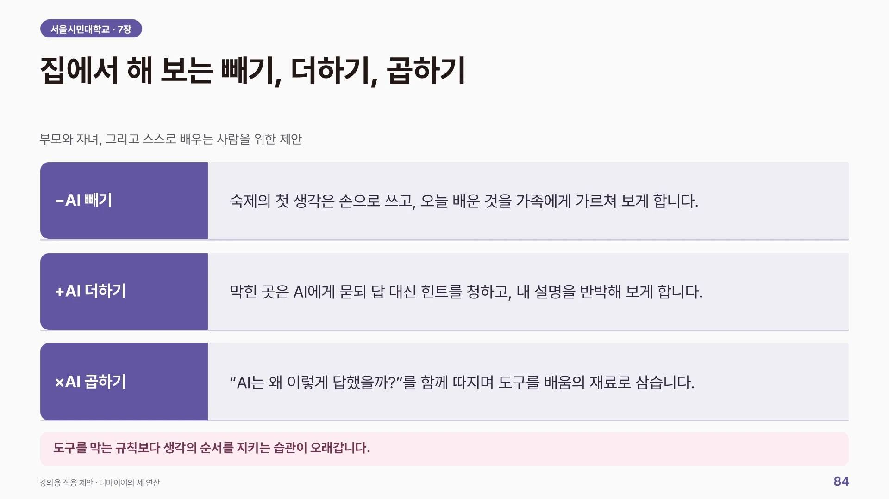
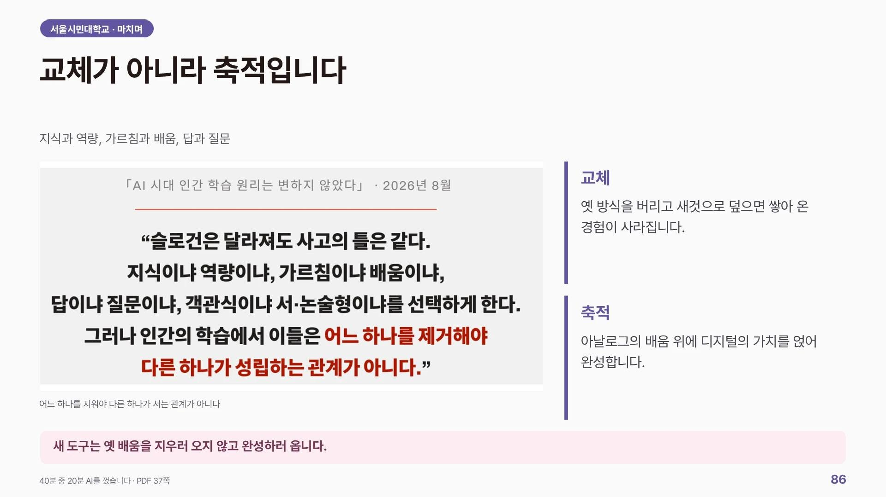
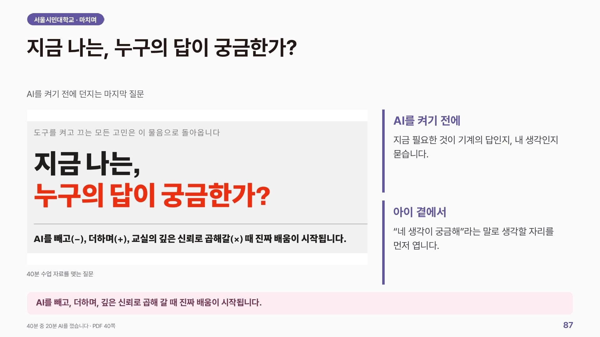
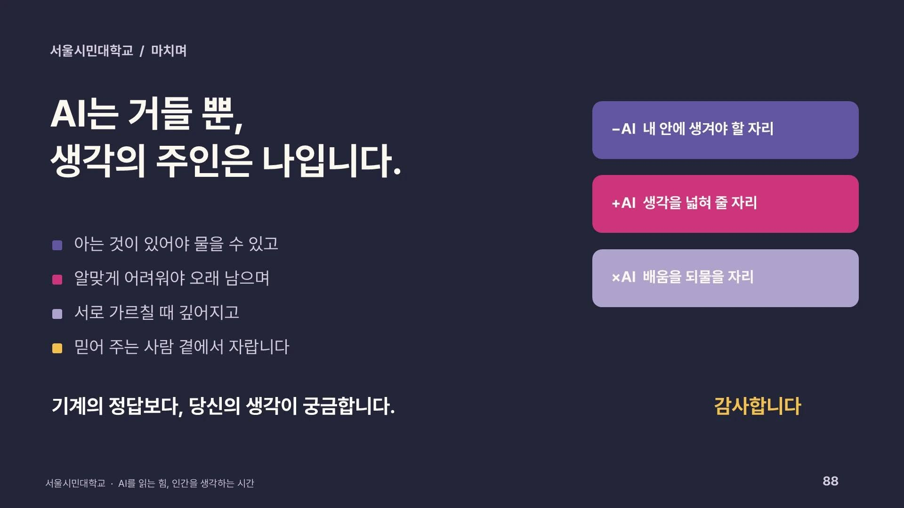

서울시민대학교 다시가는 캠퍼스에서 다양한 연령대의 서울시민들을 AI 리터러시라는 주제로 만나뵈었습니다.

<figure>

<figcaption>서울 인문 아고라_미래 「AI를 읽는 힘, 인간을 생각하는 시간」. 2026년 10월 23일부터 11월 20일까지 금요일 저녁, 서울시민대학 다시가는캠퍼스.</figcaption>
</figure>

'AI 에이전트 시대에 갖춰야 할 AI 리터러시'를 교사와 학부모의 관점에서 유네스코(2026) 방안의 알고리즘, 학습 과학 그리고 그레그 니마이어의 -, +, × AI 프레임워크로 조망해보았습니다.

늦은 저녁시간까지 다채로운 질문주시면서 참여해주신 서울 시민분들과 오래전부터 좋은기회로 제안 주신 AI 프렌즈 원종윤 교수님께 감사드립니다.

## 강연 슬라이드 다시 보기

<figure>

<figcaption>지식과 역량은 둘 중 하나를 고르는 문제가 아닙니다</figcaption>
</figure>

<figure>

<figcaption>AI를 대하는 세 가지 연산, 빼기·더하기·곱하기</figcaption>
</figure>

<figure>

<figcaption>통찰은 곱셈입니다, 신뢰가 0이면 모두 0</figcaption>
</figure>

<figure>

<figcaption>에이전트에게 맡겨도 사람이 쥐어야 할 세 가지</figcaption>
</figure>

<figure>

<figcaption>에이전트를 생각의 상대로 쓰는 세 단계</figcaption>
</figure>

<figure>

<figcaption>집에서 해 보는 빼기, 더하기, 곱하기</figcaption>
</figure>

<figure>

<figcaption>교체가 아니라 축적입니다</figcaption>
</figure>

<figure>

<figcaption>지금 나는, 누구의 답이 궁금한가?</figcaption>
</figure>

<figure>

<figcaption>AI는 거들 뿐, 생각의 주인은 나입니다</figcaption>
</figure>
