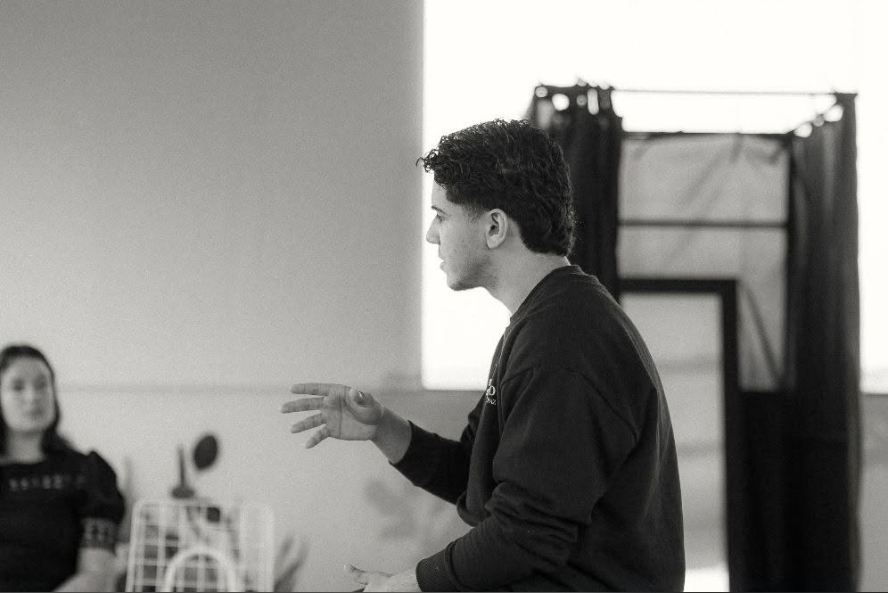

> 스스로 설명할 수 있는 사람에게 AI는 사고 확장의 도구가 되지만, 그렇지 못하다면 사고 멈춤의 도구가 된다.

최근 미국의 대학들이 잇달아 구술 면접과 대면 시험 카드를 꺼내 들고 있다. AI로 제출된 답안은 완벽하지만, 머릿속은 백지 상태인 허상의 학습이 교실을 잠식하는 중이다.

<figure>

</figure>

아무리 혁신적인 AI를 쥐여준들, 결국 그 결과물의 깊이는 아이의 문해력 바닥을 넘지 못한다. 도구를 쥘 손아귀 힘이 없는 아이에게 AI는 고유의 사유 능력을 통째로 녹여버리는 용광로에 불과하다.

미래교육의 본질은 역설적이게도 태블릿 활용법이나 프롬프트 기술이 아니다. 한 줄의 문장을 악물고 파고드는 기초 체력, 즉 읽고 이해하는 문해력과 자신의 언어로 설명해내는 능력이다. 진짜 앎은 단순한 정보의 수용에서 오지 않는다.

- 텍스트를 눈으로 읽되,
- 스스로 질문하며 관련 생각을 기록하고 텍스트와 이를 연결한 뒤,
- 남에게 말로 읊고, 글로 적고, 그림으로 그려보며 온전히 자기화하는 과정을 거쳐야 완성된다.

실험 보고서를 쓰거나 현상을 관찰하는 과학 시간에도 글을 읽고, 질문하고, 개념을 설명하고, 실험 과정을 그림으로 그리며 원리를 따져보는 입체적인 훈련이 필요한 이유다. 짝과 마주 앉아 서로를 가르치고 질문하며 배운 바를 자신만의 언어로 나타내 보는 교실.

AI시대, 미국 대학들이 뒤늦게 곤혹스러운 구술 평가를 도입하며 찾는 해답이 여기에 있다.
