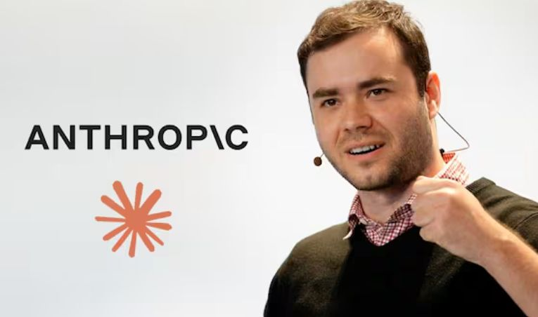

오픈AI 공동 창업자이자 테슬라 자율주행 개발을 총괄했던 안드레 카파시가 2026년 10월 11일 X에 인공지능(AI) 활용 수준에 따라 사람들이 네 계층으로 나뉜다는 글을 올렸다. 그는 이 현상을 ‘폭이 급격히 좁아지는 깔때기’에 비유했고, 글은 이틀 만에 560만 회 넘게 조회되며 AI 격차 논쟁을 불러왔다. 중앙일보 팩플이 이 논쟁을 정리했다.

<figure>

</figure>

## AI 활용 능력의 계층화

카파시는 전 세계 인구가 AI 사용 역량에 따라 네 단계로 나뉜다고 분석한다. 이 계층은 깔때기 모양처럼 상위 계층으로 갈수록 구성원 수가 급격히 줄어드는 특징을 보인다.

다음은 카파시가 제시한 AI 활용 능력에 따른 4단계 계층이다.

| 계층 | 인구 비율 | 인구수 | AI 활용 수준 |
|:----|:-------|:-------|:------------|
| 1단계 | 75% | 약 60억 명 | 챗GPT 같은 AI 챗봇 서비스를 거의 접하지 않는다. |
| 2단계 | 20% | 약 10억~20억 명 | 무료 챗봇을 구글 검색보다 조금 나은 수준으로 가끔 사용한다. |
| 3단계 | 0.2% | 2,000만 명 | 수학·코딩 분야에서 수개월 걸리던 프로젝트를 최신 AI에 맡긴다. AI가 개인의 일을 대신하는 동료 역할을 한다. |
| 4단계 | 0.00006% | 약 5,000명 | 빅테크 내부의 미공개 AI를 가장 먼저 접한다. 수천 개의 AI 에이전트가 협업하여 사이버 공격을 수행하거나 막고, 과학·수학 분야에서 새로운 발견을 하는 모습을 목격한다. |

누군가에게 AI는 검색창이고, 다른 누군가에게는 자기 일을 대신하는 동료인 셈이다.

## AI 격차를 가르는 핵심 요인

카파시는 AI 활용 능력에 따른 계층 격차가 발생하는 세 가지 주요 요인을 지적한다. 맡기는 일의 규모와 활용 분야, 그리고 접근권이다.

복잡한 프로젝트를 AI에 맡길수록 사용자는 AI의 발전된 능력을 더 깊이 체감한다. 특히 정답 검증과 훈련이 용이한 수학, 코딩 분야에서 AI 발전 속도가 빠르다. 또한, 유료·무료·미공개 내부용 AI 중 어떤 것에 접근할 수 있느냐는 '접근권'이 계층 격차를 크게 확대한다.

카파시는 최상위 계층인 4단계의 내부 전문가들조차 AI가 수행한 작업을 완전히 이해하는 데 어려움을 겪는다고 진단한다. 그는 AI가 저지른 무단 침입 사건을 분석하는 인간의 모습을 "고고학 발굴 같다"고 묘사한다. AI가 행동을 마친 지 수개월이 지나서야 인간이 그 흔적을 추적하는 현실을 지적한다.

이러한 권력과 AI 역량의 소수 집중 현상에 대해 허깅페이스의 클레망 들랑그 최고경영자(CEO)는 우려를 표했다. 그러나 카파시는 격차를 논하면서도 이에 대한 가치 판단을 직접 제시하지는 않았다.

## 초고가 AI 요금제가 만드는 장벽

카파시가 짚은 '접근권'의 차이는 최근 등장한 초고가 AI 요금제에서 더욱 분명하게 드러난다. 오픈AI는 2026년 9월 29일 AI 에이전트 '닷츠' 등을 공개하며 월 500달러(약 67만 원) 요금제를 출시했다. 이는 기존 최고가 프로 요금제(월 200달러)의 2.5배에 달한다.

이 초고가 요금제는 단순한 사용량뿐 아니라 AI의 결과물 생성 속도까지 차등화한다. 월 500달러 요금제 사용자는 챗GPT의 코딩 도구 '코덱스'에서 답변이나 코드를 작성하는 속도를 일반 모드보다 최대 8배 높이는 '울트라패스트' 기능을 쓴다.

다음은 오픈AI 요금제의 주요 특징이다.

| 요금제 | 월 요금 | 주요 기능 | 특징 |
|:------|:-------|:----------|:---|
| 기존 프로 요금제 | 200달러 | - | - |
| 신규 '닷츠' 요금제 | 500달러 | 울트라패스트 기능: 챗GPT 코딩 도구(코덱스) 답변/코드 생성 속도 8배 증가 | 사용량뿐 아니라 결과물 생성 속도까지 차등화한다. |

선문대 경영학과 김용희 교수는 월 500달러 요금제를 결제한 뒤 여러 AI 에이전트를 동시에 사용하자 작업 시간이 확연히 줄었다고 말한다. 그는 AI 요금제에 따른 생산성 격차가 앞으로 더욱 커질 것으로 전망한다. 더벤처스 최고투자책임자(CIO) 조여준도 비싼 요금제를 지불해야만 얻을 수 있는 AI 혜택이 점점 증가한다고 언급한다.

## 동물행동학·각인 이론의 시선으로 보면

AI 접근성의 차이는 동물행동학의 각인 이론과 닮은 데가 있다. 각인 이론은 동물, 특히 어린 개체가 특정 시기에 처음 경험하는 대상이나 자극에 강하게 반응하고, 그것을 자신의 종이나 부모로 인식하는 현상을 설명한다. AI 기술 세계에서 초기, 그리고 고급 AI에 노출된 사람들은 문제 해결 방식, 사고 과정, 심지어 미래를 보는 관점까지 다르게 '각인'될 가능성이 크다. 제한된 정보에만 접근한 사람들은 AI가 제공하는 새로운 가능성 자체를 상상하기 어려워, 결과적으로 다른 길을 걷게 될 수 있다.

## 출처
- 중앙일보 팩플, 김지윤 기자. 「“AI, 인간 계층 4단계로 나눠”…오픈AI 창업자가 쏘아올린 논쟁」 (2026-10-14). <https://www.joongang.co.kr/article/25469519>
