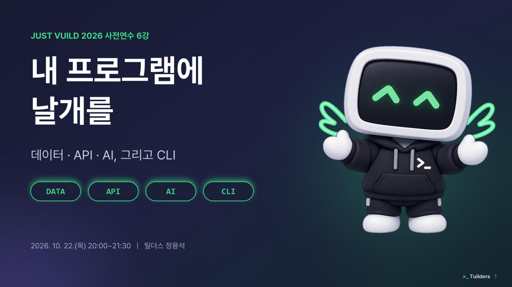

틸더스 정용석이 2026년 10월 22일 JUST VUILD 2026 사전연수 6강으로 강의한 「내 프로그램에 날개를, 데이터·API·AI 그리고 CLI」 슬라이드 104장을 정리했다. 인공지능이 문법을 대신 짜 주는 바이브 코딩에서 개발의 핵심은 코드를 외우는 일이 아니라, 무엇을 저장하고(데이터), 무엇과 연결하며(API), AI에 어떤 판단을 맡길지(AI) 설계하고, 그 작업을 폴더째 맡길 작업 공간(CLI)을 갖추는 일이다.

<figure>

<figcaption>JUST VUILD 2026 사전연수 6강 「내 프로그램에 날개를」 표지 슬라이드.</figcaption>
</figure>

## 바이브 코딩, 아이디어로 만드는 웹앱

바이브 코딩은 아이디어나 느낌만으로 코드를 짜는 방식을 말한다. 과거에는 텍스트 코딩이 문법, 공유, 오류 수정의 장벽 때문에 어려웠다. 하지만 이제 AI가 문법을 해결하고, 빅테크 기업이 공유를 쉽게 만들었으며, 오류 수정 역시 AI에게 맡길 수 있다.

마치 6살 아이가 "독립군이 일본군을 피해 미션을 수행하는 게임"이라고 말한 아이디어로 실제 게임을 만드는 것처럼, 이제는 구체적인 아이디어를 AI에게 설명해 웹앱을 만들 수 있다.

바이브 코딩을 할 수 있는 도구는 다양하다. 각 도구는 저마다 다른 장단점을 가지며, 만들고 싶은 프로그램의 성격에 따라 선택할 수 있다.

| 도구 | 특징 및 추천 용도 | 주요 장점 |
| --- | --- | --- |
| Apps Script | 구글 시트·폼·드라이브에 붙여 쓰는 자바스크립트. 설문, 기록 등 학교 업무 자동화에 적합하다. | 구글 시트가 바로 데이터베이스(DB)가 된다. 학교 계정으로 사용 가능하며 웹앱 배포가 쉽다. |
| Lovable | 대화로 완성형 웹앱을 만드는 AI 앱 빌더. 보기 좋은 서비스 시안을 빠르게 만들고 싶을 때 유용하다. | 말로 설명하면 디자인 완성도 높은 앱이 나온다. 로그인, DB 연결, 배포가 간편하다. |
| Gemini Canvas | Gemini 대화창 안의 코딩·미리보기 공간. 바이브 코딩을 처음 시작하거나 작은 수업용 앱을 만들 때 좋다. | 설치가 필요 없고 무료다. AI(Gemini)와 가상 DB(Firebase)가 내장되어 있어 편리하다. |
| Google AI Studio | Gemini 모델을 직접 다루는 구글의 작업실. API와 서버가 필요한 한 단계 높은 앱 개발에 쓰인다. | 최신 Gemini 모델을 먼저 사용하고 설정을 조절할 수 있다. API 키 발급과 사용량 확인이 쉽다. |
| CLI 환경 | 내 컴퓨터 폴더에서 일하는 AI 코딩 에이전트. Gemini Canvas로는 부족한 실제 서비스를 만들 때 쓴다. | 폴더 전체를 읽고 수정해 큰 프로젝트를 다룬다. 오류를 스스로 확인하고 배포까지 연결한다. |
| Antigravity IDE | 구글의 에이전트 중심 개발 도구(IDE). 터미널이 낯선 사용자가 화면을 보며 AI와 협업할 때 유용하다. | 코드 편집기 화면에서 직접 파일을 보며 AI 에이전트에게 작업을 맡길 수 있다. |

초심자에게는 간단한 웹앱을 빠르게 만들 수 있는 Gemini Canvas가 추천된다. 실제로도 많은 간단한 웹앱이 이 도구로 만들어진다.

## 웹앱의 기본 구조

웹앱은 크게 뼈대(HTML), 꾸미기(CSS), 움직임(JavaScript) 세 가지로 구성된다. 여기에 사용자의 기록을 기억하는 백엔드(Backend)와 데이터베이스(DB)가 더해져 완전한 서비스가 된다. 교육행정정보시스템 나이스(NEIS)를 예로 들면 쉽게 이해할 수 있다.

1.  HTML만 있을 때: 글자와 입력 칸 등 뼈대만 존재한다. 꾸밈이나 동작은 없다.
2.  CSS가 더해질 때: 우리가 아는 나이스 화면처럼 모양과 색이 입혀진다.
3.  JavaScript가 더해질 때: 상단 메뉴를 누르면 색이 바뀌거나, 달력에서 화살표를 눌러 월을 이동하는 등 상호작용이 가능해진다.
4.  DB가 붙을 때: 학생 성적, 주소, 행동 발달 기록 같은 실제 데이터가 연결되어 비로소 완전한 나이스 시스템이 된다.

Gemini Canvas는 이 과정 중 AI(Gemini API)와 가상 DB(Firebase) 연결을 매우 쉽게 만들어준다. 별도 설정 없이 프롬프트 입력만으로 체크리스트 앱, 삼행시 생성기, 실시간 가위바위보 게임 등을 만들 수 있다.

하지만 Gemini Canvas는 코드가 공개되고 큰 프로젝트를 다루기 어렵다는 약점이 있다. 진짜 서비스를 만들려면 데이터, API, AI, CLI에 대한 깊은 이해가 필요하다.

## 데이터, 어디에 저장할까

모든 정보를 클라우드 DB에 저장하는 것이 정답은 아니다. 정보의 성격에 따라 저장 위치를 신중하게 선택해야 한다.

| 저장 위치 | 특징 | 장점 | 단점 |
| --- | --- | --- | --- |
| ① 브라우저 안 | `localStorage`, `IndexedDB` 사용. 서버가 없다. | 안전하고 간단하며 비용이 없다. 교실 밖으로 정보가 나가지 않는다. | 기기를 바꾸면 기록이 사라진다. 공용 기기에서는 다음 사용자에게 노출될 수 있다. |
| ② 교사 PC 폴더 | `File System Access` API 사용. | 학생 사진, 파일 등을 교실 밖으로 보내지 않고 교사 PC에 직접 저장한다. | 크롬을 새로 켤 때마다 폴더 접근 권한을 다시 설정해야 한다. |
| ③ 클라우드 BaaS | Firebase, Supabase 등 백엔드 서비스. | 여러 기기에서 기록을 공유하고 교사가 데이터를 모아볼 수 있다. | 관리 부담과 법적 책임이 따른다. (개인정보보호법, 학습지원소프트웨어 심의 등) |
| ④ 직접 운영 서버 | 가상서버(VPS)나 학교 서버를 직접 구축한다. | 모든 것을 통제할 수 있다. | 보안, 업데이트, 백업 등 모든 것을 직접 책임져야 한다. |

예를 들어, 30명 학생의 얼굴이 찍힐 수 있는 '우유 인증 사진'은 서버로 보내지 않고 교사 PC 폴더에 저장하는 것이 안전하다. 점수 기록 한 줄만 외부 포인트 시스템 API로 보내는 식이다. 학생 정보를 서버에 모으는 순간 학습지원소프트웨어 심의 대상이 되고, 유출 시 72시간 내 통지 의무가 발생한다.

클라우드 DB가 꼭 필요하다면 Firebase와 Supabase가 좋은 선택지다.

-   Firebase: NoSQL(문서형) 방식으로 JSON처럼 데이터를 자유롭게 넣는다. 실시간 동기화와 구글 로그인이 쉽다.
-   Supabase: SQL(관계형) 방식으로, 학생-제출물-점수처럼 얽힌 기록을 표로 관리하고 계산하기 좋다.

DB를 연결할 때 가장 중요한 것은 보안 규칙이다. AI가 써준 보안 규칙을 검토 없이 그대로 배포하면, 주소만 아는 누구나 데이터를 읽고 수정할 수 있게 될 수 있다. DB를 만드는 것보다 권한 규칙을 먼저 점검해야 한다.

## API, 다른 서비스와 주고받는 약속

API(Application Programming Interface)는 프로그램끼리 정해진 양식으로 정보를 주고받는 약속이다. OpenAI API는 수많은 API 중 하나일 뿐이다. API에는 두 가지 방향이 있다.

1.  받아쓰기: 다른 서비스가 열어둔 API를 내 프로그램에서 호출한다. 나이스 교육정보개방포털 API로 급식 식단표를 가져오거나, 표준국어대사전 API로 끝말잇기 낱말을 판정하는 것이 예이다.
2.  열어주기: 내 서비스의 기능을 API로 열어 다른 프로그램이 사용하게 한다. 예를 들어, 학급 보상 시스템 Grownd는 외부 미니게임이 학생에게 포인트를 지급할 수 있도록 API를 열어두었다.

API를 요청할 때는 보통 네 가지 정보가 필요하다.

| 구성요소 | 역할 | 예시 (Grownd 포인트 지급) |
| --- | --- | --- |
| Method | 무엇을 할지 정한다. (가져오기, 보내기 등) | `POST` (보내기) |
| Endpoint | 어디로 보낼지 도착지 주소를 정한다. | `/api/v1/classes/{학급ID}/students/{번호}/points` |
| Header | 누가 보내는지 신분증(API 키)을 담는다. | `X-API-Key: sk_live_...` |
| Body | 무슨 내용을 보낼지 실제 데이터를 담는다. | `{"points": 10, "description": "퀴즈정답"}` |

중요한 점은 API 키를 절대 웹 화면 코드에 노출해서는 안 된다는 것이다. 키가 노출되면 누구나 내 권한으로 포인트를 무제한 지급하거나 비용을 발생시킬 수 있다. 따라서 API 키는 서버(Cloud Functions 등)에 숨겨 두고, 서버에서만 API를 호출해야 한다.

## AI, 생성하고 판단하는 능력

AI API 역시 일반 API와 구조가 같다. 모델 이름, 지시문, 사용자 입력을 담아 요청을 보내면, AI의 답변과 사용된 토큰(비용 계산 단위) 정보를 응답으로 받는다.

AI API는 이전 대화를 기억하지 못한다. 대화가 이어지는 것처럼 보이는 이유는, 앱이 매번 이전 대화 기록 전체를 포함해 요청을 다시 보내기 때문이다. 대화가 길어질수록 보내는 글의 양이 늘어나고 요금도 증가한다. 따라서 대화 횟수에 제한을 두거나 오래된 대화를 요약하는 전략이 필요하다.

모든 기능에 AI를 적용할 필요는 없다.

-   규칙과 코드의 영역: 2+3 계산, 출석 저장, 낱말이 사전에 있는지 확인 등 늘 같은 답이 나와야 하는 일.
-   AI의 영역: 글의 주장 찾기, 풀이 이유 되묻기, 쉬운 말로 바꿔 쓰기 등 해석, 생성, 언어 이해가 필요한 일.

API 키 유출은 곧바로 요금 폭탄으로 이어진다. 키는 반드시 서버 코드에만 보관하고, 깃허브(GitHub) 같은 공개 저장소에 올리지 않도록 주의해야 한다. 또한 학생이 사용하는 앱을 만들 때는 OpenAI, Claude, Gemini 등 각 서비스의 연령 기준과 이용 약관을 반드시 확인해야 한다.

## CLI, 폴더째로 일을 맡기는 작업 공간

CLI(Command Line Interface)는 마우스 대신 글자 명령으로 컴퓨터를 다루는 방식이다. AI 코딩에서 CLI는 채팅창과 달리 내 프로젝트 폴더 전체를 읽고 수정하며, 명령을 실행하고, 오류까지 확인하는 '출장기사' 같은 역할을 한다.

| 구분 | 채팅창 AI | CLI 코딩 에이전트 |
| --- | --- | --- |
| 작업 단위 | 코드 조각 복사·붙여넣기 | 폴더 전체를 읽고 수정 |
| 파일 처리 | 파일 하나씩 업로드 | 프로젝트 전체 구조 파악 |
| 실행·검증 | 사용자가 직접 실행하고 오류 확인 | 명령을 스스로 실행하고 오류까지 확인 |
| 연속 작업 | 단편적 코드 생성 | 코드 수정, 기록(git commit), 배포까지 연결 |

최근에는 MCP(Model Context Protocol)라는 공통 규격이 등장했다. AI가 구글 드라이브, 미리캔버스, DB 등 외부 도구와 연결되는 방식을 USB-C처럼 하나로 통일하는 표준이다. `claude mcp add miricanvas` 같은 간단한 명령 한 줄로 AI 에이전트에게 새로운 도구를 장착시킬 수 있다.

CLI 환경에서 AI 에이전트에게 "이 프로젝트의 데이터 저장 방식을 설명해줘", "API 키가 노출된 곳이 있는지 찾아줘" 와 같이 폴더 전체를 대상으로 하는 작업을 맡길 수 있다.

## 출처
- 틸더스 정용석, 「내 프로그램에 날개를, 데이터·API·AI 그리고 CLI」, JUST VUILD 2026 사전연수 6강 슬라이드 (2026. 10. 22., 104장 합본)
