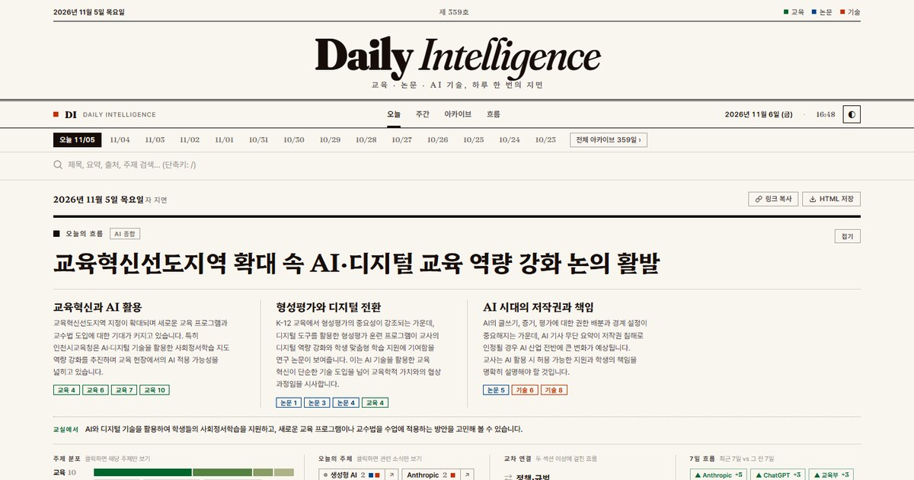

AI와 교육 소식은 하루에도 수십 건씩 쏟아지지만 아침에 훑을 시간은 몇 분뿐이다. 데일리 인텔리전스는 그 몇 분을 위해 만든 지면이다. 교육 뉴스, AI 교육 논문, AI 기술 뉴스를 매일 25건 골라 신문 1면처럼 한 화면에 놓고, 그 위에 오늘의 흐름을 얹는다. 주소는 [tigerjk9.github.io/Live-Artifact](https://tigerjk9.github.io/Live-Artifact/)이고, 2025년 11월 12일 첫 호부터 2026년 11월 5일 제359호까지 모든 날의 지면이 그대로 남아 있다. 지금까지 쌓인 소식은 8,204건이다.

<figure>

<figcaption>2026년 11월 5일자 제359호. 신문 1면처럼 제호와 날짜 띠, 오늘의 흐름 헤드라인이 먼저 온다.</figcaption>
</figure>

## 지면 한 장에 무엇이 있나

맨 위는 오늘의 흐름 보드다. 11월 5일자는 「교육혁신선도지역 확대 속 AI·디지털 교육 역량 강화 논의 활발」이 헤드라인이었고, 그 아래에 교육혁신과 AI 활용, 형성평가와 디지털 전환, AI 시대의 저작권과 책임이라는 세 갈래 흐름이 각각 관련 기사 번호와 함께 놓였다. 흐름마다 붙은 「교육 4」, 「논문 5」 같은 칩을 누르면 그 기사 카드로 바로 내려간다. 보드 끝에는 교실에서 해 볼 만한 제안 한 줄이 붙는다.

보드 아래에는 집계가 있다. 세 섹션의 주제 분포(이날은 교육 10건 가운데 정책·행정 5건, 수업·교육과정 3건), 오늘 자주 등장한 주체(생성형 AI, Anthropic, Google, 에이전트, 인천시교육청), 두 섹션 이상에 걸친 교차 연결, 최근 7일과 그 전 7일을 견준 변화(Anthropic +5, ChatGPT +3, 교육부 +3)가 한 줄씩이다. 주제나 주체를 누르면 관련 소식만 남는다.

그 아래가 본문이다. 교육 뉴스 10건, AI 디지털 연구 논문 5건, AI 디지털 기술 뉴스 10건이 세 단으로 이어진다. 기사마다 출처와 날짜, 주제 태그, 한 줄 요약이 있고, 교육 뉴스에는 학생이나 수업에 어떻게 이어지는지 한 문장을 덧붙인다. 논문은 한국어 제목을 앞세우고 원제와 저자를 작게 받친다.

## 다섯 개의 화면

| 화면 | 주소 | 무엇을 보나 |
|------|------|-------------|
| 오늘 | [/Live-Artifact/](https://tigerjk9.github.io/Live-Artifact/) | 오늘 지면. 날짜 띠에서 최근 2주 지면으로 바로 이동 |
| 주간 | [/weekly/](https://tigerjk9.github.io/Live-Artifact/weekly/) | 끝난 주마다 집계와 주간 종합, 이 주의 주체, 주제 비중 변화 |
| 아카이브 | [/archive/](https://tigerjk9.github.io/Live-Artifact/archive/) | 첫 호부터 모든 날짜를 월별 격자로. 전 기간 제목·요약 검색 |
| 흐름 | [/trends.html](https://tigerjk9.github.io/Live-Artifact/trends.html) | 30일·90일·180일·1년을 직전 같은 기간과 비교. 주제 비중, 주체 랭킹과 타임라인, 출처 |
| 주체 | [/entity.html](https://tigerjk9.github.io/Live-Artifact/entity.html?e=OpenAI) | 한 주체의 월별 언급, 함께 등장한 주체, 전체 기사 목록 |

흐름 화면을 90일로 놓으면 2026년 8월 8일부터 11월 5일까지 2,229건이 잡힌다. 많이 등장한 주체는 ChatGPT 218건, OpenAI 211건, 에이전트 176건 순인데, 에이전트는 직전 90일보다 48건이 늘어 가장 가파르게 올라온 말이다. 하루치 나열로는 보이지 않던 것이 기간으로 놓으면 보인다.

아카이브 검색은 주소에 그대로 남는다. `?q=디지털교과서`처럼 검색어를 붙인 주소를 보내면 받는 사람도 같은 결과를 본다. RSS와 JSON Feed로 구독할 수 있고, 날짜별 공유 이미지가 미리 만들어져 있어 링크를 공유하면 그날 지면이 미리보기로 뜬다.

## 어떻게 만들어지나

서버는 없다. GitHub Actions가 매일 아침 세 수집기(교육 뉴스, AI 교육 논문, AI 기술 뉴스)가 모은 하루치를 받아 정적 HTML로 지면을 만들고 GitHub Pages가 배포한다. 수집기가 늦으면 감시 작업이 낮에 한 번 더 돌아 지면을 채운다. 분류는 수집기 키워드에 기대지 않는다. 기술 뉴스의 70%, 논문의 80%는 키워드가 비어 있어서, 제목과 요약의 패턴 점수로 주제를 고르고 90여 개 별칭 사전으로 주체를 뽑는다. 보드 상단의 헤드라인과 세 갈래 흐름, 교실 제안은 Gemini가 하루 한 번 쓰며, 키가 없어도 집계만으로 지면은 완성된다.

데이터는 날짜별 JSON으로 저장소에 영구히 남는다. 그래서 템플릿을 바꾸면 첫 호부터 전부 다시 그릴 수 있고, 요약이 비어 있던 2026년 3~4월 치도 제목을 바탕으로 채웠다. 코드와 운영 지침은 저장소에 공개되어 있어, 시크릿 두 개와 Pages 설정만 하면 같은 지면을 다른 주제로도 돌릴 수 있다.

## 출처

- 데일리 인텔리전스 <https://tigerjk9.github.io/Live-Artifact/>
- 저장소 tigerjk9/Live-Artifact <https://github.com/tigerjk9/Live-Artifact>
- 수집기: [Auto-Edu-news-Collector](https://github.com/tigerjk9/Auto-Edu-news-Collector) · [Auto-AI-Edu-Paper-Curator](https://github.com/tigerjk9/Auto-AI-Edu-Paper-Curator) · [Auto-AI-Tech-news-Collector](https://github.com/tigerjk9/Auto-AI-Tech-news-Collector)
