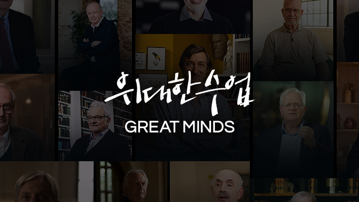

EBS 「위대한 수업 Great Minds」는 세계 정상급 학자와 창작자가 자기 연구 분야를 직접 강연하는 프로그램이다. TV 방송과 누리집 다시보기로 공개되며, 각 분야 최고 권위자의 생각을 안방에서 들을 수 있다. 누리집 안내를 바탕으로 프로그램 구성과 강연자 목록을 정리했다.

<figure>

</figure>

## 세계 석학의 강연 프로그램

강연은 정치, 경제, 경영, IT, 사회, 철학, 심리, 역사, 과학, 환경, 예술로 분류된다. 강연자는 각자의 전문 분야에서 지금 시대의 질문에 답한다. 이 프로그램은 교육부와 국가평생교육진흥원이 주관하는 한국형 온라인 공개강좌(K-MOOC) 운영 사업의 지원을 받아 제작된다.

2026년 11월 기준 누리집에는 케빈 미첼의 「AI와 자유 의지」, 가이 스탠딩의 「이 불안정한 시대를 사는 법」, 필리프 판 파레이스의 「21세기 정의론」이 새 강연으로 올라와 있고, 인기 강의에는 게르하르트 슈뢰더의 「결단의 정치」 1강 「왜 정권을 걸고 개혁했나」와 판 파레이스의 「21세기 정의론」 1강 「무조건적 기본소득은 가능한가」가 있다.

## 강연자와 주제

노벨상, 튜링상, 퓰리처상, 프리츠커상 수상자를 비롯해 각 분야를 이끄는 인물이 강연자로 나선다. 다음은 누리집에 올라 있는 강연자 가운데 일부와 강연 주제, 주요 이력이다.

| 강연자 | 주제 | 주요 이력 |
|---|---|---|
| 케빈 미첼 | AI와 자유 의지 | 트리니티 칼리지 더블린 유전학·신경과학 부교수, 저서 《자유로운 행위자들》 |
| 가이 스탠딩 | 이 불안정한 시대를 사는 법 | 기본소득지구네트워크 공동 창립자, 런던대학교 SOAS 교수급 연구원 |
| 필리프 판 파레이스 | 21세기 정의론 | 루뱅대학 명예교수, 기본소득 유럽네트워크 공동창립 |
| 최태원 | AI와 새로운 자본주의 그리고 청년 | SK그룹 회장, 대한상공회의소 회장 |
| 오르한 파묵 | 무엇이 소설이 되는가 | 2006 노벨문학상 수상자 |
| 디디에 쿠엘로 | 외계 행성 탐사 프로젝트 | 2019 노벨물리학상 수상 (외계행성 페가수스자리51 발견 공로) |
| 애나 렘키 | 도파민 과잉 시대 | 스탠포드 의과대학 정신 의학 및 중독 의학 교수, 저서 《도파민네이션》 |
| 그레고리 맨큐 | 청년을 위한 경제학 | 前 美 경제자문위 위원장, 저서 《맨큐의 경제학》 |
| 배리 마셜 | 인간과 헬리코박터 | 헬리코박터 파일로리균 발견으로 2005 노벨 생리의학상 수상 |
| 짐 로저스 | 불확실한 시대의 투자 전략 | 워런 버핏·조지 소로스와 함께 '세계 3대 투자자' |
| 스베틀라나 알렉시예비치 | 작은 사람들의 목소리 | 2015 노벨문학상 수상자 |
| 폴 로머 | 진보의 경제학 | 내생적 성장이론 제시로 2018 노벨 경제학상 수상 |
| 누리엘 루비니 | 재앙의 경제학 | 前 백악관 경제자문위원회 국제문제 수석 경제학자, 저서 《초거대 위협》 |
| 제임스 다이슨 | 기업가가 된 발명가 | 다이슨 창립자, 사이클론 방식 진공청소기 개발 |
| 재레드 다이아몬드 | 다시 보는 <총, 균, 쇠> | 1998 퓰리처상 수상, 저서 《총, 균, 쇠》 |
| 제임스 카메론 | 미래에서 온 영화 | 영화 <아바타>, <타이타닉> 감독 |
| 장 티롤 | 플랫폼 제국의 비밀 | 시장 지배력과 규제 연구로 2014 노벨 경제학상 수상 |
| 제인 구달 | 나의 이야기 | 야생 침팬지 연구 선구자, UN 평화대사 |
| 요슈아 벤지오 | AI는 어떻게 생각하는가 | 딥러닝 창시자, 2018 튜링상 수상 |
| 안도 다다오 | 건축가 안도 다다오 | 1995 프리츠커상 수상 |
| 마이클 샌델 | 공정을 말하다 | 자유주의-공동체주의 논쟁의 핵심 학자, 저서 《정의란 무엇인가》 |
| 유발 하라리 | 신년특집 유발하라리에게 듣는다 | 저서 《사피엔스》, 《호모 데우스》 |
| 스티븐 핑커 | 팩트 폭격 | 언어학 및 심리학 석학, 저서 《우리 본성의 선한 천사》 |
| 리처드 도킨스 | 당신이 몰랐던 진화론 | 저서 《이기적 유전자》, 《만들어진 신》 |
| 폴 크루그먼 | 세계 경제 예측 | 2008 노벨 경제학상 수상 |

이 밖에도 게르하르트 슈뢰더, 조지프 나이, 제프리 삭스, 에스테르 뒤플로 등이 강연자로 올라 있다.

## 시청 안내

「위대한 수업 Great Minds」는 EBS 1TV와 EBS 2TV에서 방송된다.

| 채널 | 본방 | 종합 |
|------|------|------|
| EBS 1TV | 월~금 밤 11시 45분 | 토 밤 12시 40분 |
| EBS 2TV | 월~금 저녁 8시 40분 | 금 밤 11시 55분 |

방송 시간은 편성에 따라 바뀔 수 있으니 누리집 편성표를 함께 확인한다.

## 출처
- EBS 위대한 수업 Great Minds 누리집 <https://home.ebs.co.kr/greatminds/index> (2026-11-06 열람)
