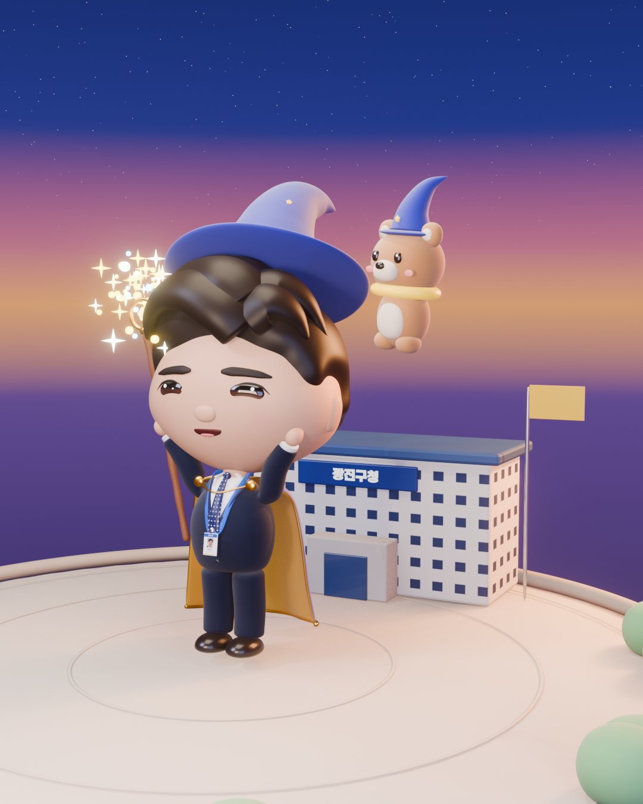

증명사진 한 장을 넣으면 치비 마법사 캐릭터가 걷고 손을 흔들고 말하는 영상이 나온다. 사진을 보고 3D 캐릭터를 만들고, 뼈대를 심어 움직이게 한 뒤, 자막과 음악을 넣은 영상까지 전부 스크립트로 제작하는 공개 프로젝트 FDE Wizard 이야기다. 만든 사람은 광진구청 류승인 주무관으로, 자기 모습을 닮은 마법사 캐릭터에서 시작해 코드와 따라 하기 프롬프트를 공개했고, 최근에는 이 도구로 박태웅 의장에게 보내는 35초 영상을 만들었다.

<figure style="max-width:560px;margin-inline:auto">

<figcaption>FDE Wizard 저장소의 대표 이미지. 증명사진 한 장으로 만든 치비 마법사 캐릭터.</figcaption>
</figure>

## 사진 한 장에서 영상까지 전부 스크립트로

FDE Wizard는 클로드 코드가 작성한 블렌더 파이썬 스크립트로 사진 한 장에서 치비 마법사 캐릭터를 생성한다. 모델링, 리깅, 포즈, 애니메이션, 그리고 자막, 음악, 내레이션이 포함된 영상 합성까지 전 과정을 스크립트로 자동화한다. 블렌더는 화면 없이 `blender -b` 명령으로 돌리며, 약 3,800줄의 블렌더 파이썬 코드로 구성된다. 이 코드에는 69개의 부품, 팔다리 IK가 적용된 44개의 뼈대, 8가지 포즈, 16개의 장면이 포함된다.

## 캐릭터 맞춤화와 다양한 출력 형태

FDE Wizard는 `scripts/params.py` 파일의 숫자만 바꾸면 다른 캐릭터를 만들 수 있도록 설계되었다. 사용자는 자신의 사진을 `ref/photo.jpg`에 넣고 `PROFILE` 정보를 업데이트하여 캐릭터를 맞춤화할 수 있다. 머리 크기, 눈 위치와 크기, 머리카락 형태, 몸, 망토, 모자, 지팡이, 공무원증, 그리고 피부색을 포함한 모든 색상까지 조절 가능하다. 저장소 안내문은 실존 인물을 닮게 만들어야 할 때는 부품 조합보다 이미지에서 3D로 가는 경로가 맞았다고 적고, 그 순서와 밟은 함정을 별도 문서로 정리해 두었다.

캐릭터에는 기본, 대기, 손인사, 인사, 주문, 엄지척, 짠, 생각의 여덟 포즈와 대기, 손 흔들기, 인사, 주문, 짠, 걷기의 여섯 동작이 들어 있다. 최종 결과물은 1080p 해상도의 영상으로 렌더링되며, 자막, 내레이션, 배경 음악이 자동으로 합성된다. 선택적으로 웹용 GLB 파일로도 내보내 웹 환경에서 직접 캐릭터 동작을 제어할 수 있다. 이 프로젝트의 완성본은 `chris.gomdori.app/wizard`에서 직접 돌려 볼 수 있다.

## 박태웅 의장 캐릭터, 35초의 선물

류승인 주무관은 이번에는 Codex와 함께 작업해 박태웅 의장의 캐릭터를 만들었다. 의장의 회색 머리, 사각 안경, 수염을 캐릭터에 담았다. 캐릭터가 만들어지는 과정부터 걷고, 생각하고, 이야기하는 모습까지 엮어 35초 길이의 영상으로 만들었다. 영상 속 대사는 박태웅 의장이 최근 AI에 관해 한 말인 "에이전트로 가게 되면 그냥 판단하는 게 아니라 실행까지 가버리는 거예요"라는 메시지를 재연한다. 그는 AI와 함께 캐릭터를 만들고 움직이는 영상을 제작하면서 이 말을 재연하니, 대화로 시작한 아이디어가 실제 결과물이 되는 과정을 자기도 겪고 있었기에 의미가 새삼 와닿았다고 적었다. 영상은 실제 촬영이 아니라 AI 음성과 3D 캐릭터로 만든 재연이며, 좋은 질문을 건네주는 의장에게 보내는 존경과 감사의 표시다.

## 개발 환경과 필수 도구

FDE Wizard는 macOS(Apple Silicon)에서 만들고 돌렸다. 구동에는 블렌더 5.2(설치만 하면 되고 켤 필요는 없다), 파이썬 3과 pillow·numpy·scipy, ffmpeg, Node와 Playwright가 필요하다. 내레이션을 넣으려면 ElevenLabs API 키를 환경변수로 준다. 클로드 코드는 스크립트를 쓰고 고치는 쪽에 쓰이므로, 완성된 킷만 돌릴 때는 없어도 된다.

## 라이선스

코드는 MIT 라이선스를 따른다. 기본 제공되는 캐릭터는 개발자의 얼굴을 본뜬 것이므로, 사용할 때는 자신의 캐릭터로 변경해야 한다.

## 정보이론·엔트로피의 시선으로 보면

원문은 하나의 이미지라는 제한된 정보를 바탕으로 복잡한 3D 애니메이션을 생성하는 과정을 설명한다. 이는 정보이론의 관점에서 낮은 엔트로피(고도로 구조화된) 결과를 만들어내는 과정으로 해석된다. 원본 이미지의 특징이라는 최소한의 입력에 수많은 규칙과 스크립트가 더해져 무작위성이 크게 감소된, 의미 있는 동적 콘텐츠가 탄생한다. 즉, AI는 주어진 데이터에 질서를 부여하고 예측 가능한 흐름을 형성하며 시스템의 엔트로피를 능동적으로 낮춘다.

## 출처
- 류승인(광진구청, 딴짓하는 류주임), FDE Wizard로 만든 박태웅 의장 캐릭터 영상 소개 글 (2026-11)
- FDE Wizard 저장소 <https://github.com/chrisryugj/fde-wizard>
- 완성본 <https://chris.gomdori.app/wizard>
