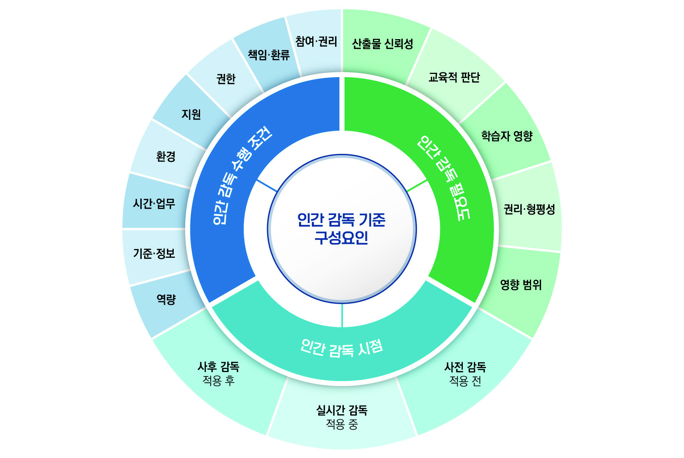
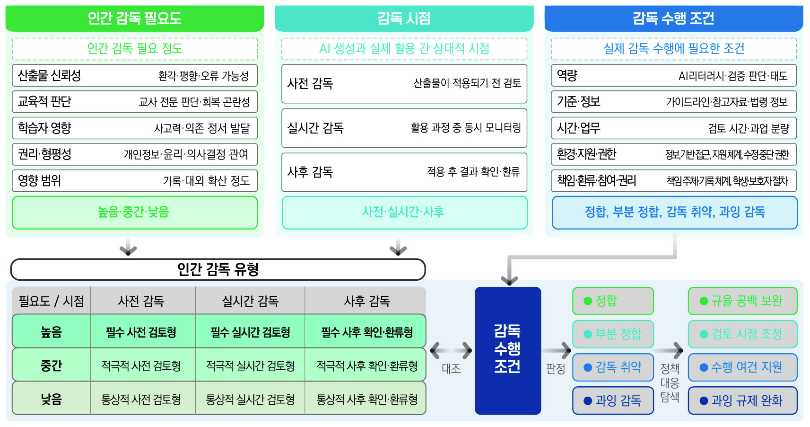
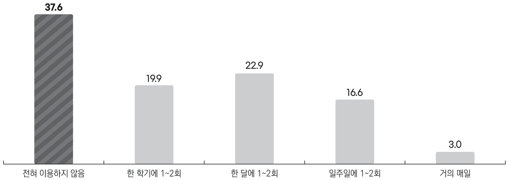
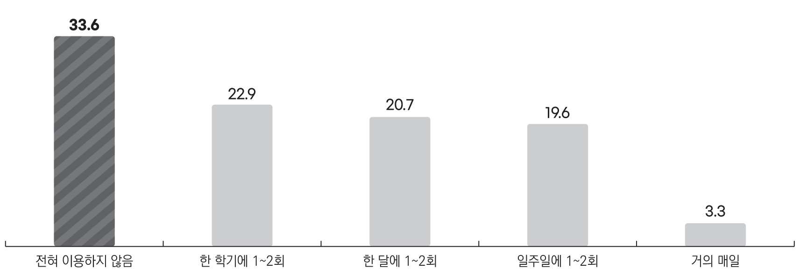

## 1. 연구의 목적

(1)
생성형 인공지능이 교육 현장에 매우 빠른 속도로 스며들고 있음. 교사는 AI로 수업 자료를 만들고 학생에게 피드백을 제공하며, 학생 또한 자료 탐색과 과제 수행 과정에서 AI와 상호작용함. AI 활용은 더 이상 일부의 실험적 시도가 아닌, 학교 교육 활동의 일상적인 부분으로 자리 잡는 중임. 그러나 기술의 활용 자체가 곧 좋은 변화를 의미하지는 않음. AI 산출물의 신뢰성, 오류나 편향 발생 시 책임 소재, 학생에게 미치는 영향 등 교육 주체인 인간의 몫으로 남는 질문들이 있음. 유네스코(UNESCO) 또한 생성형 AI의 확산 속도가 규제 제도 정비 속도를 앞지름을 지적함. 이러한 상황에서 AI의 학교 교육 활용 실태와 그 과정에서 나타나는 어려움들을 면밀히 살펴볼 필요성이 있음.

(2)
이 연구는 학교 교육에서의 AI 활용 실태와 쟁점을 파악함이 목적임. 또한 관련 정책의 대응 수준을 탐색적으로 진단할 정책 분석틀을 개발하고 타당화하여 시사점을 도출하려 했음. AI의 교육적 활용에서 권리와 안전이 조화를 이루는 정책을 마련하는 토대를 제공하려 함.

## 2. 연구의 방법

(1)
이 연구는 문헌 분석, 교사 대상 설문조사, 전문가 협의, 델파이 조사를 활용한 혼합 연구 방법론으로 접근함. AI의 도구적 활용(learning with AI)에 초점을 두었으며, AI에 대한 교육(learning about AI)은 연구 범위에 포함되지 않음. 학교 교육 현장의 활용 양상과 문제점을 드러내고, 이를 바탕으로 분석틀을 구성하며, 이 분석틀을 현장 장면과 현행 정책에 탐색적으로 적용함.

(2)
연구 범위에서 학교는 「초·중등교육법」에 따른 초등학교, 중학교, 고등학교로 한정함. 조사 대상은 이들 학교에 재직 중인 교사임. AI는 특정 기술이나 서비스 목록이 아닌, 교사가 교육적 의도를 가지고 활용하는 모든 AI 기반 도구와 방법을 포괄함. 활용의 교육적 성격은 도구의 종류가 아닌 실제 교육 장면을 고려한 맥락에 따라 판단함. 설문조사는 비확률 할당표집으로 선정된 교사 271명을 대상으로 함.

## 3. 주요 발견

(1) **인간 감독 기준 정책 분석틀: AI 시대 교육의 '감독의 허상'을 깨는 구조적 진단 도구임.**

이 연구는 AI의 학교 교육 활용이 확산됨에 따라 발생하는 이질적인 쟁점들을 해결하고자 '인간 감독 기준 정책 분석틀'을 제안함. 기술적 한계만이 아니라 교육적·윤리적 문제까지 포괄하며, 궁극적으로 '감독의 허상'을 줄이고 '실제적인 감독'을 구현함에 목적을 둠. 분석틀은 **인간 감독 필요도**, **인간 감독 시점**, **인간 감독 수행 조건**이라는 세 가지 핵심 축으로 구성됨. 이 구성 요인들은 AI 산출물의 특성, 교육적 적용 맥락, 그리고 실제 감독 역량 및 환경의 정합성을 판정하는 기준이 됨.

<figure>

<figcaption>인간 감독 기준 구성 요인. 감독 필요도, 감독 시점, 감독 수행 조건의 세 축과 그 세부 요인 (보고서 연구요약 그림 2)</figcaption>
</figure>

(2) **인간 감독 필요도: AI 활용 위험의 깊이와 폭을 다차원적으로 측정함.**

이 구성요인은 AI 활용이 초래할 수 있는 잠재적 위험의 정도를 평가함. 다섯 가지 세부 요인으로 이루어짐.

-   **산출물 신뢰성:** AI 응답의 불명확성, 환각, 편향 가능성, 최신성 한계로 인한 신뢰성 저하 가능성을 의미함. 교사 설문에서 가장 높은 문제(64.2%)로 나타난 부분임.
-   **교육적 판단:** AI가 학습자 평가의 공정성, 교사의 전문적 판단, 개별 관찰 및 맥락 이해를 대체하거나 부정적 영향을 미칠 가능성을 의미함.
-   **학습자 영향:** AI 활용이 학습 목표 도달에 부정적 영향을 주거나, 학습자의 맹목적 의존, 비판적 사고 저해, 정서 발달 및 사회적 관계 형성에 미칠 부정적 영향을 의미함. 학습에 대한 부정적 영향 우려(42.8%)가 주요 쟁점 중 하나임.
-   **영향 범위:** AI 산출물이 개인과 학급 밖의 공식 기록, 대외 자료 등으로 확산되어 영향의 범위가 확대되는 정도를 뜻함.
-   **권리 형평성:** 개인정보, 학습 데이터, 민감 정보 노출 가능성, 윤리적 판단 요구, 법적 분쟁 가능성, 학생의 권리 및 기회에 AI가 실질적으로 관여하는 정도를 의미함. 개인정보 처리 문제(40.6%)와 저작권/윤리 문제(35.4%)가 현장 교사의 큰 우려임을 보여줌.

이러한 필요도는 AI의 위험을 단순히 기술적 관점이 아닌, 교육적 맥락과 사회적 파급 효과까지 고려한 다차원적 평가임을 보여줌. 평가는 '높음', '중간', '낮음'으로 정성적으로 판정함.

(3) **인간 감독 시점: AI 산출물이 교육에 적용되는 시간을 기준으로 인간 개입 시기를 분류함.**

이 구성요인은 AI 산출물이 교육 활동에 적용되는 시간을 기준으로 인간 감독이 이루어지는 시점을 세 가지로 분류함.

-   **사전 감독:** AI 산출물이 학생 또는 교육적 의사결정에 적용되기 **전에** 인간이 검토, 수정, 거부할 수 있는 경우임. 교사들이 수업 아이디어 구상(39.2%), 자료 생성(36.2%), 행정 업무 초안 작성(28.7%) 등 주로 검토가 용이한 장면에 AI를 활용하는 현행 패턴과 부합함.
-   **실시간 감독:** AI의 생성과 적용에 대해 인간의 판단이 **실시간으로** 개입하여 즉각적인 모니터링과 개입이 요구되는 경우임. 수업 중 학생의 AI 활용에 대한 감독이 이에 해당하나, 현장 교사의 활용 빈도는 상대적으로 낮음.
-   **사후 감독:** AI 산출물이 먼저 학생 또는 교육적 판단에 영향을 미친 **뒤에** 인간이 이를 확인하는 경우임. 피드백 초안 작성이나 학생 산출물 검토 시 사후 확인이 이루어질 수 있으나, 위험성이 높은 영역에서는 부적절한 감독 시점일 수 있음.

세 유형은 상호 배타적이지 않으며, 주된 시점과 보완적 시점을 함께 활용함.

(4) **인간 감독 수행 조건: 실제 감독 가능성을 좌우하는 현장 여건을 다각도로 분석함.**

이 구성요인은 인간 감독이 실제로 효과적으로 이루어질 수 있는 현장의 제반 조건을 다각도로 평가함. 여덟 가지 세부 요인으로 구성됨.

-   **감독자 역량:** AI 리터러시, AI 윤리, 교과 내용 및 학습자 수준에 따른 AI 산출물 적절성 판단, 환각·편향 등 기술적 한계 이해, 활용 허용·제한·주의 판단 역량을 포함함. 교원 연수 등으로 지원하나, 검토 시간이나 업무 부담 등 물리적 조건 고려는 미흡함.
-   **기준·정보:** AI 산출물 검토 가이드라인, 참고 자료, 관련 법령·정책·지침의 명확하고 일관된 정보 체계 마련 여부를 의미함. 교사들의 정책 인지도가 5점 만점에 2.68점으로 낮으며, 지침 부족을 호소하는 문제(23.6%)와 직접적으로 연결됨.
-   **시간·업무:** 감독 수행에 필요한 시간 확보 및 과업 분량의 수행 가능성임. 현재 교사에게 AI 활용 확산은 업무 부담 증가로 연결되는 경향이 있음.
-   **환경:** 감독에 필요한 정보, 계정, 기기 등 환경에 안정적으로 접근할 수 있는 여건을 의미함. 기술 오류, 계정 보안, 비용 및 인프라 문제(25.5%)가 이와 관련됨.
-   **지원:** 감독 역량 강화와 자문을 위한 전문적 지원 체계 마련을 뜻함.
-   **권한:** 교사가 부적절한 AI 산출물 활용을 거부·수정·중단하거나, AI 미활용 방식으로 대체할 수 있는 재량과 권한에 대한 제도적 보호를 의미함.
-   **책임·환류:** 문제 발생 시 책임 주체 명확화, 기록, 보고, 복구, 환류 체계 마련을 뜻함. 평가의 공정성, 책임, 신뢰성 문제(25.1%)가 이와 직접 연관됨.
-   **이해관계자의 권리:** 학습자 또는 보호자가 AI 활용 영향에 대한 설명 요구, 재검토 요청, 대체 방식 요청 절차 마련을 의미함.

이 조건들은 감독 책임이 개별 교사에게만 국한되지 않고 학교 교육 체제 전반으로 분산될 필요성을 시사함.

<figure>

<figcaption>인간 감독 기준 정책 분석틀 개념 구조도, 1차 수정안 (보고서 [그림 Ⅳ-2]). 필요도와 시점을 교차한 아홉 유형을 수행 조건과 대조해 정합을 판정하고 정책 대응을 탐색한다</figcaption>
</figure>

(5) **인간 감독 유형 및 정책 대응: 필요도-시점 교차 분석으로 현장 진단을 구체화함.**

인간 감독 필요도(높음/중간/낮음)와 인간 감독 시점(사전/실시간/사후)을 교차하여 총 9가지의 '인간 감독 유형'을 도출함. 이 유형들은 감독의 정도를 서열화한 것이 아닌, 감독의 성격에 대한 분류임. 예를 들어 '필수 사전 검토형'은 필요도가 높고 사전 감독이 필수적임을 의미함. 분석틀은 각 유형별로 감독 수행 조건과의 '정합성'을 판정하고, 그 결과에 따라 정책 대응 방안(예: 공백 보완, 검토 시점 조정, 수행 여건 지원, 과잉 감독 완화)을 탐색하도록 설계됨. 이 구조는 특정 서비스 도입 여부보다 "어떤 장면에서 어떻게 활용되는가"에 정책적 논의의 초점을 둘 필요성을 강조함.

(6) **AI 활용 실태의 주요 특징: 교사 중심의 통제 가능한 활용과 다양한 쟁점의 병존함.**

교사의 AI 활용은 범용 생성형 AI(94.5%)를 중심으로 폭넓게 확산됨. 응답 교사 271명 가운데 54.6%가 일주일에 한 번 이상, 80.4%가 한 달에 1~2회 이상 AI를 활용하며, 거의 매일 여러 차례 쓰는 교사는 17.3%, 전혀 쓰지 않는 교사는 3.0%임. 주로 수업 아이디어 구상(39.2%), 수업 자료 생성(36.2%), 공문 초안 작성(28.7%) 등 교사의 검토와 통제가 비교적 수월한 장면에 집중됨. 반면, 수업 중 학생의 AI 직접 상호작용이나 학생 산출물 검토·평가 장면에서의 활용은 상대적으로 낮음. AI 활용 과정에서 교사들은 환각(64.2%), 학습에 부정적 영향 우려(42.8%), 개인정보 처리(40.6%), 저작권·윤리(35.4%) 등 다양한 문제에 직면함. 관련 법령·정책·지침을 안다고 답한 교사는 17.3%에 그치고 모른다는 응답이 45.4%이며, 정책 인지도는 5점 만점에 평균 2.68점임. 정책과 현장 인식 사이의 간격이 큼을 보여줌.

<figure>

<figcaption>(수업 중: 교사) AI 생성 자료·응답에 대한 검토 및 비판적 분석 빈도, 단위 % (보고서 [그림 Ⅲ-9])</figcaption>
</figure>

수업 중 AI가 만든 자료나 응답을 학생과 함께 검토하고 비판적으로 분석하는 장면은 '전혀 이용하지 않음'이 37.6%로 가장 많고 '거의 매일'은 3.0%에 그침. 실시간 감독이 필요한 장면일수록 활용이 낮다는 본문의 서술과 맞물리며, 활용이 늘어날 때 감독이 따라오지 않으면 '감독의 허상'이 생길 수 있음을 보여줌.

<figure>

<figcaption>(평가) 학생 산출물·답안 검토 및 피드백 초안 작성 빈도, 단위 % (보고서 [그림 Ⅲ-15])</figcaption>
</figure>

평가 장면에서 학생 산출물 검토와 피드백 초안 작성에 AI를 전혀 쓰지 않는 교사가 33.6%로 가장 많고, 거의 매일 쓰는 교사는 3.3%임. 평가의 공정성과 책임 소재를 묻는 쟁점(25.1%)이 이 장면의 활용을 붙들고 있는 것으로 읽힘.

## 4. 결론 및 시사점

(1)
학교 교육에서 AI는 교사 통제 중심의 제한적 활용이 확산됨. 교사들은 산출물 신뢰성, 학습 영향, 권리와 윤리, 활용 여건, 교육적 판단 등 이질적인 쟁점에 직면함. 현행 정책은 인간 감독을 전제로 대응하나 구조화된 접근은 미흡함. 이 연구가 제안하는 분석틀은 이러한 관점에서 정책 대응 방향과 수준을 탐색하는 실용적인 도구로 기능함.

(2)
**교육 분야 AI 인간 감독 기준 정립이 시급함.** 교사들은 명시적 기준이 없어도 산출물 확인이나 통제 가능성을 내재적인 기준으로 활용하여 AI를 사용함. 그러나 이는 비공식적이고 개인적인 판단에 의존하는 것으로, 사전 검토 중심의 단편적 활용에서 벗어나 깊이 있고 입체적인 AI 활용으로 확장할 기반 마련이 필요함. 명확한 인간 감독 기준 정립은 이러한 기반을 제공함.

(3)
**AI 감독 책임 주체 및 범위의 구체화가 요구됨.** 감독 필요도를 높이는 요인의 상당수는 학교나 교사가 통제할 수 없는 AI 설계나 개발 맥락에서 비롯됨. 따라서 그 책임을 최종 사용자인 교사가 전적으로 부담하는 것에는 한계가 있음. 인간 감독을 교사 개인의 의무가 아닌 학교 교육 체제의 기능으로 재구조화해야 함. 명확한 책임 분담과 기록, 보고, 환류 체계를 바탕으로 교사 전문적 판단을 지원할 필요가 있음. 또한 현행 학습지원 소프트웨어 선정 심의 제도에서는 인간 감독 기준에 기반한 차등적 심의 방식 도입을 고려해야 함. 단기적으로 선정 기준과 운영 지침을 정비하고, 장기적으로 심의 면제나 대체 절차를 도입하는 단계적 접근이 적절함.

## 5. 리뷰어의 ADD(+) One: 생각 더하기

(1)
이 연구의 가장 날카로운 통찰은 **'감독의 허상'** 개념에 있음. 기존의 많은 논의가 단순히 인간의 '참여' 또는 '존재'만으로 AI 활용의 윤리적 문제를 해결하려는 경향을 보였음. 그러나 이 연구는 인간 감독이 '실제로' 가능한 조건, 즉 감독자 역량, 확보된 시간, 명확한 기준, 그리고 개입 권한 등이 충족되지 않으면, 인간이 AI 루프 안에 있어도 실질적인 감독이 불가능함을 단언함. 규제와 정책이 형식적인 '인간 개입' 요구에 그치지 않고 '실질적인 감독 수행 조건'을 담보해야 함을 분명히 함. 지침을 만드는 데서 멈추지 않고, 지침이 현장에서 작동하도록 환경과 자원을 함께 설계해야 함을 보여줌.

(2)
이 분석틀은 교육 현장의 **'교사 전문성 재정의'**라는 더 큰 질문을 던짐. AI 시대의 교사는 단순한 지식 전달자 역할에서 벗어나 'AI의 교육적 활용을 비판적으로 감독하는 전문가'로 진화해야 함. AI가 생성하는 정보의 홍수 속에서 비판적 판단과 윤리적 가치를 가르치는 메타인지적 학습 환경 설계자로의 역할 전환이 필연적임. 이는 AI 리터러시 교육에 그치지 않고, 인지과학적 관점에서 '인간 인지 부하'를 관리하며 AI를 최적으로 활용하는 교육 심리학적 접근과도 연결됨. 정책적 차원에서는 'AI 에이전트'가 교육 시스템에 통합될 때, 인간 교사의 '감독 에이전트' 역할을 어떻게 설계할 것인가에 대한 논의를 촉발함.

(3)
이 연구를 발전시킬 구체적 아이디어로 **'AI 수업 시나리오 기반 감독 시뮬레이터' 개발을 제안함.** 이 분석틀을 바탕으로 다양한 교과, 학년, 수업 유형에 대한 AI 활용 시나리오를 개발할 수 있음. 각 시나리오별 '인간 감독 필요도'와 '최적 감독 시점'을 미리 분석하고, 필요한 '감독 수행 조건' 체크리스트를 제공해야 함. 교사들은 이 시뮬레이터 환경에서 AI 산출물 검토, 수정, 거부 등의 실제적 개입을 연습하고, 자신의 감독 역량과 현장 여건의 정합성을 스스로 진단하게 됨. 이 시뮬레이터는 '감독의 허상'을 줄이고 교사의 실질적 판단 역량을 강화하는 실천적 도구가 될 것임. 나아가 AI 개발사들이 이 시뮬레이터를 활용하여 '감독 가능성'이 높은 교육용 AI를 설계하도록 유도하는 제도적 유인이 필요함.

## 6. 추가 탐구 질문

(1)
이 연구의 분석틀은 주로 교사의 AI 활용 장면에 초점을 맞춤. 학생 중심의 AI 활용, 예를 들어 학생이 자율적으로 AI 튜터와 상호작용하거나 AI 기반 학습 환경에서 자기 주도적으로 학습할 때, '인간 감독'의 역할과 범위는 어떻게 재정의되어야 하는가? 비판적 사고나 창의적 문제 해결과 같이 AI가 직접 대체하기 어려운 고차원 인지 활동 영역에서 AI를 활용할 때, '학습자 영향' 요인의 평가 기준은 어떻게 더욱 정교화될 수 있는가?

(2)
이 분석틀은 초·중·고 교육 맥락에서 개발됨. 대학교육, 성인 평생교육, 또는 직업 훈련과 같이 학습자의 자율성 수준과 학습 목표가 상이한 맥락에서 이 분석틀의 '인간 감독 필요도'와 '인간 감독 수행 조건'은 어떻게 달라져야 하는가? 특히 비형식 학습(informal learning) 환경에서 AI를 활용할 때, '인간 감독'이라는 개념 자체의 적용 가능성과 한계는 무엇인가?

(3)
'감독의 허상'을 방지하기 위해 AI 시스템 개발 단계에서부터 '감독 가능성(oversee-ability)'을 높이는 기술적 설계 원칙은 무엇이며, 이러한 원칙을 강제할 수 있는 기술 표준 또는 인증 제도는 어떻게 마련될 수 있는가? AI가 학습자의 민감 정보를 처리하고 개인 맞춤형 학습 경로를 제공할 때, '권리 형평성' 요인을 충족시키기 위한 데이터 주권, 익명화 기술, 동의 모델은 어떻게 진화해야 하는가?

## 출처

- 이수환 외 (2026). 『인공지능의 학교 교육 활용 실태와 쟁점 분석』 (현안보고 OR 2026-01). 한국교육개발원.
- 관련 보도: 경향신문, 「AI 교실 일상 됐는데…관련 정책 아는 교사는 17%뿐」 (2026-10-19). <https://www.khan.co.kr/article/202610190731001>
