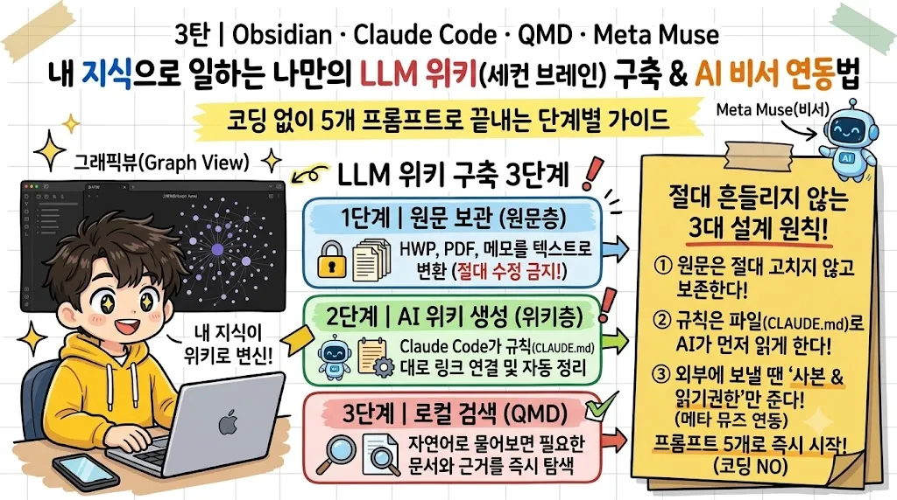

개인의 자료는 컴퓨터와 휴대폰에 방대하게 쌓이지만, 정작 실무에 필요한 지식은 찾기 어렵다. 질문할 때마다 원본 조각을 다시 조합하는 방식 대신, AI 에이전트가 사용자의 맥락과 기준을 알고 일하게 하려면 지식을 먼저 정리해 두어야 한다. LLM 위키는 개인이 쌓은 지식을 AI가 언제든 찾아 읽고 정해진 기준에 따라 일하게 만드는 방법이다.

이 글은 틸노트에 연재된 「메타 뮤즈(Meta Muse), '나를 아는 AI 비서'로 쓰는 법」 3편과 4편을 묶었다. 3편은 LLM 위키로 세컨 브레인을 만드는 과정이고, 4편은 그렇게 만든 위키를 메타 뮤즈에 연결해 내 지식을 가진 에이전트로 쓰는 방법이다.

<figure>

</figure>

## LLM 위키, AI가 관리하는 지식 체계
LLM 위키는 안드레이 카파시가 2026년 4월 제안한 지식 관리 방식이다. 원본 자료를 AI가 읽어 서로 연결된 마크다운(Markdown) 위키로 정리하고 지속적으로 고쳐 나간다. 이는 기존의 RAG(검색 증강 생성) 방식과 중요한 차이를 보인다.

다음 표는 일반적인 문서 질의 방식인 RAG와 LLM 위키의 핵심 차이를 비교한다.

| 구분           | 일반적인 문서 질의 (RAG)                  | LLM 위키                                         |
|--------------|-----------------------------------------|--------------------------------------------------|
| 정리 시점      | 질문할 때마다 원본 조각을 찾아 그때그때 조합 | 자료가 들어올 때 한 번 정리해 두고 계속 다듬는다 |
| 정리 결과      | 답변이 일회성 대화 속에 묻혀 사라진다    | 정리된 지식이 위키 문서로 차곡차곡 쌓인다         |
| 자료 간 모순   | 질문하기 전에는 드러나지 않는다           | 수집·점검 단계에서 미리 찾아내 표시하고 수정한다   |
| 사람의 역할    | 매번 질문하고 답변이 맞는지 일일이 대조한다 | 좋은 자료를 고르고, 초안을 검토하며, 규칙을 다듬는다 |

LLM 위키에서 사람은 가치 있는 원본 자료를 고르고 방향을 잡는 질문을 던진다. 문서 요약, 분류, 링크 연결, 내용 갱신 같은 번거로운 관리 작업은 AI가 맡는다.

LLM 위키는 AKM(Agentic Knowledge Management, 에이전트형 지식관리)을 구현하는 방법론이다. AKM은 AI가 지식베이스를 지켜보다가 사용자의 의도를 추론해 먼저 행동을 제안하고, 사람이 승인하면 실행하는 운영 방식이다. 이때 위키는 사용자의 기억이자 에이전트의 작업 기억이 된다.

LLM 위키는 세 개의 층과 세 가지 작업을 기반으로 운영된다.

| 계층   | 역할과 내용                                      | 수정 주체                             |
|--------|--------------------------------------------------|---------------------------------------|
| 원문층 | 규정집, 매뉴얼, 블로그 글, 메모 등 원본 텍스트 보관본 | 절대 수정 금지 (변환 도구만 생성)     |
| 위키층 | AI가 원문을 읽고 작성한 지식 문서                 | AI가 초안을 쓰고 사람이 검토한다      |
| 스키마 | 폴더 구조, 문서 형식, 문체, 작업 순서를 정의한 규칙 파일 | 사람과 AI가 합의해 함께 다듬는다      |

가장 중요한 원칙은 원문층을 손대지 않고 따로 보존하는 것이다. AI가 요약하고 정리한 위키 문서는 언제든 틀릴 수 있으므로, 원본이 살아 있어야 즉시 대조한다.

다음은 LLM 위키의 세 가지 핵심 작업이다.

| 작업   | 구체적인 역할                                          |
|--------|--------------------------------------------------------|
| 수집   | 새 자료가 들어오면 원문층에 보관하고, 관련 위키 문서를 새로 쓰거나 기존 문서를 고친 뒤 색인과 이력을 갱신한다 |
| 질문   | 질문이 들어오면 위키층에서 먼저 찾아 근거와 함께 답하고, 가치가 큰 답변은 다시 위키 문서로 저장한다 |
| 점검   | 문서끼리 모순되는 숫자, 오래된 기준일, 깨진 링크, 어디에도 연결되지 않은 고아 문서를 주기적으로 찾아 수정한다 |

## 위키를 세우는 도구와 설계 원칙
LLM 위키를 구축하는 데는 Obsidian을 화면으로, Claude Code (또는 코딩 에이전트)를 프로그래머로, 위키 폴더를 코드베이스로 사용한다. 여기에 로컬 검색 엔진 QMD와 외부 AI 비서인 메타 뮤즈(Meta Muse) 연결이 더해진다.

### 핵심 도구와 역할
다음은 LLM 위키 구축에 사용되는 핵심 도구와 그 역할이다.

| 도구            | 위키 안에서의 역할                                      |
|-----------------|---------------------------------------------------------|
| Obsidian    | 위키를 눈으로 확인하는 화면 (문서 본문, 백링크, 그래프 등 열람) |
| Claude Code | 위키를 실제로 읽고 쓰는 AI 작업자 (로컬 폴더 파일 직접 다룸) |
| Git (로컬)  | 모든 변경 이력을 기록하는 안전장치 (원격 서버로 올리지 않음) |
| QMD         | 내 컴퓨터 안에서만 도는 로컬 검색 엔진 (키워드 및 의미 검색) |
| macOS Vision OCR | 스캔된 PDF 문서를 인터넷 전송 없이 맥북 안에서 글자로 변환 |

이러한 도구들은 유료 서버나 복잡한 데이터베이스 없이 모두 평범한 마크다운 텍스트 파일로 운영된다.

### 핵심 설계 원칙과 규칙 파일
LLM 위키의 품질은 AI 모델의 성능보다 규칙 파일을 얼마나 명확하게 다듬는가에 달려 있다. CLAUDE.md 파일은 위키 관리자의 작업 표준을 잡아주는 '항상 먼저 읽는 지침서' 역할을 한다.

CLAUDE.md 규칙 파일에 명시한 7가지 핵심 원칙은 다음과 같다.

| 구분           | 규칙 파일에 명시한 내용                                       |
|--------------|---------------------------------------------------------------|
| 1. 3계층 원칙  | 원문층의 위치와 '절대 수정 금지', 위키층의 '모든 내용에 근거 달기', 스키마는 합의 후 변경을 명시 |
| 2. 폴더 역할   | 각 폴더에 담을 문서 성격 정의. 임의 새 폴더 생성 금지, 제안 먼저 |
| 3. 문서 형식   | 문서 유형, 필수 머리말 속성, 검토 상태 값, 태그 사전 준수 규칙 명시 |
| 4. 서술 문체   | 출처를 주어로 쓰지 않고 지식 그 자체를 단정형으로 서술. 판본 비교나 파일 수집 경위는 본문에 쓰지 않음 |
| 5. 근거 표기   | 본문 문장마다 원문 링크를 붙이지 않고, 수치에만 각주를 달며 일반 근거는 문서 맨 끝 표에 모음 |
| 6. 작업 순서   | 자료 수집 시 개인정보 점검부터 QMD 검색 색인 갱신까지 일곱 단계 순서 명시 |
| 7. 금지 사항   | 이용자 개인정보 수록 금지, 동료 이름 가명 처리, 기관 공유 드라이브 접근 제외, 원본 위키 원격 저장소 업로드 금지, 모든 외부 공개는 사용자 승인 후 진행 |

이 규칙 파일이 없으면 AI는 작업을 시킬 때마다 다른 모양의 문서를 생성한다.

또한, 자주 사용하는 반복 작업은 Claude Code의 스킬(Skills) 기능으로 자동화한다. `.claude/skills/스킬이름/SKILL.md`에 작업 순서와 안전 수칙을 적어 짧은 명령만으로 정해진 절차를 밟아 일하게 한다. "AI는 제안과 보고서 작성까지만 하고, 실제 파일 수정은 사람이 눈으로 확인하고 승인한 뒤에 한다"는 원칙을 모든 스킬에 적용한다.

### 원문층 만들기, 자료를 텍스트로 바꾸는 일
LLM 위키 구축에서 가장 손이 많이 가는 단계는 다양한 원본 자료를 깨끗한 텍스트로 변환하는 것이다. 특히 아래아한글(HWP) 파일과 스캔된 이미지 PDF가 많은 공공 현장 자료는 더욱 그렇다. 다음은 주요 원본 자료별 변환 방법과 주의점이다.

| 원본 자료                 | 규모                | 변환 방법 및 실무 주의점                                        |
|---------------------------|---------------------|-----------------------------------------------------------------|
| 블로그 글                 | 165편               | 글 한 편당 마크다운 텍스트 파일 하나로 저장                     |
| 사업 규정집·업무 매뉴얼 | 수십 개 파일로 분할 | HWP 파일에서 본문 텍스트와 표 추출. 그림 상자 글자는 OCR 처리. PDF는 쪽 번호 유지 |
| 스캔된 PDF 문서           | 수백 쪽             | 각 쪽을 이미지로 바꾼 뒤 macOS 내장 글자 인식(Vision)으로 텍스트 추출. 가로 예산표는 회전 후 인식 |
| 휴대폰 메모 앱            | 1,437개 중 145개 선별 | 무조건 다 넣기보다 업무에 다시 쓸 만한 메모만 선별. 동료 이름은 가명 처리 |
| 강의 자료                 | 6개 묶음            | 슬라이드와 스캔본 PDF를 글자 인식으로 텍스트화                    |
| 직접 만든 웹앱·GitHub      | 32개                | 배포된 화면 설명과 저장소 안내문(README) 텍스트 수집              |

변환된 원문 파일 맨 위에는 '원문 보관본이므로 절대 고치지 말 것'이라는 안내문을 고정으로 넣는다. 자료 묶음마다 출처 카드 문서를 따로 만들어 원본 보관 위치, 발행 연도, 열람 권한, 변환 방식, 개인정보 가명 처리 내역, 원본 자체의 결함 등을 기록한다.

### 위키층 다듬기, 요약문을 쓸모 있는 지식 문서로
AI가 처음 만든 위키 문서는 '자료 요약문'처럼 읽힐 수 있다. 이를 실무에 바로 참고할 '지식 문서'로 만들기 위해 세 가지 원칙을 적용한다.

- "누가/어느 자료가 ~라고 한다"처럼 출처를 주어로 쓰지 않고, 지식 그 자체를 단정형으로 명확하게 쓴다.
- 본문 문장 끝에는 원문 링크를 붙이지 않는다. 지원 금액, 신청 기한, 자격 요건처럼 숫자 하나라도 틀리면 안 되는 곳에만 각주를 달고, 나머지 참고 출처는 문서 맨 아래 '근거 자료' 표에 모은다.
- 예전 규정과 현행 규정을 본문에서 길게 비교하지 않고, 지금 당장 적용하는 최신 기준만 본문에 남긴다.

이 기준을 적용해 수백 개의 문서를 한 번에 재작성한다. 이 과정에서 '본보기 문서(모범 사례)' 하나를 지정해 주고 "이 문서의 구조와 문체대로 써라"라고 지시하는 편이 훨씬 정확하다는 교훈을 얻는다. LLM 위키는 한 번 만들고 끝내는 결과물이 아니라 계속 점검하고 고쳐 쓰는 과정이다.

### 문서가 수백 개를 넘으면 QMD 로컬 검색
위키 문서가 수십 개일 때는 색인 목록으로도 충분하지만, 수백 개를 넘어서면 QMD 같은 로컬 검색 도구가 필수적이다. QMD는 마크다운 폴더를 내 컴퓨터 안에서 색인해 두고, 키워드 검색(BM25)과 문맥의 뜻을 찾는 의미 검색(임베딩)을 동시에 수행한다.

QMD를 선택하는 주된 이유는 다음과 같다.

- 완전한 로컬 실행: 모든 과정이 100% 내 컴퓨터 안에서만 돌아가 보안상 안전하다.
- 한국어 모델: 한국어를 잘 이해하는 임베딩 모델(예: Qwen3-Embedding-0.6B)을 직접 지정할 수 있어 일상적인 질문에도 정확한 문서를 찾는다.
- MCP 자동 연동: Claude Code에 QMD 플러그인을 연결하면 AI가 질문을 받는 순간 스스로 QMD를 호출해 관련 문서를 찾아 읽고 답한다.

QMD 설정 파일에서는 검색 묶음을 `wiki`와 `sources` 두 개로 분리하는 것이 중요하다.

| 검색 묶음 | 포함 범위                                          | 검색 용도와 순서                                   |
|-----------|----------------------------------------------------|----------------------------------------------------|
| `wiki`    | 위키 폴더 전체 (단, 원문 폴더·설정·템플릿은 제외) | AI가 잘 정제해 둔 지식 문서. 질문 시 가장 먼저 검색한다 |
| `sources` | `90_출처/원문/` 폴더                           | 원본 텍스트 보관본. `wiki` 검색만으로 근거가 부족할 때 2차로 검색한다 |

이는 잘 정리된 위키 지식을 먼저 찾아 읽게 하고, 원문은 세부 근거를 대조할 때만 열어 보게 하려는 목적이다.

## 메타 뮤즈에 위키를 연결하기
내 컴퓨터의 LLM 위키를 메타 뮤즈 같은 클라우드 기반 AI 에이전트와 연결하면, AI 비서가 사용자의 규정, 기준, 지난 결정을 기반으로 일할 수 있게 된다. 가장 안전한 연결 방법은 "기관 자료를 뺀 사본 → GitHub 비공개 저장소 → 뮤즈는 그 저장소 하나만 읽기"이다.

다음 표는 LLM 위키를 뮤즈와 연결하는 세 가지 방법을 비교한다.

| 방법                    | 어떻게                                | 좋은 점                                  | 아쉬운 점                                        |
|-------------------------|-------------------------------------|------------------------------------------|--------------------------------------------------|
| 뮤즈가 Mac을 직접 읽기    | 뮤즈의 Mac 연결 기능으로 위키 폴더를 그때그때 열어 본다 | 설정이 필요 없다                           | Mac이 켜져 있어야 하며, 파일을 하나씩 가져와 느리다 |
| 구글 드라이브             | 위키 복사본을 드라이브에 올리고 뮤즈가 드라이브를 읽는다 | 이미 백업해 두었다면 바로 시작한다       | 고칠 때마다 다시 올려야 하며, 드라이브 전체에 접근 권한을 준다 |
| GitHub 비공개 저장소 (추천) | 사본을 비공개 저장소에 올리고 뮤즈는 그 저장소만 내려받는다 | 올리기 한 번으로 갱신, 변경 기록이 남으며, 권한을 저장소 하나로 좁힌다 | 처음에 10분 정도 설정이 필요하다               |

### 연결 5단계
GitHub로 연결하는 과정은 다음 5단계로 진행된다.

1.  원본이 아니라 "사본"을 만든다: 개인정보나 보안상 문제가 없는 문서만 골라 별도 폴더에 사본을 만든다. 내부 계획·예산, 이용자 정보, 저작권 있는 교재 전문 등은 제외한다.
2.  GitHub 비공개 저장소에 올린다: GitHub에서 새 저장소를 만들고 반드시 `Private`으로 설정한다. 사본 폴더에서 Git을 시작하고 저장소에 올린다.
3.  뮤즈에게 저장소 하나만 허용한다: 뮤즈가 제공하는 연결 방법을 따른다. `읽기 전용 배포 키(Deploy key)`를 등록하거나 `GitHub 커넥터`를 사용하며, 이때 전체 저장소가 아닌 해당 사본 저장소 하나만 선택한다.
4.  뮤즈 안에 검색 색인을 만들게 한다: 뮤즈에게 저장소를 내려받아 QMD로 키워드 색인과 의미 검색 색인을 만들도록 지시한다. QMD의 `qmd embed`는 기본 시간 제한이 있으므로 `--timeout 0` 옵션을 사용하여 제한을 해제한다. 위키에 `검색 테스트 문서`를 넣어두면 뮤즈가 스스로 색인을 검증한다.
5.  답하는 규칙과 비용 규칙을 기억에 남긴다: "추가 비용이 생기는 외부 API는 절대 쓰지 마. 비용이 생길 수 있는 작업은 미리 알리고 내가 승인한 뒤에만 해"와 같은 비용 규칙을 뮤즈의 기억에 절대 지침으로 저장한다.

### 검색 효율화와 토큰 비용
연결 직후 의미 검색이 느리다면, 이는 가상 컴퓨터에 GPU가 없어 AI 모델이 CPU에서 느리게 돌기 때문이다. 이를 해결하는 방법은 검색 순서 규칙을 정하는 것이다.

다음 표는 질문 종류에 따른 검색 순서 규칙을 보여준다.

| 질문 종류                           | 먼저 쓸 검색                                    |
|-------------------------------------|-------------------------------------------------|
| 용어·서식 이름이 분명함("직무지도원 수당") | 키워드 검색                                     |
| 일상어 질문("훈련생이 중간에 그만두면 돈은?") | 핵심어를 뽑아 키워드 검색 → 0건이면 의미 검색   |
| 개념·사례를 넓게 찾음                   | 의미 검색(순위 다시 매기기 끔)                  |
| 보고서·공문처럼 근거를 꼼꼼히 골라야 함 | 의미 검색 + 순위 다시 매기기(느리지만 정확하다) |

뮤즈에게 "규정·서식처럼 용어가 분명한 질문은 키워드 검색부터 하고, 0건일 때만 의미 검색을 써 줘"라고 명시한다. 키워드 검색에 질문 문장을 통째로 넣으면 못 찾을 수 있으므로 핵심어만 넣어야 한다.

LLM 위키와 뮤즈 연결은 토큰을 많이 소비하는 방식이 아니라 오히려 토큰을 아끼는 방식이다.

다음 표는 주요 작업별 토큰 소비 여부를 설명한다.

| 하는 일                  | 어디서 도나                 | 토큰 |
|--------------------------|-----------------------------|------|
| 사본 내려받기(동기화)    | 뮤즈 가상 컴퓨터에서 파일만 내려받는다 | 0    |
| 검색 색인 만들기(임베딩) | 가상 컴퓨터 안의 작은 AI 모델이 계산 | 0    |
| 질문할 때 검색           | 가상 컴퓨터의 검색기        | 0    |
| 답 쓰기                  | 뮤즈(AI 모델)               | 든다 |

검색기가 없으면 에이전트는 파일을 통째로 열거나 웹을 뒤져 답을 찾으므로 읽는 양이 곧 토큰이 된다. 검색기가 있으면 관련 문단만 집어서 읽으므로 읽는 양이 적다.

### 실무 적용과 흔한 오해
LLM 위키는 방대한 새 자료가 들어올 때 가장 큰 진가를 발휘한다. 900쪽 분량의 자료를 12개의 핵심 지식 문서로 재구성하고, 원본 오류까지 찾아내는 능력을 보인다. 또한 업무 중 궁금한 점에 대해 즉시 근거와 함께 답을 제공하고, 사업계획서나 강의안 작성 시 빈 화면에서 시작하지 않도록 초안 뼈대를 제공한다. 여러 AI 에이전트가 하나의 지식 창고를 공유하며 일관된 기준을 따른다.

하지만 LLM 위키에 대한 오해도 존재한다. 다음은 LLM 위키에 대한 여섯 가지 오해와 진실이다.

| 오해                                       | 진실                                                   |
|--------------------------------------------|--------------------------------------------------------|
| AI가 내 위키를 학습해서 나를 다 외운다   | AI 모델 자체가 위키를 학습하는 것이 아니라, 질문을 받을 때마다 위키 폴더에서 문서를 검색해 그때그때 읽는다. |
| 에이전트에 연결하면 언제 어디서든 모든 자료를 다 쓸 수 있다 | 원본 위키는 내 컴퓨터에 있으며, 외부에 연결하는 것은 '필요한 범위 안에서 안전하게' 허용된 사본이다. |
| AI가 정리한 문서니 그대로 믿어도 된다    | AI가 만든 위키 문서는 어디까지나 초안이다. 사람이 직접 검토하고 원문과 대조해야 한다. |
| 자료는 무조건 많이 넣을수록 좋다           | 가치 없는 일회성 메모가 섞이면 검색 결과가 흐려지고 AI가 엉뚱한 문서를 근거로 가져온다. 선별한 자료가 훨씬 낫다. |
| LLM 위키는 RAG를 대체하므로 검색 도구가 필요 없다 | 문서가 늘어나면 QMD 같은 로컬 검색 도구가 필수다. LLM 위키는 '날것의 원본 대신 잘 정제된 지식을 검색하게 만드는 방식'이다. |
| 옵시디언을 잘 다루는 것이 핵심이다       | 옵시디언은 보기 좋은 뷰어일 뿐이다. 진짜 핵심은 원문을 훼손하지 않고 보관하는 원칙과 AI의 행동을 제어하는 `CLAUDE.md` 규칙 파일이다. |

## 개인정보와 보안 원칙 일곱 가지
사회복지 현장이나 기업 실무 자료로 세컨 브레인을 만들 때 보안과 개인정보 보호는 최우선 과제다. 다음은 LLM 위키 구축 시 지켜야 할 일곱 가지 철칙이다.

| 보안 원칙                                 | 실제 위키 적용 방식                                                              |
|-------------------------------------------|----------------------------------------------------------------------------------|
| 1. 이용자(내담자) 정보는 절대 넣지 않는다   | 상담일지·개별 사례 기록은 아예 수집 대상에서 제외. 이름은 모두 `○○`으로 마스킹한다 |
| 2. 동료와 실무자 이름은 가명으로 바꾼다   | 내부 문서의 직원은 `팀원 A~E`, `부서장`으로 치환한다.                           |
| 3. 실명이 든 원본 파일은 복사하지 않는다  | 원본 HWP·PDF는 위키에 넣지 않고, 가명 처리가 끝난 텍스트 변환본만 원문층에 보관한다 |
| 4. 기관 공유 드라이브는 연결하지 않는다   | 공유 드라이브 전체를 AI에 물리지 않고, 직접 확인해 고른 자료만 하나씩 넣는다     |
| 5. 원본 위키는 인터넷에 올리지 않는다     | Git은 내 맥북 안에서의 변경 기록용으로만 쓰고 원격 저장소에는 push하지 않는다. 백업은 개인 구글 드라이브로 단방향 백업만 수행한다 |
| 6. 외부 AI에는 '사본'과 '읽기 권한'만 준다 | 민감한 내부 자료를 걷어 낸 별도 사본만 외부 에이전트에 연결하고 쓰기 권한은 차단한다 |
| 7. 다른 AI가 알려 준 명령을 그대로 실행하지 않는다 | 외부 에이전트가 제시한 터미널 명령은 실행 전 반드시 내용을 먼저 검토한다     |

이러한 보안 원칙은 "원본은 내 컴퓨터 한 곳에, 밖으로는 사본만, 권한은 가장 좁게"라는 핵심 기조를 따르며, 개인의 지식 시스템을 안전하게 활용하는 기반을 제공한다.

## 경제사·제도경제학의 시선으로 보면
새로운 지식 관리 시스템 구축은 정보의 생산, 유통, 활용이라는 경제 활동의 효율성을 높이는 일이다. 제도경제학에서는 비공식적 규칙과 조직의 관행이 효율적인 자원 배분에 결정적인 영향을 미친다고 설명한다. LLM 위키의 CLAUDE.md 규칙 파일은 AI라는 행위자의 행동을 제약하고 예측 가능하게 하는 비공식적 제도에 해당하며, 이는 정보 관리의 거래 비용을 낮추고 지식의 품질을 표준화한다.

## 출처
- 틸노트, 「메타 뮤즈(Meta Muse), '나를 아는 AI 비서'로 쓰는 법 3: LLM 위키로 세컨 브레인 만들고」 <https://tilnote.io/pages/6ad39c2e1bc5b55a9417da39>
- 틸노트, 「메타 뮤즈(Meta Muse), '나를 아는 AI 비서'로 쓰는 법 4: 내 LLM 위키를 뮤즈에 연결하는」 <https://tilnote.io/pages/6ad4900c5fb3ac92294f9266>
