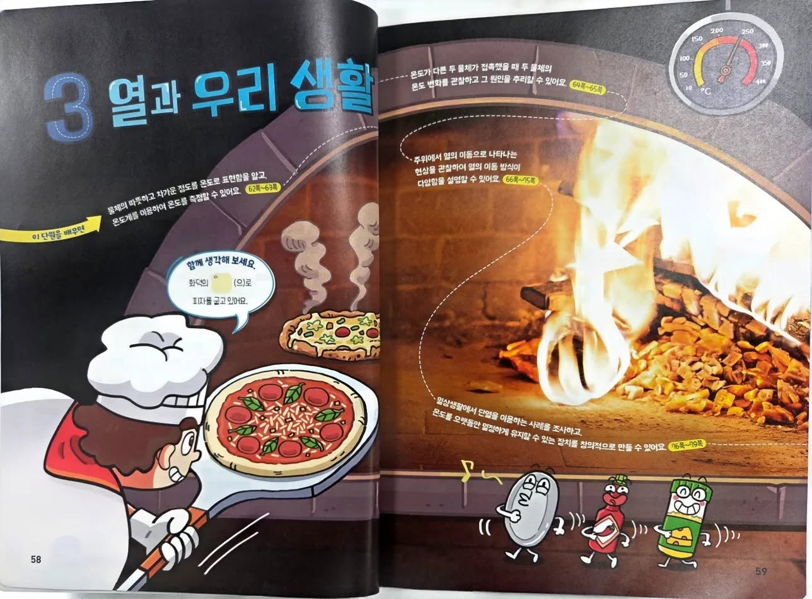
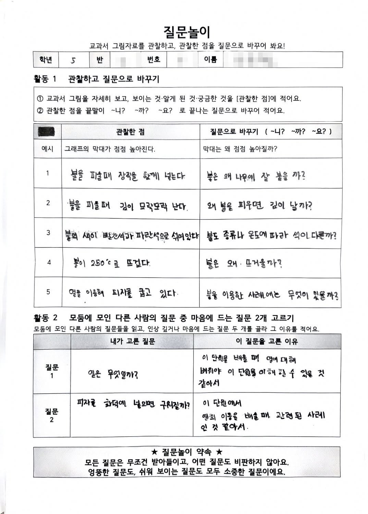
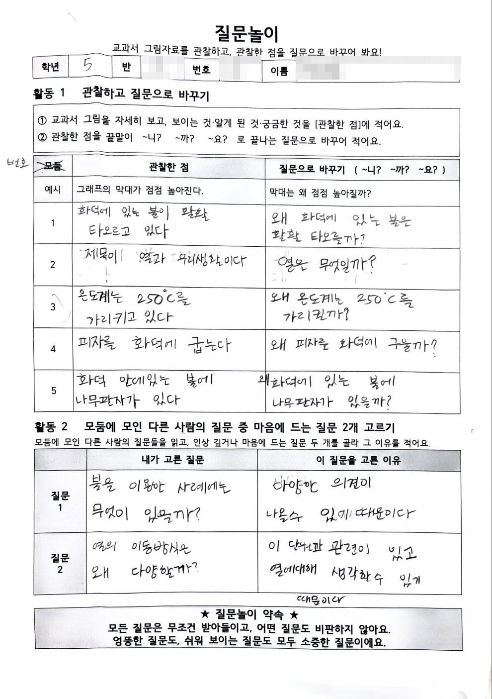

5학년 과학 3단원 '열과 우리 생활'의 첫 시간, 교과서 단원 도입면 한 장을 두고 질문놀이를 했다. 보이는 것을 적고, 그것을 질문으로 바꾸고, 모둠 친구들의 질문 중 마음에 드는 두 개를 골라 이유를 쓰는 활동이다. 걷은 활동지를 읽다가 몇 번 멈춰서는 순간들이 있어 기록해둔다.

<figure>

<figcaption>5학년 과학 3단원 '열과 우리 생활' 단원 도입면.</figcaption>
</figure>

## 활동지를 읽다 멈춘 순간들

(1) 같은 눈금을 두고 한 아이는 불의 온도로, 다른 아이는 온도계가 가리키는 값으로 읽었다. 이 단원의 첫 차시가 바로 온도와 온도계인데, 무엇부터 가르쳐야 하는지를 교과서보다 아이들 문장이 먼저 알려 주었다.

(2) 교과서 말풍선에는 "화덕의 ○○(으)로 피자를 굽고 있어요"라는 빈칸이 있고, 정답은 열이다. 그런데 아이들의 질문은 거의 다 불에서 나왔다. "불은 왜 뜨거울까?", "불은 왜 나무에 잘 붙을까?" 피자에서 올라오는 김마저 "불을 피울 때 김이 난다"라고 적었다.

눈에 보이는 불에서 보이지 않는 열로 건너가는 다리를 놓는 것이 이 단원 초입에서 진짜 할 일이라는 걸 아이들 질문을 보고 알았다.

(3) '왜'를 붙인다고 탐구 질문이 되지는 않는다. "왜 온도계는 250℃를 가리킬까?", "왜 피자를 화덕에 구울까?"처럼 관찰한 문장 앞에 '왜'만 붙인 질문이 대부분이었는데, 그 중 이 질문이 눈에 띄었다.

> 불도 종류나 온도에 따라 색이 다를까?

'빨간색과 파란색이 섞여 있다'는 관찰에서 출발해, 비교할 조건(종류, 온도)을 스스로 끌어낸 질문이다. 실험으로 확인해 볼 수도 있다. 다음 질문놀이에서는 이 질문을 질문 바람개비에 추가해볼 생각이다. '왜 ~할까?'에서 '~에 따라 달라질까?'로 넘어가는 연습이다.

<figure>

<figcaption>질문놀이 활동지. 관찰한 점을 질문으로 바꾸고, 모둠 친구들의 질문 중 두 개를 골라 이유를 적는다.</figcaption>
</figure>

(4) 질문을 고른 이유에서 아이의 학습관이 보인다. "열에 대해 배워야 이 단원을 이해할 수 있을 것 같아서.", "다양한 의견이 나올 수 있기 때문이다."

한 아이는 단원을 여는 열쇠가 되는 질문을, 다른 아이는 대화를 넓히는 질문을 골랐다. 좋은 질문이 무엇인지에 대한 기준을 아이들은 이미 각자 갖고 있었다. 활동지 맨 아래의 고른 이유 칸이 사실상 메타인지를 보여 주는 칸이었다.

<figure>

</figure>

(5) 도입면에는 그림 말고도 단원 제목과 학습목표 문장이 함께 있다. "열은 무엇일까?"는 제목에서 나온 질문이었고, "열의 이동 방식은 왜 다양할까?"는 학습목표 문장에서 나온 질문이었다. 나는 그림을 관찰하라고 했지만, 아이들에게는 페이지 전체가 관찰 대상이었다.

반대로 아무도 묻지 않은 것도 있었다. 페이지 아래쪽에서 동전, 소스병, 캔 캐릭터가 걸어가고 있는데, 이것은 단원 마지막에 배울 단열로 이어지는 단서다. 아이들이 무엇을 물었는지만큼, 무엇을 묻지 않았는지도 수업을 설계하는 자료가 된다.

## 비판하지 않기와 평가

질문놀이는 모든 질문은 무조건 받아들이고, 어떤 질문도 비판하지 않는다는 약속을 전제로 이루어진다. 비판하지 않기와 평가가 어떻게 함께 갈 수 있을지 근본적인 고민을 했었는데 해 보니 답은 간단했다. 질문에 점수를 매기는 것이 아니라, 질문을 통해 아이의 생각을 읽고 다음 수업을 바꾸는 것이다.

(모인 질문은 단원 끝에 다시 꺼내 이제 답할 수 있는 질문과 여전히 궁금한 질문으로 나눠 볼 계획이다.)
