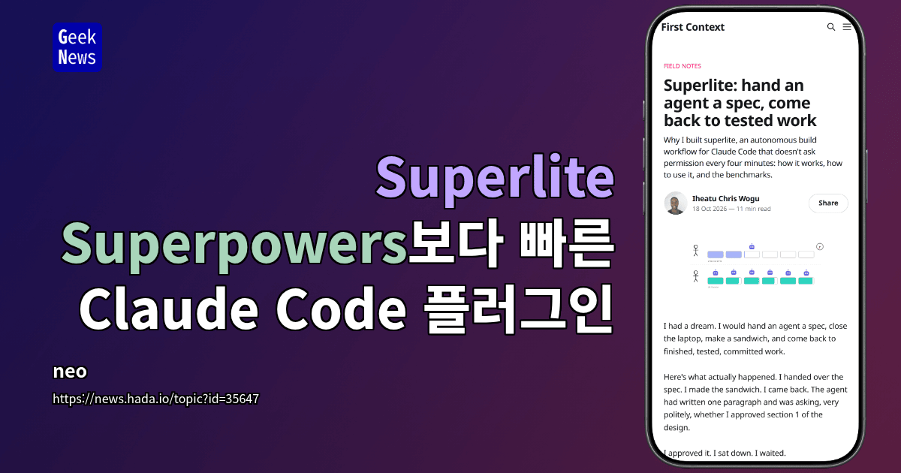

인공지능을 활용한 코드 개발은 점차 보편화되고 있다. 그러나 많은 개발 과정은 여전히 반복적인 사람의 승인과 순차적인 작업 흐름으로 느려진다. 클로드 코드(Claude Code) 플러그인 슈퍼라이트(Superlite)는 명세 하나를 넘기면 사람 없이 테스트와 커밋까지 끝내는 쪽으로 이 흐름을 바꾼다. contextfirst.blog에 실린 소개 글을 GeekNews가 옮겼고, 그 내용을 정리했다.

<figure>

</figure>

## 코드 개발의 병목 현상
기존 클로드 코드 개발 플러그인 슈퍼파워즈(Superpowers)는 사람이 각 단계에 긴밀히 참여하는 협업 방식을 따른다. 이 방식은 개발 과정에 대한 통제력을 높이는 안전장치 역할을 한다. 그러나 원하는 결과가 이미 명확한 상황에서는 여러 병목 현상이 발생하여 개발 속도를 저해한다.

주요 병목 현상은 다음과 같다.

- **잦은 사람 승인**: 기능당 8~12회의 사람 승인이 필요하다. 질문 응답, 설계 섹션 승인, 명세 및 계획 검토 등 여러 단계에서 개입해야 한다.
- **엄격한 순차 실행**: 에이전트 호출이 21회까지 순차적으로 이어진다. 구현과 리뷰를 포함한 모든 작업이 한 줄로 진행된다.
- **반복적인 검토**: 작업마다 리뷰와 재리뷰 과정에 많은 시간을 사용한다. 34분 빌드 중 약 12분이 여기에 소요된다.
- **전체 테스트 반복 실행**: 여러 스킬이 전체 테스트 모음을 반복 실행하여 비효율적이다.
- **느린 코드 작성 속도**: 핵심 실행 경로에 배치된 Opus 하위 에이전트의 코드 작성 속도가 Sonnet의 약 절반 수준이다.

이러한 문제들은 자율적이고 빠른 개발을 방해한다.

## 슈퍼라이트의 자율 개발 워크플로
슈퍼라이트는 이러한 병목 현상을 해결하고자 클로드 코드 플러그인으로 개발되었다. 이 플러그인은 명세를 넘기면 사용자가 자리를 비워도 테스트와 커밋까지 마친 작업을 받을 수 있도록 설계된다.

슈퍼라이트의 핵심 작동 방식은 다음과 같다.

1.  **계획 수립 및 병렬 작업 분배**: 빌드를 계획하고, 여러 병렬 작업으로 나눈다. 각 작업은 가장 적합하고 저렴한 에이전트에 배정된다.
2.  **병렬 실행**: 작업별 파일, 인터페이스, 테스트를 정의해 독립적인 작업을 동시에 실행한다. 최신 벤치마크에서 최대 18개 에이전트가 동시에 작업했다.
3.  **통합 및 검토**: 작업 사이의 통합 경계를 확인하고 결과를 리뷰한다.
4.  **결정 기록**: 실행 중 내린 모든 결정과 그 이유를 기록한다. 사용자가 나중에 돌아왔을 때 어떤 결정을 재검토해야 할지 파악할 수 있다.
5.  **제한된 사용자 개입**: 자율 실행을 선택해도 사용자 승인 없이 코드 푸시나 병합은 수행하지 않는다.

슈퍼라이트는 슈퍼파워즈의 플러그인 구조, 세션 시작 훅, 생명주기 스킬을 차용하지만, 용도는 빠른 자율 개발에 맞춰진다.

## 유연한 조율과 모델별 역할 분담
슈퍼라이트는 요청 규모에 따라 계획 절차를 다르게 가져간다. 또한, 사람이 조율하는 방식과 AI가 스스로 결정하는 방식 중 하나를 선택할 수 있다.

| 조율 방식 | 특징 | 개입 시점 |
|---|---|---|
| 사람 조율 | 예상 일정이 포함된 전체 계획을 한 번 승인한다. | 실행 전 한 번 승인 후, 파괴적이거나 외부에 영향을 주거나 보안에 민감한 작업에서만 멈춘다. |
| AI 조율 | 일반적으로 사용자에게 물을 선택도 AI가 스스로 결정한다. | 각 결정에 대한 내용, 이유, 실패 시 비용을 기록한다. 사용자 없이 푸시나 병합은 하지 않는다. |

작업은 작업 그래프로 구성되며, 각 작업에는 소유 파일, 입력, 출력 인터페이스, 통과해야 할 테스트가 명시된다. 파일을 공유하지 않고 상호 의존성이 없는 작업은 병렬 실행된다.

슈퍼라이트에서 모델과 에이전트의 역할은 명확히 분리된다.

| 모델/에이전트 | 담당 역할 | 주요 기능 |
|---|---|---|
| Opus 조율자 | 계획 수립 및 작업 배정 | 코드를 수정할 수 없다. |
| Sonnet 구현자 | 대부분의 구현 작업 | - |
| Haiku 구현자 | 작고 명확한 기계적 작업 | 핵심 실행 경로 외의 작업을 담당한다. |
| Sonnet 리뷰어 | 패키지 검토 | - |
| Opus 최종 리뷰어 | 실행 로그 기반 리뷰 | 직접 수정하지 않으며, 발견 사항만 반환한다. |
| 3단계 수정 전담 에이전트 | 코드 수정 | 원인 파악의 명확성에 따라 수정 작업을 배정받는다. |

## 코드로 강제하는 규칙과 모니터링
슈퍼라이트는 프롬프트 지시에 기대지 않고 코드로 규칙을 강제해 워크플로의 안정성과 효율성을 높인다.

-   **조율자의 코드 수정 금지**: 훅(hook)을 사용해 조율자가 프로젝트 코드를 직접 수정하는 것을 차단한다.
-   **테스트 백그라운드 실행**: 조율자가 직접 실행한 pytest 또는 npm test를 감지해 백그라운드 실행으로 전환한다. 이는 테스트가 조율자의 작업을 지연시키지 않도록 한다.
-   **프로세스 종료 제한**: 훅으로 프로세스 이름을 이용한 임의 종료를 모든 에이전트에게 금지한다.
-   **계획 안정화**: 작업을 시작하기 전에 계획이 lint --stable을 통과해야 한다. 안정화된 작업은 나머지 계획 수정이 끝나기를 기다리지 않고 즉시 배정된다.
-   **자원 기록 및 예측**: 훅이 에이전트별 토큰, 비용, 시간을 기록하고, 이 측정값을 다음 실행 예측에 반영한다. 또한, 소프트 예산 한도의 70%에 도달하면 알림을 제공한다.

## 벤치마크 결과
슈퍼라이트는 자체 헤드리스 벤치마크 하네스에서 슈퍼파워즈보다 짧은 시간에 같은 테스트를 모두 통과했다. 벤치마크 프로젝트는 정적 사이트 생성기와 스프레드시트 엔진을 포함하며, 177개의 비공개 테스트로 평가한다.

| 플러그인 | 구성 | 평균 실행 시간 | 시간 단축 (Superlite vs Superpowers) | 테스트 통과 |
|---|---|---|---|---|
| Superlite | 최신 실행 | 16.1분 | - | 177/177 |
| Superpowers | 기본 구성 | 33.6분 | 52% | 177/177 |
| Superpowers | 조율 구성 | 23.5분 | 31% | 177/177 |

최신 슈퍼라이트 실행은 명세 입력부터 빌드 완료까지 16.1분이 걸렸으며 177개 테스트를 모두 통과했다. 총 21개 에이전트가 참여했고 최대 18개가 동시에 실행되었다. 특히, 첫 구현 에이전트는 약 3분 시점에 작업을 시작했으며 최종 리뷰는 30초에 불과했다.

이는 슈퍼파워즈의 기본 구성 대비 52%, 조율 구성 대비 31% 시간이 단축된 수치이다. 이전 슈퍼라이트 빌드(평균 26.9분)와 비교해도 실행 시간이 40% 줄어들었다.

초기 사이트젠(sitegen) 단독 과제(모듈 9개, 비공개 테스트 89개)에서도 슈퍼파워즈는 34.4분, 슈퍼라이트는 8.8분으로 4배 가까운 차이를 보였다. 슈퍼파워즈가 21회 순차 호출을 한 반면, 슈퍼라이트는 총 10개 에이전트를 최대 5개씩 동시에 실행하며 순차 호출 경로를 3단계로 줄였다. 속도 향상의 대부분은 순차 대기열 제거에서 발생한다.

슈퍼라이트의 성능 향상은 다음 네 가지 변경으로 이루어졌다.

-   조율자의 코드 수정 권한을 제거한다.
-   모든 테스트 실행을 백그라운드로 옮긴다.
-   수정 작업을 단계별 수정 전담 에이전트에 배정한다.
-   안정화된 작업은 나머지 계획 수정이 끝나기를 기다리지 않고 구현을 시작한다.

## 프로세스 최적화의 관점에서
슈퍼라이트의 성공은 AI 에이전트 워크플로의 느린 주된 원인이 모델의 깊은 사고 능력 부족이 아니라, 비효율적인 순차 대기와 반복 승인에 있다는 점을 보여준다. 이는 복잡한 시스템의 프로세스 최적화에서 흔히 발견되는 패턴이다. 즉, 개별 요소의 성능보다 요소 간의 연결과 흐름이 전체 효율성을 좌우한다. 슈퍼라이트는 인터페이스 경계에 따라 작업을 나누고, 독립적인 작업을 동시에 실행하며, 기계적인 단계는 스크립트로 자동화하는 방식으로 이러한 병목 현상을 해소한다. 이는 복잡한 작업 흐름을 가진 모든 분야에서 적용할 수 있는 보편적인 최적화 원칙을 제시한다. 중요한 규칙은 단순히 "이렇게 해달라"고 요청하는 대신, 시스템 자체에 코드로 강제하는 방식으로 내재화해야 한다.

## 출처
- 원문: 「Superlite: hand an agent a spec, come back to tested work」, contextfirst.blog (2026-10-18). <https://contextfirst.blog/superlite-hand-an-agent-a-spec/>
- 경유: GeekNews, 「Superlite - Superpowers보다 빠른 Claude Code 플러그인」 <https://news.hada.io/topic?id=35647>
