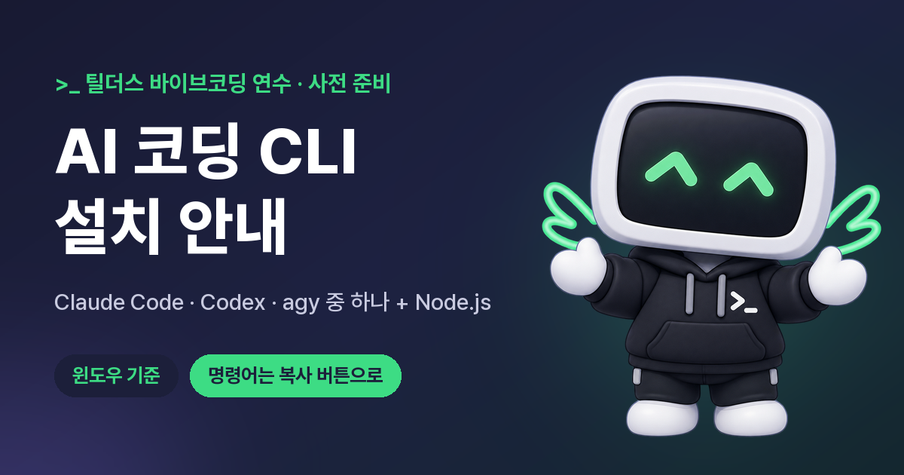

AI 코딩 도구는 교사에게 교실 문제를 직접 해결할 기회를 준다. 다만 교육 서비스를 만드는 일은 코드 생성에 그치지 않고, 웹 서비스의 기본 구조 이해, 교사 신분에 따르는 법적·윤리적 제약, 장기 운영 전략까지 함께 요구한다. 라이프오브파이와 비상교육이 펴낸 『교실 문제를 해결하는 교사 개발자를 위한 지침서』(40쪽)와 틸더스의 AI 코딩 CLI 설치 안내를 묶어 정리했다.

> 이 글이 바탕으로 삼은 지침서 원문을 내려받을 수 있다. [『교실 문제를 해결하는 교사 개발자를 위한 지침서』 내려받기 (PDF, 40쪽, 10MB)](https://github.com/tigerjk9/tigerjk9.github.io/releases/download/lecture-materials/teacher-developer-essentials.pdf)

<figure>

</figure>

## AI 코딩 환경 설정과 서비스 구조 이해

교사 개발자가 직접 문제를 해결하는 첫 단계는 AI 코딩 환경을 구축하는 것이다. 클로드 코드(Claude Code), Codex CLI, Antigravity CLI가 주요 AI 코딩 도구다. 이 중 하나를 선택하여 설치하며, 모든 도구는 Node.js 버전 22 이상이 필요하다.

AI 코딩 도구의 설치 과정은 다음과 같다.

| 단계 | 설명 | 유의사항 |
|---|---|---|
| Node.js 설치 | 명령 프롬프트(cmd)에 `winget install OpenJS.Nodejs.LTS` 입력하거나 Node.js 공식 홈페이지에서 LTS 버전 설치 파일을 내려받아 실행한다. | 약관 동의 시 `Y` 입력, 권한 확인 창에서 `예` 선택한다. 관리자 권한으로 cmd를 실행하지 않는다. |
| 설치 확인 | cmd에 `node --version`과 `npm --version`을 입력하여 버전이 정상적으로 출력되는지 확인한다. | cmd 창을 새로 열어 확인한다. |
| AI 코딩 CLI 설치 | 선택한 도구의 설치 문서에 따라 명령어를 입력하여 설치한다. | 학교 네트워크 차단 시 다른 네트워크를 이용한다. |
| PATH 환경 변수 확인 | `Get-Command [도구명]` 명령으로 설치 경로가 나오는지 확인한다. | 명령어를 찾지 못하면 열려 있는 cmd 창을 모두 닫고 다시 시도하거나, 환경 변수 `Path`에 직접 설치 폴더를 추가한다. |

이러한 환경에서 AI는 사용자의 요청에 따라 코드를 생성한다. 기능명만 요청하는 방식은 데이터 소실이나 무단 접근과 같은 문제를 야기한다. AI 코딩의 품질은 문제를 여러 계층으로 분해하는 능력에 따라 결정된다.

| 요청 방식 | AI 결과물의 특징 |
|---|---|
| 기능명만 요청 | 새로고침 시 데이터 소실, 인증 절차 없음, 코드 구조 복잡화가 나타난다. |
| 계층별 책임 요청 | UI, 화면 상태, 서버 데이터, API, DB, 권한, 에러 처리 등으로 책임을 분리하여 구현한다. |

모든 웹 서비스는 요청과 응답을 기반으로 동작하며, URL(위치), HTTP(방식), HTML(내용) 세 가지 규약을 따른다. 이 중 HTML은 브라우저가 화면으로 렌더링하는 문서 구조이며, AI가 생성하는 화면도 최종적으로 HTML로 귀결된다. 프론트엔드 화면은 HTML(구조), CSS(표현), JavaScript(동작) 세 가지 언어로 구성되며, 상태(State) 변화에 따라 갱신된다.

서비스의 상태는 두 가지 유형으로 분류한다.

| 상태 유형 | 특징 | 사례 | 주요 도구 | 경고 |
|---|---|---|---|---|
| 화면 상태(Client State) | 브라우저 내부에서만 유효하며 새로고침 시 초기화되어도 무방하다. | 모달 열림 여부, 선택한 탭, 다크 모드 | useState, Zustand | |
| 서버 데이터(Server State) | 원본이 서버와 DB에 존재하고 여러 기기 및 사용자가 동일 값을 조회해야 한다. 로딩, 실패, 재시도, 동기화 문제가 수반된다. | 학생 명단, 과제 제출 기록, 학급 포인트 | React Query, SWR | useState나 localStorage에만 저장하면 다른 기기에서 미표시되고 브라우저 기록 삭제 시 소실된다. |

백엔드는 사용자별로 다른 결과를 제공하기 위해 필요하며, 현재는 JSON 데이터만 송수신하는 API(Application Programming Interface)가 표준이다. API는 엔드포인트(Endpoint), 메서드(Method), 바디(Body), 에러(Error)로 구성된다. 데이터베이스(DB)는 대량의 데이터를 안정적으로 관리하며, 인증(Authentication)과 인가(Authorization)는 정보 접근 범위를 결정하는 필수 요소이다.

## 교사 개발자의 법적·윤리적 제약과 성장 경로

국공립 교사는 국가공무원법의 영리업무 금지와 겸직허가 의무를 예외 없이 적용받는다. 이는 서비스 개발의 수익화에 대한 엄격한 제약을 의미한다.

| 금지 및 제한 사항 | 설명 | 사례 |
|---|---|---|
| 영리업무 금지 | 공무원은 영리를 목적으로 하는 업무에 종사하지 못한다. | 개인 사업체 경영, 법인 대표 취임은 사실상 불가능하다. 유료 결제, 구독, 광고 도입 시 영리 목적 업무로 간주될 가능성이 높아진다. |
| 겸직허가 의무 | 소속 기관장의 허가 없이는 다른 직무를 겸할 수 없다. | 앱 개발이나 이모티콘처럼 지속적으로 수익이 발생하는 활동도 겸직허가 대상이다. |
| 부수입에 대한 시선 | 서비스가 알려지고 수익이 가시화되면 동료나 학부모의 민원과 신고로 이어질 수 있다. | 무허가 겸직, 근무 시간 중 개인 활동, 직무 지식 및 학생 정보 사적 이용 등의 문제가 발생할 수 있다. |

따라서 교사 개발자는 수익 창출보다 교실 현장 문제 해결에 초점을 맞추고, 처음부터 무료·비영리·허가 범위 내에서 서비스를 설계하는 것이 안전하다.

하지만 서비스 판매 수익을 얻기 어려워도, 문제를 직접 해결한 경험과 전문성은 교사 개발자의 중요한 자산이 된다.

| 교사 개발자가 얻을 수 있는 가치 | 설명 |
|---|---|
| 출판 | 1회성 저술은 겸직허가 대상이 아니다. |
| 강연 | 시간당 상한 100만 원까지 사례금을 받을 수 있다. 1개월 이상 지속 시 겸직허가가 필요하다. |
| 명예 | 교육청의 교사 개발자 사업에서 사례집 발간, 연수 강사, 표창으로 이어진다. 서울시교육청은 2025년 1호 교사 개발자 33명을 양성했다. |
| Co-Work | 문제 정의, 설계, 검증 경험은 수업 설계 역량과 동일한 구조를 가지며, 기업과의 코웍 기회로 이어진다. |
| 합법적 사업화 | 교육부·교육청 정책 연구, 비영리 사단법인 임원 활동, 공익 목적 에듀테크 자문, 특허 및 저작권 보상 등이 포함된다. |

학생 정보를 처리하는 학습 지원 소프트웨어는 교육 자료로 분류되어 학교운영위원회(학운위) 심의를 거쳐야 학교에서 사용할 수 있다. 교사가 직접 개발한 앱도 예외가 아니다.

| 법규 및 지침 | 핵심 내용 |
|---|---|
| 개인정보보호법 (2026.9.11 시행) | - 수집·이용(제15조): 동의 및 법적 근거 필요, 목적, 항목, 보유 기간, 거부권 고지 - 최소 수집(제16조): 최소한의 정보만 수집했음 증명 책임은 개발자에게 있다. - 만 14세 미만(제22조의2): 법정 대리인 동의 필수, 아동이 이해하기 쉬운 표현으로 고지 - 가명 정보(제28조의2): 통계·연구 목적 시 동의 없이 가명 처리 정보 활용 가능 - 안전 조치(제29조): 내부 관리 계획 수립, 접속 기록 보관 의무를 명시한다. |
| 초·중등교육법 (2026.3.1 시행) | 학습 지원 소프트웨어를 교육 자료로 선정 시 교육부 장관과 개인정보보호위원회가 정하는 기준을 따르고, 학운위 심의를 거쳐야 한다. |
| 학운위 심의 필수 기준 (5개 기준, 9개 항목) | 최소 수집 및 목적 명시, 안전 조치, 열람·정정·삭제 절차, 만 14세 미만 아동 보호, 보호 책임자 지정 및 제3자 제공·위탁이다. 이 중 1개라도 미충족 시 사용 불가하다. |

학운위 심의 대상 여부는 앱의 종류보다 수업 활용 방식에 따라 결정된다. 정규 교과 수업에서 사용하며 다음 두 조건 중 하나 이상에 해당하면 심의 대상이 된다.

| 조건 1 | 조건 2 | 심의 대상 여부 |
|---|---|---|
| 학생 개인 정보를 수집·이용·제공한다. | 교과 성취 기준 관련 학습 콘텐츠를 포함하고, 교육 과정 운영 지원을 목적으로 개발·보급되었다. | 조건 1 또는 조건 2 중 하나 이상 해당 시 심의 대상이 된다 (공공 플랫폼, 민간 에듀테크, 교사 제작 앱 모두 포함). 두 조건 모두 해당하지 않으면 심의 대상에서 제외한다. |

가장 안전한 학생 정보 보호 전략은 애초에 수집하지 않는 것이다. 최소한의 정보만 수집하고, AI 입력 전 룰베이스 마스킹을 적용하며, 최종 확인은 사람이 수행해야 한다. 예를 들어, 이름 대신 번호를 사용하거나, AI 입력 시 이름을 '학생A' 등으로 치환한다.

AI가 작성한 코드의 약 45%에서 보안 취약점이 발견된다는 연구 결과도 있다. 따라서 KISA(한국인터넷진흥원)의 시큐어 코딩 가이드를 기반으로 보안 점검을 통과하는 것이 서비스 배포 준비의 필수 단계이다. 주요 취약점으로는 RLS(Row Level Security) 미흡, 비밀키 노출, 입력값 검증 부족, 에러 메시지 내부 정보 노출 등이 있다.

## 서비스 구축, 운영, 그리고 성장

사용자 수 30명의 앱과 3만 명의 서비스는 구조부터 다르다. AI 코딩은 코드를 생성하지만, 대규모 서비스에서는 코드보다 인프라와 운영 관리가 핵심 문제로 떠오른다.

| 운영 관리의 주요 항목 | 설명 |
|---|---|
| 서버 인프라 | 운영과 개발 환경 분리, 비밀키, 로그, 모니터링, 사용량 상한 및 과금 알림 관리. 2025년 Replit AI 에이전트의 운영 DB 삭제 사고 이후 개발·운영 DB 자동 분리 및 원클릭 복원 기능이 도입되었다. |
| CI/CD(지속적 통합/배포) | 변경 사항을 수시로 통합하고 자동 빌드 및 테스트로 검증하며, 상시 배포 가능한 상태를 유지한다. GitHub push 시 Vercel 자동 배포와 같은 방식을 사용한다. |
| 보안·백업 정책 | 사본 3개를 서로 다른 매체 2종에 보관하고 그중 1개는 원격지에 두는 '3-2-1 원칙'이 기본이다. 2025년 국가정보자원관리원 대전 화재 시 G드라이브 백업이 복구 불가능했던 사례가 있다. |
| 마케팅 | 교사는 영리 광고에 제한이 있으므로 연수, 사례 공유, 교사 커뮤니티, 교육청 사업 등 비영리 경로로 홍보한다. |

교사 개발자 테크 트리는 사용자 범위와 규모에 따라 단계적으로 전환한다.

| 단계 | 대표 예시 | AI 개발 도구 | 화면 기술 스택 | 데이터·서버 | 배포·인프라 | 비용 |
|---|---|---|---|---|---|---|
| 초급 | 타이머, 랜덤 뽑기 | Lovable 등 앱 빌더 | HTML·CSS·JS 단일 파일, Vite + React | 저장 없음, 브라우저 저장소 | GitHub Pages, Cloudflare Pages | 0원 |
| 중급 | 과제 제출, 학급 포인트 | Antigravity, Claude Code, Codex | React(Vite) 또는 Next.js, TypeScript, Tailwind | Supabase 또는 Firebase (Postgres + 로그인 + RLS/보안 규칙) | Vercel·Netlify + GitHub 자동 배포, 커스텀 도메인 | 0원 ~ 연 2~3만 원 + AI API 사용량 |
| 고급 | 다수 학교 대상 플랫폼 | 스펙 기반 개발, PR 리뷰 자동화 | React 또는 Next.js, 디자인 시스템, 다국어 | 별도 API 서버 (Spring Boot, NestJS), 관리형 DB, Redis 캐시 | Docker + 쿠버네티스, 운영·스테이징 분리, CDN, 클라우드 | 월 수만~수십만 원 이상 |

무료 플랫폼은 정책을 변경하고 가격을 인상하거나 서비스를 종료할 수 있다. 편리한 플랫폼일수록 이전이 어려우므로 플랫폼 종속성을 경계해야 한다.

| 플랫폼 정책 변경·종료 사례 | 대응 원칙 |
|---|---|
| - Google Workspace for Education 무제한 저장 공간 변경 (2022.7)  - Heroku 무료 플랜 종료 (2022.11)  - Firebase 무료 플랜의 Cloud Storage 유료 전환 필요 (2026.2)  - 아이엠스쿨 등 서비스 종료 (2026.2) | 1. 코드를 앱 빌더 외부의 본인 GitHub 저장소에 보관한다. 2. 데이터를 정기적으로 추출한다. 3. 이전 가능한 표준 기술(Postgres, React 등)을 선택한다. 4. 무료 한도와 약관을 확인한다. 5. 특정 도구의 사용법보다 기술 원리를 습득한다. |

## 교육 현장과 교사 개발자의 미래

교육 서비스 시장은 비용 부담 주체와 사용자 주체가 달라 수익화가 어렵다는 구조적 문제를 안고 있다. 예를 들어, NHN에듀 서비스 종료, AI 디지털 교과서 활용 학교 감소 및 소송 제기가 있다. 우수한 서비스와 수익성 있는 서비스는 별개의 문제이다.

하지만 AI 에이전트 시대에는 판매용 서비스 가치가 하락하고, 자체 활용 도구 개발은 더욱 용이해진다. 마이크로소프트 CEO 사티아 나델라는 비즈니스 앱이 AI 계층으로 이전될 것이라 전망했다. 실제로 기업들은 에이전틱 코딩 도구를 활용해 소프트웨어 구매를 철회하고 자체 개발로 전환하는 사례가 늘고 있다. 교육 현장에서도 교사들이 직접 클로드 코드나 바이브 코딩으로 수업 영상 피드백 도구, 학교 사이트, 학습 앱 등을 개발하며 비용을 절감한다.

결국 교사 개발자의 1차 목표는 판매보다 학급 현장의 문제 해결에 두는 것이 타당하다. 교실의 문제는 매우 다양하며, 범용 서비스로는 해결할 수 없는 학급 규칙, 학교 일정, 학생 특성에 맞춘 도구를 교사만이 개발할 수 있다. 출결, 과제 확인, 설문 취합, 가정통신문, 평어 초안 작성 등 교실 업무 흐름은 에이전틱 방식으로 개선할 여지가 크다. 문제를 끝까지 해결하는 역량은 교사의 전문성과 자기 효능감을 향상시키고, 출판, 강연, 연구 등 합법적인 경로로 전문성을 확장시킨다.

## 인류학·문화진화론의 시선으로 보면

인류는 오랜 시간 동안 도구를 사용하여 환경에 적응하고 문제를 해결해 왔다. 교사가 직접 AI 코딩 도구를 활용하여 교실 환경에 최적화된 서비스를 개발하는 현상은, 외부의 범용 도구를 그대로 받아들이는 데서 나아가, 특정 환경의 고유한 맥락 안에서 문화적 변이를 스스로 만들어 내는 과정과 닮았다. 이는 특정 집단의 필요와 제약에 맞춰 도구를 발명하고 개선하는 인류의 기본적인 진화 메커니즘을 디지털 시대에 재현하는 모습이라 볼 수 있다.

## 출처
- 라이프오브파이·비상교육, 『교실 문제를 해결하는 교사 개발자를 위한 지침서, 피가 되고 살이 되는 교사의 서비스 개발 방법론』 (VIBE CODING TEACHER DEVELOPER, PDF 40쪽) — [PDF 내려받기](https://github.com/tigerjk9/tigerjk9.github.io/releases/download/lecture-materials/teacher-developer-essentials.pdf)
- 틸더스, 「AI 코딩 CLI 설치 안내」 <https://tuilders-cli-setup.vercel.app/>
