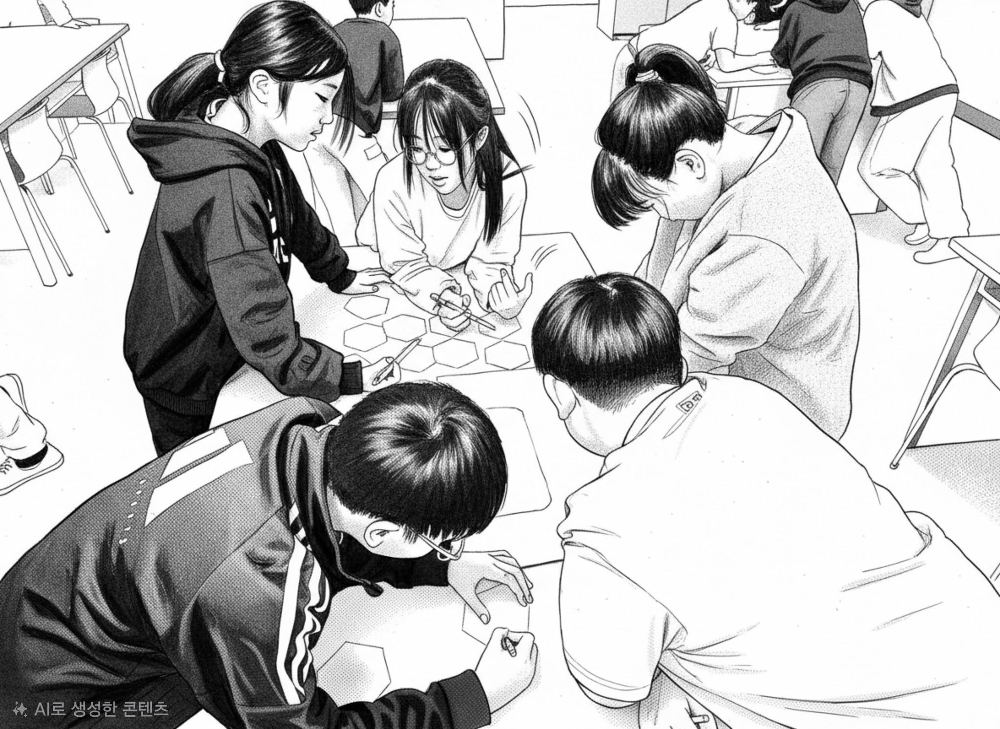

초등학교 5-6학년 과학 수업인 계절에 따른 태양 고도 변화나 용액의 진하기처럼 실험 조건을 직접 설정하고 변인을 통제해 보며 원리를 스스로 고민해야 할 탐구 활동 중임에도 아이들은 수업중 잠시 허용한 AI 검색이 작성해 준 매끄러운 수치와 원인 분석을 그대로 실험관찰에 적곤 한다. 완벽해 보이는 정답이 실험관찰을 가득 채우고 있지만, "이 실험에서 용액의 색깔이 왜 변했는지 친구들에게 직접 설명해 볼 사람?" 하고 물으면 교실에는 이내 적막이 흐른다. 정답이라는 지식이 머릿속에 존재하지만, 정작 원리를 추론하고 스스로 설명할 수 있는 이해로 충분히 전환되지는 못했기 때문이다.

<figure>

<figcaption>AI로 생성한 이미지.</figcaption>
</figure>

## AI가 더 잘해도 과학을 배워야 하는 이유

카네기멜론 대학교의 연구진은 AI가 인간보다 더 빠르고 정확하게 과학적 답을 찾아내는 시대일수록 왜 아이들이 과학을 직접 탐구하고 배워야 하는가에 대해 대답을 들려준다. 과학과 교육의 궁극적인 가치는 단순히 잘 정리된 지식 결과물을 수집하는 것이 아니라, 지속 가능한 집단적 인간의 이해와 인간의 주도성을 보존하고 발전시키는 데 있다. 특히 초등 5-6학년 과학 교육은 단순히 완성된 지식을 외우는 단계가 아니라, 직접 실험을 수행하고 데이터를 수집하며 오차를 해결하는 기초 탐구 역량을 체득하는 결정적 시기이다. 이 기초 탐구 단계를 AI에 전적으로 맡겨버리면 비판적 추론이라는 생각의 근육이 왜 필요한지 이해하지 못한 채, 당장 평가에 도움이 되는 지식 쌓기가 전부가 된다.

이 연구가 밝히듯, 과학의 방향과 탐구의 목적을 설정하는 인간의 주도성은 AI에게 넘겨줄 수 없는 핵심 가치이다. AI는 환경 오염이나 생태계 파괴에 대한 수많은 자료와 해결책을 순식간에 제시할 수 있지만, 우리 학교 주변의 생태계를 보호하기 위해 우리가 지금 당장 다루어야 할 문제는 무엇인가?를 결정하고 거기에 의미를 부여하는 일은 아이들 자신의 가치 판단에 달려 있다는 점이다. AI가 제시한 수많은 아이디어 중에서 우리 삶과 교실, 지역사회에 중요한 문제를 스스로 선택하고, 그것이 왜 탐구할 가치가 있는지 주도적으로 정당화하는 역량을 키워주는 것이다.

## 결과물이 아니라 과정을 보는 평가

AI라는 만능 오라클이 교실 깊숙이 들어올수록 AI가 화려한 텍스트와 그래프를 뚝딱 만들어낼 수 있는 환경에서 단순히 최종 제출물의 완성도나 문장의 매끄러움으로 평가하는 방식은 앞으로 유효하기 어렵다. 이런 시대일수록 역설적으로 직접 실험관찰 책에 손으로 기록하며, 오답을 정정해보고, 친구에게 서로 가르치고 배우며, 질문으로 스스로 탐구의 키를 잡는 과정을 통한 배움의 본질이 곧 평가의 본질의 위치를 찾아간다.

초등학교 과학 교실은 AI가 주는 정답을 실험관찰에 베껴넣는 지식 습득 공장이 아니라, 그 지식을 바탕으로 과학이라는 렌즈로 세상을 이해하는 기초탐구역량을 기르고, 자신만의 질문을 던지는 꼬마 과학자를 기르는 전략이 가득한 탐구 교실이 되어야 하겠다.

## 참고 논문

- Hoda Heidari, Aydin Mohseni (2026). Why and How to Do Science When AI Is Better at It: A Framework Grounded in Human Understanding and Direction. Carnegie Mellon University. arXiv:2610.36116. <https://arxiv.org/abs/2610.36116>
