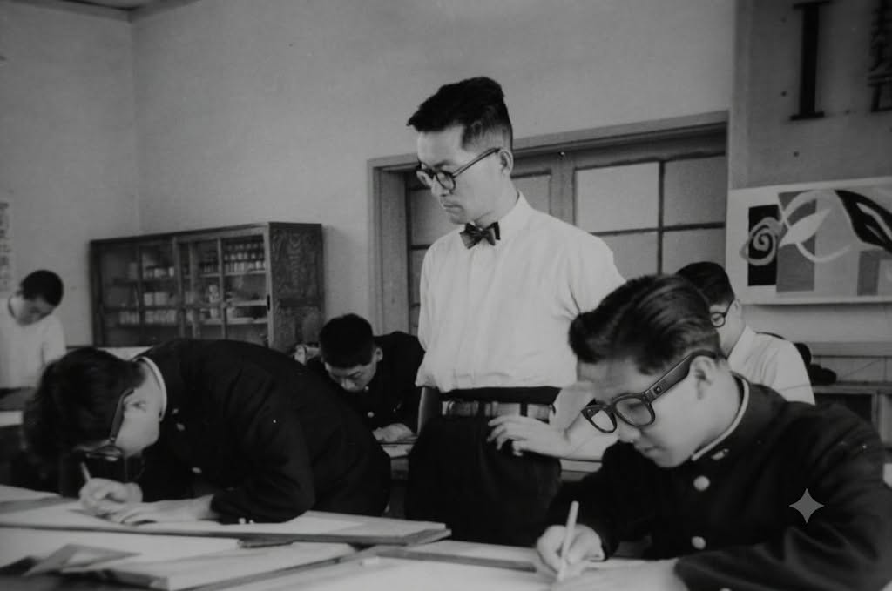

수능을 열하루 앞두고, 인스타그램 교사툰 「오늘도 0000를 했습니다」의 &lt;AI 안경&gt; 편을 보았다. 2023 수능 부정행위 적발 이후 악성 민원과 1인 시위, 무차별적 소송에 노출되어 무너져 내린 어느 동료 교사의 비극에서 출발하는 이 웹툰은, 스마트안경이라는 첨단 기술이 고위험 평가 현장에 침투했을 때 교사가 마주하는 극단적인 외통수를 고발하고 있다. 안경을 만져 확인하면 시험 방해, 벗어 보라고 하면 인권 침해, 적발하면 강압 행위, 방치하면 직무유기다. 웹툰이 지적한 '어느 쪽을 택해도 죽는 사지선다'는 단순한 비유가 아니라, 기술의 비대칭성과 행정적 방임 속에서 현장 교사 개인이 온몸으로 받아내야 하는 위협이자 위험 외주화의 현주소이다.

<figure>

<figcaption>1963년 2월, 가나가와의 한 고등학교 교실. 사진 takato marui, <a href="https://commons.wikimedia.org/wiki/File:Kanagawa_highschool_class.jpg">Wikimedia Commons</a>, CC BY-SA 2.0(흑백 변환).</figcaption>
</figure>

## 감독의 허상이라는 틀

한국교육개발원(KEDI)의 연구 보고서 &lt;인공지능의 학교 교육 활용 실태와 쟁점 분석&gt;이 포착한 '감독의 허상'이라는 개념은 바로 이 비극의 구조적 원인을 설명해 준다. 단순히 사람이 시스템 루프 안에 위치한다는 정황만으로는 감독이 이루어지지 않으며, 역량, 시간, 명확한 기준, 탐지 장비, 법적 권한 및 기관적 책임 체계가 결합될 때 비로소 실제 감독이 성립함을 말하고 있다. 현장 교사이자 연구자의 관점에서 수능 스마트안경 감독 상황에 이 틀을 대입해 보면 세 가지 구조적 결함이 선명히 드러난다.

첫째, 감독 필요도의 극대화. 수능은 수험생의 미래와 국가적 공정성이 직결된 초고위험 평가로, 판별의 오차(과잉 적발 또는 미적발)가 불러오는 사회적, 법적 비용이 양쪽 모두 치명적이다.

둘째, 실시간 판단 부하의 집중. 실시간 상황일수록 교사의 AI 응용 및 제어 수준이 낮아진다는 보고서의 지적처럼, 감독관은 돌발하는 첨단 기기 탐지 상황을 찰나의 순간에 수험생과 대면하여 자력으로 판단해야 하는 극심한 인지적, 정서적 부하에 직면한다.

셋째, 수행 조건의 치명적 결여. 전담 인력 지정과 상황실 상행 보고 체계가 도입되었으나, 연수 미비, 탐지 장비 부재, 무엇보다 초기 의심과 직접 대면, 그로 인한 사후 분쟁의 칼날을 여전히 교사 개인에게 방치해 두고 있다. 판단의 인지 프로세스는 상부로 이관하는 흉내를 냈을지언정, 감정 노동과 법적 리스크의 현장은 아래에 그대로 남아 있는 셈이다.

## 교사 개인이 아닌 체제가 감독하도록

올 수능 감독이 염려스러운 점은 감독 필요도를 상승시키는 위협의 근원이 교사나 학교가 전혀 통제할 수 없는 기술 설계의 비가시성으로부터 기인한다. 일반 안경과 구별조차 되지 않는 첨단 기기를 교사의 육안과 직관으로 가려내라는 요구는 무리하고도 과중한 행정적 요구다. 따라서 AI 시대의 인간 감독 체제는 교사 개인의 헌신이나 도덕적 의무에 의존할 것이 아니라, 교육 체제 차원의 안전한 대리 기능으로 재설계되어야 한다.

첫째, 개별 지목이 아닌 보편적 절차화가 필요하다. 입실 단계에서 모든 수험생의 안경 및 착용 물품을 일괄 확인하는 표준 가이드라인을 도입하여, 특정 학생 지목에 따른 마찰과 감정적 소모를 원천 차단해야 한다.

둘째, 보고와 판별 역할을 구분해야 한다. 시험실 감독관의 역할을 이상 징후 감지 및 보고로 엄격히 제한하고, 실제 판정과 통지의 권한 및 책임은 전담 인력과 중앙 상황실로 완전히 이관해야 한다.

셋째, 기관 책임 소재 및 법적 방호 체계를 명문화해야 한다. 이의 제기, 악성 민원, 소송의 대응 창구를 교사 개인이 아닌 교육청과 교육부로 명확히 마킹해야 한다. 사후 보험 지급은 훼손된 교사의 존엄과 일상을 복구해주지 못한다.

넷째, 기술의 감독 가능성을 확보해야 한다. 장기적으로는 시험장 입실이 가능한 스마트 기기에 대해 육안이나 간이 장비로 식별 가능하도록 하는 기술 표준 및 제도적 규제를 국가 차원에서 주도해야 한다.

## 명찰에서 지워진 이름

웹툰의 마지막 컷에 새겨진 "명찰에서 교사의 이름은 지워졌지만, 책임에서까지 지워준 것은 아니었다"라는 문장은, AI 교육 전환기 속에서 교사들이 느끼는 깊은 고립감을 대변해주고 있다. 사람이 단지 시스템의 부품처럼 루프 안에 서 있는 것만으로는 인간 중심 AI 교육도, 공정한 국가시험 체제도 완성되지 않는다. 현장의 교사가 보호받으며, 정당한 권한과 전문성을 바탕으로 버텨낼 수 있는 체계적이고도 기술적인 조건이 구비될 때, 연구보고서가 말하는 '감독의 허상'을 극복한 진정한 의미의 '인간 주도적 감독'이 시작될 수 있을테다.

## 참고 자료

- 웹툰: 인스타그램 @casefound404 「오늘도 0000를 했습니다 - AI 안경」. <https://www.instagram.com/p/DfR64aWGWI_/>
- 연구 보고서: 한국교육개발원(KEDI), 『인공지능의 학교 교육 활용 실태와 쟁점 분석』
- 이 블로그의 앞선 글, [AI의 학교 교육 활용, 현장 교사는 어떻게 감독해야 하는가?](/post/kedi-ai-school-use-and-issues-2026/) (2026-11-06)
