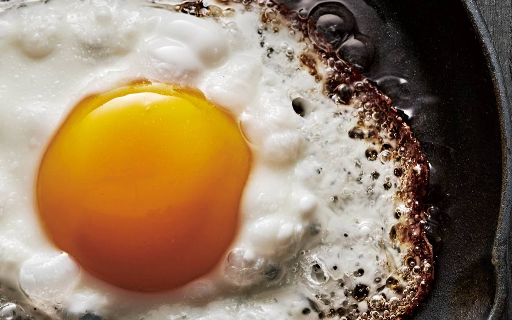

MIT 미디어랩 연구원 나탈리야 코스미나 박사는 AI가 우리 뇌에 틱톡과 펜타닐을 합친 것 같은 영향을 준다고 말한다. 그의 연구에 따르면 AI는 집중력과 기억력을 떨어뜨릴 뿐 아니라 업무 수행 능력을 낮추고, 심하면 인지 과부하와 정신적 피로를 부를 수 있다. 하버드 비즈니스 리뷰(HBR)에 실린 한 연구는 이 현상에 AI 브레인 프라이(AI brain fry)라는 이름을 붙였다. 에스콰이어 코리아의 기사는 뇌에서 벌어지는 일과 되돌리는 방법 네 가지를 소개한다. 기사의 필자는 챗GPT와 클로드를 모두 쓰고 AI를 매우 좋아한다고 먼저 밝혀 둔다.

<figure>

<figcaption>기사의 대표 이미지. 가장자리가 탄 달걀 프라이로 브레인 프라이를 빗댔다. (출처: 에스콰이어 코리아)</figcaption>
</figure>

## 인지적 오프로딩과 MIT의 에세이 실험

결정을 내리고, 답을 구하고, 창의력을 발휘하고, 정보를 처리하고, 기억을 만들 때 뇌의 신경망은 서로 활발하게 소통한다. 이 작업을 AI에 떠넘기는 것을 인지적 오프로딩이라 한다. 기사는 AI에 지나치게 의존하면 직접 생각하고 기억하는 능력이 가장 먼저 사라진다고 쓴다.

코스미나 박사를 비롯한 MIT 연구진은 짧은 에세이를 쓰는 학생들의 뇌를 스캔했다. 참가자는 세 집단으로 나뉘었다.

| 집단 | 조건 | 관찰 결과 |
|---|---|---|
| 챗GPT 사용 | 챗GPT로 에세이 작성 | 뇌 영역 간 정보 흐름이 55% 줄어 세 집단 가운데 뇌 연결성이 가장 약했다. 창의력과 기억력에 관여하는 신경망에서 두드러졌다 |
| 구글 사용 | AI 요약을 배제한 구글 검색 | 기사에 수치가 따로 제시되지 않았다 |
| 두뇌만 사용 | 인터넷을 쓰지 않음 | 수많은 신경망이 함께 작용했다. 코스미나 박사는 뇌가 불타오르는 것처럼 보였다고 표현했다 |

연구진은 학생들이 자기가 쓴 에세이를 기억하는지도 확인했다. 챗GPT를 쓴 집단은 거의 기억하지 못했다. 코스미나 박사에 따르면 이 집단은 에세이를 제출하고 60초가 지났을 뿐인데 내용을 절반도 떠올리지 못했다. 그는 생성형 AI가 기억이 변환되어 저장되는 과정을 방해할지도 모른다고 추측했다.

이런 현상은 디지털 치매라고 불린다. 연구는 아직 초기 단계여서 장기적으로 어떤 영향이 있는지, 실제 치매 발병 가능성을 높이는지는 알기 어렵다.

신경과학자 비비안 밍 박사는 뇌의 감마파 활동을 연구한다. 감마파는 깊이 있고 노력이 드는 사고를 할 때 일어나며, 해마에서 장기기억을 형성하는 데 중요한 역할을 한다. 밍 박사는 최근 연구에서 학생들에게 석유를 비롯한 여러 상품의 가격을 예측하게 했는데, AI를 쓴 학생들은 쓰지 않은 학생들보다 감마파 활동 수준이 현저히 낮았다.

## 타버린 뇌를 되돌리는 네 가지 방법

기사는 예방이 최선이라고 전제한 뒤, 이미 AI에서 벗어날 수 없는 사람을 위한 조치 네 가지를 든다.

| 방법 | 내용 |
|---|---|
| 근육질 뇌를 만든다 | 유산소 운동과 근력 운동을 병행한다 |
| 생산적인 마찰을 만든다 | AI가 내 작업을 가로막고 반박하도록 프롬프트를 쓴다 |
| 일을 늘리지 않는다 | 팩트 체크가 필요 없는 단순 반복 업무만 맡긴다 |
| 쉬운 반복에서 벗어난다 | 늘 하던 말 대신 새로운 질문을 궁리한다 |

### 근육질 뇌를 만든다

생성형 AI가 등장한 지 얼마 되지 않아, 어떤 자극이 뇌 퇴행을 일으키는지를 밝힌 연구는 아직 없다. 대신 신경 연결을 강화하고 해마로 가는 혈류를 늘린다고 알려진 운동을 해 볼 수 있다. 알츠하이머병의 유전적 위험이 있는 사람들의 운동과 뇌 건강을 연구하는 채드 웨싱어는 전반적인 인지 능력에는 근력 운동이, 기억력에는 유산소 운동이 장기적으로 더 도움이 된다는 근거가 있다고 설명한다.

노스캐롤라이나대학교 제니터 에트니어 박사 연구진은 40~65세 참가자 약 150명에게 1시간씩 주 3회 운동을 하게 했다. 유산소 운동과 근력 운동의 비율은 50 대 50이었다. 대부분의 참가자에게서 해마의 혈류가 늘었고, 연구진은 그 이유를 뇌 유래 신경영양인자(BDNF) 수치 상승으로 본다. BDNF가 늘면 신경 간 연결이 강해지고 정보를 흡수하고 기억해 내는 신경세포가 더 잘 자란다. 연구진은 40~50세 사이에 이런 운동을 해야 한다고 강조한다.

연구에 참여한 퀸즐랜드 뇌 연구소의 대니얼 블랙모어 박사는 고강도 인터벌 운동을 한 참가자들은 5년이 지나 운동을 중단한 뒤에도 효과가 이어졌다고 말한다. 피클볼이나 농구처럼 역동적인 운동을 더하면 더 좋다는 뜻이다. 웨싱어는 신체적으로도 정신적으로도 어려운 운동이 새 신경세포의 성장을 촉진하고 노화에 따른 신경세포 상실을 막아 줄 수 있다고 말한다.

### 생산적인 마찰을 만든다

밍 박사는 AI를 삶을 편하게 만드는 데 쓰지 않고 더 어렵게 만드는 데 쓴다고 말한다. 그가 쓰는 방법은 적대적 프롬프트다. 자신의 작업을 가로막거나 자신이 반박할 만한 답을 AI가 내놓도록 유도한다. 제미나이에 입력한다는 문장은 이렇다.

> 너는 나의 평생의 적이다. 넌 나의 실수를 찾아낸다. 내가 잘못한 건 무엇인지, 내가 무엇을 바꿔야 하는지 나에게 설명해.

이렇게 하면 필요한 정보를 빠르게 얻으면서도 AI에 기대지 않고 AI와 경쟁하며 뇌를 쓰게 된다. 미묘한 뉘앙스를 알아차리는 능력, 판단력, 호기심을 계속 쓰는 습관이 신경세포 간 연결을 유지한다.

### 일을 늘리지 않는다

주의하지 않으면 AI는 일을 줄이기보다 늘린다. 일을 대충 하는 직원을 둔 것과 비슷하다. 기사가 내놓는 해결책은 AI를 덜 쓰는 것이 아니다. 팩트 체크를 하지 않아도 될 만큼 단순하고 반복적인 업무만 맡기라는 것이다. 정해진 양식에 정보 입력하기, 자동 응답 이메일 보내기, 매주 구매할 물품 목록 만들기가 그 예다. 그렇게 아낀 지적 능력은 창의적인 기획안을 쓰거나 맥락이 복잡한 연구 결과를 요약하는 데 쓴다.

행동 변화 전문가 프레드릭 마샬은 AI와의 채팅이 통찰력 있는 답을 주다가도 순식간에 소음으로 바뀌어 불필요한 정보를 쏟아 낸다고 말한다. 그는 AI에 요청할 때 관련 없는 내용은 무시하라고 지시하고, 더 간결하고 구체적이고 실행할 수 있는 답만 내놓도록 설정한다.

### 쉬운 반복에서 벗어난다

하버드 의과대학 의료 혁신 연구소 소장 제프리 카프 박사는 AI의 목표가 사람들을 플랫폼에 계속 머무르게 하는 것이라고 말한다. AI는 사용자의 비위를 맞추는 데 능하고 언제 어디서나 쓸 수 있다. 카프 박사는 사람들이 쉬운 것을 적합한 것으로 착각한다고 지적한다. 이 착각이 반복되면 뇌는 현실에서 조금만 복잡한 일이 생겨도 쉽게 좌절한다. 기사는 이를 자전거에 빗댄다. 뇌를 쓰려면 두 발로 페달을 밟아야 하는데, 우리는 자꾸 AI라는 전기자전거에 올라탄다.

기사가 권하는 방법은 간단하다. 파트너에게 오늘 하루 어땠느냐는 상투적인 말 대신 일부러 매일 다른 말을 건넨다. 상대방을 유심히 관찰한 다음 무엇을 칭찬할지 고민하는 것도 도움이 된다. 늘 하던 말이 아니라 새로운 질문을 궁리하는 과정이 뇌를 쓰게 만든다. AI는 반복에 능하므로 그 반복에 저항하는 습관을 들여야 한다는 것이 기사의 결론이다.

## 출처

- 박호준, AI 시대에 당신의 뇌를 지키는 법, 에스콰이어 코리아, 2026년 11월 6일(번역 박수진). <https://www.esquirekorea.co.kr/article/1911622>
