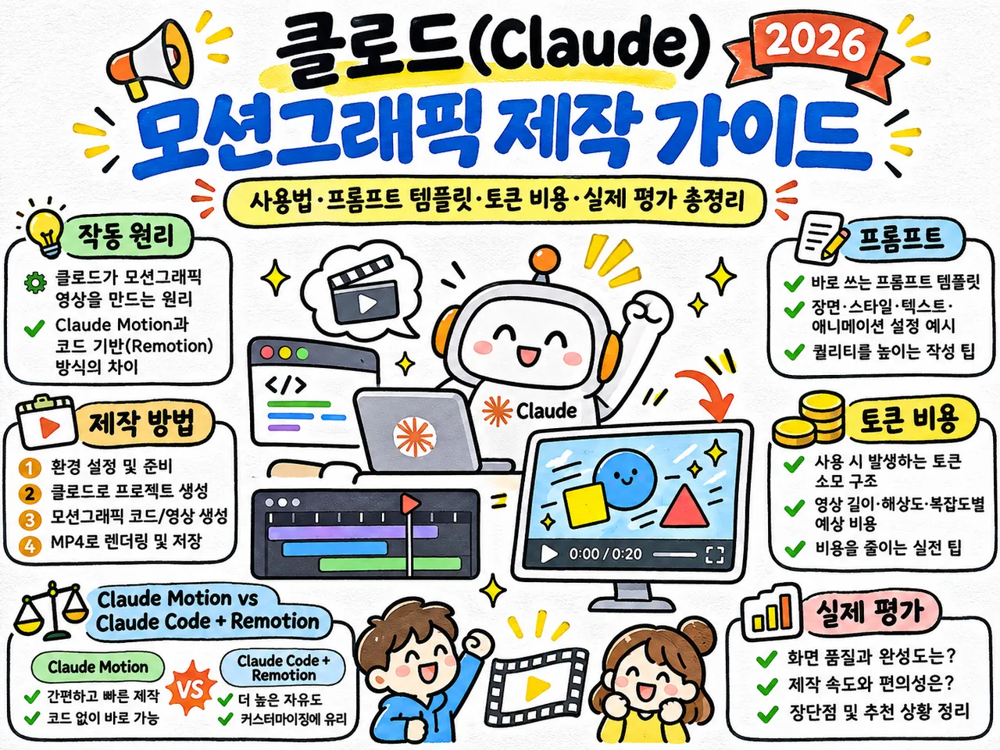

애프터 이펙트로 며칠 동안 키프레임을 찍어 만든 듯한 모션그래픽을 Claude와 자연어 프롬프트만으로 만든 사례가 늘고 있다. 틸노트에 올라온 제작기의 필자는 블로그 홍보 영상과 2분짜리 자기소개 영상 두 편을 30분 만에 만들었다고 한다. 픽셀을 생성하는 AI 비디오 모델과 달리 Claude가 애니메이션 코드를 쓰고 그 코드를 렌더링하는 방식이라, 글자와 도형이 오차 없이 맞물리는 타이포그래피 연출이 가능하다.

<figure>

<figcaption>원문이 다루는 다섯 주제를 정리한 대표 이미지. (출처: 틸노트)</figcaption>
</figure>

## 두 가지 제작 방식

Claude로 모션그래픽을 만드는 길은 둘이다. Anthropic의 공식 기능인 Claude Motion을 쓰거나, Claude Code에 영상 프레임워크 Remotion을 붙인다. 둘 다 AI가 애니메이션 코드를 작성해 영상을 렌더링한다는 원리는 같다.

| 구분 | Claude Motion | Claude Code + Remotion |
|---|---|---|
| 제공 형태 | Anthropic 공식 내장 기능(베타) | AI 코딩 에이전트 + React 기반 영상 프레임워크 |
| 작동 방식 | 채팅창에서 요청하면 아티팩트에서 바로 렌더링 | Claude가 React/JS 영상 코드를 로컬에 작성 |
| 사용 대상 | Team, Enterprise 플랜 | Claude Code를 쓸 수 있는 사용자(Pro, Max, API 등) |
| 수정 방법 | 대화형 피드백 또는 아티팩트 편집기 | 자연어 지시와 코드 직접 수정 |
| 영상 출력 | MP4 직접 내보내기 | MP4 등 여러 포맷과 해상도 |
| 주요 활용 | 보고서, 핵심 지표 요약, 짧은 설명 영상 | 브랜드 필름, 홍보 영상, 복잡한 커스텀 모션그래픽 |

Claude Motion은 2026년 11월 기준 Team과 Enterprise 플랜에서만 제공되고 Free, Pro, Max 같은 개인 플랜에서는 쓸 수 없다. 개인 구독자이거나 화면 전환, 카메라 워크, 모핑처럼 정교한 연출이 필요하면 Remotion 방식을 쓴다. Remotion은 React와 JavaScript로 동영상을 프로그래밍하는 프레임워크다.

## Claude Motion으로 시작하기

Team 플랜은 기본으로 켜져 있고, Enterprise 플랜은 조직 관리자가 활성화해야 한다. 개발 환경은 필요 없다.

1. 채팅 입력창에서 출력(Output) → Motion을 고르거나 아티팩트에서 Motion 템플릿을 연다.
2. 첨부 자료와 함께 영상의 목적, 길이, 컬러 톤을 입력한다.
3. 생성된 애니메이션을 재생해 보고 어색한 타이밍이나 문구를 대화로 고친다.
4. 오른쪽 위 내보내기(Export) → MP4로 저장한다.

## Claude Code와 Remotion으로 만들기

원문은 Windows에서 Claude Desktop의 Code 기능을 쓰는 방법을 따라간다. 터미널에서 명령어를 직접 치지 않고 대부분을 자연어로 처리한다.

준비물은 세 가지다. Claude Desktop(Claude Code를 쓸 수 있는 계정), Node.js LTS 버전, Git for Windows를 설치하고 PowerShell에서 `node -v`, `npm -v`, `git --version`으로 버전 번호가 나오는지 확인한다. 그다음 작업용 폴더를 하나 만든다.

제작 흐름은 다섯 단계다.

1. 필요한 프로그램을 설치한다.
2. Claude Desktop 왼쪽 메뉴에서 Code를 고르고, 실행 환경을 로컬로 지정한 새 세션에 작업 폴더를 연결한다. 폴더를 신뢰한다고 답하면 준비가 끝난다.
3. 자연어 프롬프트로 Remotion 프로젝트를 만든다.
4. Remotion Studio에서 미리 보며 고친다.
5. MP4로 출력한다.

프로젝트 생성 프롬프트에는 작업 경로와 함께 Node.js 확인, Remotion 공식 Blank 템플릿 초기화, Remotion 공식 Agent Skills 설치, Studio 미리보기 실행, 1920×1080·30fps 테스트 컴포지션, 검은 배경에 글자가 부드럽게 나타나는 5초 테스트 영상을 차례로 적는다. 주의사항으로 한글과 공백이 든 폴더 경로를 정확히 처리할 것, 기존 파일을 임의로 지우지 말 것, 시스템 설정을 바꿔야 하면 먼저 설명할 것을 붙였다. Claude가 내부에서 쓰는 주요 명령은 다음과 같다.

```
npx create-video@latest --yes --blank jang-go-motion
cd jang-go-motion
npx remotion skills add
npm run dev
```

`create-video`가 프로젝트를 만들고, `remotion skills add`는 AI 코딩 에이전트가 Remotion의 개발 규칙을 쓰도록 스킬을 설치한다. 개발 서버가 뜨면 보통 `http://localhost:3000` 같은 주소로 Remotion Studio가 열리고, 브라우저에서 타임라인을 옮겨 가며 장면을 확인한다. 수정은 키프레임을 만지지 않고 말로 한다. 원문의 예는 글자가 나타나는 속도를 1초쯤 늦추고, 민트색 빛을 약하게 하고, 배경을 더 차분한 차콜 블랙으로 바꿔 달라는 요청이다.

5초 테스트가 돌아가면 실제 영상으로 넘어간다. 필자가 만든 것은 20초 분량의 블로그 소개 영상으로, 흩어진 AI 정보가 구조화된 지식으로 바뀌고 다시 작동하는 웹 애플리케이션으로 이어진다는 콘셉트다. 프롬프트는 규격, 콘셉트, 장면별 구성, 디자인, 제작 방식으로 나뉜다. 장면 구성 부분은 이렇다.

```
[Scene 1: 0~4초]
어두운 화면에 AI, 자동화, 바이브 코딩, 데이터 등의 키워드가 흩어져 있다.
이 키워드들이 중앙의 빛을 따라 부드럽게 정렬된다.

[Scene 2: 4~9초]
정렬된 키워드들이 서로 연결되어 지식 네트워크를 형성한다.
연결선을 따라 빛이 이동하고 카메라가 네트워크 중심으로 자연스럽게 이동한다.

[Scene 3: 9~15초]
지식 네트워크가 코드 조각으로 변형되고, 코드가 실제 웹 애플리케이션 UI로 조립된다.

[Scene 4: 15~20초]
모든 요소가 화면 중앙으로 수렴하고 브랜드명이 등장한다.
```

디자인 항목에는 차콜 블랙 배경, 오프화이트 텍스트, 민트와 보라색 포인트, 자연스러운 가속과 감속, 장면 사이의 연속적인 모핑, 과한 네온·글로우 지양, 한글 겹침과 줄바꿈 오류 방지를 적었다. 제작 방식으로는 핵심 장면 5초를 먼저 구현해 디자인과 움직임을 확인한 뒤 전체로 넓히라고 지시했다. 멋진 영상으로 만들어 달라는 요청만으로는 무엇을 구현할지 정해지지 않는다. 오브젝트의 움직임, 화면 전환, 카메라 이동, 색상, 시간을 지정해야 원하는 결과에 가까워진다는 것이 필자의 설명이다.

출력은 Remotion Studio 오른쪽 위의 Render 단추로 하거나 Claude에게 맡긴다. 맡길 때는 해상도, 프레임, 코덱(H.264), 파일명, 저장 위치를 적고 검수 항목을 함께 준다. 한국어 글자가 깨지지 않는지, 텍스트가 화면 밖으로 잘리지 않는지, 장면 전환이 자연스러운지, 중요한 문구를 읽을 시간이 충분한지, 영상 길이가 맞는지 확인하게 한다.

## 용도에 따라 달라지는 프롬프트 설계

원문은 대괄호 부분만 바꿔 쓰는 템플릿 두 가지를 싣고 있다. 하나는 브랜드·기관 홍보용이고, 다른 하나는 발달장애인을 위한 알기 쉬운(Easy-Read) 안내 영상용이다. 두 템플릿은 설계 방향이 정반대다.

| 구분 | 브랜드·기관 홍보용 | 알기 쉬운 안내 영상용 |
|---|---|---|
| 길이 | 20초 | 30초 |
| 핵심 | 혼란스러운 정보가 작동하는 솔루션으로 바뀌는 과정 | 인지적 부담을 줄이는 화면 설계 |
| 화면 전환 | 페이드 대신 이전 장면의 도형이 다음 장면의 오브젝트로 변형되는 모핑 | 빠른 회전, 화면 흔들림, 모핑 금지. 페이드인과 슬라이드업만 사용 |
| 화면 구성 | 4개 장면(도입, 전개, 절정, 마무리) | 1화면 1메시지, 행동 지침 하나와 시각 요소 하나 |
| 읽기 시간 | 문장이 나타난 뒤 최소 2.5초 정지 | 문장이 다 나타난 뒤 최소 5초 유지 |
| 글자 | 단어 중간 줄바꿈 방지(`word-break: keep-all`), 충분한 여백 | 최소 60px 굵은 고딕, 한 줄 12글자 이하, 짧은 긍정문 |
| 색 | 딥 다크(#0D1117) 배경, 흰색 글자, 네온 그린(#39FF14) 포인트 | 짙은 네이비(#1A202C) 배경, 흰색 글자, 핵심 단어에 노란색·연두색 하이라이트 |
| 시각 요소 | 그래프, 차트, 프로그램 UI 프레임 | 단계 숫자를 넣은 큰 원형 배지, 굵은 선의 단순한 SVG 아이콘 |

## 토큰 비용과 추론 강도

영상 길이나 프레임 수는 토큰 소모량과 비례하지 않는다. 30fps 20초 영상은 600프레임이지만 Claude가 600장을 그리는 것이 아니라 렌더링용 React 코드를 쓰기 때문이다. 실제 프레임 생성과 MP4 출력은 Remotion이 한다. 토큰 사용량을 정하는 것은 애니메이션 코드의 복잡도, 오류 수정 횟수, 대화 컨텍스트 길이다.

원문이 2026년 11월 4일 기준 API 단가로 계산한 예는 다음과 같다. 입력 10만 토큰, 출력 2만 토큰을 가정한 산술 예시이고, 구독 플랜의 차감 방식이나 캐시, 반복 수정 횟수에 따라 실제 비용은 달라진다.

| 모델 | 입력(100만 토큰당) | 출력(100만 토큰당) | 가정 시나리오 비용 |
|---|---|---|---|
| Claude Sonnet 5.5 | $2 | $10 | 약 $0.40 |
| Claude Opus 5.5 | $4 | $20 | 약 $0.80 |

추론 노력 수준은 `low`, `medium`, `high`, `xhigh`, `max` 다섯 단계다. 구독 요금제 이름인 Max 플랜과는 다른 개념이다. 필자가 시험해 보니 `xhigh`만으로도 타이포그래피와 화면 전환이 매끄럽게 이어졌다. 강도를 올릴수록 추론 토큰과 대기 시간이 늘어나므로 전체 뼈대는 `high`나 `xhigh`로 잡고, 부분적인 문구·타이밍 수정은 강도를 낮추라고 권한다.

Claude Code에서 사용량을 관리하는 명령도 함께 소개했다. `/model`은 모델 확인과 변경, `/usage`는 구독 플랜의 사용량 확인, `/cost`는 API 사용자의 세션 누적 비용 확인, `/context`는 컨텍스트 점유율 확인, `/compact`는 대화 요약, `/clear`는 대화 초기화다.

토큰을 아끼는 요령은 세 가지다. 대본과 데이터를 마크다운 문서로 먼저 정리하고, 5초짜리 핵심 장면 하나로 디자인 톤을 확정하고, 나머지 장면은 초나 색상 코드 같은 구체적인 수치로 수정을 지시한다. 이렇게 하면 불필요한 전면 재작성을 막을 수 있다.

## 커뮤니티 평가와 라이선스

원문이 레딧 세 커뮤니티의 반응을 모아 정리한 내용은 이렇다.

| 커뮤니티 | 평가 |
|---|---|
| r/ClaudeCode | 장면 구성은 자연어로 틀을 잡고 세부 타이밍과 문구는 React 코드의 변수만 바꿔 다시 렌더링할 수 있다는 점이 강점이다. 오디오 싱크나 세부 편집은 따로 손봐야 한다 |
| r/ClaudeAI | SNS에서 본 수준으로 나오지 않는다는 불만이 많다. 화제가 된 영상은 프롬프트 한 줄이 아니라 레퍼런스 지정, 외부 디자인 에셋과 음성 API, 여러 차례의 디버깅을 거친 결과물이다 |
| r/MotionDesign | 데이터 시각화나 타이포그래피 중심의 웹·IT 홍보 영상에서는 생산성이 높다. 미세한 텐션 조절, 복합적인 3D·실사 합성에는 전문 도구와 디자이너의 감각이 여전히 필요하다 |

업무에 쓰려면 요금제와 라이선스를 확인해야 한다. Claude Motion은 Team 플랜(미국 기준 1인당 월 25달러, 연간 결제 시 월 20달러, 최소 2인) 이상에서 동작한다. Remotion은 개인과 3인 이하 소규모 조직에만 무료 라이선스를 적용하므로, 4인 이상 기업이나 기관이 공식 홍보용으로 쓰거나 자동화 서버를 구축할 때는 유료 라이선스 정책을 확인해야 한다. 외부 폰트, 배경음악, 이미지 에셋의 상업적 이용 권한도 따로 챙겨야 한다.

Windows에서 작업할 때의 조언도 있다. 처음부터 긴 영상을 만들지 말고 5초 테스트로 프로젝트가 제대로 돌아가는지 확인한 뒤 장면별로 넓혀 가면 오류 원인을 찾기 쉽다. 필자는 제작 시간이 30분으로 줄었다는 사실보다 머릿속의 추상적인 이미지가 대화로 움직이는 영상 코드가 되는 과정이 놀라웠다고 적었다. 제작의 문턱이 낮아진 자리에는 무엇을 누구에게 왜 전할지를 정하는 기획이 남는다는 것이 글의 맺음말이다.

## 출처

- 틸노트, 클로드(Claude) 모션그래픽 제작 가이드: 사용법·프롬프트 템플릿·토큰 비용·실제 평가 총정리 (2026). 2026년 11월 4일 작성. <https://tilnote.io/pages/6aea422c010a5c47f5232c9d>
