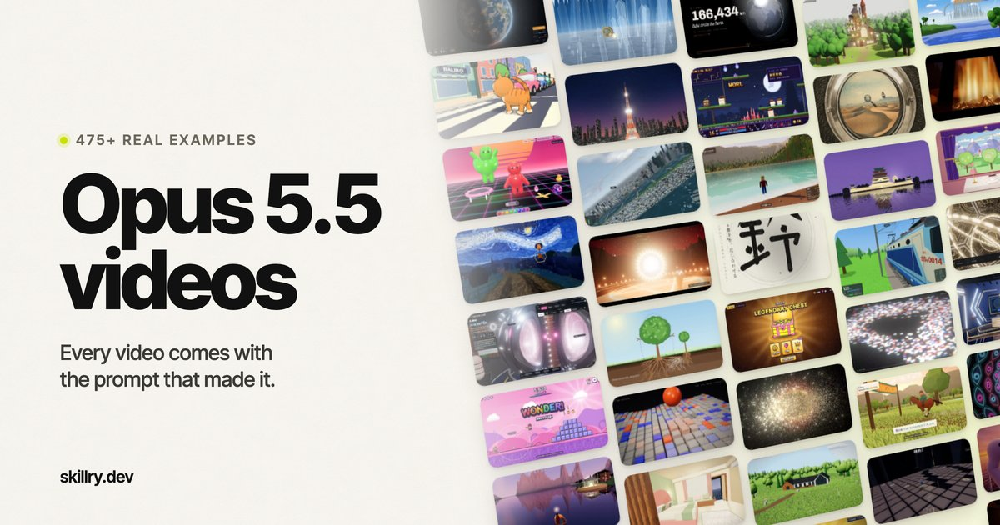

Claude Opus 5.5에게 애니메이션을 코드로 써 달라고 해서 만든 영상과 그 프롬프트를 모은 깃허브 저장소가 있다. `yihui-dev/awesome-opus5-5-videos`에는 프롬프트 703개가 올라와 있고, 그중 418편은 Skillry에서 원본과 리메이크를 나란히 볼 수 있다. 영상 편집 프로그램이 아니라 코드가 화면을 그린다.

<figure>

<figcaption>Skillry의 Opus 5.5 영상 모음 페이지 대표 이미지. (출처: skillry.dev)</figcaption>
</figure>

이 모음이 쓸모 있는 까닭은 결과와 주문서가 한 쌍으로 붙어 있다는 데 있다. 멋진 AI 영상은 넘쳐나지만 대개 무엇을 어떻게 시켰는지는 알 수 없다. 여기서는 영상을 보고 마음에 들면 그 영상을 만든 문장을 그대로 가져가 내 에이전트에 넣어 볼 수 있다. 프롬프트를 처음 써 보는 사람에게는 남이 쓴 좋은 주문서 수백 장을 한꺼번에 들여다볼 기회이기도 하다.

## 코드가 그리는 영상이란

저장소 README는 모든 영상이 HTML, Canvas, SVG, Three.js 같은 코드로 만들어졌다고 밝힌다. 동영상 파일을 생성하는 AI와는 방식이 다르다. 모델은 웹 페이지 한 장을 짜고, 브라우저가 그 페이지를 실행하면서 화면이 움직인다. 우리가 보는 영상은 그 화면을 녹화한 것이다.

이 방식에는 장점이 분명하다. 글자가 깨지지 않고, 숫자와 도형이 정확하며, 마음에 안 드는 부분은 코드의 그 줄만 고치면 된다. 반면 사람 얼굴이나 실사 풍경처럼 코드로 그리기 어려운 장면은 약하다. 그래서 모음에는 도형과 글자가 움직이는 모션 그래픽, 개념을 그림으로 풀어 주는 설명 영상, 3D 장면, 직접 조작하는 게임이 주로 모여 있다.

README의 리메이크 100편에는 각각 어떤 기술로 다시 만들었는지 꼬리표가 붙어 있다. 한 편에 여러 기술이 함께 쓰이므로 합계는 100을 넘는다.

| 기술 | 붙은 편수 | 하는 일 |
|---|---|---|
| Canvas | 72 | 브라우저 안의 도화지에 점과 선, 색을 매 순간 다시 그린다 |
| SVG | 41 | 도형과 글자를 수식으로 그려 확대해도 깨지지 않는다 |
| GSAP | 20 | 요소가 언제, 얼마나 빠르게 움직일지 시간표를 짜는 애니메이션 라이브러리다 |
| Three.js | 20 | 웹 페이지에서 3D 장면과 카메라를 다룬다 |
| GLSL | 20 | 그래픽 카드에서 직접 돌아가는 셰이더 언어로, 빛과 질감 효과를 만든다 |
| CSS | 8 | 웹 페이지의 모양과 간단한 움직임을 정한다 |
| Web Audio | 6 | 브라우저에서 소리를 만들고 재생한다 |

Canvas가 압도적으로 많은 것은 자유도 때문이다. 정해진 부품 없이 매 프레임 화면 전체를 새로 그리므로 입자, 파도, 연기처럼 형태가 계속 바뀌는 장면에 맞는다.

## 두 곳에 나뉘어 있는 자료

| 곳 | 들어 있는 것 | 쓰임 |
|---|---|---|
| 깃허브 저장소 | `prompts/` 폴더의 프롬프트 703개, 목록 파일 `data/videos.json`, README에 고른 리메이크 100편 | 프롬프트를 복사해 내 에이전트에서 실행 |
| Skillry 페이지 | 영상 418편, 원본과 실시간 리메이크 나란히 보기 | 결과를 눈으로 비교하며 고르기 |

저장소의 항목마다 만든 사람의 원 게시물 링크가 붙어 있다. 프롬프트가 공개되지 않은 영상은 프롬프트 대신 원 게시물을 싣는다. README 기준 마지막 갱신은 2026년 10월 12일이고, 그날 프롬프트 285개와 영상 10편이 추가됐다. 추가된 영상은 주로 설명 영상과 3D 장면이다.

Skillry는 AI 에이전트용 스킬을 파는 상업 사이트이고, 영상 모음 페이지 곳곳에 유료 요금제 안내가 붙어 있다. 영상을 보고 프롬프트를 복사하는 데는 돈이 들지 않는다.

## 영상의 갈래

Skillry 페이지는 418편을 네 갈래로 나눈다.

| 갈래 | 편수 |
|---|---|
| 모션 그래픽 | 229 |
| 설명 영상 | 68 |
| 3D 장면 | 56 |
| 게임·인터랙티브 | 65 |

README에 실린 100편도 같은 갈래로 묶여 있다. 모션 그래픽 58편, 설명 영상 16편, 3D 장면 14편, 게임·인터랙티브 12편이다. 어느 쪽으로 세어도 절반 넘게 모션 그래픽이다.

## 프롬프트는 생각보다 제각각이다

프롬프트 파일을 몇 개 열어 보면 길이와 방식이 전혀 다르다. 두 사례를 나란히 놓으면 차이가 잘 보인다.

| 작성자 | 프롬프트의 내용 | 리메이크 기술 |
|---|---|---|
| @moritzkremb | 사람들이 아는 SaaS 제품 하나를 골라 실제 이미지와 자료를 인터넷에서 가져오고, 트위터에서 신제품을 알릴 때 흔히 보는 전문 편집 스타일의 출시 영상으로 만들라는 긴 문단 | SVG, GSAP |
| @itsolelehmann | `4 seasons passing outside a train window, a cozy carriage, a cup of coffee on the table, Grand Budapest Hotel style` 한 줄 | Canvas |

첫 번째는 목적과 재료와 장르를 길게 설명한다. 두 번째는 장면 하나와 영화 한 편의 이름만 준다. 기차 창밖으로 사계절이 지나가는 장면에 「그랜드 부다페스트 호텔」의 색감과 구도라는 기준을 붙인 셈이다. 짧은 프롬프트가 통하는 이유가 여기에 있다. 누구나 아는 작품 이름 하나가 색, 구도, 분위기에 대한 긴 설명을 대신한다.

반대로 첫 번째 프롬프트는 에이전트가 인터넷에서 이미지를 가져올 수 있어야 그대로 실행된다. 웹 검색이 안 되는 환경이라면 그 부분은 직접 고른 이미지로 바꿔 줘야 한다. 실제 회사의 로고와 화면을 쓰는 영상이라면 공개해도 되는지도 따져 봐야 한다.

## 쓰는 법

README가 안내하는 순서는 세 단계다.

1. 프롬프트 파일을 열고 Prompt 아래의 글 상자를 복사한다.
2. Claude Opus 5.5가 돌아가는 곳에 붙여 넣는다. Claude Code, Claude 앱, 또는 Opus 5.5를 쓰는 다른 에이전트 어디든 된다.
3. 결과를 HTML 파일 하나로 만들어 달라고 하고, 영상이 필요하면 그 페이지를 화면 녹화한다.

일부 작성자는 프롬프트를 부분만 공개했거나 결과를 말로만 설명했는데, 그런 파일에는 그 사실이 적혀 있다.

## 처음 해 보면 막히는 곳

코딩을 해 본 적이 없다면 세 번째 단계에서 멈추기 쉽다. 몇 가지를 미리 알아 두면 덜 헤맨다.

- HTML 파일 하나로 받으면 실행이 쉽다. 파일을 내려받아 더블클릭하면 브라우저가 열리며 바로 움직인다. 별도 설치가 필요 없도록 "외부 파일 없이 HTML 하나로"라고 덧붙이면 좋다.
- 녹화는 운영체제 기능으로 충분하다. 윈도에서는 게임 바(Win+Alt+R)나 캡처 도구의 녹화 기능을, macOS에서는 Shift+Command+5를 쓴다. 녹화 전에 브라우저를 전체 화면(F11)으로 바꾸면 주소창이 찍히지 않는다.
- 같은 프롬프트라도 결과는 실행마다 달라진다. Skillry의 나란히 보기로 원본과 리메이크가 얼마나 다른지 먼저 확인해 두면 기대치를 잡기 쉽다.
- 한 번에 완성하려 하지 않는다. 처음 결과를 본 뒤 "제목이 너무 빨리 사라진다", "배경을 더 어둡게"처럼 눈에 보이는 것 하나씩 고쳐 달라고 하는 편이 빠르다.
- 남의 작품이다. README는 모든 영상과 프롬프트의 권리가 각 작성자에게 있다고 밝힌다. 연습과 참고는 자유롭지만, 남의 결과물을 내 작품처럼 공개하지 않는다.

## 수업 자료로 볼 때

교사에게 가장 눈여겨볼 만한 갈래는 설명 영상이다. 개념이 단계별로 움직이며 드러나는 애니메이션은 칠판 그림으로는 보여 주기 어려운 변화를 보여 준다. 마음에 드는 설명 영상의 프롬프트를 가져와 주제만 우리 수업 내용으로 바꿔 보는 것이 가장 쉬운 출발점이다. 코드로 만든 결과물이라 글자와 숫자가 정확하다는 점도 수업 자료에서는 장점이 된다. 단, 내용이 맞는지는 AI가 아니라 교사가 확인해야 한다.

## 출처

- yihui-dev, awesome-opus5-5-videos, GitHub. <https://github.com/yihui-dev/awesome-opus5-5-videos>
- Skillry, Opus 5.5 Videos: Awesome Prompts & Live Remakes. <https://skillry.dev/ai-videos/opus-5-5>
