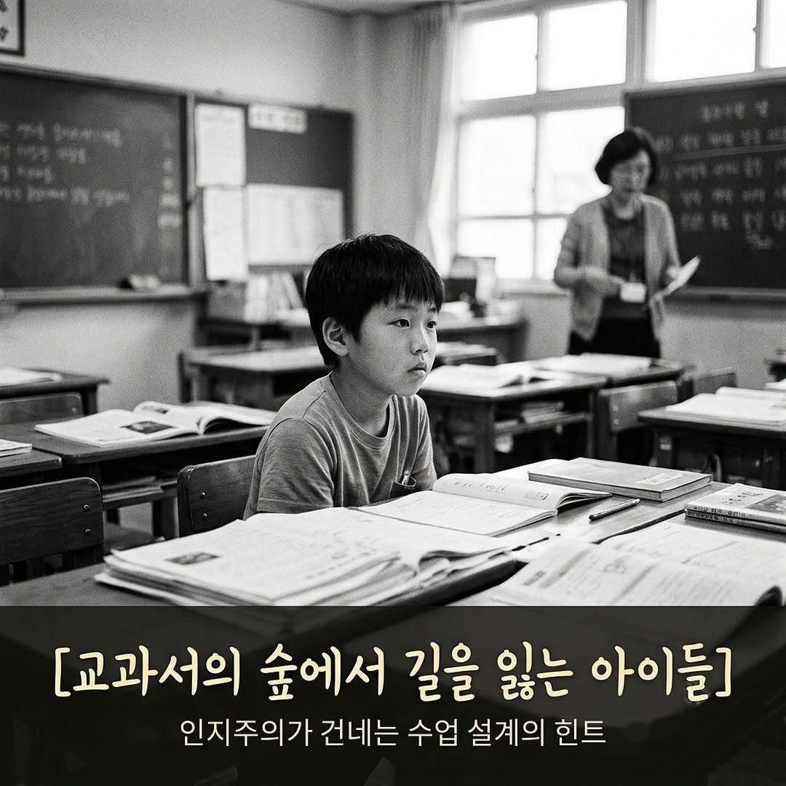

단원 도입부마다 교과서와 화면을 번갈아 보며 눈빛이 아득해지는 아이들을 가만히 들여다보곤 한다. 많은 내용들속에서 수업이 끝난 후 "오늘 뭘 배웠지?"라며 길을 잃는 아이들의 모습은 늘 깊은 고민을 던진다. 교실 속 아이들이 겪는 인지 과부하를 단지 개인의 주의력 부족이나 노력 탓으로만 돌릴 수 있을까?

<figure>

</figure>

수업 설계는 단순히 교과서 내용을 시간표에 나누어 담는 작업은 아니다. 학습자의 머릿속에 지식의 지도를 그려주는 인지 설계다. 거시적 조직 전략을 다루는 라이거루스(Reigeluth)의 정교화 이론, 미시적 실행 절차를 밝힌 가네(Gagné)의 교수조건 이론, 인지 구조의 결합을 다룬 오스벨(Ausubel)의 유의미 학습이론은 교실 속 배움을 되살릴 세 가지 강력한 힌트를 준다.

## 세 이론이 주는 힌트

첫째, 거대한 숲을 먼저 보여주지 않고 나무만 심으면 아이들은 길을 잃는다. 라이거루스는 가장 단순하고 핵심적인 뼈대인 정수(Epitome)를 먼저 보여주는 줌아웃(Zoom-out) 후 세부 내용으로 줌인(Zoom-in)할 것을 제안한다. 전체 구조를 쥔 채 세부 내용을 탐구하고, 다시 요약과 종합으로 돌아올 때 파편적 지식은 단단한 지식망이 된다.

둘째, 단 한 시간의 수업이라도 아이들의 인지 흐름에 맞춘 미시적 설계가 필요하다. 가네의 9가지 교수사태는 주의집중부터 작업기억 활성화, 피드백으로 이어지는 학습 스위치인 셈이다. 지식의 위계에 따른 정밀한 단계별 스캐폴딩 없이는 아무리 좋은 내용도 아이들의 뇌 속에 안착하지 못한다.

셋째, 새로 배우는 지식이 아이들의 기존 경험과 연결되지 않으면 헛돌고 만다. 오스벨이 말한 선행조직자는 기존 지식과 새 지식을 잇는 다리다. 수업 도입부의 정교한 질문과 비유 한 조각이 아이들의 뇌속 포섭자를 깨워 지식을 찰떡처럼 붙게 만든다.

## 2022 개정 교육과정과 맞물리는 지점

이 통찰들은 2022 개정 교육과정이 강조하는 깊이 있는 학습 및 핵심아이디어 중심 교육과정과 맞물린다. 교과를 관통하는 핵심아이디어는 라이거루스가 말하는 정수이자 오스벨의 선행조직자가 되어 지식의 융합과 삶으로의 전이를 이끈다.

## 한 차시 수업에 녹여내기

그렇다면 이 세 이론과 2022 개정 교육과정의 지향을 한 차시 수업에 어떻게 녹여낼 수 있을까?

첫째, 단원의 문을 열 때 세부 공식보다 단원 전체를 관통하는 핵심아이디어(정수) 기반 줌아웃을 먼저 제시해 머릿속 지형도를 쥐여준다.

둘째, 차시 내부에서는 가네의 교수사태를 활용해 하위 지식과 기능의 단단한 디딤돌(스캐폴딩)을 놓아주며 성공 경험을 누리게 한다.

셋째, 수업 후반부에는 역방향 줌아웃과 통합적 조정을 통해 "오늘 배운 세부 내용이 처음에 본 핵심아이디어와 어떻게 연결되는가?"를 확인하며 배움을 완성한다.

AI가 조력을 넘어 세상의 표준으로 자리 잡아가는 시대지만, 인간의 인지 구조를 외면한 교육은 아이들을 지치게 할 뿐이다. 숲의 지도를 그리고(Reigeluth), 오늘 당장의 탐험 길을 깔아주며(Gagné), 발견을 삶의 지식으로 결속시키는(Ausubel) 일 즉, 분절된 이론들을 하나의 수업으로 엮어 배움을 이끌어내는 것은 결국 교사만이 할 수 있는 아름다운 전문성이 된다. 그렇기에 수업은 과학적 예술인 동시에 예술적 과학이다.

## 참고문헌

- Reigeluth, C. M., & Stein, F. S. (1983). The Elaboration Theory of Instruction.
- Gagné, R. M., Wager, W. W., Golas, K. C., & Keller, J. M. (2005). Principles of Instructional Design.
- Ausubel, D. P. (1968). Educational Psychology: A Cognitive View.
