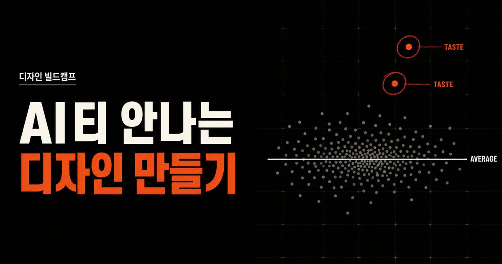

AI가 만든 웹페이지와 이미지가 서로 비슷해 보이는 까닭은 모델의 재주보다 입력에 있다. 참고할 자료도, 고를 기준도, 싫은 것의 목록도 주지 않으면 AI는 가장 흔한 답을 낸다. 디자인 빌드캠프의 온라인 강의 'AI티 안나는 디자인 만들기'는 이 문제를 "입력이 없으면 평균이 출력된다"는 한 문장으로 짚고, 취향을 전달하는 방법을 보여주기, 고르기, 만지기, 금지하기, 쌓기 다섯 가지로 묶었다. 이 글은 강의 소개 페이지가 밝힌 내용과, 그 다섯 가지를 실제 요청문과 파일로 옮기는 일반적인 방법을 나눠 정리한다.

<figure>

<figcaption>평균(AVERAGE) 선에서 벗어난 취향(TASTE)을 나타낸 강의 대표 이미지. (출처: vibecodingcamp7.com)</figcaption>
</figure>

## 왜 평균으로 모이는가

생성형 AI는 주어진 조건에서 가장 그럴듯한 다음 결과를 고르도록 만들어졌다. "학급 소개 페이지 만들어줘"처럼 조건이 거의 없으면, 그럴듯함의 기준은 AI가 학습한 수많은 페이지의 공통분모가 된다. 그래서 따로 말하지 않으면 많이 본 모양이 나온다. 흔히 AI 티가 난다고 지적받는 화면이 대개 이렇다. 가운데 정렬한 큰 제목, 보라색에서 파란색으로 번지는 그라디언트 배경, 모서리가 둥근 카드 세 장, 제목 앞의 이모지 아이콘.

이 결과는 틀린 답이 아니다. 무난하고 깔끔하다. 문제는 누가 만들어도 같아 보인다는 데 있다. 학교 행사 안내든 동아리 홍보든 개인 포트폴리오든 같은 얼굴을 하게 된다. 평균에서 벗어나려면 모델을 바꾸기보다 AI가 짐작해야 하는 빈칸을 사람이 먼저 채워야 한다.

## 강의 소개 페이지가 내린 진단

강의 페이지는 평균이 나오는 원인을 세 가지로 꼽는다.

1. 레퍼런스가 없다
2. 선택 기준이 없다
3. 싫은 것을 말한 적이 없다

페이지 첫 화면에는 이 진단을 뒤집은 예시가 실려 있다. 프롬프트는 "넓은 여백과 거친 종이 질감, 한 지점에만 쓰는 주황 포인트. 반듯하지만 너무 매끈하지 않게"이고, 결과물은 레퍼런스 세 개에서 뽑은 이 기준들을 조합한 이미지다. "멋있게"나 "세련되게" 같은 형용사가 하나도 없다는 점이 눈에 띈다. 대신 눈으로 확인할 수 있는 조건만 있다.

같은 기준은 글에도 적용된다. 페이지가 고치기 전으로 든 문장은 "좋은 디자인은 단순히 보기 좋은 것이 아니라, 브랜드의 본질을 전달하는 강력한 커뮤니케이션 도구입니다"이고, 고친 뒤는 "예쁜 화면만 만들어선 끝나지 않습니다. 브랜드가 무엇을 믿는지 한눈에 보여야 합니다"이다. 발표 자료 예시에는 48px 그리드, 7:1 대비, 강조색 하나, 글자 크기 64/20/12라는 규칙이 붙어 있다. 취향이 숫자로 적혀 있다는 점이 핵심이다.

## 다섯 가지 방법을 요청문으로 옮기면

강의 페이지는 다섯 가지 방법의 이름만 밝히고 구체적인 내용은 강의에서 다룬다. 아래는 각 이름을 일반적인 디자인 작업 방식에 비추어 풀어 본 것이다. 강의가 가르치는 내용 그대로라는 뜻은 아니다.

### 보여주기

말로 설명하기 어려운 느낌은 그림으로 보여 주는 편이 빠르다. 다만 이미지를 붙여 넣기만 하면 AI는 그 이미지를 통째로 흉내 낸다. 무엇을 가져올지 짚어 줘야 한다.

> 첨부한 세 장을 참고해 줘. 1번에서는 여백 비율만, 2번에서는 종이 질감만, 3번에서는 주황색을 한 곳에만 쓰는 방식만 가져와. 배치와 글자는 따라 하지 마.

레퍼런스 하나에 한 가지 역할을 맡기는 것이 요령이다. 강의 페이지의 첫 예시가 레퍼런스 세 개에서 기준 세 개를 뽑은 것도 같은 구조다.

### 고르기

사람은 백지에서 원하는 것을 말하기는 어려워도, 여러 개를 놓고 고르기는 쉽다. 한 번에 정답을 받으려 하지 말고 서로 다른 시안을 여러 개 받아 비교한다. 이렇게 한 요청에서 여러 갈래로 펼치는 것을 팬아웃이라고 부르며, 강의 커리큘럼도 팬아웃과 다듬기를 반복하는 흐름으로 짜여 있다.

> 같은 내용으로 첫 화면 시안 네 개를 만들어 줘. 넷은 글자체만 다르게 하고 나머지는 똑같이 둬.

바꾸는 축을 하나로 묶어야 비교가 된다. 넷이 색도 배치도 글자도 다 다르면 무엇 때문에 끌리는지 알 수 없다. 고른 뒤에는 이유를 한 줄로 적어 둔다. "2번, 글자 획이 굵어서 칠판 느낌이 난다"처럼 적은 이유가 다음 작업의 기준이 된다.

### 만지기

결과를 본 뒤 직접 손대 보는 단계다. 브라우저에서 글자 크기를 키워 보거나, 이미지 편집기에서 색을 바꿔 보거나, AI가 만든 파일의 숫자 하나를 고쳐 본다. 눈으로 확인하며 조정하다 보면 "좀 더 시원하게"라는 막연한 느낌이 "여백 24px를 40px로"라는 숫자로 바뀐다.

> 내가 제목 크기를 48에서 64로, 본문 줄 간격을 1.5에서 1.8로 직접 바꿨어. 이 비율을 나머지 섹션에도 똑같이 맞춰 줘.

직접 바꾼 값을 AI에게 알려 주면, AI는 그 값을 짐작이 아니라 기준으로 삼는다.

### 금지하기

AI는 하지 말라는 말을 듣기 전까지 기본값을 쓴다. 싫은 것을 목록으로 적는 것은 기본값을 하나씩 지우는 일이다. 강의 페이지가 세 번째 원인으로 "싫은 걸 말한 적이 없다"를 꼽은 이유가 여기에 있다.

> 다음은 쓰지 마. 보라색·파란색 그라디언트, 제목 앞 이모지, 모서리가 둥근 그림자 카드, 모든 요소 가운데 정렬, "혁신적인" 같은 홍보 문구.

금지 목록은 막연하면 안 된다. "촌스럽게 하지 마"는 아무것도 금지하지 않는다. 화면에서 손가락으로 짚을 수 있는 것만 적는다.

### 쌓기

앞의 네 가지에서 얻은 결론을 한곳에 모아 다음 작업에도 다시 쓰는 단계다. 강의는 그 결과물로 취향 파일 `TASTE.md`를 남긴다고 밝힌다. 매번 처음부터 설명하지 않고, 새 작업을 시작할 때 이 파일을 함께 건네면 된다. Claude Code처럼 작업 폴더의 파일을 읽는 도구라면 "TASTE.md를 먼저 읽고 시작해"라는 한 줄로 충분하다.

## TASTE.md는 어떻게 생겼나

강의 페이지는 `TASTE.md`의 구체적인 형식을 공개하지 않는다. 아래는 앞의 다섯 단계를 거친 사람이 만들 법한 파일을 가정한 예시다. 학급 홈페이지를 만드는 교사의 경우를 상상해 적었다.

```markdown
# TASTE.md (예시)

## 레퍼런스에서 가져온 것
- 여백: 오래된 그림책처럼 넓게. 화면 폭의 40%는 비운다
- 질감: 재생지처럼 살짝 거친 배경. 사진 위에는 쓰지 않는다
- 색: 크림색 바탕, 짙은 남색 글자, 주황은 한 화면에 한 곳만

## 숫자로 정한 것
- 글자 크기: 제목 64 / 본문 20 / 캡션 12
- 그리드: 48px 단위
- 글자와 배경 대비: 7:1 이상

## 고른 이유
- 손글씨 느낌 제목을 골랐다. 학생 작품이 주인공이라 화면이 차분해야 한다

## 쓰지 않는 것
- 보라·파랑 그라디언트, 이모지 아이콘, 둥근 그림자 카드
- 모든 요소 가운데 정렬
- "혁신", "새로운 경험" 같은 홍보 문구

## 글의 말투
- 짧은 문장. 형용사보다 사실. "즐거운 체험학습" 대신 "11월 14일, 과학관에서 별자리를 봤다"
```

파일에 들어간 것은 모두 확인할 수 있는 조건이다. AI가 이 파일을 읽고 만든 결과가 마음에 안 들면, 결과를 고치기 전에 파일의 어느 줄이 모자랐는지부터 본다. 그 줄을 고치면 다음 작업부터 같은 문제가 반복되지 않는다.

## 웹페이지 밖에서도 같다

다섯 가지 방법은 웹페이지에만 해당하지 않는다. 강의 페이지가 글과 발표 자료, 이미지에 같은 기준을 적용한 예시를 함께 실은 것도 그래서다. 교사의 일로 옮기면 이렇다.

| 만드는 것 | 평균값의 모습 | 바꾸는 한 가지 예 |
|---|---|---|
| 가정통신문 | "즐겁고 유익한 시간이 되었습니다" 같은 인사와 형용사 | 날짜, 장소, 준비물, 아이가 실제로 한 일을 먼저 쓰라고 금지 목록과 함께 요청 |
| 수업 슬라이드 | 장마다 제목, 불릿 다섯 줄, 아이콘 | 글자 크기 세 단계와 강조색 하나를 숫자로 정해 모든 장에 적용 |
| 수업용 삽화 | 매끈하고 채도가 높은 3D 캐릭터 | 학생 그림책 두 권을 레퍼런스로 주고 선의 굵기와 색 수만 가져오게 함 |

한번 만든 취향 파일은 가정통신문에도, 슬라이드에도 다시 쓸 수 있다. 같은 기준이 쌓이면 학급의 자료들이 한 사람이 만든 것처럼 보이기 시작한다.

## 막히기 쉬운 곳

레퍼런스를 너무 많이 모으면 오히려 평균으로 돌아간다. 스무 장을 한꺼번에 주면 AI는 그 스무 장의 공통분모를 낸다. 서너 장을 고르고, 장마다 가져올 것을 하나씩 정하는 편이 낫다.

형용사는 기준이 되지 못한다. "미니멀하게", "따뜻하게"는 사람마다 떠올리는 그림이 다르다. 이런 말이 떠오르면 그것이 화면에서 무엇인지 한 번 더 묻는다. 따뜻함이 크림색 바탕인지, 둥근 글자체인지, 손글씨인지에 따라 결과가 전혀 달라진다.

금지 목록만 길어지면 결과가 텅 빈다. 하지 말 것만 가득하고 할 것이 없으면 AI는 아무 장식 없는 밋밋한 화면을 낸다. 금지하기는 보여주기와 짝을 이뤄야 한다.

취향 파일은 한 번 쓰고 끝나는 문서가 아니다. 작업할 때마다 새로 고른 것과 새로 싫어진 것을 더해야 쌓기가 된다.

## 강의 정보

강의 페이지는 코딩 수업이 아니라고 여러 번 강조한다. 4강에서 터미널을 쓰지만 코드를 직접 작성하지 않고, 디자인을 넘기고 지시하는 방식으로 진행한다. 선수 지식은 필요 없고 디자인 전공자가 아니어도 된다. 강의 구성과 조건은 다음과 같다.

| 항목 | 내용 |
|---|---|
| 강사 | 원종윤 교수(동명대학교, 디자인·AI 활용 교육) |
| 구성 | 회당 15분 영상 5강, 전체 75분. 취향 모으기, 해체와 분석, 모방과 반복, 내재화와 확장, 검증하기 |
| 결과물 | 애니메이션이 들어간 인터랙티브 웹사이트 1개(온라인 배포)와 `TASTE.md` |
| 도구 | Claude 구독(Pro 이상 권장), Claude Code와 코덱스, 이미지 생성 도구(챗GPT나 제미나이), macOS나 Windows 노트북 |
| 일정 | 온라인 5강 2026년 9월 7일 개강, 오프라인 1일 캠프 9월 12일 오후 2~6시(대전역 근처) |
| 정가 | 온라인 5강 13만 원, 온라인과 오프라인 캠프 28만 원 |

개강일과 오프라인 캠프 날짜는 이미 지났다. 페이지에 따르면 목차는 콘텐츠 제작 중 일부 바뀔 수 있다.

## 출처

- 디자인 빌드캠프, AI티 안나는 디자인 만들기(강의 소개 페이지). <https://vibecodingcamp7.com/design-camp>
