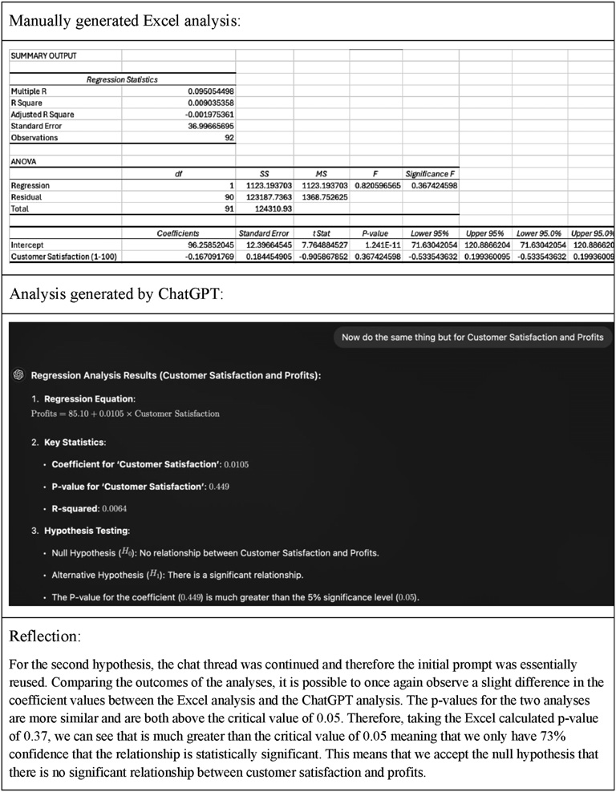
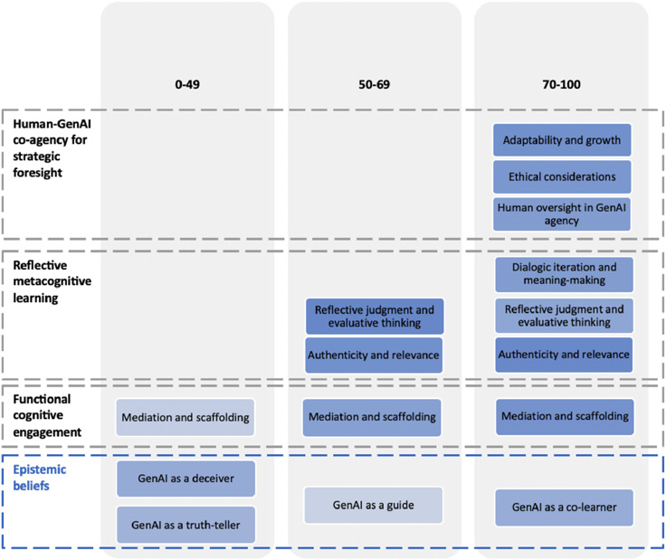
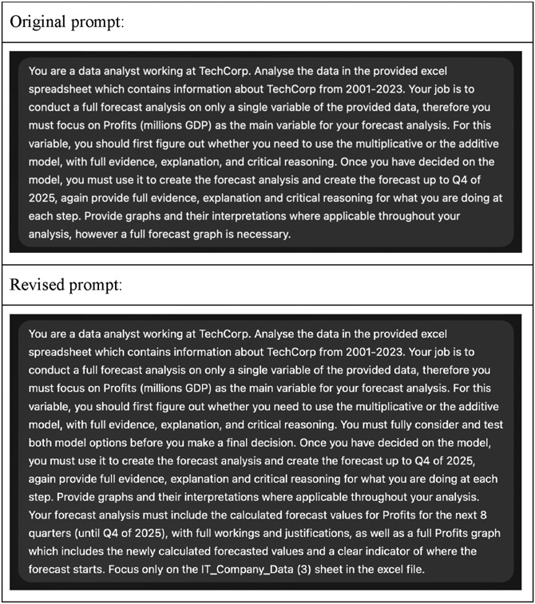

## 1. 연구의 목적

(1) 사회구성주의 이론은 지식이 유능한 동료나 교사와의 상호작용 속에서 구성된다고 보며, 그 상대는 지금까지 사람으로 전제되어 옴. 저자들은 생성형 AI가 피드백을 주고 대화를 주고받으며 성찰을 촉발하는 역할을 맡게 된 만큼, AI를 수동적 도구가 아니라 능동적인 공동 학습자로 포함하도록 이 이론을 다시 볼 필요가 있다고 주장함.

(2) 저자들이 짚은 선행 연구의 공백은 두 가지임. 기존 연구는 개념적 논의이거나 설문·면담으로 학생의 인식을 묻는 데 머물러, 실제 학습 과제 안에서 학생이 AI 사용을 어떻게 성찰하는지 직접 본 연구가 드묾. 실증 연구는 STEM 분야에 몰려 있고 경영 교육, 특히 정량 분석에 자신감이 낮은 학생이 많은 경영 데이터 분석 영역은 거의 다뤄지지 않음.

(3) 연구 질문은 두 가지임. 학생은 교과 학습에서 생성형 AI와 상호작용할 때 어떤 형태의 인지적 관여를 보이는가, 그리고 비계가 주어진 성찰적 학습 접근은 성적 집단에 따라 학생의 인지 기능 발달에 어느 정도 영향을 주는가임.

---

## 2. 연구의 방법

(1) 자료는 학부 2학년 과목 Working with Business Data의 평가 과제에서 수집함. 수강생 258명 전원이 동의해 전체가 분석에 포함됨. 대학 연구윤리위원회의 승인을 받음.

(2) 과제는 가상의 IT 기업 TechGlobal Corp.의 분기별 실적 자료로 AI 투자가 매출, 이익, 직원 만족도, 고객 만족도, 이직률에 미친 영향을 분석하는 것임. 학생은 엑셀로 예측과 가설 검정을 직접 수행한 뒤 ChatGPT나 Microsoft Copilot 같은 생성형 AI로 같은 작업을 다시 하고, 두 결과를 비교해 AI 사용 경험을 비판적으로 성찰하는 글을 씀. 모든 학생은 대학이 제공하는 웹 버전 Copilot을 무료로 쓸 수 있었음.

<figure>

<figcaption>한 학생이 엑셀로 직접 낸 회귀 분석과 ChatGPT가 낸 분석을 나란히 놓고 쓴 성찰문. 계수는 조금 다르지만 두 p값 모두 0.05보다 크다는 점을 비교함. (논문 8쪽 그림 1)</figcaption>
</figure>

(3) 성찰문을 주제 분석함. 두 저자가 각자 코딩한 뒤 결과를 비교하고 불일치를 논의해 합의함. 코드의 정의와 경계를 담은 용어집을 만들어 기준을 맞춤.

(4) 학생은 과목 전체 성적에 따라 하위(0~49점) 99명, 중위(50~69점) 94명, 상위(70~100점) 65명으로 나뉨. 이 성적은 해당 과제만이 아니라 경영 데이터 분석 전반의 능력을 반영함. 관여의 질과 깊이는 0~3점 척도(언급 없음, 표면적, 발달 중, 깊고 통합적)로 따로 코딩해 집단 평균을 비교함.

---

## 3. 주요 발견

(1) 성찰문에서 네 가지 주제가 나옴. 생성형 AI에 대한 인식론적 신념, 기능적 인지 관여, 성찰적 메타인지 학습, 전략적 예견을 위한 인간과 AI의 공동 행위주체성임. 성적대가 높을수록 언급되는 코드가 늘어남.

<figure>

<figcaption>성적대별 주제 분석 요약. 색이 진할수록 그 코드를 언급한 학생 비율이 높고, 집단 내 10% 미만이 언급한 코드는 표시하지 않음. (논문 12쪽 그림 2)</figcaption>
</figure>

(2) 인식론적 신념은 집단마다 달랐음.

| 성적대 | 주된 신념 | 비율 | 전형적 행동 |
| :--- | :--- | :--- | :--- |
| 하위(0~49점) | AI는 진실 전달자 | 45% | 출력을 거의 따져 보지 않고 받아들임 |
| 하위(0~49점) | AI는 기만자 | 51% | 오류와 불일치에 좌절하고 사용을 접음 |
| 중위(50~69점) | AI는 안내자 | 22% | 한계를 알면서 작업 구조화와 분석 추론에 활용함 |
| 상위(70~100점) | AI는 공동 학습자 | 49% | 반복해서 다듬고 자기 분석으로 보완함 |

(3) 기능적 인지 관여에 해당하는 매개와 비계 코드는 모든 집단에서 나타났고 비율은 성적대와 함께 높아짐. 하위 51%, 중위 72%, 상위 78%임. 하위 집단은 보고서 구조 잡기와 출력 해석에, 중위 집단은 자료 정리와 가설 수립 같은 절차 지원에 AI를 썼음. 상위 집단은 MAE, MAPE, RMSE 같은 오차 지표를 제안받아 방법을 다듬는 등 더 전략적으로 활용함.

(4) 성찰적 메타인지 학습은 중위와 상위 집단에서 두드러짐.

- 실제성과 관련성 코드는 중위 80%, 상위 83%에서 나타남. 상위 집단은 과제 속 기업에 머물지 않고 산업 전반의 인간과 AI 협업으로 논의를 넓힘.
- 성찰적 판단과 평가적 사고 코드는 중위 84%, 상위 69%에서 나타남. 상위 집단은 가설 검정은 엑셀과 일치하지만 예측은 다르다는 식으로 과제별 신뢰도를 구분했고, 한계가 있다는 이유로 AI를 버리지 않음.
- 대화적 반복과 의미 형성은 상위 집단의 특징임. 의미 있는 결과를 얻기까지 프롬프트를 여러 차례 고쳤다고 서술함.

<figure>

<figcaption>학생이 프롬프트를 고쳐 AI 응답을 개선한 예. 수정본에는 두 모형을 모두 검토하라는 지시와 산출물 조건이 추가됨. (논문 17쪽 그림 3)</figcaption>
</figure>

(5) 전략적 예견을 위한 공동 행위주체성은 하위와 중위 집단에서 10% 미만이었고 상위 집단에서만 뚜렷했음. 상위 집단의 74%가 AI 출력에 대한 인간의 감독을, 77%가 데이터 보호·편향·학문적 진실성 같은 윤리적 고려를, 80%가 AI의 변화에 맞춘 적응과 성장을 언급함.

(6) 관여 깊이 점수도 갈림. 상위 집단의 주제별 평균은 1.46~1.72, 하위 집단은 0.08~0.68임. 상위 집단은 대체로 2~4회 프롬프트를 고쳤다고 썼고 하위 집단 대부분은 반복을 언급하지 않음. 다만 상위 집단의 평균도 척도 최고점인 3점에 한참 못 미쳐, 저자들은 성적이 가장 좋은 학생들도 아직 높은 수준의 생성형 AI 역량에는 이르지 못했다고 해석함.

---

## 4. 결론 및 시사점

(1) 저자들은 상위 집단이 AI를 과제 완수 수단이 아니라 협력 상대로 썼고, 중위와 하위 집단은 더 표면적으로 관여하며 비판적 성찰이 제한적이었다고 결론지음. 인식론적 신념, 메타인지적 인식, 행위주체성이 관여 양상을 좌우했다고 봄.

(2) 이론 면에서는 사회구성주의의 비계, 행위주체성, 근접발달영역 개념을 인간과 AI의 상호작용까지 넓혀 해석할 수 있다고 주장함. 공동 행위주체성은 학습자의 성찰, 윤리적 판단, 전략적 활용 능력과 함께 자라는 발달적 구인이라고 봄.

(3) 저자들은 성적대 간 차이를 생성형 AI가 만드는 새로운 디지털 격차의 조기 경보로 읽음. 이 격차는 도구 접근 여부가 아니라 출력을 이해하고 평가하고 적용하는 방식의 차이에서 온다는 것임. 성적대별 지원 방안도 제시함.

| 대상 | 제안된 비계 |
| :--- | :--- |
| 하위 집단 | 프롬프트 수정 워크숍과 안내된 예시, AI 결과를 신뢰한 근거를 쓰고 반복 간 출력을 비교하게 하는 성찰 점검표 |
| 중위 집단 | 성찰 과제에 대한 맞춤 피드백, 협력적 프롬프트 설계 기회 |
| 상위 집단 | 여러 AI 도구의 비판적 평가, 동료 멘토링, AI를 통합한 사례 연구 직접 설계 |

(4) 엑셀 분석과 AI 분석을 비교해 성찰하게 한 과제 구조 자체를 다른 수업에서 재현할 수 있는 모형으로 제안함.

(5) 저자들이 밝힌 한계는 세 가지임.

- 한 대학의 학부 2학년 경영 데이터 분석 과목에서 나온 결과라 다른 학교급, 전공, 기관으로 일반화하기 어려움.
- 신념과 윤리적 추론이 시간에 따라 어떻게 발달하는지는 추적하지 않음.
- 텍스트 기반 AI에 초점을 두었고 시각화, 음성, 시뮬레이션을 포함한 멀티모달 도구는 다루지 않음.

---

## 5. 리뷰어의 ADD(+) One: 생각 더하기

(1) 눈여겨볼 대목은 하위 집단의 양극화임. 같은 성적대 안에서 45%는 AI를 그대로 믿고 51%는 믿지 않기로 했는데, 저자들은 둘을 같은 신념 유형으로 묶음. 지식을 고정된 것으로 보면 AI의 답은 맞거나 틀리거나 둘 중 하나가 되고, 한 번 묻고 끝내는 행동으로 이어진다는 해석임. AI를 과신하는 학생과 불신하는 학생에게 서로 다른 처방이 아니라 같은 처방, 곧 다시 묻고 비교하는 경험이 필요하다는 뜻이 됨.

(2) 이 결과는 자기조절학습 연구에서 반복 확인된 양상과 겹침. 점검하고 조정하는 습관이 있는 학생이 새 도구에서도 더 많은 것을 얻음. 다만 이 연구의 자료는 채점되는 과제의 일부로 쓴 성찰문이고 집단 구분은 과목 전체 성적임. 성찰문을 잘 쓰는 능력과 과목 성적이 함께 움직였을 수 있으므로, AI 활용 방식이 성적을 높였다는 인과로 읽을 수는 없음. 저자들도 관계가 시사된다는 수준으로 서술함.

(3) 수업에 옮긴다면 손으로 한 분석과 AI 분석을 나란히 놓고 차이를 설명하게 하는 과제 형식이 출발점임. 여기에 프롬프트 수정 이력을 함께 제출하게 하면 반복 여부가 드러남. 한 번 묻고 멈춘 학생에게는 무엇을 바꿔 다시 물을지 한 줄을 적게 하는 것만으로도 하위 집단에 제안된 성찰 점검표의 기능을 일부 대신할 수 있음.

---

## 6. 추가 탐구 질문

(1) AI를 기만자로 본 학생에게 프롬프트 수정 경험을 주면 인식론적 신념과 이후 사용 방식은 달라지는가?

(2) 정량적 데이터 분석이 아닌 인문학이나 예술 분야의 과제에서도 성적대에 따른 같은 관여 격차가 나타나는가?

(3) 채점되지 않는 상황에서 학생이 쓰는 성찰은 과제 성찰문에서 드러난 감독과 윤리 의식을 그대로 보여 주는가?

---

## 출처

Fang, L., & Zhou, X. (2025). From tool to co-learner: Exploring student engagement with GenAI through the lens of social constructivism. *Evaluation Review*. Advance online publication. https://doi.org/10.1177/0193841X251411618
