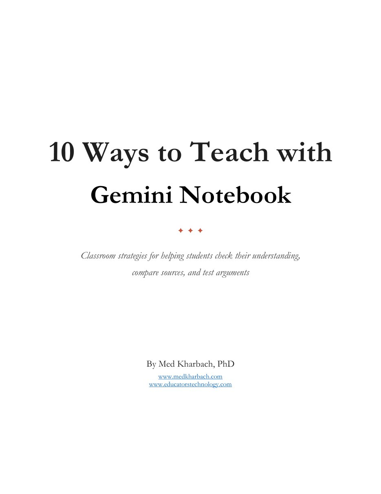

학생이 Gemini Notebook에 자기가 고른 자료를 올려 두고 이해를 스스로 점검하고, 자료를 견주고, 논증을 시험하도록 돕는 교실 전략 열 가지를 담은 안내서다. Med Kharbach의 자료를 우리말로 옮긴 글이다. 본문의 '나'는 원저자를 가리킨다.

<figure style="max-width:520px;margin-inline:auto">

<figcaption>원문 표지. (출처: Med Kharbach, Educators Technology)</figcaption>
</figure>

## 들어가며

Gemini Notebook은 지금 교사와 학생이 쓸 수 있는 AI 도구 가운데 가장 뛰어난 축에 든다고 해도 좋다. 나는 2025년 최고의 교육용 AI 도구 목록에 이 도구를 넣었고, Google이 최근 더한 기능들을 보면 ChatGPT와 Claude를 대신할 만한 선택지로 자리를 잡아 가고 있다.

Gemini Notebook의 힘은 AI가 정보를 다루는 방식에서 나온다. 사용자가 고른 자료를 올려 닫힌 컨텍스트 창을 만들고, 그 자료를 대상으로 Google의 AI 기술을 온전히 쓴다. AI가 내놓는 내용은 모두 사용자가 넣어 준 자료에 근거를 둔다.

범용 챗봇은 방대한 학습 데이터에서 답을 끌어온다. 그래서 유연하지만 그럴듯하게 들릴 뿐 정확하지 않은 정보를 만들어 내기도 쉽다. Gemini Notebook의 닫힌 컨텍스트 창은 이런 환각을 크게 줄인다.

질문을 받으면 AI는 학습 데이터의 패턴으로 짐작하지 않고 올려 둔 문서를 살핀다. 답이 사용자가 고른 자료, 가능하다면 이미 직접 읽은 자료에 묶여 있으니 더 정확하고, 질문에 더 잘 맞고, 더 믿을 만하다.

이 안내서에서는 학생과 교사가 Gemini Notebook으로 학습을 도울 수 있는 실용적인 방법 열 가지를 나눈다. 간단한 사용법 안내에서 볼 수 있는 뻔한 활용이 아니다. 자기 평가, 대화, 시각화, 그리고 본격적인 학술 과제가 요구하는 꼼꼼한 자료 작업처럼 사람이 실제로 배우는 방식에 바탕을 둔 전략이다. 절마다 구체적인 활용 사례 하나와 실천에 옮길 제안을 함께 적었다.

## 1. YouTube 영상 요약

YouTube는 오늘날 가장 풍부한 교육 콘텐츠 도서관 가운데 하나가 되었다. 다큐멘터리식 설명 영상부터 대학 강의, 전문가 인터뷰까지, 학생은 거의 모든 주제에서 수준 높은 자료를 몇 시간씩 볼 수 있다. 문제는 물론 시간이다. 45분짜리 강의에 학생에게 필요한 정보가 정확히 들어 있더라도, 그 핵심을 찾아 뽑아내는 일은 색인 없는 책에서 특정 쪽을 찾는 것처럼 느껴질 수 있다.

Gemini Notebook 같은 AI 도구가 이럴 때 쓸모 있다. 학생은 영상 내용을 넣고 주요 논점을 요약해 달라거나, 핵심 개념을 뽑아 달라거나, 다룬 내용으로 학습 질문을 만들어 달라고 요청할 수 있다. 긴 자료를 다루기 쉬운 분량으로 줄이는 힘든 일은 도구가 맡는다. 학생은 영상 속도를 따라가느라 애쓰는 대신 내용을 이해하고 적용하는 데 집중할 수 있다.

내 경험에서 나온 솔직한 말을 하나 덧붙인다. 나는 AI가 영상을 직접 보고 해석하는 것을 온전히 믿지 않는다. 시각 정보와 음성 정보를 함께 정확히 처리하는 기술은 아직 거기까지 가지 못했다. 그래서 간단한 우회로를 즐겨 쓴다.

1. YouTube 영상을 연다.
2. 플레이어 아래로 내려가 스크립트 보기를 누른다. YouTube는 대부분의 영상에 스크립트를 자동으로 만들어 준다.
3. 스크립트 전체를 한 번에 복사한다.
4. 복사한 스크립트를 Gemini Notebook에 소스 문서로 그대로 붙여 넣는다.

이렇게 하면 AI는 영상에서 실제로 나온 말을 가지고 일한다.

이 전략은 연구 프로젝트나 시험 준비처럼 학생이 여러 영상 자료를 효율적으로 소화해야 하는 상황에 특히 잘 맞는다. 여러 영상의 생각을 견주고, 공통 주제를 찾고, 다시 볼 만한 장면을 짚어 낼 수 있다. 내용의 주도권이 학생에게 넘어오는데, 이 변화만으로도 학생이 자료에 얼마나 깊이 들어가는지가 눈에 띄게 달라진다.

## 2. 형성적 자기 평가

이해 점검(comprehension monitoring)은 이름은 전문 용어 같지만, 읽기가 잘될 때 학생이 자연스럽게 하는 일을 가리키는 메타인지 전략이다. 독자가 잠깐 멈추고 "잠깐, 내가 이걸 정말 이해했나?" 하고 묻는 내면의 확인이다. Baker(1979), Maki와 McGuire(2002) 같은 연구자들이 수십 년 동안 이 과정을 연구했고, 이해에 대한 자기 평가 또는 메타이해(metacomprehension)라고 부르기도 했다. Baker(1979, 1989)는 이를 지금 진행 중인 자신의 이해 과정을 평가하고 조절하는 일이라고 설명했다. 쉽게 말해 무엇을 파악했고 무엇을 파악하지 못했는지 알고, 그에 맞춰 접근 방식을 바꾸는 능력이다.

문제는 많은 학생이 이런 자기 인식을 어려워한다는 점이다. 혼자 공부할 때 특히 그렇다. 한 장을 읽거나 강의를 보고 나서, 그 순간 말이 이해되었으니 내용도 이해했다고 여긴다. 그러나 문장 하나하나를 이해하는 것과 큰 논지를 파악하거나 그 생각을 나중에 적용하는 것은 다르다. 주기적인 점검 지점이 없으면 학생은 이해의 빈틈을 너무 늦게, 대개 시험을 치르거나 과제를 하려 할 때에야 발견한다.

Gemini Notebook은 퀴즈 기능으로 실용적인 해법을 내놓는다. 읽기 자료나 스크립트, 노트를 올린 뒤 그 내용에 바탕을 둔 퀴즈 문항을 만들 수 있다. 문제 은행에서 꺼내 온 일반적인 문항이 아니다. 학생이 배워야 하는 바로 그 자료에 직접 묶인 문항이다. 이 문항에 답하는 일은 개념이 실제로 머리에 남았는지 가리는 정직한 시험이 된다. 문제를 틀리거나 답하기 전에 망설였다면, 그 불확실한 순간이 값진 정보다. 어디로 돌아가 시간을 더 들여야 하는지 정확히 알려 준다.

이 방법이 힘을 갖는 까닭은 즉시성이다. 학생은 교사가 채점해 주거나 복습 시간이 잡히기를 기다리지 않아도 된다. 새 자료를 접한 직후, 곧 피드백이 가장 쓸모 있는 바로 그때 자기 이해를 확인할 수 있다. 퀴즈 기능은 이해 점검 과정을 사실상 자동화한다. 많은 학생이 혼자서는 끝내 기르지 못하는 능력을 체계적으로 연습할 길이 생긴다.

## 3. 대화적 추론

대화적 추론(dialogic reasoning)은 러시아 철학자 미하일 바흐친(Bakhtin, 1981)의 작업에서 나왔다. 그는 의미란 혼자서 도달하는 것이 아니라고 주장했다. 의미는 대화에서, 여러 목소리가 생각을 주고받는 가운데 생겨난다. 교실에서라면 소크라테스식 세미나나 학생들이 서로의 생각을 이어 가는 모둠 토의가 그런 모습일 것이다. 대화의 가치는 다른 관점을 듣는 데서 그치지 않는다. 그 관점들이 우리를 밀어붙여 자기 이해를 분명히 하고, 변호하고, 때로는 고치게 만든다. 대화는 생각을 밖으로 끌어내어 살피고 다듬을 수 있게 한다.

학생에게 어려운 점은 이런 풍부한 대화가 원할 때마다 열리지 않는다는 것이다. 스터디 모임은 무산되고, 면담 시간은 일정과 맞지 않고, 자정에 혼자 자료를 붙들고 있는데 이야기할 사람이 없을 때도 있다. 이럴 때 Gemini Notebook이 뜻밖에 유능한 대화 상대가 될 수 있다. 학생이 수업 자료나 수업 노트, 읽기 자료에서 밑줄 친 부분을 올려 두면, 자료에 근거해 답하는 동반자가 어느 시간에든 질문을 받아 준다.

핵심은 알맞은 질문을 던지는 것이다. 역사 단원 노트를 올린 학생이라면 이렇게 물을 수 있다.

- "이 자료들을 바탕으로 볼 때, 이 시기에 경제적 이해관계와 도덕적 주장 사이에는 어떤 긴장이 있었나요?"
- "이 글의 저자는 제 강의 노트에 나온 주장에 어떻게 답할까요?"

이런 프롬프트는 좋은 수업 토론이 만들어 내는 비교하고 분석하는 사고를 불러낸다. AI는 올려 둔 자료에서만 답을 끌어오므로 대화가 실제 수업 내용에서 벗어나지 않는다.

이 방법은 수업 토론과 글쓰기 과제를 준비하는 데도 도움이 된다. 생각을 대화 형식으로 미리 연습하다 보면 어느 생각이 탄탄하고 어느 생각을 더 발전시켜야 하는지 드러나곤 한다. 이해했다고 여긴 개념을 막상 설명하지 못한다는 것을 깨닫기도 하고, 읽기 자료들 사이에서 미처 보지 못한 연결을 우연히 발견하기도 한다. Gemini Notebook은 학생이 자기 추론을 밖으로 꺼내 놓도록 돕는 생각 동반자가 된다. 추론을 꺼내 놓는 일은 대개 자료를 정말로 자기 것으로 만드는 첫걸음이다.

## 4. 연구 공백 찾기

진짜 연구 공백을 찾는 일은 학술 작업에서 가장 어려운 부분에 속한다. 논문을 수십 편 읽고도 무엇이 아직 연구되지 않았는지, 기존 문헌이 어디서 모자란지 말로 풀어내지 못할 수 있다. Gemini Notebook이 이 과정을 도울 수 있지만 접근 방식이 중요하다. 이 도구는 사용자가 지적인 기초 작업을 이미 스스로 해 두었을 때 가장 잘 작동한다. 올리려는 논문을 실제로 읽고, 논증과 씨름하고, 그 분야에 대한 자기 나름의 이해를 세워 두었다는 뜻이다.

이것은 학문적 진실성만의 문제가 아니다. 자료를 직접 읽는 일에는 실용적인 목적이 두 가지 있다.

- 자기 분야의 학자로 성장하는 데 도움이 된다. 그 분야를 이루는 패턴과 논쟁, 방법론적 선택이 눈에 들어오기 시작한다.
- 못지않게 중요한 것으로, AI가 내놓는 결과를 평가할 배경지식이 생긴다. 논문을 읽지 않았다면 Gemini Notebook의 제안이 정말 통찰력 있는지 완전히 빗나갔는지 알 길이 없다.

AI는 그럴듯하게 들리는 생각을 지어낼 수 있고, 이를 막는 실질적인 안전장치는 자료에 대한 자신의 익숙함뿐이다.

읽기를 마쳤다면 논문 여러 편을 올리고, 자료 전체에서 아직 충분히 탐구되지 않은 영역을 찾아 달라고 Gemini Notebook에 요청할 수 있다. 도구는 다음과 같은 것을 훑어 찾아낸다.

- 잠깐 언급되었을 뿐 더 전개되지 않은 주제
- 기존 연구에 포함되지 않은 대상 집단이나 맥락
- 아직 시도되지 않은 방법론적 접근

Gemini Notebook은 올려 둔 문서에 근거해 답하므로, 제안은 그 분야의 일반 지식에서 끌려 나오지 않고 사용자의 실제 문헌 기반에 이어져 있다.

내가 쓸모 있다고 느끼는 전략이 하나 더 있다. 공백을 찾는 일을 먼저 직접 해 보는 것이다.

1. 논문을 읽으면서 무엇이 빠져 있는지, 저자들이 답하지 않은 질문이 무엇인지 직감을 적어 둔다.
2. 그 메모를 원 논문과 함께 올린다.
3. Gemini Notebook에 그 생각을 다듬고 넓히는 일을 도와 달라고 요청한다. 직접 찾은 공백을 바탕으로 연구 질문을 제안해 달라고 하거나, 자신의 생각 가운데 기존 문헌의 뒷받침이 가장 튼튼한 것이 무엇인지 짚어 달라고 할 수 있다.

이렇게 하면 지적인 운전대는 사용자가 쥐고, AI는 생각을 비춰 보는 상대 역할을 맡는다.

## 5. 오디오 요약

Gemini Notebook에서 가장 저평가된 기능 가운데 하나가 오디오 요약 도구다. 팟캐스트 기능이라고도 불린다. 수업 자료나 연구 논문, 노트를 올리면 플랫폼이 그 내용을 대화 형식의 오디오 개요로 만들어 준다. AI 목소리 둘이 핵심 생각을 이야기하고, 중요한 대목을 짚고, 놀랄 만큼 자연스럽게 자료를 훑어 나간다. 읽기보다 듣기로 더 잘 배우는 학생에게는 학술 내용을 만나는 전혀 다른 길이 열린다.

실용적인 이점은 분명하다. 학생은 통학하면서, 운동하면서, 강의실 사이를 걸으면서, 집안일을 하면서 오디오 요약을 들을 수 있다. 그냥 흘려보냈을 시간이 공부 시간이 된다. 학교까지 버스를 오래 타는 학생은 그 시간에 강의 내용을 복습하거나 다가오는 토론을 준비할 수 있다. 일과 가족 돌봄, 무거운 수강 부담을 함께 지고 있는 학생에게 이런 유연함은 특히 값지다.

이 기능을 더 실용적으로 만드는 것은 조절할 수 있는 폭이다. 학생은 일반적인 요약에 묶이지 않는다. 프롬프트를 고치거나 올릴 자료를 가려서 오디오의 초점을 이끌 수 있다. 팟캐스트가 특정 장이나 특정 개념 묶음에 집중하기를 바란다면 올리는 자료를 그에 맞게 짜면 된다. 그러면 오디오는 모든 내용을 똑같이 얕게 훑지 않고 학생이 실제로 배워야 하는 것에 맞춰진다.

자료를 다른 형식으로 듣는 일에는 인지적으로도 값진 면이 있다. 읽기는 한 갈래의 처리 경로를 깨우고 듣기는 다른 갈래를 깨운다. 글을 이미 읽은 학생도 같은 생각이 소리 내어 논의되는 것을 들으면 새로운 연결을 붙잡거나 다른 강조점을 알아챌 수 있다. 참여 방식이 바뀌었으니 오디오 요약은 반복처럼 느껴지지 않는 복습이 된다. 특히 청각형 학습자에게는 금세 흐려지는 정보와 실제로 남는 정보를 가르는 차이가 될 수 있다.

## 6. 이해를 시각화하기

복잡한 자료를 섬세하게 이해하는 가장 좋은 방법이 그것을 눈앞에 펼쳐 놓고 보는 것일 때가 있다. 경제 체제를 다룬 빽빽한 읽기 자료나 여러 개념이 얽힌 이론 틀은, 조각들이 어떻게 맞물리는지 보여 주는 도식을 만나기 전까지 학생의 머릿속에서 흐릿하게 남아 있을 수 있다. 시각적 표현은 한 줄로 이어지는 글이 흔히 하지 못하는 일을 한다. 구조와 위계, 관계를 한눈에 드러낸다. 많은 학습자에게는 그 공간적 배치가 생각이 마침내 맞아떨어지게 하는 계기다.

Gemini Notebook의 인포그래픽 기능이 이 필요에 바로 답한다. 학생이 읽기 자료든 강의 노트든 연구 논문이든 수업 자료를 올리면, 도구가 핵심 개념을 시각적으로 표현해 준다. 다음과 같은 것이 나올 수 있다.

- 과정을 보여 주는 순서도
- 생각들 사이의 관계를 그린 도식
- 복잡한 논증을 소화하기 쉬운 요소로 나눈 구조화된 개요

학생에게 디자인 기술은 필요 없다. 시각적 번역은 AI가 맡아, 글이 빽빽한 내용을 눈이 더 직관적으로 따라갈 수 있는 것으로 바꾼다.

플랫폼에는 비슷한 목적에 쓰는 슬라이드와 영상 개요 기능도 있다. 시험을 준비하는 학생은 한 단원 분량의 자료를 순차적인 시각 형식으로 추린 슬라이드 묶음을 만들 수 있다. 슬라이드 한 장 한 장이 마음속 닻이 되고, 나중에 정보를 꺼내려 할 때 떠올릴 틀이 된다. 영상 개요는 시각 요소에 내레이션을 결합해 한 겹을 더한다. 여러 경로로 동시에 자료를 강화하는 셈이다. 이런 결과물은 깊이 읽기를 대신하려는 것이 아니다. 다만 내용으로 들어가는 다른 입구를 내준다.

이 도구들이 특히 값진 까닭은 복습 과정을 받쳐 주는 방식에 있다. 학생이 원 자료를 공부한 뒤 시각 요약을 만들어 보면, 논증의 구조를 정말 이해했는지 그저 낱말을 따라갔을 뿐인지 드러날 수 있다. 인포그래픽이 자기 머릿속 모형과 맞지 않는다면 그 어긋남이 쓸모 있는 피드백이다. 이해가 어디서 온전하지 않은지 알려 준다. 시각화는 학습 보조 도구이자 이해 점검이 되어, 학생이 내용만이 아니라 자기 학습의 모양까지 보게 돕는다.

## 7. 자료 비교와 종합

학술 작업에서 가장 까다로운 능력 가운데 하나가 같은 주제를 다룬 여러 자료를 읽고 그것들이 서로 어떤 관계인지 알아내는 일이다. 저자들은 같은 의견인가? 핵심 논점에서 서로 어긋나는가? 애초에 같은 질문을 던지고 있는가, 아니면 서로 엇갈린 이야기를 하고 있는가? 이런 비교 분석은 문헌 검토, 연구 논문, 논증적 에세이에 꼭 필요하지만, 복잡한 논증 여러 개를 한꺼번에 머릿속에 붙들고 있어야 한다. 많은 학생이 이를 버거워한다. 자료가 길거나 그 분야 고유의 용어를 쓸 때는 더 그렇다.

Gemini Notebook은 이런 작업에 쓸모 있는 도구가 될 수 있다. 학생은 같은 주제를 다룬 글이나 장을 여러 편 올린 뒤, 저자들이 어디서 뜻을 같이하고 어디서 갈라지는지 찾아 달라고 요청한다. AI는 처음 읽을 때는 잘 보이지 않는 합의 지점을 드러낼 수 있다. 서로 다른 저자가 비슷한 현상을 다른 용어로 설명할 때 특히 그렇다. 모순이나 긴장도 짚어 준다. 한 자료의 결론이 다른 자료의 가정이나 연구 결과에 이의를 제기하는 대목을 부각한다.

이 기능은 문헌 검토를 쓰는 초기 단계에 특히 값지다. 학생들은 자료를 하나씩 따로 요약하는 수준에서 더 나아가지 못해 애를 먹곤 한다. "이 저자는 X라고 했고, 저 저자는 Y라고 했다"는 목록만 만들 뿐 자료들을 서로 대화하게 두지 못한다. Gemini Notebook은 종합이 실제로 어떤 모습인지 시범을 보여 그 틈을 메우는 데 도움을 준다. AI가 두 자료 사이의 긴장 지점을 짚어 내는 것을 본 학생은, 자기 글에서 해야 할 분석이 어떤 것인지 구체적인 예를 얻는다.

이 도구는 학생이 학문적 대화 안에서 자기 자리를 찾는 데도 도움이 된다. 기존 자료가 어디서 일치하고 어디서 엇갈리는지 보이면, 자기 논증이 어디에 들어갈 수 있을지 알아볼 준비가 더 잘 갖춰진다. 한 저자의 편에 서고 싶을 수도 있고, 어느 자료도 제대로 다루지 않은 질문을 발견할 수도 있다. 개별 논증을 정리하는 데만도 허덕이는 동안에는 이런 통찰에 닿기 어렵다. 대화의 지도가 또렷하면 거기에 무엇을 보태고 싶은지 가늠하기가 훨씬 쉬워진다.

## 8. 학습 가이드 만들기

일반적인 학습 가이드에는 뻔한 한계가 있다. 교과서나 교육과정이 중요하다고 여기는 것을 다룰 뿐, 특정 수업이 실제로 강조한 것을 다루지는 않는다. 가르치는 사람은 저마다 어떤 개념에 시간을 쓸지, 어떤 예시를 부각할지, 어떤 논쟁을 깊이 파고들지 선택한다. 미리 만들어진 학습 가이드에 기대는 학생은 수업에서 거의 언급되지 않은 내용을 복습하면서, 교수가 강의 세 번을 들여 풀어낸 주제는 건너뛸 수 있다. 이런 어긋남은 준비는 했는데 엉뚱한 것을 준비했다고 느끼는 답답한 시험 경험으로 이어진다.

Gemini Notebook에서는 학생이 자기 자료로 학습 가이드를 만들 수 있다.

1. 수업 노트, 강의 슬라이드, 밑줄 친 읽기 자료와 그 밖에 자기 수업에 고유한 자료를 올린다.
2. 그 내용을 바탕으로 학습 가이드를 만들어 달라고 요청한다.

결과물은 교수자가 실제로 가르친 내용에 따라 빚어진 복습 문서다. 학생 자신의 학습 경험에 등장한 개념과 예시를 중심으로 짜인다. 이렇게 개인에 맞춘 학습 가이드는 어느 추상적인 교육과정 위원회가 상상한 수업이 아니라 실제로 진행된 수업을 반영한다.

이 과정은 일반 가이드를 내려받는 것으로는 결코 얻지 못할 방식으로 학습을 다진다. 노트를 모으고 어떤 자료를 올릴지 정하는 동안 학생은 이미 일종의 복습을 하고 있다. 무엇을 다루었는지, 어느 읽기 자료가 어느 강의와 이어졌는지, 큰 주제가 어디서 떠올랐는지 생각해야 한다. 이 정리 작업 자체가 인지적 연습이다. Gemini Notebook이 학습 가이드를 만들어 낼 즈음이면 학생은 인터넷에서 요약본을 그냥 가져왔을 때보다 이미 훨씬 능동적으로 자료와 씨름한 상태다.

학생은 필요에 따라 결과물을 맞춤 조정할 수도 있다.

- 특정 단원이 시험에 많이 나올 것을 안다면, 그 부분의 자료를 더 많이 올리고 더 자세한 정리를 요청한다.
- 어려워하는 개념이 있다면, 그 영역에 초점을 둔 설명이나 추가 연습 문항을 요청한다.

학습 가이드는 학생의 실제 빈틈에 반응하는 살아 있는 문서가 된다. 이렇게 겨냥한 복습은 이미 완벽하게 이해한 내용을 몇 쪽씩 헤치고 가는 것보다 훨씬 효율적이다.

## 9. 글쓰기 피드백과 논증 점검

학술적 글쓰기에서 가장 까다로운 부분 가운데 하나는 자기 논증이 실제로 앞뒤가 맞는지 아는 일이다. 학생은 초고에 자신감을 느끼다가, 핵심 주장이 증거로 뒷받침되지 않는다거나 자료를 잘못 읽었다거나 글의 두 부분이 서로 모순되어 보인다는 지적을 받고서야 문제를 안다. 이런 문제는 혼자서 잡아내기 어렵다. 자기가 무슨 말을 하려 했는지 이미 알고 있기 때문이다. 뇌가 빈틈을 채우고 어긋난 곳을 매끄럽게 덮는다. 바깥의 피드백이 꼭 필요하지만 동료가 늘 곁에 있는 것은 아니고, 교수자의 피드백은 대개 마감이 지난 뒤에 도착한다.

Gemini Notebook이 쓸 만한 우회로가 된다. 학생은 초고를 근거로 삼은 자료와 함께 올린 뒤, 자기 논증이 자료 내용을 정확히 나타내는지 평가해 달라고 요청할 수 있다. AI는 다음을 확인할 수 있다.

- 인용한 대목이 학생의 주장을 실제로 뒷받침하는지
- 바꿔 쓴 문장이 원저자의 뜻을 담고 있는지
- 학생이 자료의 입장을 과장하거나 잘못 규정하지 않았는지

이런 자료 대조는 손으로 하기에는 지루하지만, 많은 학생 글이 어긋나는 곳이 바로 여기다.

정확성에서 더 나아가 추론의 논리를 시험하는 데도 이 도구를 쓸 수 있다. 논증의 빈틈, 충분한 뒷받침 없이 건너뛴 곳, 증거가 논제와 제대로 이어지지 않는 대목을 찾아 달라고 Gemini Notebook에 요청하면 된다. AI는 독자가 어디서 반론을 제기할지, 어느 반대 논증을 다루지 않았는지 짚어 줄 수 있다. 이 피드백은 학생에게 아직 고칠 시간이 있을 때, 곧 가장 값진 바로 그때 도착한다. 셋째 문단에 논리의 빈틈이 있다는 사실은 화요일 밤에는 쓸모 있는 정보지만, 2주 뒤 채점되어 돌아온 글에서는 쓸모가 덜하다.

이 과정은 학생이 엄밀한 논증이 어떤 모습인지 더 또렷하게 감각하도록 돕는다. Gemini Notebook이 약점을 짚으면 학생은 그것을 어떻게 고칠지 스스로 찾아야 한다. 증거를 더 찾아야 할 수도 있고, 주장에 단서를 달아야 할 수도 있고, 한 부분을 통째로 다시 짜야 할 수도 있다. 이 고쳐 쓰기 작업이 앞으로의 글쓰기에 옮겨 갈 능력을 기른다. 시간이 지나면 학생은 AI가 던진 질문을 내면화하고, 초고를 쓰면서 그 질문을 스스로 던지기 시작한다. 이 도구는 일종의 훈련장 구실을 한다. 꼼꼼한 독자가 무엇을 알아채는지 보여 주어, 학생이 자기 글의 가장 좋은 편집자가 되도록 돕는다.

## 10. 토론과 발표 준비

세미나에 들어서거나 발표하러 일어서는 일은 긴장될 수 있다. 어려운 질문을 받을지 모른다는 것을 알 때는 더 그렇다. 불안은 준비가 모자라서가 아니라 다른 사람이 무엇을 물을지 모른다는 데서 오는 경우가 많다. 학생은 몇 시간씩 노트를 복습하고도, 교수가 생각해 보지 못한 지점을 파고들거나 급우가 당연하게 여긴 가정에 이의를 제기하면 허를 찔린 기분이 든다. 문제는 자료를 아느냐가 아니다. 다른 사람이 그 자료에 어떻게 접근할지 예상하느냐다.

Gemini Notebook은 학생이 이런 순간을 미리 연습하도록 도울 수 있다. 발표 슬라이드나 토론 노트, 세미나에 배정된 읽기 자료를 올린 뒤, 그 내용을 바탕으로 까다로운 질문을 만들어 달라고 요청한다. AI는 올려 둔 자료에서 사려 깊은 교수나 열심히 참여하는 급우가 던질 법한 질문을 뽑아낸다. 이 연습은 긴장을 가라앉힐 뿐 아니라, 학생이 지나쳤을지 모르는 각도에서 자료를 끝까지 생각해 보도록 밀어붙인다.

이 연습은 교실에서 드러나는 일종의 지적 자신감도 길러 준다. 어려운 질문과 이미 씨름해 본 학생은 아무도 어려운 것을 묻지 않기를 바라는 학생과 몸가짐이 다르다. 그 까다로운 질문을 어떤 형태로든 이미 들어 보았고, 답을 세워 보았고, 그 과정에서 생각을 다듬었다. 실제 순간이 오면 답을 찾아 허둥대지 않는다. 내용을 외우는 데서 그치지 않고 자기 생각을 정말로 혹독하게 시험해 본 준비에 기댄다.

## 맺으며

학생과 함께 써 보라고 강력히 권할 도구를 하나만 꼽으라면 Gemini Notebook이다. 이 플랫폼은 진정한 학습과 참평가를 받쳐 주는 기능을 한데 모았다. 학생은 내용을 요약하고 소화하며, 자기 이해를 시험하고, 자료와 대화하고, 복잡한 생각을 시각화하고, 정말 중요한 학술 과제를 준비할 수 있다. 이 모든 일이 AI가 학생이 고른 자료를 가지고 일하는, 근거가 있는 환경 안에서 이루어진다. 그래서 알고리즘이 내놓는 것을 무턱대고 믿는 대신 검증하고 비판적으로 따져 보는 습관이 길러진다.

이 안내서의 전략은 출발점이지 빠짐없는 목록이 아니다. 교사와 학생이 Gemini Notebook을 탐색하기 시작하면, 어떤 안내서도 예상하지 못한 방식으로 저마다의 맥락에 들어맞는 활용법을 발견하게 될 것이다. 핵심은 의도를 가지고 도구에 다가가는 것이다. 실제로 공부한 자료를 올리고, 생각을 밀어붙이는 질문을 던지고, AI를 생각 동반자로 대한다.

## 참고문헌

- Baker, L. (1979). Comprehension monitoring: Identifying and coping with text confusions. *Journal of Reading Behavior, 11*(4), 365–374.
- Baker, L. (1989). Metacognition, comprehension monitoring, and the adult reader. *Educational Psychology Review, 1*(1), 3–38.
- Bakhtin, M. M. (1981). *The dialogic imagination*. University of Texas Press.
- Maki, R. H., & McGuire, M. J. (2002). Metacognition for text: Findings and implications for education. In T. Perfect & B. L. Schwartz (Eds.), *Applied metacognition* (pp. 39–67). Cambridge University Press.

## 출처

- Kharbach, M. (2026). *10 ways to teach with Gemini Notebook*. Educators Technology. [www.educatorstechnology.com](https://www.educatorstechnology.com) · [www.medkharbach.com](https://www.medkharbach.com)
- 라이선스: Copyright © 2026 Med Kharbach, PhD. Some rights reserved. 원문은 [CC BY-NC-SA 4.0](https://creativecommons.org/licenses/by-nc-sa/4.0/)으로 배포되며, 이 번역문에도 같은 라이선스가 적용된다. 비영리 목적으로만 쓸 수 있다.
- 변경 표시: 원문 전체를 우리말로 옮기며 문장을 다듬었다. 본문에 풀어 쓴 절차와 나열 일부를 목록으로 정리했고, 화면 갈무리 그림과 저자의 책 소개, 다른 안내서 목록은 싣지 않았다.
