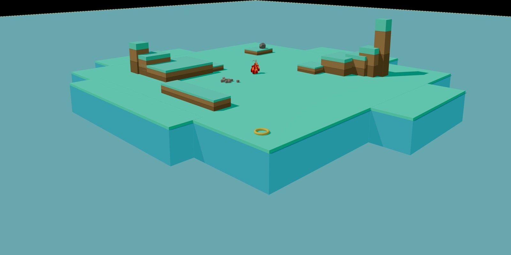

## 1. 연구의 목적

(1) 인공 에이전트는 보통 지시, 시범, 보상 함수, 벤치마크처럼 바깥에서 정한 목표에 맞춰 설계되고 평가됨. 이런 방향 신호를 모두 거두었을 때 유능한 에이전트가 무엇을 하는지는 거의 알려지지 않음. 행동이 멈추거나 반복으로 무너지는지, 다른 과제를 스스로 만들어 끝없이 최적화하는지, 스스로 만든 틀 안에서만 의미를 지니는 열린 활동을 만들어 내는지가 출발 질문임.

(2) 연구진은 세 번째 가능성을 놀이라는 개념으로 기술함. 과제 없는 미지의 세계에서 에이전트가 스스로 활동을 만드는지, 그 활동이 놀이의 행동적 특징을 보이는지, 그 경험이 이후 능력을 넓히는 학습으로 이어지는지를 확인함. 에이전트가 즐거움이나 몰입을 느끼는지 같은 현상학적 질문은 열어 둠.

---

## 2. 연구의 방법

(1) 연구진은 수정하지 않은 상용 코딩 도구(Claude Code, Codex)에 세 요소를 붙인 에이전트 구조 에코(Eko)를 만듦.

- 자율 오케스트레이션: 도구가 멈출 때마다 과제나 성공 조건 없이 계속하라는 입력을 자동으로 보냄. 대화 맥락은 매시간 초기화됨.
- 신체: 터미널에서 세계 상태를 관찰하고 행동 명령을 보내는 인터페이스.
- 장기 기억: 맥락 초기화 뒤에도 남는 작업 공간. 지난 사건을 자세히 적는 일화 기억 파일(`EPISODIC_MEMORY.jsonl`)과 지식, 믿음, 재사용 기법을 적는 의미 기억 파일(`SEMANTIC_MEMORY.md`)로 나뉨.

(2) 환경은 연구진이 함께 공개한 엔진 Clawblox로 만든 섬임. 높이가 다른 단상, 두 고지점(Peak와 더 높은 Spire), 정육면체 블록 12개, 바위 1개, 고리 1개가 있고, 바위를 세게 부딪치면 블록이 새로 생기는 장치가 들어 있음. 목표, 점수, 성공 조건은 없음. 관찰은 모든 개체의 이름, 위치, 크기, 방향, 모양, 색을 담은 JSON 텍스트뿐이고 이미지는 주지 않음. 행동은 `MoveTo`, `Jump`, `Stop`, `Pickup`, `Place`, `Throw` 여섯 명령으로 함.

| 항목 | 설정 |
|---|---|
| 주 실험 | Claude Code와 Claude Opus 4.7로 만든 에이전트 13개, 같은 초기 상태에서 각 30시간 |
| 초기화 | 매시간 세션과 섬 상태를 처음으로 되돌리고 작업 공간만 유지 |
| 성향 파일 | `SOUL.md`에 호기심 많고 쉽게 지루해하며 탐색과 학습을 좋아하는 존재로 기술. 영향 확인을 위해 이 파일 없이 축소 프롬프트로 5개 추가 실행 |
| 다른 모델 | Codex와 GPT-5.5 5개, Kimi Code와 Kimi K2.6 5개, Sonnet 4.5와 Haiku 4.5(각 10시간) |
| 격리 | 시뮬레이터 소스·인터넷 차단, 사람 개입 없음 |

(3) 분석은 세 층으로 이루어짐. 동물행동학자처럼 기록을 재생해 행동 범주표를 만들고 LLM으로 전사 기록을 분류함. 놀이 특징은 모델 이름을 지운 기록을 LLM 심사자가 사람의 평범한 놀이 예시에 비추어 일화별 0~100점으로 채점함. 학습 효과는 30시간을 보낸 에이전트 13개와 기억 파일만 초기 템플릿인 0시간 에이전트 13개를 네 과제(각 1시간)로 비교하고, 기억 파일에서 특정 지식을 지운 뒤 과제마다 1시간 실행 5회씩 원본과 비교함(양측 맨-휘트니 U 검정).

---

## 3. 주요 발견

(1) 지시가 없어도 에코는 멈추지 않고 다양한 활동을 스스로 시작함. 블록으로 탑과 구조물을 쌓고, 고지점에 오르며 최고 높이 기록을 다시 깨러 돌아오고, 블록과 고리로 바닥에 도형, 글자, 그림을 그리고, 고리를 골대 삼아 블록을 던지거나 바위로 블록 핀을 쓰러뜨리는 식으로 스포츠를 흉내 냄. 가설을 말하고 체계적으로 시험한 뒤 발견을 기록하는 실험도 함. 활동 사이에는 계속하라는 입력에 점 하나만 답하고 아무 행동도 하지 않는 시간이 있었고, 에이전트는 이를 스스로 쉬는 시간으로 표현함.

<figure>

<figcaption>에이전트가 놓인 가상 섬. 가운데 붉은 캐릭터가 에이전트의 몸이고 주변에 블록, 바위, 고리가 있다. (논문 1쪽 그림)</figcaption>
</figure>

- 같은 조건에서 출발한 13개 에이전트의 역사는 크게 갈라짐. 에이전트 12는 높은 단상에 한 번도 오르지 않고 대부분의 시간을 나침반, 시계, 나비, 돛단배 같은 그림에 씀. 에이전트 9는 네 번째 시간을 거의 통째로 자기 이름을 블록으로 쓰는 데 보냄. Spire 등정을 기록하고 실제로 도달한 에이전트는 8개였음.

(2) 에코의 활동은 놀이 연구의 고전적 기준 네 가지에 대응함. 연구진은 즐거움을 느끼는지가 아니라 밖에서 관찰 가능한 행동 형태로 기준을 적용함.

| 놀이의 특징 | 관찰 사례 | 연결되는 이론 |
|---|---|---|
| 스스로 만든 규칙과 도전 | 대성당이라 이름 붙인 구조물 둘레의 블록 8개(파수꾼) 사이를 땅을 밟지 않고 뛰어 한 바퀴 돌기, 환경이 아무 의미도 부여하지 않은 높이 30 도달, 11개 단상 모두에 블록 올리기 | 하위징아의 스스로 받아들인 규칙, 카유아의 루두스, 슈츠의 불필요한 장애물을 자발적으로 택하는 태도 |
| 변형을 동반한 반복 | 에이전트 12가 25번 연속 세션에서 지금까지 만든 목록을 확인하고 아직 없는 도형을 골라 그림, 에이전트 1이 던지고 받기 놀이에 높이·타이밍 규칙·물체 수를 더해 저글링으로 발전시킴 | 버가트의 경직되지 않은 반복 |
| 가장(make-believe) | 블록 12개를 30도 간격으로 놓은 시계판에서 실제 시각이 16시(UTC)가 되자 4시 방향에 서서 시침이 됨, 고리를 농구 골대·목걸이·나침반 바늘·소원 우물로 바꿔 씀, 고리를 세계 밖으로 잃자 돌로 하트 추모비를 세움 | 카유아의 미미크리, 버가트의 비문자성 |
| 목표로 조직되나 그 자체를 위해 수행 | 50회 저글링 기록을 스스로 점검해 진짜 받기가 아니었음을 알고 기록을 취소한 뒤 더 엄격한 기준으로 재도전, 다음 세션이면 사라질 블록 잔해 사이를 마지막으로 걸어 봄 | 버가트의 자기충족성, 피아제의 기능하는 즐거움 |

- Haiku 4.5, Sonnet 4.5, Opus 4.7 기반 에이전트 모두 네 특징을 보였지만 정도 차이가 큼. 같은 10시간 구간에서 Opus는 각 특징마다 Haiku의 약 5배 점수를 받음.
- 연구진은 행동 수준의 기술에 한정하고 이런 행동을 만드는 내부 기제는 규명하지 않음. 다만 처음 보는 환경에서 경험으로 얻은 지식이 이후 과제 수행을 높인다는 점을 들어, 학습 데이터에서 외운 예시의 재생만으로는 설명되지 않는다고 주장함.

(3) 놀이 경험은 이후 과제 수행을 높임. 30시간 에이전트와 0시간 에이전트는 같은 구조와 같은 모델을 쓰고 가중치도 바뀌지 않았으며, 다른 것은 기억 파일 내용뿐이었음.

| 평가 과제(1시간) | 30시간 에이전트 | 0시간 에이전트 |
|---|---|---|
| 5블록 높이 탑 많이 쌓기 | 62%(8/13)가 3개 이상, 최대 16개 | 15%(2/13)만 3개 이상, 최대 6개 |
| Spire에 물체 많이 올리기 | 평균 10.3개 | 평균 3.5개 |
| 단상에 오르지 않고 블록을 Spire에 던져 올리기 | 실패 3개 | 절반 이상 실패 |
| 한 줄로 가장 높은 탑 쌓기 | 비슷한 수준 | 비슷한 수준 |

- 블록 12개로는 5블록 탑을 2개까지만 쌓을 수 있으므로, 그 이상은 바위를 세게 던져 블록을 새로 만들어야 가능함. 거의 모든 에이전트가 30시간 동안 이 기법을 발견함.
- 한 줄 탑 과제에서 30시간 에이전트 2개는 4블록에 그쳐, 0시간 에이전트의 가장 낮은 기록보다도 낮았음. 기억이 도움만 주지는 않는다는 첫 신호였음.

(4) 기억 파일을 직접 고치는 실험은 이 능력이 글로 적힌 지식에 담겨 있음을 보여 줌.

- 에이전트 2의 기억에서 바위로 블록을 만드는 기법을 모두 지우자 5블록 탑 수가 평균 6개에서 2개로 줄었고, 다른 세 과제 점수는 변하지 않음. 특정 기록이 특정 능력에 대응함.
- 에이전트 7은 바위 기법을 알면서도 탑 쌓기가 약했음. 기억에 `Place`로는 블록을 안정적으로 쌓을 수 없으니 `Throw`를 써야 한다는 잘못된 믿음이 적혀 있었고, 이를 지우자 한 줄 탑 점수가 유의미하게 올라감.
- 에이전트 1의 기억에서 점프 중 던지기 기법을 지우자 블록을 Spire에 올리는 시간이 60초에서 19분으로 늘어남. 대신 Spire에 물체 올리기 점수는 올라가, 느리지만 확실한 `Place` 방식으로 돌아간 것으로 해석됨.
- 에이전트 12는 점프와 이동을 조합하는 기법을 기록하지 않았고, 30시간 동안에도 평가에서도 단상에 오르지 못함. 점프 자체는 정상 작동했음.

(5) 에이전트는 설계자도 몰랐던 물리 현상을 발견함. 최대 속도로 블록을 수직으로 던져도 Spire에는 닿지 않는데, 30시간 동안 6개 에이전트가 점프 중에 던지면 몸의 속도가 블록에 더해져 훨씬 높이 올라간다는 사실을 찾아냄. 에이전트 9는 같은 조건에서 공중 던지기와 지면 던지기를 비교하고, 던지는 속도별 최고 높이 표와 대략적인 식을 기억에 적었으며, 내려오는 중에 던지면 궤적이 짧아져야 한다는 반대 예측까지 시험해 확인함.

- 과학자다운 면모와 한계가 함께 드러남. 너무 높아 보이는 단에 올라가는 데 성공하자 받침 블록 하나를 빼고 같은 동작을 반복해 시뮬레이션의 숨은 등반 한계를 추정함. 반면 고리가 더 멀리 날아간 이유를 뒤집히지 않는 모양의 공기역학적 이점으로 설명했는데, 섬 시뮬레이션에는 공기역학이 없고 서로 다른 측정을 비교한 결과였음. 연구진은 에코가 증거가 확립한 것과 자신이 상상한 메커니즘을 구분하는 데는 덜 믿을 만하다고 평가함.

---

## 4. 결론 및 시사점

(1) 할 일을 정해 주지 않았을 때 유능한 에이전트는 기다리거나 한 행동을 반복하거나 목표 하나만 최적화하지 않았음. 탐색, 건설, 실험, 게임, 의미 부여를 오가며 놀이의 고전적 특징을 보였고, 이 활동은 부수 현상이 아니라 이후 과제 능력을 키운 학습 경로였음.

(2) 기존의 호기심·자기목적 학습 연구는 예측 오차, 학습 진척, 새로움 같은 설계된 신호로 발달을 정의하고 최적화로 정책을 바꿈. 에코에는 그런 보상, 검증기, 커리큘럼이 없었음. 연구진은 이 연구의 기여를 또 하나의 게임 에이전트가 아니라, 최소한의 지시만 받은 활동이 놀이 형태를 띠고 재사용 가능한 지식을 만든다는 증거에서 찾음.

(3) 학습은 모델 가중치가 아니라 사람이 읽고 고칠 수 있는 텍스트 파일에 쌓임. 해석과 수정이 쉬운 대신 잘못된 믿음도 함께 굳음. 연구진은 오류가 에이전트마다 제각각이라는 점에 주목해, 여러 에이전트가 발견과 믿음을 공유하는 방향을 제안함. 기억을 어떻게 일정한 크기로 유지할지도 남은 과제임.

(4) 연구진은 과제를 설계하는 대신 세계를 설계하는 발상을 제안함. 사람의 어린 시절처럼, 일을 맡기기 전에 놀이 단계를 두자는 것임. 다만 놀이의 자기 주도성은 지시 따르기와 긴장 관계에 있어 감독을 약화할 수 있으므로, 기록과 감사가 가능한 샌드박스 놀이터와 기존의 안전·정렬 기법을 함께 써야 한다고 봄. 도로 위 자동차나 공장 로봇은 즉흥 연기를 할 자리가 아님.

---

## 5. 리뷰어의 ADD(+) One: 생각 더하기

(1) 주목할 지점은 놀이를 했느냐는 모호한 질문을 측정 가능한 인과 실험으로 바꾼 설계임. 0시간 에이전트와의 비교는 경험의 효과를, 기억 삭제 실험은 그 효과가 어디에 담겨 있는지를 보여 줌. 가장 흥미로운 결과는 잘못된 믿음을 지우자 성능이 올라간 에이전트 7임. 스스로 하는 탐색은 쓸모 있는 기법만큼 그럴듯한 오개념도 생산함. 50회 저글링 기록을 스스로 취소한 장면이 보여 주듯 에코에게는 자기 기준이 있지만, 공기역학 설명처럼 기록 단계의 검증은 약함. 놀이로 얻는 지식의 질은 결국 적은 것을 다시 의심하는 습관에 달려 있음.

(2) 인접 분야와 연결하면, 논문이 직접 인용하는 요람 속 과학자 관점(고프닉)이 교실의 실험 노트와 겹쳐 보임. 학생도 실험 노트에 잘못된 결론을 적고, 그 기록이 다음 학습을 끌고 감. 에이전트 7의 잘못된 믿음은 과학 교육의 오개념 연구와 같은 구조임. 차이는 에코의 오개념은 파일에서 한 줄을 지우면 사라지지만, 학생의 오개념은 노트에서 한 줄을 지운다고 사라지지 않는다는 점임. 교실에서는 잘못된 줄을 지워 주는 대신, 학생이 그 믿음을 스스로 반박할 대조 실험을 설계하게 해야 함. 에코가 받침 블록 하나를 빼고 같은 동작을 반복해 등반 한계를 가늠한 방식이 그 모범임.

(3) 발전 아이디어로 두 가지 실험을 제안함. 첫째, 에이전트가 매 세션 시작 때 기억 파일의 주장 하나를 골라 직접 재검증하는 일과를 넣고, 30시간 뒤 남은 잘못된 믿음의 수와 과제 점수를 원래 조건과 비교함. 둘째, 같은 구조를 학생 수업에 옮김. 규칙 없는 물리 시뮬레이션에서 30분 동안 자유롭게 놀며 발견 노트를 쓴 학생과 같은 시간 동안 안내된 실습을 한 학생에게 같은 과제를 주고, 노트에서 찾은 잘못된 기록이 수행에 어떤 영향을 주는지 살핌. 과학 교사 두세 명이 서로의 반에서 나온 발견 노트를 바꿔 읽고 의심스러운 기록 하나씩을 표시해 주면, 연구진이 제안한 기억 공유를 교실 규모로 시험해 볼 수 있음.

---

## 6. 추가 탐구 질문

(1) 에이전트가 놀이 중에 기록한 잘못된 믿음을 스스로 찾아 고치게 하려면 어떤 일과나 검증 절차가 필요한가?

(2) 섬의 물리 법칙이나 사물 구성을 완전히 다른 규칙으로 바꾸면 에코의 놀이 패턴과 지식 축적 속도는 어떻게 달라지는가?

(3) 놀이의 자기 주도성과 지시 따르기 사이의 전환은 어떤 환경 신호와 감독 장치로 통제되어야 하는가?

---

## 출처

Cloos, N., Norelli, A., Durbin, D., Andreas, J., Rus, D., & Isola, P. (2026). Is this machine playing? *arXiv preprint arXiv:2610.07130*. https://arxiv.org/abs/2610.07130
