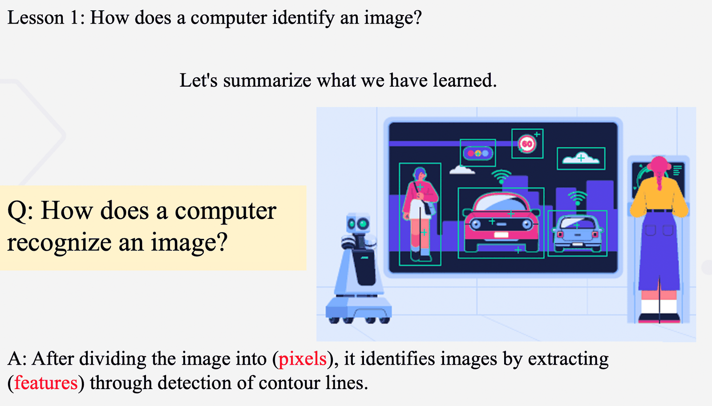
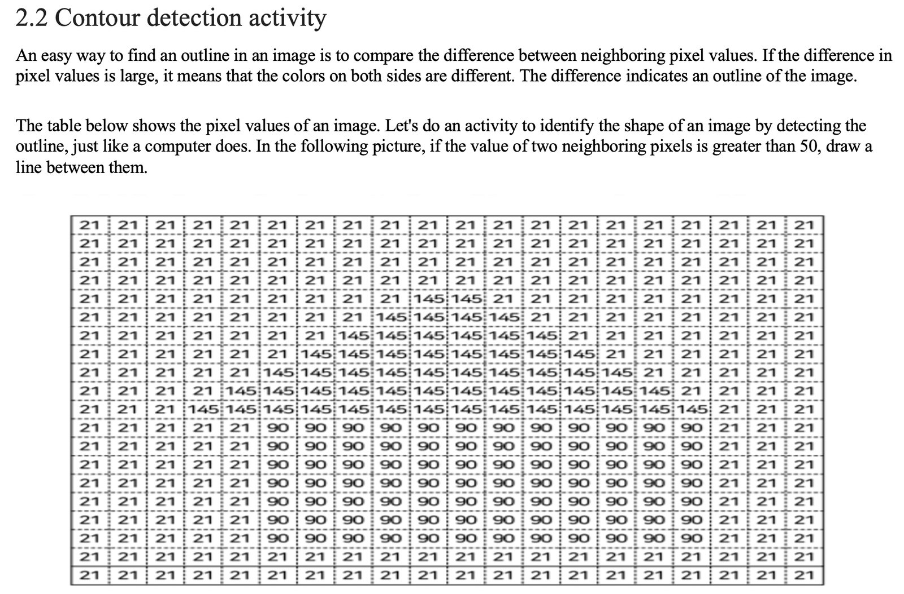
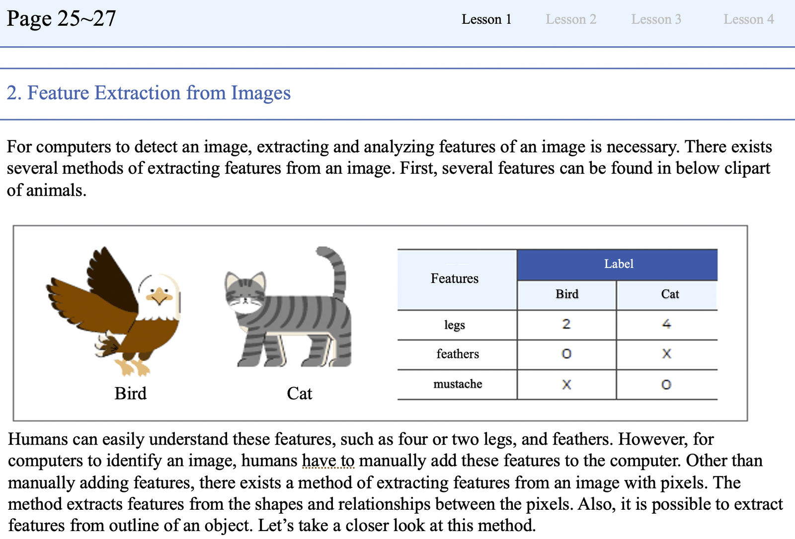

## 1. 연구의 목적

(1) 인공지능 교육은 주로 대학에서 이루어지며, 대학 교육과정은 학계와 산업계의 전문가를 기르는 데 목적이 있음. 저자들은 이 교육과정을 초등학교에 그대로 적용하는 것은 초등교육의 목적에 맞지 않는다고 봄. 초등학교 인공지능 교육은 학생의 AI 리터러시를 기르는 데 중심을 두어야 한다는 것이 출발점임.

(2) 이 연구는 인공지능에 대해 왜, 무엇을 가르칠 것인가라는 질문에 답하고자 초등학생용 교육과정을 제안함. AI 리터러시를 AI 지식, AI 기술, AI 태도 세 역량으로 정의하고, 그에 맞춘 8개 모듈과 수업 자료를 설계한 뒤 첫 모듈을 학교에 적용해 봄.

---

## 2. 연구의 방법

(1) 교육과정 내용은 주요 인공지능 교재 10권과 컴퓨터과학 교육과정 지침인 CS2013을 조사해 구성함. CS2013의 지능형 시스템 영역 주제를 AI 지식 역량의 다섯 하위 범주에 대응시키고, 교재 10권의 공통 개념이 이 범주에 들어맞는지 확인함. 바라는 학습 결과를 먼저 정하고 학습 활동과 교수 전략을 설계하는 백워드 설계를 따름. 지식의 범위는 AI4K12 지침의 3~5학년군에 맞춤.

(2) 첫 모듈인 인공지능 소개를 한국의 초등학교 5곳에서 5학년 4개 반, 6학년 4개 반에 주 1시간씩 4주간 적용함. 참가 학생은 60명(5학년 25명, 6학년 35명)임. 수업 전후에 세 역량에 관한 일곱 문항을 5점 리커트 척도로 묻고, 인공지능과 알고리즘을 구별하는 여섯 문제를 풀게 한 뒤 유의수준 0.05에서 t-검정으로 비교함. 비교 집단은 없으며 나머지 일곱 모듈은 적용하지 않음.

---

## 3. 주요 발견

(1) 저자들은 AI 리터러시를 세 역량과 아홉 하위 범주로 정의함. 세 역량 사이에 우선순위를 두지 않으며, 셋을 고르게 길러야 AI 리터러시에 이른다고 봄.

| 역량 | 하위 범주 | 내용 |
|------|----------|------|
| AI 지식 | 정의와 유형, 문제 해결과 탐색, 추론, 데이터와 기계학습, 응용 | AI 기반 시스템과 알고리즘 기반 시스템의 차이, 탐색 알고리즘, 데이터에서 패턴을 찾는 기계학습, 컴퓨터 비전·음성 인식·기계 번역 같은 응용 분야 |
| AI 기술 | AI 도구 사용, 컴퓨팅 사고와 프로그래밍 | 문제 해결에 맞는 AI 도구를 쓰고, 간단한 AI 응용 프로그램을 직접 만듦 |
| AI 태도 | 사회적 영향, AI와의 협업 | AI가 사회에 미치는 긍정적·부정적 영향을 함께 인식하고 사용을 비판적으로 바라봄 |

(2) 교육과정은 8개 모듈이며 모듈마다 4차시로 구성됨. 5~6학년에 가장 적합하고, 선수 조건은 블록 코딩으로 명령을 순서대로 구성할 수 있는 정도임. 모듈의 주제는 달라도 차시 흐름은 같음. 1차시에는 일상에서 만나는 AI 기술을 체험하고, 2~3차시에는 블록 기반 플랫폼인 엔트리로 프로그래밍 활동을 하며, 4차시에는 복습과 함께 AI의 사회적 영향을 또래와 토의함.

| 모듈 | 주제 | 프로그래밍 활동 | 4차시 토의·활동 |
|------|------|----------------|----------------|
| 1 | 인공지능 소개 | 스마트 스피커 | AI의 일상 활용과 사회적 영향 |
| 2 | 전통적 접근(탐색과 추론) | 동물 분류기 | 의료 분야의 AI, AI의 긍정적 영향 |
| 3 | 얼굴 검출 | 얼굴 필터 앱 | 얼굴 인식이 사회에 미치는 영향 |
| 4 | 음성 인식 | 스마트 홈 시스템 | 음성 인식이 사회에 미치는 영향 |
| 5 | 기계 번역 | 음성 번역기 | 음성 번역기와 음성 합성의 활용 |
| 6 | 이미지 분류 | 이미지 분류기 | 이미지 분류의 활용 |
| 7 | 텍스트 분류 | 악성 댓글 차단기 | 학습 데이터의 중요성과 편향 |
| 8 | 자율주행차 | 자율주행 로봇 | 자율주행차가 사회에 미치는 영향 |

(3) 교육과정과 함께 강의 슬라이드, 학생 워크북, 교사용 지도서를 묶은 수업 자료를 개발해 온라인에 공개함. 워크북은 차시별 네 부분으로 나뉘어 1차시는 언플러그드 활동, 2~3차시는 프로그래밍 단계별 안내, 4차시는 AI 태도 역량을 다룸. 교사용 지도서는 AI 개념에 익숙하지 않은 교사의 부담을 덜기 위한 보충 설명을 담음.

<figure>

<figcaption>얼굴 검출 모듈 1차시 강의 슬라이드의 정리 화면. 이미지를 픽셀로 나눈 뒤 윤곽선을 찾아 특징을 뽑는다는 내용을 빈칸 채우기로 확인한다. (논문 Figure 3의 강의 슬라이드 부분)</figcaption>
</figure>

<figure>

<figcaption>학생 워크북의 윤곽선 찾기 활동. 이웃한 픽셀 값의 차이가 50보다 큰 곳에 선을 그으면 집 모양이 드러난다. 컴퓨터 없이 하는 언플러그드 활동이다. (논문 Figure 3의 학생 워크북 부분)</figcaption>
</figure>

<figure>

<figcaption>교사용 지도서의 특징 추출 설명. 새와 고양이를 다리 수, 깃털, 수염으로 구별하는 예를 들어 사람이 특징을 직접 넣어 주는 방식과 픽셀에서 특징을 뽑는 방식을 대비한다. (논문 Figure 3의 교사용 지도서 부분)</figcaption>
</figure>

(4) 첫 모듈을 적용한 사전·사후 설문에서 일곱 문항 가운데 다섯 문항이 유의하게 상승함.

| 역량 | 문항 | t | p | 결과 |
|------|------|-----|------|------|
| AI 지식 | AI의 정의를 안다 | 3.490 | .001 | 유의한 상승 (평균 3.07에서 3.52) |
| AI 기술 | AI 기반 앱을 쓸 수 있다 | 3.782 | <.001 | 유의한 상승 |
| AI 기술 | 실생활 문제에 AI로 접근할 수 있다 | 2.151 | .036 | 유의한 상승 |
| AI 기술 | 블록 코딩으로 AI 프로그램을 만들 수 있다 | 2.272 | .027 | 유의한 상승 |
| AI 태도 | AI는 사회에 긍정적 영향을 준다 | 2.500 | .015 | 유의한 상승 |
| AI 태도 | AI는 내 생활에 도움이 된다 | -0.331 | .742 | 차이 없음 |
| AI 태도 | AI는 내 공부에 도움이 된다 | -0.142 | .888 | 차이 없음 |

(5) 인공지능과 알고리즘을 구별하는 여섯 문제의 정답 수는 사전 평균 3.23에서 사후 4.42로 올랐음(t=10.998, p<0.01). 설문 문항보다 변화 폭이 큼.

(6) 생활과 공부에 도움이 된다는 두 문항은 사전 평균이 각각 4.33, 4.17로 이미 높았음. 저자들은 학생 다수가 수업 전부터 AI에 긍정적 태도를 갖고 있었던 것으로 추정함.

---

## 4. 결론 및 시사점

(1) 저자들은 초등학교 인공지능 교육과정의 주된 목표를 AI 리터러시로 세우자고 제안하며, 그 구성 요소를 AI 지식, AI 기술, AI 태도로 정의함. 첫 모듈 적용 결과를 근거로 이 교육과정이 학생의 AI 리터러시를 높였다고 결론지음.

(2) 수업 전략으로는 특정 개념이나 도구를 강조하기보다 프로젝트 기반 학습과 문제 해결로 접근할 것, 개념 강의보다 언플러그드 활동으로 일상의 AI 도구 활용 능력을 기를 것, 학생의 이해 수준과 교실 환경에 맞는 도구와 플랫폼을 고를 것을 제안함. 이는 효과가 검증된 결과가 아니라 교육과정에 딸린 권고임.

(3) 평가는 또래 상호작용, 발표, 토의의 전 과정을 대상으로 하고, 프로그래밍 활동은 결과물과 함께 문제 해결 과정 전체를 보도록 제안함. 점검표를 만들어 자기 평가와 동료 평가에 쓸 수 있다고 봄.

(4) 저자들은 후속 과제로 모든 모듈의 타당성을 평가하고, 이 교육과정을 K-12 전체로 넓히는 일을 듦.

---

## 5. 리뷰어의 ADD(+) One: 생각 더하기

(1) 이 연구의 강점은 대학 교육과정을 줄여 쓰지 않고, 초등교육의 목적에서 출발해 무엇을 가르칠지 다시 정했다는 데 있음. 모든 모듈의 4차시를 사회적 영향 토의에 배정해 태도 역량을 지식, 기술과 같은 무게로 다룬 설계가 눈에 띔. 얼굴 인식 기술을 감시에 쓰는 것에 찬성하는지 근거를 들어 쓰고 반론까지 예상해 보게 하는 워크북 활동이 그 예임.

(2) 효과 검증은 근거가 얇음. 8개 모듈 가운데 첫 모듈만, 비교 집단 없이 60명에게 4주간 적용했고, 설문 문항은 학생이 스스로 안다고, 할 수 있다고 느끼는 정도를 물은 것임. 수업 직후의 자신감 상승과 실제 역량 향상은 구별해야 함. 실제 수행을 잰 것은 AI와 알고리즘 구별 문제뿐인데, 여기서 변화가 가장 컸다는 점은 의미가 있음. 논문 본문의 AI 정의 문항 서술에는 사후 평균이 3.52와 4.42 두 값으로 적혀 있어, 이 글에서는 그림의 검정 통계와 맞는 3.52를 따름.

(3) 2021년 논문이라는 점을 감안해 읽어야 함. 다루는 AI는 스마트 스피커, 얼굴 필터, 번역기, 이미지 분류처럼 정해진 기능을 수행하는 응용이며, 대화형 생성 AI가 교실에 들어오기 전의 설계임. 지식, 기술, 태도의 세 축과 체험, 제작, 토의로 이어지는 차시 구조는 지금도 쓸 수 있는 뼈대임. 다만 AI와의 협업 범주에 생성물 검증이나 과제에서의 AI 사용 기준 같은 내용을 채우는 일은 이 논문 바깥의 과제로 남음.

---

## 6. 추가 탐구 질문

(1) 학생이 스스로 응답한 자신감이 아니라 실제 수행 과제로 측정하면, 세 역량 가운데 어느 것이 4주 수업으로 길러지고 어느 것이 그렇지 않은가?

(2) 수업 전부터 AI에 긍정적인 학생들에게 사회적 영향 토의는 부정적 측면에 대한 인식을 얼마나 바꾸는가?

(3) 대화형 생성 AI가 보편화된 지금, 인공지능과 알고리즘을 구별하게 하는 첫 모듈의 학습 목표는 무엇으로 바뀌어야 하는가?

---

## 출처

Kim, S., Jang, Y., Kim, W., Choi, S., Jung, H., Kim, S., & Kim, H. (2021). Why and what to teach: AI curriculum for elementary school. *Proceedings of the AAAI Conference on Artificial Intelligence, 35*(17), 15569–15576. https://doi.org/10.1609/aaai.v35i17.17833
