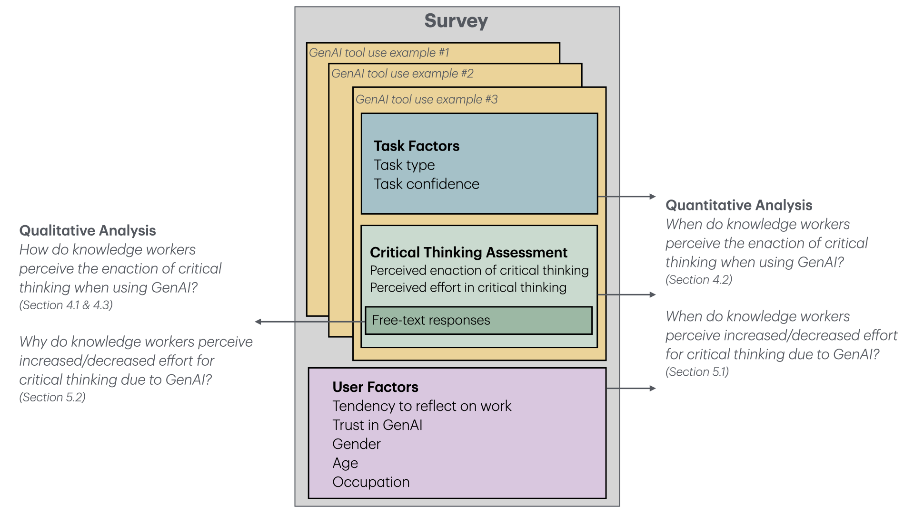
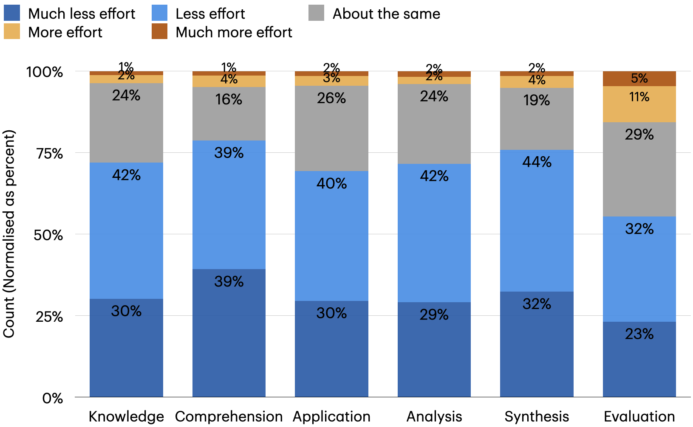

## 1. 연구의 목적

(1) 생성형 AI가 사고 기술에 미치는 영향을 다룬 연구는 기술 함양에 대한 걱정이 큰 교육 장면에 몰려 있음. 여러 직종의 지식 노동에서 어떤 활동이 비판적 사고를 요구하는지, AI를 쓰면서 그것이 어떻게 달라지는지에 관한 폭넓은 실증 자료는 부족함. 선행 논의는 AI를 쓴 사람들의 산출물이 서로 비슷해진다는 관찰을 비판적 사고 저하의 근거로 삼았으나, 저자들은 산출물 다양성이 결함 있는 대리 지표라고 봄. AI 출력을 고치지 않고 쓴 사람도 고치지 않기로 판단하는 과정에서 성찰을 했을 수 있기 때문임.

(2) 연구 질문은 두 가지임. 지식 노동자는 생성형 AI를 쓸 때 언제, 어떻게 비판적 사고를 수행했다고 인식하는가. 그리고 생성형 AI 때문에 비판적 사고의 노력이 늘거나 줄었다고 느끼는 때와 이유는 무엇인가. 순수한 정신 현상인 비판적 사고 자체는 스스로 관찰해 보고하기 어렵다는 이유로, 연구진은 겉으로 드러나는 수행을 응답자가 어떻게 인식하는지에 초점을 맞춤.

---

## 2. 연구의 방법

(1) 프롤리픽(Prolific)에서 생성형 AI를 주 1회 이상 업무에 쓴다고 밝힌 지식 노동자를 모집해 온라인 설문을 실시함. 응답 333건 가운데 서술이 부실한 14건을 빼고 319명을 분석함. 참가자는 창작, 정보, 조언 세 과업 유형에서 실제 사용 사례를 하나씩, 모두 세 건을 적어 냈고, 내용이 모호하거나 중복된 21건을 뺀 936건이 분석 대상이 됨(창작 374건, 정보 303건, 조언 259건).

(2) 사례마다 비판적 사고를 수행했는지 예/아니오로 답하고 이유를 자유롭게 서술함. 블룸의 분류에 따른 여섯 가지 인지 활동(지식, 이해, 적용, 분석, 종합, 평가) 각각에 대해 AI를 쓸 때의 노력이 쓰지 않을 때보다 얼마나 달라졌는지를 5점 척도로 응답함. 과업 단위로는 자기 능력에 대한 확신, AI 능력에 대한 확신, AI 출력을 평가할 자신감을 재고, 개인 단위로는 업무를 성찰하는 성향과 생성형 AI 전반에 대한 신뢰, 성별, 연령, 직업을 조사함.

(3) 정량 분석에는 참가자를 무선 절편으로 둔 로지스틱 회귀 모형 1개(비판적 사고 수행 여부)와 선형 회귀 모형 6개(인지 활동별 노력)를 쓰고, 다중 비교는 벤저미니-호크버그 절차로 보정함. 자유 서술은 연구자들이 개방 코딩으로 분석함.

<figure>

<figcaption>설문 구성과 분석 방식. 사용 사례마다 과업 요인과 비판적 사고 문항을 묻고, 사용자 요인은 한 번 조사했다. 자유 서술은 정성 분석에, 나머지는 정량 분석에 쓰였다. (논문 Figure 1)</figcaption>
</figure>

---

## 3. 주요 발견

(1) 참가자들은 936건 가운데 555건(59.29%)에서 비판적 사고를 수행했다고 보고함. 이들이 비판적 사고라고 부른 활동은 AI 사용 흐름의 세 지점에 걸쳐 있음.

- 목표와 질의 만들기: 무엇을 얻으려는지 먼저 정하고 프롬프트를 고쳐 씀
- 응답 점검하기: 요구 사항을 충족하는지, 코드가 오류 없이 도는지 같은 기준으로 확인하고(319명 중 125명이 언급), 공식 문서나 웹 검색, 자기 전문 지식과 대조해 검증함(114명)
- 응답 통합하기: 쓸 부분만 골라 넣고, 어조와 문체를 자기 글에 맞게 고침

(2) 비판적 사고 수행 보고를 가른 것은 과업 유형이 아니라 확신이었음. 창작, 정보, 조언 사이에는 유의한 차이가 없었음.

| 예측 변인 | 비판적 사고 수행 보고와의 관계 | 계수 |
|-----------|------------------------------|------|
| 해당 과업에서 AI 능력에 대한 확신 | 높을수록 수행 보고가 줄어듦 | β=-0.69, p<0.001 |
| 해당 과업에서 자기 능력에 대한 확신 | 높을수록 수행 보고가 늘어남 | β=0.26, p=0.026 |
| AI 출력을 평가할 자신감 | 높을수록 수행 보고가 늘어남 | β=0.31, p=0.046 |
| 업무를 성찰하는 평소 성향 | 높을수록 수행 보고가 늘어남 | β=0.52, p<0.001 |
| 생성형 AI 전반에 대한 신뢰 | 유의한 관계 없음 | - |

(3) 대부분의 사례에서 참가자들은 AI를 쓸 때 인지 활동의 노력이 줄었다고 느낌. 노력이 줄었다는 응답 비율은 지식 72%, 이해 79%, 적용 69%, 분석 72%, 종합 76%, 평가 55%였음. 평가 활동만은 노력이 늘었다는 응답이 16%로 다른 활동보다 눈에 띄게 많았음.

<figure>

<figcaption>생성형 AI를 쓸 때 여섯 인지 활동에서 체감한 노력의 분포. 파란색이 노력이 줄었다는 응답, 주황색이 늘었다는 응답이다. 막대의 수치는 반올림 값이라 본문 수치와 1%p 안팎 차이가 난다. (논문 Figure 2)</figcaption>
</figure>

(4) 확신은 노력 체감과도 관련됨. AI 능력을 확신할수록 적용을 뺀 다섯 활동에서 노력이 더 줄었다고 느꼈고, 생성형 AI 전반을 신뢰할수록 지식, 적용, 분석, 평가에서 노력이 줄었다고 느낌. 반대로 자기 능력을 확신하는 사람은 적용(β=0.08)과 평가(β=0.10)에 노력이 더 든다고 답함. 저자들은 두 결과를 이렇게 묶음. AI를 확신하는 사람은 비판적 사고를 덜 하면서 그것이 덜 힘들다고 느끼고, 자신을 확신하는 사람은 더 힘들다고 느끼면서도 비판적 사고를 더 함.

(5) 자유 서술을 분석한 결과, 비판적 사고에 들이는 노력의 성격이 세 방향으로 옮겨 감.

| 인지 활동 | 줄어든 노력 | 새로 늘어난 노력 |
|-----------|-------------|------------------|
| 지식, 이해 | 정보를 찾고 모으고 정리하기 | AI가 내놓은 정보가 맞는지 검증하기 |
| 적용 | 문제를 직접 풀기 | AI 응답을 자기 과업과 맥락에 맞게 통합하기 |
| 분석, 종합, 평가 | 과업을 직접 실행하기 | 의도를 질의로 옮기고, 응답을 조정하고, 품질과 책임을 지는 과업 관리(스튜어드십) |

(6) 비판적 사고를 하게 만든 동기는 작업 품질을 높이려는 것, 부정적 결과를 피하려는 것, 자기 기술을 키우려는 것이었음. 가로막은 요인은 세 갈래로 정리됨.

- 인식의 장벽: AI를 신뢰하고 의존해서(83명), 과업이 사소하다고 여겨서(55명) 비판적 사고가 필요하다는 생각 자체를 하지 않음
- 동기의 장벽: 시간이 없거나(44명), 검증이 자기 업무가 아니라고 여김(11명)
- 능력의 장벽: 해당 분야 지식이 부족해 응답을 점검하지 못하거나(58명), 문제를 알아도 질의를 고쳐 응답을 개선하지 못함(72명)

---

## 4. 결론 및 시사점

(1) 생성형 AI는 업무 효율을 높이지만 일에 대한 비판적 관여를 억제할 수 있고, 장기적으로 도구 과의존과 독립적 문제 해결 능력의 약화로 이어질 가능성이 있다는 것이 저자들의 결론임. 저위험 과업에서 판단을 연습할 기회가 사라지면 고위험 상황에서 쓸 능력도 무뎌질 수 있다는 자동화의 역설을 근거로 든 우려이며, 이 연구가 능력 저하를 직접 측정한 것은 아님.

(2) 도구 설계의 과제는 인식, 동기, 능력의 장벽을 낮추는 것임. 저자들은 비판적 사고가 빠지기 쉬운 상황에서 도구가 먼저 알려 주는 방식과 사용자가 필요할 때 요청하는 방식을 함께 제안함. AI 출력의 신뢰도를 가늠하게 돕는 피드백, AI의 추론 설명, 다듬을 부분 제안도 설계 방향으로 듦. 비판적 사고 지원을 건별 감사 작업이 아니라 장기적인 기술 개발의 일부로 제시해야 한다고 봄.

(3) 지식 노동자 훈련은 정보 검증, 응답 통합, 과업 관리 기술에 초점을 두되, 정보 수집과 문제 해결 같은 기초 기술을 유지하는 일도 함께 다뤄야 과의존을 피할 수 있다고 제안함.

(4) 저자들이 밝힌 한계는 다음과 같음.

- 모든 수치는 자기 보고임. 참가자들이 AI 사용의 수고가 줄어든 것과 비판적 사고의 노력이 줄어든 것을 혼동한 경우가 있었고, 특히 AI 응답에 만족했을 때 그러했음
- 분석은 상관관계이며 인과를 확립하지 않음
- 주관적 자기 확신은 실제 전문성과 일치하지 않을 수 있음
- 설문은 영어로만 진행되어 비영어권과 다국어 맥락을 대표하지 못함
- 표본이 젊고 기술에 익숙하며 AI를 주 1회 이상 쓰는 사람에게 치우쳐 있음(25~34세가 44.83%)
- 생성형 AI 도구가 계속 바뀌고 있어 종단 연구가 필요함

---

## 5. 리뷰어의 ADD(+) One: 생각 더하기

(1) 이 논문에서 주목할 지점은 측정 대상을 정직하게 좁혔다는 데 있음. 제목부터 자기 보고된 인지적 노력의 감소라고 밝히고, 비판적 사고 능력이 아니라 수행에 대한 인식을 쟀다고 본문에서 거듭 밝힘. 이 논문을 AI가 비판적 사고를 떨어뜨린다는 증거로 인용하는 것은 원문의 주장 범위를 벗어남. 논문이 보여 준 것은 AI를 확신하는 사람일수록 비판적 사고를 했다고 보고하는 일이 적다는 상관관계와, 사고의 노력이 실행에서 감독으로 옮겨 간다는 응답자들의 서술임.

(2) 자기 확신이 비판적 사고와 함께 간다는 결과는 전문성 연구와 맞닿음. AI 출력을 검증하려면 무엇이 틀렸는지 알아볼 지식이 먼저 있어야 하고, 능력의 장벽으로 분류된 응답이 바로 그 지점을 가리킴. 학교에 옮겨 보면 해당 영역의 지식이 얕은 학습자일수록 AI 출력을 그대로 받아들일 조건에 놓인다는 뜻이 됨. 다만 이 연구의 대상은 성인 직장인이고 학습자에게 같은 관계가 성립하는지는 다루지 않음.

(3) 수업이나 연수에 적용한다면 저자들이 든 세 장벽을 점검표로 쓸 수 있음. 학생이 검증을 건너뛰는 이유가 필요를 느끼지 못해서인지, 시간이 없어서인지, 검증할 방법을 몰라서인지에 따라 처방이 달라짐. 필요를 못 느끼는 학생에게는 AI가 틀린 사례를 직접 찾게 하는 과제가, 방법을 모르는 학생에게는 공식 자료와 대조하는 절차를 가르치는 일이 맞음. 논문이 인용한 인지적 강제 장치, 곧 AI 출력을 받기 전에 기다리게 하거나 직접 고치게 하는 설계도 과제 구조에 넣어 볼 만함.

---

## 6. 추가 탐구 질문

(1) 자기 확신이 높을수록 비판적 사고를 더 한다면, 초보자와 숙련자 사이에서 AI 사용이 만드는 격차는 시간이 갈수록 어떻게 달라지는가?

(2) 자기 보고가 아니라 소리 내어 생각하기나 과제 기반 평가로 측정해도 AI에 대한 확신과 비판적 사고 사이의 음의 관계가 그대로 나타나는가?

(3) 영어를 쓰는 젊은 사용자 중심의 이 결과는 비영어권 사용자나 AI를 가끔만 쓰는 고연령 직장인에게서 어떤 다른 양상으로 나타나는가?

---

## 출처

Lee, H.-P., Sarkar, A., Tankelevitch, L., Drosos, I., Rintel, S., Banks, R., & Wilson, N. (2025). The impact of generative AI on critical thinking: Self-reported reductions in cognitive effort and confidence effects from a survey of knowledge workers. In *Proceedings of the 2025 CHI Conference on Human Factors in Computing Systems* (pp. 1–22). ACM. https://doi.org/10.1145/3706598.3713778
