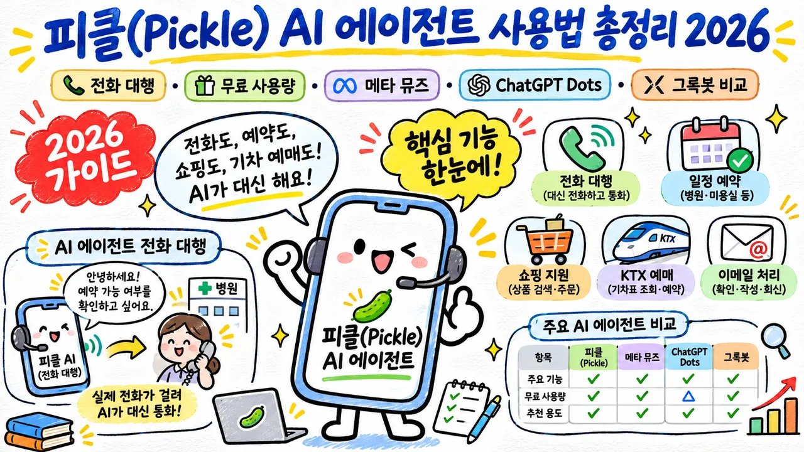

피클(Pickle)은 사용자를 대신해 전화, 예약, 주문, 결제, 일정 조율을 처리하는 AI 에이전트다. 한국인 창업자들이 미국 실리콘밸리에 세운 Pickle, Inc.가 만들었고, 초기에는 AI 아바타 기술로 알려졌다. 웹사이트 조작과 예약은 다른 에이전트도 지원하지만, 피클은 실제 전화번호로 발신해 상대방과 음성으로 대화하는 기능을 국내 생활 서비스 연동과 함께 기본으로 내세운다. 틸노트의 정리 글과 Jay Choi(인디해커 라이프)의 사용 가이드 영상을 바탕으로 전화 대행의 작동 방식, 앱 안의 조작 흐름, 요금, 경쟁 서비스와의 차이, 주의점을 정리한다.

<figure>

<figcaption>피클의 핵심 기능과 비교 대상을 그림으로 정리한 원문 대표 이미지. (출처: 틸노트)</figcaption>
</figure>

## 컴퓨터 앞의 동료가 아니라 휴대폰 속 비서

브라우저를 쓰고 Gmail이나 Notion 같은 앱을 연결하는 것은 요즘 에이전트라면 대부분 갖춘 기능이다. 피클이 다른 점은 방향이다. 처음부터 모바일 앱으로 나왔고, 맡기는 일도 회사 업무보다 쇼핑·예약·민원 같은 일상 업무가 중심이다.

| 구분 | 다른 AI 에이전트 | 피클 |
|------|------------------|------|
| 주 사용 환경 | 컴퓨터 | 휴대폰(모바일 앱) |
| 맡기는 일 | 대부분 업무용 | 쇼핑, 예약, 민원 같은 일상 업무 |
| 비유 | 일을 돕는 동료 | 일을 돕는 비서 |

만든 팀이 YC(와이 컴비네이터) 출신의 한국인 팀이라 네이버, 쿠팡, 정부24처럼 한국에서 매일 쓰는 서비스가 기본으로 들어 있다. Jay Choi의 영상에 따르면 팀의 목표는 부모님도 그냥 집어서 쓸 수 있는 에이전트이고, 복잡한 설정 없이 말 한마디로 일을 맡기는 데 집중한다.

## 핵심 기능

| 기능 | 내용 |
|---|---|
| AI 전화 대행 | 고객센터, 식당, 업체 등에 대신 전화를 걸어 문의 |
| 예약 및 예매 | 식당·병원·숙소 예약, KTX 열차표 예매 |
| 쇼핑 자동화 | 상품 검색, 최저가와 쿠폰 비교, 주문, 반품 처리 |
| 일정 관리 | 연결된 캘린더 확인과 일정 조율 |
| 이메일 관리 | 수신함 확인, 분류, 후속 작업 |
| 친구와 일정 조율 | 사용자별 피클 에이전트끼리 대화해 약속 시간과 장소 조정 |
| 개인화 기억 | 이전 대화와 사용 습관을 바탕으로 한 장기 기억 |
| 선제적 작업 제안 | 연결된 정보를 토대로 할 일을 먼저 제안 |

식당 예약을 예로 들면 차이가 드러난다. 기존 AI는 조건에 맞는 식당을 추천하고 예약 링크를 건네는 데서 멈췄다. 피클은 예약 페이지에 직접 접속하고, 온라인 예약이 막혀 있으면 식당에 전화를 걸어 빈자리를 확인한다.

## 전화 대행은 어떻게 작동하는가

전화 기능은 두 가지다. 하나는 사용자가 피클에게 전화를 걸어 말로 업무를 지시하는 것으로, 기존 생성형 AI의 실시간 음성 대화와 비슷하다. 다른 하나가 외부 전화 대행이다. 용건을 남기면 피클이 자체 발신번호로 업체나 지인에게 전화를 건다. 원문 필자는 잘 일어나지 못하는 친구에게 아침마다 모닝콜을 걸어 달라고 시켜 보았고, 목소리와 반응이 생각보다 자연스러웠다고 적었다.

통화 한 건은 여섯 단계로 진행된다.

1. 사용자 요청: 전화할 대상, 목적, 지켜야 할 조건을 전달한다.
2. 정보 확인: 피클이 상대방 연락처와 통화에 필요한 정보를 점검한다.
3. 전화 발신: 사용자 승인 등 정해진 절차를 거쳐 전화를 건다.
4. AI 대화: 피클이 상대방과 용건을 주고받는다.
5. 실시간 확인: 통화 내용이 화면에 글자로 기록된다.
6. 결과 보고: 문의 결과와 후속 조치를 요약해 보고한다.

상대방에게는 사용자의 휴대전화 번호가 아니라 피클 시스템의 발신번호가 뜬다. 이용자 후기에 따르면 한국에서는 02로 시작하는 서울 지역번호, 일본에서는 050 번호가 찍혔다. 받는 쪽에서는 스팸 전화로 오해할 수 있다. 현재 확인된 기능은 발신 대행이고, 걸려 오는 전화를 대신 받아 주는 착신 대행은 아니다.

## 실사용에서 드러난 성능과 한계

디지털투데이는 2026년 11월 6일 25시간 체험 기사에서 쇼핑, 열차 예매, 일정 관리, 배송 조회와 함께 전화 대행을 시험했다. 가족에게 전화를 걸어 바뀐 일정을 전해 달라는 요청은 성공했다. 다만 상대방이 이미 알아들었다는 반응을 여러 번 보였는데도 피클이 추가 질문을 이어 갔다. 전화가 연결되는 것과 대화가 매끄러운 것은 별개의 문제다.

한국 앱스토어에는 그록봇에 외부 전화 서비스를 연결해 시도했다가 실패한 예약 변경을 피클로는 한 번에 성공했다는 후기가 있다. 그러나 통화 성공률을 입증할 대규모 비교 실험이나 공식 통계는 공개되지 않았다.

기술 바깥의 장벽도 있다. 모르는 번호는 받지 않는 사람이 많고, AI 음성이 들리면 불쾌해하며 끊는 사람도 적지 않다. 본인확인이 필수인 금융 업무나 통신사 계약 변경은 대리 처리에 한계가 있다.

2026년 10월 29일 일본에서는 사고가 있었다. 여행 유튜버 오노다(Onoda)가 호텔 정보를 검색하는 과정에서 피클이 통화 지시 없이 해당 호텔에 전화를 걸어 문의한 사실이 드러났다. 피클 CEO는 사전 승인 없이 발신이 이루어진 점과 일부 통화에서 AI라는 신원을 밝히지 않은 점을 인정하고 사과했으며, 발신 전 이용자 승인 의무화와 AI 신원 고지 강화를 재발 방지책으로 내놓았다. 이 장치가 모든 국가와 기기에 적용됐는지는 계속 확인이 필요하다고 원문은 덧붙인다. 그래서 전화 대행을 처음 쓸 때는 조건을 걸어 지시하라고 권한다. 원문의 예시는 다음과 같다.

> 전화로 문의할 대본을 먼저 나에게 보여줘. 내가 승인하기 전에는 절대 전화를 걸지 마. 통화가 연결되면 가장 먼저 AI 비서라고 신원을 밝히고, 예약이나 계약 변경은 내 최종 승인 없이 확정하지 마.

## 설치부터 첫 작업까지

피클은 아이폰(iOS 17.0 이상)과 안드로이드에서 쓸 수 있다. 초대 기반 베타로 운영되고 있어 가입할 때 초대 코드를 입력하거나 대기해야 할 수 있다.

1. 앱 마켓에서 '피클: 나만의 AI 에이전트'를 찾아 개발사가 Pickle, Inc.인지 확인하고 설치한다.
2. 비서의 캐릭터와 이름을 정한다. 전화 대행을 쓸 계획이면 이름을 무난하게 짓는 편이 좋다. 통화에서 AI가 독특한 별명을 그대로 소개해 상대방이 당황했다는 후기가 있다.
3. 외부 서비스 연동이 필요 없는 가벼운 작업으로 먼저 시험한다. 이번 주 업무를 질문으로 정리해 우선순위 표를 만들게 하되, 승인하지 않은 외부 작업은 실행하지 말라고 적는 식이다.
4. 계정은 필요한 것부터 하나씩 연결한다. 구글 캘린더만 먼저 연동해 며칠 써 본 뒤 이메일이나 쇼핑몰로 넓힌다.
5. 전화, 예약, 결제는 목표와 승인 한계를 구체적인 숫자로 적어 지시하고, 완료 알림을 받은 뒤에도 해당 사이트에서 내역을 직접 확인한다.

계정을 하나도 연결하지 않아도 쓸 수 있는 기본 도구가 아홉 가지 있다. 전화 걸기, 가상 브라우저 사용, 문서 파일 생성과 편집(PDF, 워드, 엑셀, 파워포인트, HTML, 한글 .hwp), 이미지 생성과 편집, 길찾기와 대중교통 조회, 날씨, 지정한 시각에 작업을 실행하는 예약 실행, X 검색, 모두의 주차장 연동이다.

계정을 연결하면 범위가 넓어진다.

| 연동 서비스 | 수행 작업 |
|---|---|
| 구글 로그인 등록 | 구글 계정으로 가입된 외부 웹사이트 이용 |
| 네이버 메일, 지메일 | 받은 편지함 분류와 이메일 발송 |
| 구글 드라이브 | 파일 검색과 문서 요약 |
| 네이버 | 예약 확인, 쇼핑 주문, 네이버페이 결제 내역 조회 |
| 쿠팡 | 주문 내역과 배송 상태 확인, 재주문 |
| 정부24 | 민원 서류 발급, 정부 혜택과 지원금 조회 |
| 위치, 연락처(Android) | 현재 위치 파악, 주소록에서 이름으로 번호 찾기 |

## 앱 안에서 실제로 일이 흘러가는 모습

Jay Choi의 영상은 앱을 처음 여는 순간부터 따라간다. 앱을 실행하면 피클이 먼저 인사를 건네고, 피클을 눌러 외형·이름·목소리와 존댓말·반말 말투를 정한다. 베타 기간에는 초대 링크가 있어야 가입되는데, 스레드에서 피클을 검색하면 초대 링크를 나누는 글을 쉽게 찾을 수 있다고 한다. 하루 사용량을 다 쓰면 초기화 티켓을 사서 바로 되살릴 수 있고, 친구를 초대하면 이 티켓을 무료로 받는다.

서비스 연결 메뉴에는 생활 앱이 분야별로 들어 있다.

| 분야 | 영상에 나온 서비스 | 맡길 수 있는 일 |
|------|--------------------|-----------------|
| 쇼핑 | 쿠팡, 무신사, 올리브영, 다이소몰, 번개장터 | 말 한마디로 주문, 중고 매물 찾기 |
| 식사 | 캐치테이블, 네이버 예약, 요기요 | 식당 예약, 웨이팅 걸기, 배달 주문 |
| 교통 | 코레일, 대중교통, 우버 | 잔여석 조회, 기차 예매, 도착 이후 이동편 연결 |
| 영화 | CGV | 상영 시간표 확인, 좌석 선택, 예매 |
| 행정 | 정부24 | 민원 서류 발급 |

일이 사람 손을 거치는 지점이 두 군데 있다. 하나는 결제다. 쿠팡에서 재주문을 시키면 피클이 주문 내역에서 상품을 찾아와 결제 직전에 승인 카드를 띄운다. 상품과 금액이 맞는지 보고 사용자가 결제를 눌러야 끝난다. 다른 하나는 사람 확인 절차다. 정부24에서 서류를 떼다가 자동 입력 방지 문자가 나오면 피클이 화면을 사용자에게 넘긴다. 사용자가 직접 입력하고 다 했다고 누르면 피클이 이어서 마무리한다. 에이전트가 모든 단계를 혼자 처리하는 것이 아니라, 돈과 본인 확인이 걸린 순간에는 사람에게 바통을 돌려주는 구조다.

따로 설정하지 않아도 켜져 있는 기능도 있다. 아침 브리핑은 기본으로 켜져 있어 그날 일정과 챙길 일을 매일 아침 보내 준다. 정해 둔 시각에 일을 시작하는 예약 실행도 말로 부탁하면 된다. 친구를 추가하면 서로의 피클끼리 대화하며 비는 시간과 장소를 맞추는데, 두 피클이 나눈 대화는 전부 확인할 수 있고 친구 피클에게 알려 줄 범위는 설정에서 정한다.

## 무료 사용량과 요금

한국 계정과 영어권 계정의 과금 방식이 다르다. 피클은 무료라는 글과 월 20달러 유료 서비스라는 글이 함께 돌아다니는 까닭이다.

| 항목 | 한국 계정(2026년 11월 초 기준) |
|---|---|
| 기본 조건 | 월 구독료 없이 일일 한도 안에서 무료 |
| 사용량 초기화 | 매일 오전 4시(한국 시간) |
| 잔여량 확인 | 앱 안 '나의 피클' 사용량 화면 |
| 차감 대상 | 일반 채팅, 음성 대화, 작업 대행 전반 |
| 외부 전화 대행 | 기본 한도와 별개로 발신 횟수 제한이 적용될 수 있음 |
| 추가 충전 | 일일 한도 티켓 단건 구매. 절반 2,900원, 전체 5,800원 |

영어권 계정에는 주간 사용량 기준이 적용되고 Plus(월 20달러), Pro(월 50달러), Max(월 100달러), Ultra(월 200달러) 네 단계 구독제가 운영된다. 자신이 가입한 국가 계정의 앱 내 결제 화면을 확인하는 것이 가장 정확하다.

## 활용 장면 다섯 가지

- 병원 예약 문의: 진료 가능한 시간대만 전화로 확인하게 하고 예약 확정은 맡기지 않는다. 병명이나 건강정보를 설명해야 하는 상담은 직접 통화하는 편이 안전하다.
- KTX 예매: 코레일 연동으로 예매와 취소표 대기를 지원한다. 디지털투데이 체험에서는 지시한 시간대의 좌석 확보에 성공했지만 카드 결제 단계에서 보안 인증 오류가 나 사람이 마무리했다.
- 최저가와 쿠폰 계산: 같은 체험 기사에서 피클은 여러 오픈마켓의 판매가와 다운로드 쿠폰 조건을 대조해, 대용량 묶음을 한 번에 사는 것보다 소량 구성을 여러 개 담는 편이 싸다는 것까지 계산했다.
- 이메일 정리: 뉴스레터와 광고 메일을 추리게 하되 삭제 후보 목록만 먼저 받아 확인한 뒤 승인한다. 거래처 메일을 스팸으로 잘못 분류할 위험이 있다.
- 친구의 피클과 약속 잡기: 양쪽 캘린더의 빈 시간을 대조해 날짜를 찾고 식당 예약까지 간다. 내 일정이 상대 에이전트에 어디까지 노출되는지 미리 점검해야 한다.

## 메타 뮤즈, ChatGPT Dots, 그록봇과의 차이

원문은 2026년 11월 8일 기준으로 각 사가 공식 발표한 기능을 대조했다. 미확인은 공식 핵심 기능으로 안내되지 않았다는 뜻이고, 외부 도구를 붙여 구현하는 것까지 불가능하다는 의미는 아니다.

| 구분 | 피클 | 메타 뮤즈 | ChatGPT Dots | 그록봇 |
|---|---|---|---|---|
| 개발사 | Pickle, Inc. | Meta | OpenAI | xAI |
| 지향점 | 생활 밀착형 행동 대행 | 장기 목표 관리형 개인 비서 | 지속적인 지식 프로젝트 수행 | 역할 분담형 AI 팀원 |
| 대표 기능 | 외부 전화, 예약, 주문 | 장기 목표 관리, 여행, 쇼핑 | 자료 조사, 문서, 개발, 업무 관리 | 다중 봇 협업, 반복 업무 자동화 |
| 전용 클라우드 PC | 지원 | 지원(Muse Secure VM) | 지원 | 지원 |
| 장기 기억 | 지원 | 지원 | 지원 | 지원 |
| 외부 전화 대행 | 공식 핵심 기능 | 미확인 | 미확인 | 외부 서비스 연동으로 시도 |
| 한국 서비스 연동 | 네이버, 쿠팡, 코레일 등 | 한국 공식 출시 미확인 | 연결 앱에 따라 다름 | 연결 앱에 따라 다름 |
| 이용 조건 | 한국 일일 무료 한도 | 무료 기본 기능과 유료 구독 병행 | 상위 유료 플랜 중심 순차 제공 | 대상 구독 플랜 중심 |

메타 뮤즈는 2026년 9월 8일 공개됐다. 사용자의 장기 목표와 습관을 기억하고 며칠에 걸친 과제를 관리하며, 결제나 최종 선택처럼 사람의 판단이 필요한 순간에만 알림을 보낸다. 9월 미국에 이어 10월 23일 일본, 10월 27일 싱가포르로 넓혔고 일본에서는 메르카리, 머니포워드 ME, 티켓피아와 연동했다. 한국 출시 일정은 나오지 않았다.

ChatGPT Dots는 OpenAI가 2026년 9월 29일 공개한 상시 가동형 에이전트로, 심층 리서치, 데이터 분석, 보고서 작성, 소프트웨어 개발 같은 업무용 프로젝트에 집중한다. 2026년 11월 현재 ChatGPT Pro, Business Premium, 일부 Enterprise 등 상위 유료 요금제에 순차 제공된다. 그록봇은 xAI가 2026년 8월 11일 내놓았고, 총괄·조사·문서·개발·일정 봇처럼 여러 AI에게 직무를 나눠 주고 팀처럼 굴리는 구조다. 지원되는 SuperGrok이나 Cursor 구독 계정이 필요하다. Meta Muse와 OpenAI dots를 Claude Duet과 견준 내용은 [먼저 말을 거는 AI 에이전트 비교 글](/post/proactive-ai-agents-claude-duet-muse-dots/)에 있다.

원문의 권고는 자주 막히는 일이 어디인지에 따라 고르라는 것이다. 한국 쇼핑몰, 열차 예매, 식당 예약, 고객센터 전화가 잦으면 피클, 여행 계획처럼 긴 개인 목표를 관리받고 싶으면 메타 뮤즈, 정기 보고서와 시장 조사와 개발을 맡기려면 Dots, 여러 역할의 AI를 묶어 팀을 꾸리고 싶으면 그록봇이 맞다.

## 이용자 평가

앱스토어 리뷰, 블로그 체험기, 언론 보도를 종합한 평가는 이렇다.

| 구분 | 내용 |
|---|---|
| 좋은 평가 | 장바구니 담기, 기차표 확보, 전화 통화까지 실제로 일을 끝낸다 |
| 좋은 평가 | 네이버, 쿠팡, 코레일, 정부24 등 60여 개 국내외 서비스를 오간다 |
| 좋은 평가 | 낯선 업체와 통화하는 부담을 덜어 준다 |
| 아쉬운 평가 | 가상 브라우저가 로그인과 보안 인증을 거치느라 느리다. 단순 조회나 익숙한 앱 결제는 직접 하는 편이 빠르고, 메타 뮤즈와 비교해도 상당히 느리다 |
| 아쉬운 평가 | 매장 위치나 할인 적용 가격이 실제 결제창과 다른 사례가 있다. 금액, 시간, 주소는 최종 화면에서 대조해야 한다 |
| 아쉬운 평가 | 상대방이 스팸으로 오해해 끊거나, 알아들었다는 신호에도 AI가 질문을 반복한다 |
| 아쉬운 평가 | 무료 사용량이 얼마나 남았는지 알기 어렵고, 계정을 연결할수록 개인 데이터가 한곳에 모인다 |

## 개인정보와 안전 수칙

피클은 공식 홈페이지에서 비밀번호와 결제 카드 정보의 암호화, 격리된 클라우드 실행 환경, 사용자 중심의 권한 통제를 원칙으로 밝히고, 대화 기록과 개인 기억을 맞춤형 광고나 외부 AI 모델 학습에 넘기지 않는다고 명시한다. 다만 서비스 운영과 오류 해결을 위해 승인된 내부 직원이 제한된 범위에서 대화 기록과 작업 로그를 열람할 수 있다는 조항도 있다.

원문이 제시한 수칙은 다섯 가지다.

1. 당장 자동화할 필요가 없는 개인 계정과 금융 서비스는 연동하지 않는다.
2. 전화 발신과 결제 단계에는 사전 승인 후 실행 조건을 건다.
3. 전화 대행에서는 AI 비서라는 사실을 첫머리에 밝히도록 지시한다.
4. 업무 기밀이나 타인의 민감한 개인정보가 담긴 문서는 입력하지 않는다.
5. 완료 보고만 믿지 말고 실제 예약·결제 사이트에서 결과를 대조한다.

Jay Choi는 에이전트 경쟁에서 누가 더 똑똑한가보다 누가 내 일상에 더 가까이 있는가가 중요할 수 있다고 본다. 부모님도 쓸 만큼 쉽다는 것은 내 일을 그만큼 쉽게 맡길 수 있다는 뜻이기도 하다. 어디까지 맡길지 선을 긋는 일은 여전히 사용자 몫이다.

## 출처

- Jay Choi | 인디해커 라이프. (2026-11-05). [피클 핵심 가이드: 쿠팡, KTX, 정부24까지 맡기는 AI 에이전트](https://www.youtube.com/watch?v=Gbj_dWfvprM). YouTube.
- 틸노트, 피클(Pickle) AI 에이전트 사용법 총정리 2026｜전화 대행·무료 사용량·메타 뮤즈·ChatGPT Dots·그록봇 비교. 2026년 11월 8일 기준. <https://tilnote.io/pages/6aef8c9b5f81b6d13c613dbe>
