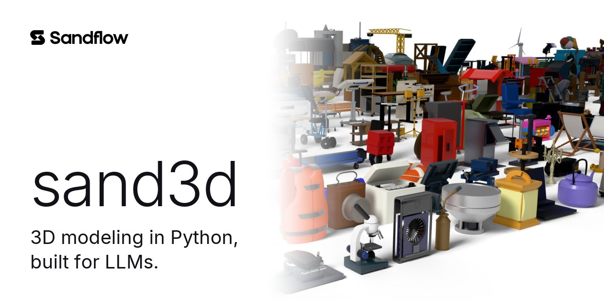

sand3d는 3D 물체를 짧은 프로그램으로 쓰는 파이썬 라이브러리다. 블렌더의 `bpy` 위에서 프로파일, 솔리드, 편집, 프레임, 관절, 조립을 다룬다. 프로그램은 형상이 어떻게 만들어지는지를 부품 단위로 적는다. 그래서 LLM은 몇백 토큰으로 물체를 쓰고 사람은 그 코드를 읽을 수 있다. 저장소가 내건 문구는 LLM을 위해 만든 파이썬 3D 모델링이다.

<figure>

<figcaption>sand3d로 작성한 물체들. (출처: GitHub Sandflow-ai/sand3d)</figcaption>
</figure>

## 내세우는 네 가지

- 짧다. 같은 부품을 Blender Python, CadQuery, FeatureScript로 쓸 때보다 토큰이 2~6배 적게 든다.
- API 전체가 프롬프트 하나에 들어간다. 약 3,600토큰이다.
- 계산하지 않고 이름으로 부른다. 부품, 모서리, 면을 손으로 계산한 좌표가 아니라 이름으로 가리킨다.
- 결정적이다. 같은 프로그램은 비트 단위까지 같은 메시를 만든다.

README의 토큰 비교는 같은 부품을 쓰는 데 드는 토큰의 중앙값을 sand3d 대비 배수로 나타낸다.

| 도구 | sand3d 대비 부품당 토큰 |
|---|---|
| Blender Python | 4.0배 |
| CadQuery | 2.3배 |
| FeatureScript | 6.0배 |
| Articraft SDK | 2.0배 |

## 첫 프로그램

설치는 `pip install sand3d`이고, uv 프로젝트라면 `uv add sand3d`를 쓴다. 블렌더는 `bpy` 모듈로 함께 들어온다. 구멍 두 개가 뚫린 브래킷은 이렇게 쓴다.

```python
import sand3d as s3d

def bracket(w=80, d=40, t=6, hole_d=6.6, pitch=50):
    plate = s3d.extrude("plate", s3d.rect(w, d, r=4), t)
    s3d.hole(plate, hole_d, on=s3d.grid(2, 1, pitch, 0))
    s3d.fillet(plate, 1, edges="top")
    return plate

s3d.export(bracket(), "bracket.glb")
```

모서리가 둥근 사각형을 돌출시켜 판을 만들고, 격자 위치에 구멍을 내고, 윗면 모서리를 둥글게 깎은 뒤 GLB로 내보낸다. 모델링 단위는 기본이 밀리미터다.

| 파이썬 | 블렌더(bpy) | 비고 |
|---|---|---|
| 3.13(권장) | 5.2 LTS | CI가 bpy 5.2로 돈다 |
| 3.11 | 4.5 LTS | 5.2부터 인텔 맥용 휠이 없어 인텔 맥은 3.11을 쓴다 |
| 3.12 | 지원 안 됨 | `bpy` 휠이 없다 |

## 부품과 관절로 쓰는 물체

README는 드럼 세탁기를 예로 든다. 코드 38줄에 본체, 드럼, 유리와 손잡이가 달린 문, 세제 서랍, 다이얼이 각각 이름 붙은 부품으로 들어가고, 관절 네 개가 이들이 어떻게 움직이는지를 정한다.

```python
door = s3d.group("door", ring, glass, handle)
s3d.joint("door_hinge", door, hinge, axis="-Z", range=(0, 143))
s3d.joint("drum_spin", drum, front.move(0, 400), kind="continuous")
s3d.joint("drawer_slide", drawer, top_band.move(150), kind="prismatic", axis="+X", range=(0, 200))
s3d.joint("dial_turn", dial, top_band.move(-150), kind="continuous")
return s3d.assembly("washing_machine", cab, drum, door, drawer, dial, front=front)
```

문은 경첩을 축으로 0도에서 143도까지 열리고, 드럼과 다이얼은 계속 돌고, 서랍은 X축으로 0에서 200까지 미끄러진다. 손잡이와 유리는 문과 한 그룹으로 묶여 함께 움직인다.

모든 기능은 `s3d.<동사>` 한 층에 놓여 있다.

| 계열 | 동사 |
|---|---|
| 프로파일 | `rect` `circle` `slot` `polygon` `poly` `arc` `spline` `superellipse` `text` `offset` `stroke` 등 16개 |
| 솔리드와 경로 | `extrude` `revolve` `sweep` `loft` `wire` `helix` `box` `cylinder` `tube` `sphere` `torus` `dome` 등 15개 |
| 편집 | `cut` `join` `intersect` `split` `hole` `pocket` `fillet` `chamfer` `shell` `dent` 등 15개 |
| 프레임과 배치 | `Frame` `face` `edge` `bbox` `local` `at` `transform` `grid` `ring` `along` `snap` |
| 관절 | `joint` `pose` `seat` |
| 조립 | `group` `assembly` `attach` `export` `units` `fingerprint` 등 8개 |
| 부품과 재질 | `gear` `knurl` `thread` `material` |

`chair()`나 `table()` 같은 범주 동사는 없다. 의자나 탁자는 sand3d로 쓴 프로그램이지 라이브러리가 제공하는 함수가 아니라는 설계다.

## 내보내기 형식

`s3d.export(machine, "washer.glb")`처럼 한 번 호출하면 되고, 파일 확장자가 형식을 정한다. 내보낸 파일의 길이 단위는 미터다.

| 형식 | 담는 정보 | 쓰는 곳 |
|---|---|---|
| GLB | 메시, 재질, 각 노드의 extras에 든 관절 정보(현재 자세) | 웹, 뷰어, 게임 엔진 |
| URDF | 움직이는 부품마다 링크 하나, 관절과 한계(기본 자세), 옆에 OBJ 메시 | ROS, PyBullet, MuJoCo, Isaac |
| USDA | 같은 트리를 OpenUSD(UsdGeom, UsdPhysics)로, 재질 포함 | Omniverse, Isaac Sim, USD 파이프라인 |
| IFC | 부품 트리를 IFC4 프로젝트로. 조립체, 부품별 프록시, 삼각화된 면, 재질 | Revit, ArchiCAD, Tekla, BIM |
| OBJ, STL | 현재 자세의 메시만. OBJ는 Y축이 위, 바이너리 STL은 Z축이 위 | 범용 3D 도구, 슬라이서 |

`.usd`, `.usdc`, `.usdz`는 `.usda`를 USD 자체 도구(`usdcat`, `usdzip`)로 변환해 얻는다. Revit의 `.rvt`는 Revit만 쓸 수 있는 형식이어서, Revit이 열고 링크하는 공개 표준 IFC(ISO 16739)로 내보낸다. IFC는 관절 없이 현재 자세만 담는다. IFC의 `GlobalId`는 형상과 배치에 따라 정해지므로 부품을 고치거나 옮기면 값이 바뀔 수 있고, 서로 다른 모델의 같은 부품이 같은 값을 가질 수도 있다. README는 내보낸 파일 사이에서 부품을 추적하는 데 이 값을 쓰지 말라고 적었다.

## LLM에 넘기는 방법

저장소의 `docs/api.md`를 시스템 프롬프트에 넣으면 된다. 어휘 규칙, 모든 시그니처, 예제가 약 3,600토큰에 들어 있고 `llms.txt`가 모델을 이 문서로 안내한다. 부품이 여럿인 물체를 위해서는 조립 프로그램의 여덟 규칙을 담은 가이드라인이 따로 있다. 계획을 먼저 쓰고, 세부를 정하고, 부품을 쓰는 순서다.

Hugging Face에는 다섯 출처의 3D 물체를 sand3d 프로그램으로 옮긴 데이터셋이 CC BY 4.0으로 올라와 있다.

| 데이터셋 | 내용 |
|---|---|
| sand3d-objaverse | Objaverse의 일상 물체를 프로그램으로 다시 작성 |
| sand3d-cad | 공개 CAD 모델의 기계 부품 |
| sand3d-articraft | Articraft의 관절 물체, 관절 선언 포함 |
| sand3d-simready | NVIDIA SimReady의 시뮬레이션용 에셋 |
| sand3d-automate | AutoMate의 기계 조립체 |

라이선스는 Apache 2.0이다. 인용 정보에는 저자가 Thibault Neveu와 Andréa Loy, 버전이 1.6.3(2026)으로 적혀 있다.

## 출처

- Sandflow-ai, sand3d 저장소 README(버전 1.6.3). <https://github.com/Sandflow-ai/sand3d>
