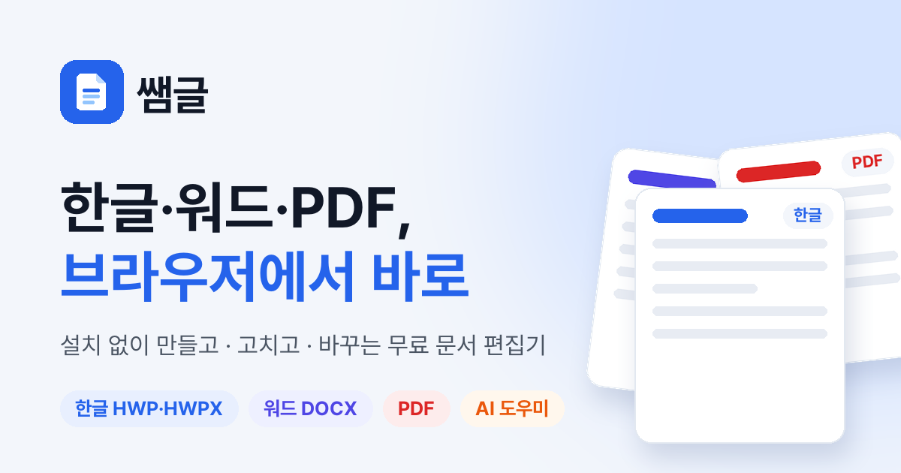

쌤컷과 어비폰트를 만든 어비가 무료 문서 편집 도구 쌤글(SsamGeul)을 공개했다. 한글(HWP·HWPX), 워드(.docx), PDF를 프로그램 설치 없이 웹브라우저에서 열고, 고치고, 다른 형식으로 바꾼다. 학교에서 받은 HWP 양식을 한컴오피스가 없는 컴퓨터에서 고쳐야 하는 교사에게 특히 쓸모가 있다. 관리자 권한 없이 크롬에서 바로 열리고, 맥에서도 윈도우와 똑같이 HWP를 고칠 수 있다.

광고와 유료 결제가 없다. 개발자는 2026년 11월 3일 스레드 소개 글에서 돈을 받을 생각이 아예 없고 운영비는 자기 돈으로 낸다고 밝혔다.

<figure>

<figcaption>쌤글 공식 사이트의 대표 이미지. (출처: ssamtool.com)</figcaption>
</figure>

## 쓰는 환경

| 항목 | 내용 |
|---|---|
| 시작 | 구글 계정으로 로그인, 처음 한 번 이용약관·개인정보 동의 |
| 브라우저 | PC·노트북의 크롬, 엣지 권장. 윈도우·맥 모두 가능 |
| 휴대폰 | 사이트 안내로는 휴대폰 화면에 아직 맞춰져 있지 않음 |
| 문서 파일 | 서버로 보내지 않고 브라우저 안에만 저장 |
| 내려받기 | HWP, HWPX, DOCX, PDF |
| 비용 | 무료, 광고 없음 |

개발자는 소개 글에서 휴대폰이든 컴퓨터든 들어와서 쓰라고 했지만 공식 사이트는 PC 사용을 권한다. 지금은 PC에서 쓰는 도구로 보는 편이 맞다.

## 문서 기능

| 기능 | 내용 |
|---|---|
| 한글(HWP·HWPX) 편집 | 한컴오피스 없이 열어 그대로 고치고 저장. 글자·문단 모양, 표, 쪽 나눔, 머리말·꼬리말 |
| 워드(.docx) 편집 | 리본 메뉴로 편집. 고친 부분만 원본에 반영해 서식을 보존 |
| PDF | 보기, 형광펜, 밑줄, 메모, 그리기, 서명, 양식 채우기, 글자 고치기 |
| 형식 바꾸기 | PDF → 워드, HWP ↔ HWPX, 한글·워드 → PDF, PDF 용량 줄이기 |
| AI 도우미 | 맞춤법 교정, 문장 다듬기, 공지문 초안 작성. 바뀐 곳을 보여 주고 되돌릴 수 있음 |

## 학교 문서에 쓰는 장면

공식 사이트의 교사용 안내는 학교에서 자주 하는 일을 이렇게 정리한다.

| 하고 싶은 일 | 쌤글에서 |
|---|---|
| 학교 HWP 양식 고치기 | HWP·HWPX를 열고 고쳐서 같은 형식으로 저장 |
| 가정통신문·안내문 새로 쓰기 | 새 한글·워드 문서와 AI 도우미 초안 |
| 학부모에게 보내기 | PDF로 저장, 용량이 크면 PDF 용량 줄이기 |
| 받은 PDF 확인·서명 | 형광펜·메모·서명·양식 채우기 |
| PDF 자료를 고쳐 쓰기 | PDF → 워드로 바꿔 편집 |
| 학교 컴퓨터에서 | 설치·관리자 권한 없이 크롬에서 바로 |

연수 신청서나 동의서처럼 입력 칸이 있는 PDF는 칸을 눌러 바로 채운다. 서명은 한 번 그려 두면 그 브라우저가 기억했다가 다음 문서에도 다시 넣을 수 있다. 사진이 많은 PDF가 메일에 붙지 않을 때는 용량 줄이기를 쓴다. 사진만 줄이고 글자와 도형은 건드리지 않아서 글자는 선명하게 남는다.

## 자주 하는 작업 순서

가정통신문은 교사용 안내의 다섯 단계를 따르면 된다.

1. 크롬에서 쌤글을 열고 구글 계정으로 로그인한다.
2. 학교에서 쓰는 HWP 양식이 있으면 내 문서에 끌어다 놓아 열고, 없으면 새 한글 문서나 새 워드 문서를 만든다.
3. 날짜, 행사 내용, 준비물을 고치고 표에 일정이나 명단을 채운다.
4. 초안이 필요하면 옆의 AI 도우미에게 "학부모 상담 주간 안내문 초안 써 줘"처럼 부탁한다. 내 Gemini API 키가 필요하다.
5. 내려받기로 HWP·DOCX 파일을 받거나, 인쇄 창에서 PDF로 저장해 학부모에게 보낸다.

형식 변환은 내 문서 화면의 파일 변환에서 한다. 바꿀 파일을 끌어다 놓거나 내 문서에서 고르기로 고른 뒤 바꿀 형식을 누른다. 다 바뀌면 내려받기로 PC에 저장하거나 내 문서에 보관하고 열기로 쌤글에 남긴다. 한글과 워드를 PDF로 만들 때는 인쇄 창이 열리면 대상을 PDF로 저장으로 고른다.

저장과 내려받기는 다른 동작이다. 저장은 쌤글의 내 문서에 넣는 것이고, 내려받기는 HWP·HWPX·DOCX·PDF 파일로 PC에 받는 것이다. 결재나 메일 첨부에 쓸 파일은 내려받기로 만들어야 한다.

## 안 되는 것과 조심할 것

문서는 쓰고 있는 브라우저 안의 내 문서에만 저장된다. 브라우저 데이터를 지우면 함께 지워지고 다른 컴퓨터에서는 보이지 않는다. 학교 PC에서 쓰던 문서를 집에서 이어 쓰려면 HWP·DOCX로 내려받아 집 컴퓨터의 쌤글에서 다시 열어야 한다. 휴지통에 넣은 문서는 7일 뒤 자동으로 지워진다.

한컴오피스로 만든 문서는 대부분 그대로 보이지만, 일부 도형, 글상자, 특수 글꼴처럼 아주 복잡한 개체는 조금 다르게 보일 수 있다. 저장할 때 손대지 않은 부분은 원본 그대로 남긴다고 사이트는 밝힌다. 글상자로 칸을 맞춘 공문 서식이나 도형이 많은 학습지는 고친 뒤 PDF로 한 번 열어 모양을 확인하고 보내는 편이 안전하다.

아직 없는 기능도 분명히 적혀 있다.

| 아직 안 되는 것 | 대신 할 수 있는 것 |
|---|---|
| 한글 ↔ 워드 직접 변환 | 한글·워드 → PDF, PDF → 워드 |
| 여러 PDF 합치기, 쪽 나누기·끼워 넣기 | 없음 |
| 스캔한 PDF의 글자 고치기 | 형광펜·메모·서명 같은 표시 |
| 가정통신문 서식(템플릿) 제공 | 학교 HWP 양식을 그대로 열거나 AI 도우미 초안으로 시작 |

스캔한 PDF는 글자가 사진으로 들어 있어서 워드로 바꿔도 편집할 수 있는 글자가 되지 않을 수 있다.

## AI에게 보이는 것과 보이지 않는 것

쌤글에서 AI를 쓰는 길은 두 가지이고, 문서 내용이 가는 곳이 다르다.

| 방식 | 쓰는 AI | 문서 내용이 가는 곳 |
|---|---|---|
| AI 도우미 | 내 Google Gemini API 키 | 요청과 문서 일부가 내 키로 Google Gemini에 바로 감. 쌤툴 서버는 거치지 않음 |
| MCP 연결 | 내 Claude·ChatGPT | AI가 읽고 고치는 문서 내용이 연결을 거쳐 내가 쓰는 AI 앱으로 전달됨. 파일은 쌤툴 서버에 올라가거나 저장되지 않음 |

두 경우 모두 파일이 쌤툴 서버에 올라가지 않는다는 점은 같다. 하지만 AI가 읽는 내용은 Google이나 Anthropic, OpenAI 같은 AI 회사로 간다. 사이트도 학생 이름이나 연락처 같은 개인정보는 AI에게 맡기기 전에 지우거나 가려 달라고 안내한다. 학생 명단이 든 표를 채우는 일을 AI에게 맡긴다면, 그 명단이 AI 앱 대화에 그대로 남는다는 뜻이다. 학교나 교육청이 정한 생성형 AI 사용 지침이 있다면 그 기준이 우선이다.

## AI 앱에서 대화로 문서 고치기

MCP 연결은 [쌤컷](/post/ssamcut-free-web-video-editor/)과 같은 커넥터 하나로 된다. 쌤컷을 이미 연결했다면 따로 추가할 필요가 없다.

1. AI 앱 설정의 커스텀 커넥터에 `https://ssamtool.com/mcp`를 넣는다. Claude는 설정의 커넥터에서 추가하고, ChatGPT는 개발자 모드를 켠 뒤 인증을 OAuth로 만든다.
2. 열리는 쌤툴 창에서 구글 계정으로 로그인하고 허용한다. 처음 연결할 때 한 번은 이용약관·개인정보 동의를 사람이 직접 해야 한다.
3. 쌤글의 내 문서나 편집 화면을 같은 구글 계정으로 열어 둔다. 연결이 안 되면 쌤글 왼쪽 AI 설정의 AI 연결(MCP)에서 이 브라우저에서 AI 연결 켜기를 체크한다.
4. 대화로 부탁하고, 마지막에 "저장해 줘"라고 말한다. AI가 고친 내용은 저장해야 내 문서에 남는다.

사이트가 든 예시는 내 문서에서 가정통신문을 열어 날짜를 11월 10일로 바꾸고 저장하기, 새 워드 문서에 학부모 상담 안내문 초안 쓰기, 한글 문서 표의 빈칸을 명단으로 채우기, PDF를 읽고 중요한 문장에 형광펜 표시하기다. 한글 문서에서는 글 찾아 바꾸기, 문단 넣기·지우기, 표 만들기·칸 채우기·합치기, 스타일, 차례, 각주까지 AI가 다룬다. 워드는 머리말·꼬리말, 메모, 변경 내용 추적도 된다.

쌤글과 연결은 무료지만 AI 사용량은 각자 쓰는 Claude나 ChatGPT 요금제를 따른다. 쌤컷 연결 안내에 따르면 Claude는 무료 요금제도 커스텀 커넥터 1개까지 되고, ChatGPT는 요금제에 따라 편집 기능이 막힐 수 있다.

## 만든 이유

출발은 개발자 자신의 불편이었다. 광고계약서를 고칠 일이 너무 많았고, 워드와 한글과 아크로뱃을 모두 결제해 쓰고 있었지만 번거로웠다. 그래서 MCP를 직접 만들어 자신의 Claude에 연결해 쓰기 시작했다고 한다. 쌤컷은 대부분 자신의 노하우로 만들었지만 쌤글은 대부분 오픈소스를 기반으로 만들었다는 점도 밝혔다.

왜 이렇게 돈을 들이느냐는 물음에 어비는 돈이 중요한 게 아니라 함께 열심히 놀려고 하는 것이라고 답했다. 버그 리포트 기능이 있으니 문제가 있으면 알려 달라고도 했다. 쌤글이 속한 쌤툴은 설치 없는 무료 웹 창작 도구 모음으로, 영상·문서·사진 편집, 더빙, 폰트 찾기 기능을 차례로 열 예정이다.

## 출처

- 어비. (2026, 11월 3일). 쌤글 오픈 소개 글. Threads. <https://www.threads.com/@uhbee_rurucheche/post/DfRjzWGFNYJ>
- 쌤글(SsamGeul) 공식 사이트. <https://ssamtool.com/tool/geul/>
- 가정통신문·학교 문서, 설치 없이 무료로 만드는 법(선생님용). 쌤툴. <https://ssamtool.com/tool/geul/guide/teachers/>
- 한글(HWP·HWPX) 파일, 설치 없이 무료로 열고 고치는 법. 쌤툴. <https://ssamtool.com/tool/geul/guide/hwp-online/>
- PDF 글자 고치기·메모·형광펜, 무료로 하는 법. 쌤툴. <https://ssamtool.com/tool/geul/guide/pdf-edit/>
- 한글·워드·PDF 변환, 설치 없이 무료로 하는 법. 쌤툴. <https://ssamtool.com/tool/geul/guide/convert/>
- Claude·ChatGPT로 한글·워드 문서 고치는 법(MCP 연결). 쌤툴. <https://ssamtool.com/tool/geul/guide/ai-mcp/>
- 쌤글(SsamGeul) 자주 묻는 질문. 쌤툴. <https://ssamtool.com/tool/geul/guide/faq/>
