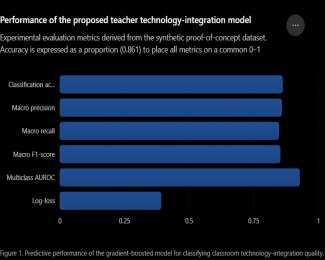

## 1. 연구의 목적

(1) 저자는 기기를 다룰 줄 아는 것과 기술을 수업에 녹여 교수법, 개별화, 평가, 학생 참여를 개선하는 것은 다른 문제라고 봄. 학습지를 파일로 배포하거나 기존 시험을 온라인으로 옮기는 것도 기술 사용이지만 수업 구조는 거의 바뀌지 않음.

(2) 선행 연구에서 저자가 짚은 공백은 세 가지임.

- 교사 디지털 역량 연구의 상당수가 자신감이나 지각된 능력을 묻는 자기보고 도구에 의존해, 점수가 높은 교사가 실제로 수준 높은 기술 통합을 하는지 확인되지 않음.
- 기술 사용 빈도를 통합의 질과 같은 것으로 취급하는 경향이 있음.
- AI 생성 정보, 자동 추천, 학습 분석, 사생활, 인간의 감독에 관한 판단이 기존 역량 모형에 충분히 담기지 않음.

(3) 연구 목적은 교사 디지털 역량의 여러 차원이 디지털 도구의 사용 빈도가 아니라 교실 기술 통합의 질을 어떻게 예측하는지 밝히는 것임. 기관 지원, 전문성 개발, 인프라, 교과, 교직 경력이 이 관계를 강화하거나 약화하는지도 함께 살핌.

---

## 2. 연구의 방법

(1) 저자는 역량에서 통합으로 이어지는 분석 틀을 제안함. 교사 디지털 역량은 여섯 차원으로 구성됨. 디지털 자원 역량, 기술 지원 교수법, 디지털 평가와 데이터 문해력, 학습자 역량 강화, 책임 있는 디지털 실천, AI 교수 준비도임. 결과 변수는 교실 기술 통합 질 지수(CTIQI)로, 형성적 피드백, 학습자 상호작용, 개별화 수업, 디지털 협업, 데이터에 근거한 수업 조정, 학생의 콘텐츠 제작, AI 시스템의 책임 있는 사용을 지표로 삼음.

(2) 실제 교사에게서 수집한 자료는 없음. 저자는 독립적으로 수집된 실증 자료가 없으므로 보고한 수치를 합성 자료에 기반한 개념 증명 시연으로 해석해야 하며 실제 참여 교사의 관찰값이 아니라고 명시함. 초록에서도 실증 단계는 앞으로 수행할 계획으로 서술함.

(3) 합성 자료는 가상 교사 프로필 1,200개이고, 프로필마다 역량, 맥락, 행동 범주의 입력 변수 18개를 가짐. 역량 지표는 0~100 척도임. CTIQI는 기초 통합, 발전 통합, 심화 통합의 세 수준으로 범주화함.

(4) 분석 절차는 다음과 같음.

- 연속 변수의 약 4.5%를 의도적으로 결측 처리한 뒤 중앙값으로 대체하고, 범주형 변수는 원-핫 인코딩, 연속 변수는 z점수로 표준화함.
- 자료를 70:15:15로 층화 분할해 훈련, 검증, 시험 세트를 만듦.
- 다항 로지스틱 회귀, 랜덤 포레스트, 그래디언트 부스팅 결정 트리, 다층 퍼셉트론 네 가지를 검토하고 그래디언트 부스팅 트리 앙상블을 최종 모형으로 고름.
- 층화 5겹 교차검증과 매크로 F1 점수로 초매개변수를 정하고, SHAP 방식의 변수 기여도 분석으로 어떤 역량 차원이 예측에 크게 기여하는지 살핌.

---

## 3. 주요 발견

(1) 합성 자료의 시험 세트에서 그래디언트 부스팅 모형이 낸 분류 성능은 다음과 같음.

| 평가 지표 | 값 | 논문의 해석 |
|----------|---------|---------|
| 분류 정확도 | 86.1% | 기초, 발전, 심화 통합 수준을 구분함 |
| 매크로 정밀도 | 0.858 | 수준 전반에서 예측이 고르게 신뢰할 만함 |
| 매크로 재현율 | 0.847 | 대부분의 통합 범주를 올바르게 찾아냄 |
| 매크로 F1 점수 | 0.852 | 균형 잡힌 분류 성능임 |
| 다중 분류 AUROC | 0.927 | 수준 간 변별력이 높음 |
| 로그 손실 | 0.391 | 확률 추정이 무난하게 보정됨 |

<figure>

<figcaption>합성 자료로 시연한 그래디언트 부스팅 모형의 평가 지표. 정확도는 비율(0.861)로 바꿔 다른 지표와 같은 0~1 축에 그림. (논문 7쪽 그림 1)</figcaption>
</figure>

(2) 기술 사용 빈도는 심화 통합의 가장 강한 예측 변수가 아니었음. 주간 기술 사용량이 많은 프로필이 자동으로 심화 통합으로 분류되지 않았고, 플랫폼은 자주 쓰지만 교수 설계와 평가 문해력 점수가 낮은 프로필은 발전 통합으로 분류되는 경우가 더 많았음.

(3) 가장 강한 예측 변수는 기술 지원 교수법이었음. 저자는 기술의 기능을 학습 목표와 연결하는 능력이 사용 빈도보다 중요하다고 해석함.

(4) 두 번째로 강한 예측 변수는 디지털 평가와 데이터 문해력이었음. 저자는 전자 퀴즈를 실시하는 것은 기술 사용이고, 응답 자료에서 오개념 패턴을 찾아 다음 수업을 조정하는 것이 교육적으로 의미 있는 통합이라고 구분함.

(5) AI 교수 준비도도 심화 통합과 관련이 컸으나 AI 도구를 많이 쓰는 것만으로는 충분하지 않았음. 심화 통합으로 예측된 프로필은 AI 사용에 검증, 수업 목표와의 정렬, 윤리적 인식, 인간의 감독이 결합되어 있었음. 저자는 AI 역량을 프롬프트 작성 능력으로 좁혀서는 안 된다고 봄.

(6) 기관의 기술 지원은 개인 역량을 대신하지 못하지만 역량이 수업에서 드러나는 정도를 강화함. 역량이 같아도 연결이 불안정하거나 기기가 부족하거나 기관 지원이 약한 프로필은 예측된 통합의 질이 더 낮았음.

(7) 교직 경력은 기술 통합과 비선형 관계를 보임. 근무 연수만으로는 디지털 역량의 높낮이가 일관되게 예측되지 않았고, 전문성 개발은 일회성 기술 워크숍이 아니라 지속적이고 교수법에 초점을 둔 연수로 표현될 때 심화 통합과 가장 강하게 관련됨.

---

## 4. 결론 및 시사점

(1) 저자는 교사 디지털 역량을 평가하는 기준을 기술 보유와 사용 빈도가 아니라 교수 장면에서 드러난 능력으로 옮기자고 제안함. 개념 증명 분석에서는 기술 지원 교수법, 디지털 평가와 데이터 문해력, AI 교수 준비도가 일반적인 기술 사용 빈도보다 심화 통합을 더 잘 알려 주는 신호였음.

(2) 교사 연수에 대해서는 특정 소프트웨어 사용법 중심의 연수가 조작 숙련도는 높여도 수업을 바꾸지 못할 수 있다고 봄. 학습 목표, 학습자 요구, 피드백, 평가 전략에 따라 기술을 고르는 교수 시나리오를 다루고, 대시보드 해석, 형성평가 패턴 분석, 오해를 부르는 지표 식별을 연수에 넣을 것을 권함.

(3) 기관 조건을 빼고 교사의 수행을 평가하는 것은 위험하다고 지적함. 역량이 높은 교사도 인프라, 기술 지원, 승인된 플랫폼, 준비 시간이 부족하면 수준 높은 기술 기반 수업을 하기 어려움.

(4) 저자가 밝힌 한계는 다섯 가지임.

- 수치 실험은 분석 틀을 시연하려고 구성한 합성 자료를 썼으므로, 독립적인 실증 검증 없이는 보고된 값을 실제 교사 집단에 일반화할 수 없음.
- 디지털 역량은 교과, 학년, 기관 유형, 교육과정, 학생의 사회경제적 여건, 지역 인프라의 영향을 받으므로 하나의 예측 틀은 맥락에 맞게 조정해야 함.
- 교실 기술 통합은 객관적으로 측정하기 어려움. 관찰은 평가자 판단에, 자기보고는 사회적 바람직성 편향에 영향을 받음.
- 기계학습의 변수 중요도는 예측 기여도이지 인과 효과가 아님.
- AI 응용이 빠르게 바뀌므로 AI 준비도 측정 도구는 정기적으로 고쳐야 함.

---

## 5. 리뷰어의 ADD(+) One: 생각 더하기

(1) 이 논문에서 가져갈 것은 수치가 아니라 구분임. 할 수 있다고 보고한 것과 수업에서 드러난 것을 따로 재고, 사용 빈도와 통합의 질을 따로 재자는 제안은 학교가 디지털 역량 진단 도구를 고를 때 바로 쓸 수 있는 기준임. 반면 86.1%라는 정확도와 변수 순위는 저자가 만든 가상 프로필에서 나온 값이고, 논문은 그 프로필을 어떤 규칙으로 생성했는지 설명하지 않음. 교사 집단에 관한 근거로 인용할 수 없는 수치임.

(2) 디지털 평가 역량을 실시, 해석, 수업 조정의 세 단계로 나눈 대목은 학습 분석 연구와 이어짐. 대시보드가 보급되어도 수업이 바뀌지 않는 까닭을 도구가 아니라 해석과 조정 단계에서 찾게 해 줌.

(3) 저자가 후속 과제로 든 것처럼 교사 설문, 수업 관찰, 학습관리시스템 기록, 수업 산출물, 학생 피드백을 묶은 실제 자료로 같은 분석을 반복해야 이 틀의 쓸모를 판단할 수 있음. 학교 단위에서는 동학년 교사들이 같은 단원의 형성평가 응답 자료를 함께 보고 다음 차시를 어떻게 고쳤는지 기록해 두는 것이 통합의 질을 보여 주는 가장 손쉬운 증거가 됨.

---

## 6. 추가 탐구 질문

(1) 자기보고 역량 점수와 수업 관찰로 본 통합의 질은 실제 교사 집단에서 얼마나 일치하는가?

(2) 인프라가 열악한 학교에서 교사의 높은 디지털 역량은 환경적 제약을 어디까지 상쇄하는가?

(3) 교사의 디지털 역량 향상은 학생의 참여, 성취, 자기조절학습 변화보다 시간상 앞서 나타나는가?

---

## 출처

Singh, S. (2026). Teacher digital competence and technology integration in classroom instruction. *Global Journal of Innovative Research Perspectives, 2*(3), 186–195.
