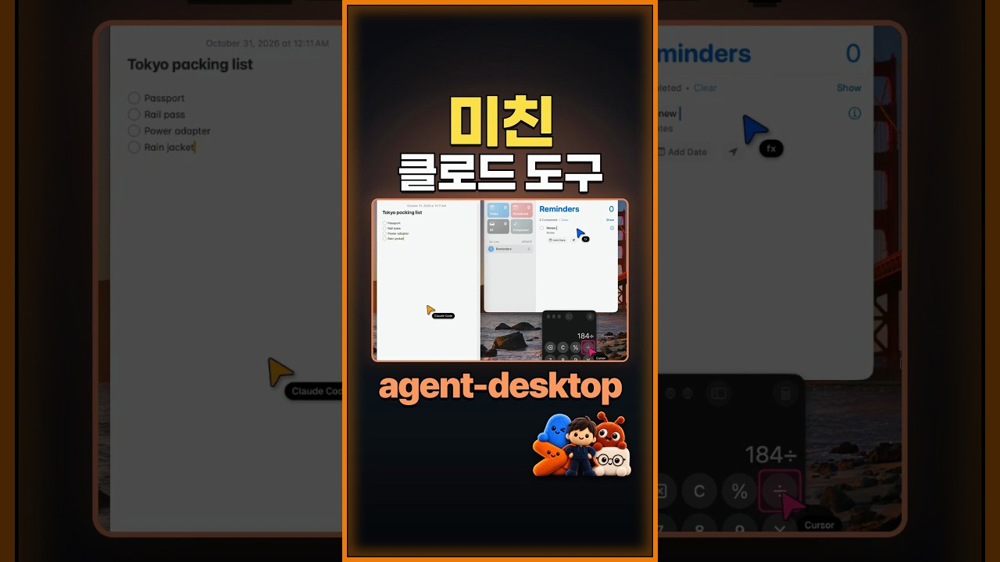

AI 에이전트 세 개가 한 컴퓨터에서 동시에 메모를 쓰고, 미리 알림을 넣고, 계산기를 두드린다. Next.js를 개발하는 Vercel이 공개한 무료 도구 agent-desktop은 Claude Code나 Codex 같은 AI 에이전트가 맥, 윈도우, 리눅스의 앱을 직접 조작하게 해 준다. 터미널에서 실행하는 프로그램(CLI)과 에이전트용 스킬로 이루어져 있고, 오픈소스(Apache-2.0)다.

<figure>

<figcaption>영상 썸네일. (출처: 잔재미코딩(DaveLee))</figcaption>
</figure>

## 화면을 보지 않고 앱을 다루는 방법

AI가 컴퓨터를 조작하는 방식을 흔히 computer use라고 부른다. 널리 알려진 방식은 AI가 화면을 캡처해 보고, 버튼이 있는 좌표를 짐작해 그 자리를 클릭하는 것이다. 사람이 모니터를 보며 마우스를 움직이는 모습을 흉내 내는 셈이라, 일하는 동안 진짜 마우스와 화면을 AI가 차지한다.

agent-desktop은 스크린숏도 픽셀 대조도 쓰지 않는다. 대신 운영체제가 제공하는 접근성 트리를 읽는다. 접근성 트리는 화면 낭독기처럼 시각장애인을 돕는 프로그램을 위해 운영체제가 만들어 두는 목록이다. 창 안에 어떤 버튼, 입력칸, 메뉴가 있고 각각의 이름이 무엇인지가 나무 구조로 정리돼 있다. 화면 낭독기가 "확인 버튼"이라고 읽어 줄 수 있는 것도 이 목록 덕분이다. 그림을 해석할 필요 없이 목록에서 "7" 버튼을 찾아 누르라고 명령하면 된다.

공식 저장소가 설명하는 작동 순서는 다음과 같다.

1. 앱의 접근성 트리를 읽어 JSON 형식으로 돌려준다. 조작할 수 있는 요소마다 참조(ref)라는 이름표가 붙는다.
2. 에이전트가 그 ref를 지정해 클릭하거나 글자를 입력한다.
3. 화면을 다시 읽어 결과가 맞는지 확인하고, 필요하면 같은 과정을 되풀이한다.

이 반복은 에이전트 쪽에서 돌아간다. agent-desktop 안에는 AI 모델이 없다. 무엇을 누를지는 Claude Code 같은 에이전트가 판단하고, agent-desktop은 손발 역할만 한다. 운영체제별로 macOS는 AX API, 윈도우는 UI Automation, 리눅스는 AT-SPI라는 접근성 기능을 쓴다.

ref로 하는 동작은 기본적으로 마우스 포인터를 움직이지 않고, 앱 창을 앞으로 끌어오지도 않는다. 저장소는 이를 헤드리스(화면에 드러나지 않는 방식)가 기본이라고 표현한다. 실제 마우스·키보드 입력이 꼭 필요한 동작은 `--headed` 옵션을 붙였을 때만 허용된다.

## computer use와의 차이

영상은 Claude Code에 이미 있는 computer use 기능과 비교한다. Claude Code의 computer use는 한 번에 세션 하나만 쓸 수 있고, 일하는 동안 다른 앱을 숨겨서 사용자가 PC를 함께 쓰기 어렵다. agent-desktop은 진짜 마우스 대신 버튼과 입력칸을 곧바로 다루므로, 에이전트 여러 개가 동시에 일하는 동안에도 사용자는 자기 일을 계속할 수 있다.

| 비교 항목 | Claude Code computer use | agent-desktop |
|---|---|---|
| 동시 실행 | 한 번에 세션 하나 | 에이전트 여러 개 동시 실행 |
| 작업 중 사용자 PC 사용 | 다른 앱을 숨겨 쓰기 어려움 | 방해받지 않음 |
| 붙여 쓸 수 있는 에이전트 | Claude Code | Claude Code, Codex, Cursor 등 |

접근성 트리를 쓰는 방식에도 한계는 있다. 앱이 접근성 정보를 제대로 내주지 않으면 읽을 것이 없다. 윈도우 문서에는 크롬 계열(Chromium·Electron) 앱이 처음 읽을 때 전체 목록의 일부만 돌려주고, 새로 켠 직후에는 정리되기까지 10~25초가 걸린다는 설명이 있다. 이럴 때는 기다리는 시간을 늘려 다시 읽으라고 안내한다.

## 할 수 있는 일의 범위

저장소에 따르면 agent-desktop의 명령 이름은 61개이고, 그중 57개가 실제로 동작한다. 나머지 넷(키나 마우스 버튼을 누른 채로 두는 명령)은 눌린 입력을 안전하게 풀어 줄 장치가 생길 때까지 실행을 거부한다. 묶음별로 보면 다음과 같다.

| 묶음 | 하는 일 |
|---|---|
| 관찰 | 화면 구조 읽기(`snapshot`), 요소 찾기, 상태 확인, 스크린숏 |
| ref로 조작 | 클릭, 더블클릭, 글자 입력, 값 바꾸기, 체크, 펼치기·접기, 스크롤 |
| 키보드와 마우스 | 키 누르기, 마우스 이동·클릭·드래그 |
| 앱과 창 | 앱 실행·종료, 창 목록, 창 크기·위치 바꾸기, 최소화·복원 |
| 알림 | 알림 목록 보기, 닫기, 알림 속 버튼 누르기 |
| 클립보드 | 클립보드 읽기·쓰기·비우기 |
| 기타 | 기다리기(`wait`), 세션 기록, 권한·상태 확인 |

사용자가 이 명령을 외울 필요는 없다. 스킬을 설치하면 에이전트가 "계산기 열어서 7 곱하기 6"이라는 말을 앱 실행, 화면 읽기, 버튼 클릭, 결과 읽기라는 명령의 순서로 바꿔 실행한다. 저장소는 종료 단축키처럼 위험한 키 조합(맥의 `cmd+q`, 윈도우의 `alt+f4` 등)을 별도 옵션 없이는 거부하도록 막아 두었다.

## 설치와 실행

가장 쉬운 방법은 에이전트에게 맡기는 것이다.

1. Claude Code에 agent-desktop의 GitHub 주소(`https://github.com/vercel-labs/agent-desktop`)를 주고 프로그램과 스킬을 같이 설치해 달라고 한다.
2. 맥에서는 처음 한 번 손쉬운 사용 권한을 허용한다.
3. 평소 말로 시킨다. 예: "agent-desktop으로 계산기 열어서 7 곱하기 6 해 줘"

직접 설치하려면 공식 저장소가 안내하는 명령을 쓴다.

```bash
npm install -g agent-desktop
agent-desktop status
agent-desktop permissions --guide
npx skills add https://github.com/vercel-labs/agent-desktop --skill agent-desktop
```

첫 줄이 CLI 설치다. `status`는 운영체제, 권한 상태, 지원 범위를 보여 준다. `permissions --guide`는 맥에서 손쉬운 사용 권한을 허용하는 과정을 안내한다. 마지막 줄은 에이전트가 agent-desktop 쓰는 법을 익히도록 스킬을 설치한다. 맥과 리눅스에서는 `brew install agent-desktop`도 된다. 스킬 대신 MCP로 붙일 수도 있다. MCP는 AI 에이전트가 외부 도구를 부르는 표준 연결 방식인데, `agent-desktop mcp`를 실행하면 모든 명령이 MCP 도구로 열린다.

| 운영체제 | 요구 사항 | 쓰는 접근성 기능 |
|---|---|---|
| macOS | macOS 13 이상, 인텔 또는 애플 실리콘 | AX API |
| 윈도우 | Windows 10 1809 이상, x64 또는 ARM64 | UI Automation |
| 리눅스 | Ubuntu 24.04 이상, X11 또는 Wayland | AT-SPI |

## 권한에서 막히는 지점

맥에서는 손쉬운 사용 권한을 agent-desktop을 실행한 앱에 줘야 한다. 터미널, iTerm2, VS Code처럼 명령을 실행한 프로그램이 대상이다. 그래서 터미널에서 권한을 허용해 두고 VS Code 안에서 실행하면 VS Code에도 따로 허용해야 한다. 시스템 설정의 개인정보 보호 및 보안 아래 손쉬운 사용 항목에서 해당 앱을 추가하고 켜면 되고, 앱을 다시 시작할 필요는 없다. 화면 기록 권한은 스크린숏 기능을 쓸 때만 필요하다.

윈도우는 사정이 다르다. 권한을 허락하는 창이 따로 없고, 그래서 `permissions --guide`는 윈도우에서 지원되지 않는다는 결과를 돌려준다. 대신 몇 가지를 알아 둬야 한다.

- 관리자 권한으로 실행 중인 앱은 읽을 수만 있고 조작은 못 한다. 조작하려면 터미널도 같은 수준의 관리자 권한으로 띄워야 한다.
- 프로그램 파일에 전자 서명이 없다. 그래서 브라우저로 받을 때 SmartScreen 경고가 뜨거나, 백신이 격리하거나, 새로 설치한 Windows 11의 스마트 앱 컨트롤이 막을 수 있다.
- 다른 창 뒤에 가려진 창은 조작할 수 있지만, 최소화한 창은 조작할 수 없다. 창을 복원(`restore`)한 뒤 다시 읽어야 한다.
- 헤드리스 상태에서는 키를 한 자씩 누르는 `type`이 막혀 있다. 글을 넣을 때는 입력칸의 값을 바로 바꾸는 `set-value`를 쓴다.
- PowerShell에서는 `@`로 시작하는 ref를 작은따옴표로 감싸야 한다(예: `'@s8f3k2p9:e8'`). 감싸지 않으면 PowerShell이 그 글자를 다른 뜻으로 읽어 버린다.

## 맥북에서 써 본 결과

잔재미코딩 운영자가 맥북에서 다른 앱으로 작업하며 위 계산 명령을 시켰더니, Claude가 뒤에 깔린 계산기의 버튼을 하나씩 눌러 42를 읽어 왔다. 그동안 계산기 창은 한 번도 앞으로 나오지 않았고 마우스 커서도 그대로였다.

최소화해 둔 창에도 글을 써 넣었다. 에이전트 두 개를 동시에 돌렸을 때는 하나가 계산기를 누르는 사이 다른 하나가 글을 쓰며, 서로 방해 없이 둘 다 해냈다. 다만 이것은 맥에서의 결과다. 앞에서 본 것처럼 윈도우에서는 최소화한 창을 다룰 수 없다고 공식 문서가 밝히고 있으니, 윈도우 PC에서 같은 시험을 하면 결과가 다를 수 있다.

## 쓰기 전에 알아 둘 점

저장소는 접근성 트리를 읽은 결과, 클립보드 내용, 스크린숏, 명령 출력에 개인 화면 정보가 담길 수 있다고 경고한다. 성적 처리 프로그램이나 학생 명단이 열린 창을 에이전트가 읽었다면 그 내용이 기록에 남는다. 이런 기록은 공개 로그나 업로드에 섞이지 않게 관리하라고 안내한다.

맥 문서는 결과 확인도 강조한다. 앱이 아무 일도 하지 않고 성공 신호만 돌려주는 경우가 있으므로, 동작이 실제로 일어났는지는 화면을 다시 읽어 판단해야 한다. agent-desktop이 동작마다 다시 읽는 단계를 기본 순서에 넣어 둔 이유다. 에이전트에게 일을 맡길 때도 "끝나면 결과를 다시 읽어서 확인해 줘"라고 덧붙이면 같은 원칙을 따르게 할 수 있다.

## 출처

- 잔재미코딩(DaveLee). (2026-11-01). [클로드에 붙여 쓰는 미친 도구 | agent-desktop](https://www.youtube.com/shorts/luEhiMTWlW8). YouTube.
- Vercel Labs. [agent-desktop](https://github.com/vercel-labs/agent-desktop). GitHub.
- Vercel Labs. [macOS | agent-desktop](https://agent-browser.dev/desktop/platforms/macos). agent-desktop 문서.
- Vercel Labs. [Windows | agent-desktop](https://agent-browser.dev/desktop/platforms/windows). agent-desktop 문서.
