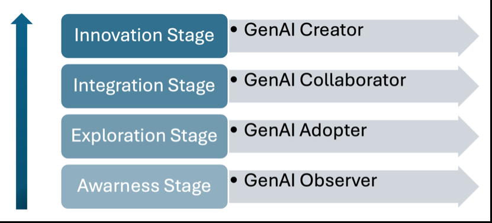
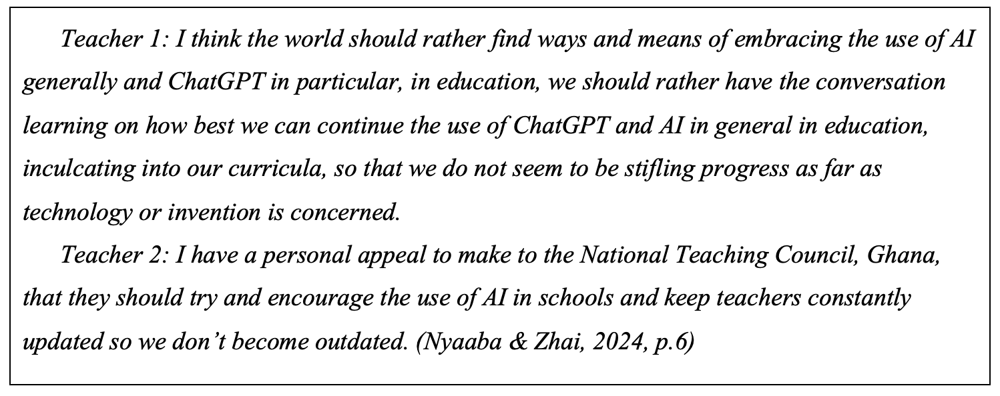
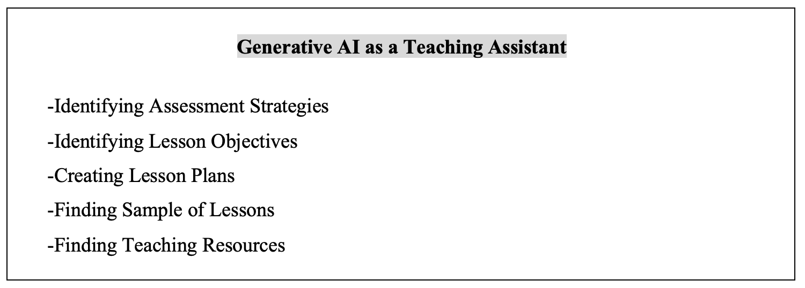
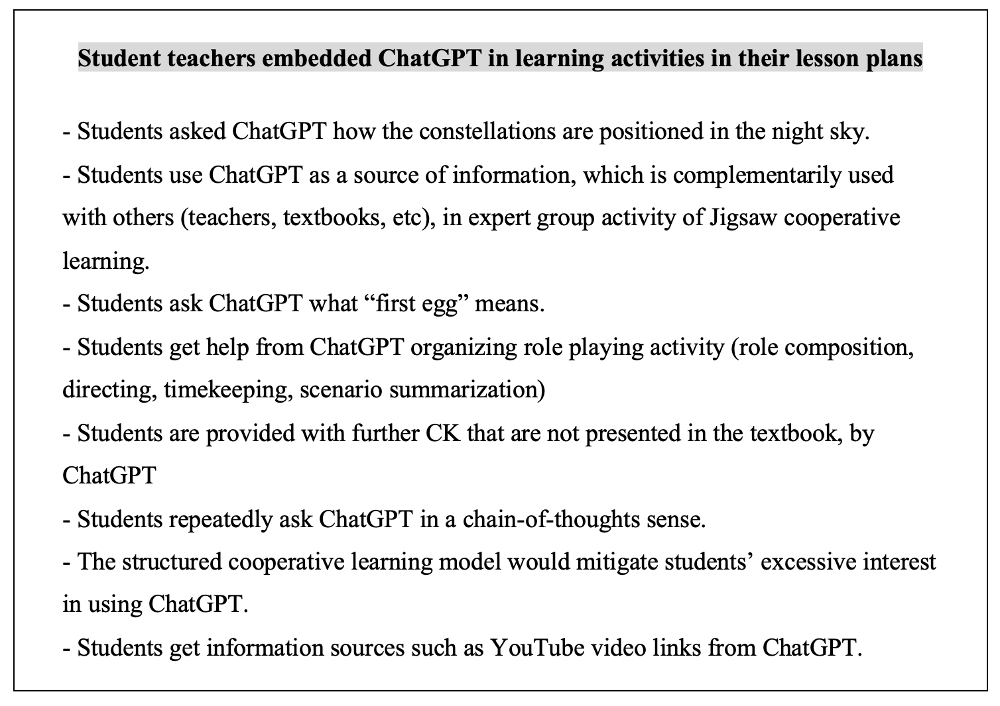
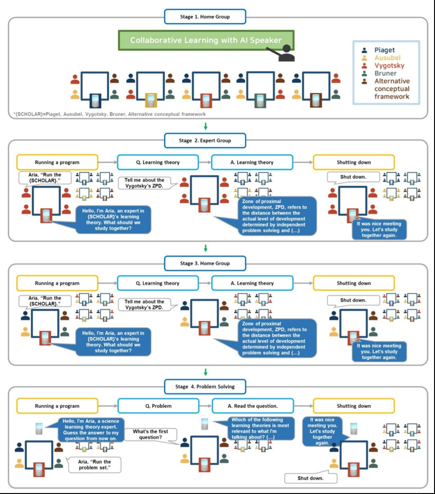

## 1. 연구의 목적

(1) 저자는 기존 연구가 생성형 AI 도구의 기술적 효능과 교육 성과에 대한 영향에 집중하고, 교사가 이 기술에 어떻게 적응하고 협업하는지, 교실에서 교사의 주도성이 어떻게 달라지는지는 소홀히 다뤘다고 봄. 교사를 다룬 연구도 태도와 인식을 일반적으로 살피는 데 그치고, 모든 교사가 같은 방식으로 기술을 받아들인다고 가정하는 경향이 있다고 지적함.

(2) TPACK 같은 기존 틀은 교사가 디지털 도구를 수업에 통합하는 방법에 초점을 두기 때문에, 콘텐츠를 스스로 만들어 내는 생성형 AI가 교사 역할에 가져오는 변화를 충분히 담지 못한다는 것이 저자의 진단임.

(3) 이 논문은 교사의 인식, 수용, 지식, 실천을 서로 연결된 요소로 묶어 교사의 역할과 주도성 변화를 설명하는 개념적 틀을 제시함. 여기서 주도성은 교사가 스스로 결정하고 주도권을 쥐고 자신의 수업과 전문성 개발을 만들어 가는 역량과 자율성을 뜻함.

---

## 2. 연구의 방법

(1) 새 자료를 수집해 분석한 실증 연구가 아니라 선행 연구를 엮어 틀을 제안하는 개념 논문임. 생성형 AI의 성격을 먼저 정리하고, 교사의 인식, 수용, 지식, 실천에 관한 문헌을 차례로 검토한 뒤 네 단계 틀을 제시함.

(2) 단계 구분은 기술수용모형(TAM)과 통합기술수용이론(UTAUT)에 뿌리를 둠. 새 기술의 채택이 인지에서 시작해 적극적 참여와 주도로 이어지는 연속선을 따른다는 이 모형들의 전제를 생성형 AI에 적용함.

(3) 각 단계는 저자와 동료들의 선행 연구에서 가져온 사례로 예시함. 가나 예비 교사의 생성형 AI 사용 조사, 예비 교사의 챗GPT 활용 수업 계획 연구, AI 스피커를 쓴 협력 학습 원형 개발 연구가 그것임.

---

## 3. 주요 발견

(1) 틀은 네 단계와 각 단계에 대응하는 네 역할로 이루어짐. 단계가 올라갈수록 교사의 실천, 인식, 수용, 지식이 함께 깊어진다고 서술함.

| 단계 | 역할 | 실천 | 인식과 수용 | 지식 |
|------|------|------|-------------|------|
| 인지 | 관찰자 | 교실 사용은 거의 없고 개인 학습에 가끔 써 봄 | 호기심과 우려가 섞여 있고 수용도는 낮음 | 최소한이며 이론적임 |
| 탐색 | 수용자 | 시행착오를 거치며 시범적으로 사용함 | 실질적 이점을 알아보고 조심스럽게 낙관함 | 실용 지식이 쌓이기 시작함 |
| 통합 | 협력자 | 수업의 일부로 일관되고 목적 있게 사용함 | 교육의 필수 요소로 보고 사용에 자신감을 가짐 | 중급에서 고급 수준, 도구를 비판적으로 평가함 |
| 혁신 | 혁신가 | 새 교수법과 교육과정을 설계하고 동료를 이끎 | AI를 교육 혁신의 동력으로 보고 적극 옹호함 | 고급의 전문 지식, 새 응용 개발에 참여함 |

<figure>

<figcaption>교사 역할과 주도성 변화의 네 단계 틀. 그림에는 맨 위 역할이 창조자(Creator)로 적혀 있으나 논문 본문과 초록은 혁신가(Innovator)로 부른다. (논문 Figure 1)</figcaption>
</figure>

(2) 인지 단계의 교사는 관찰자임. 소셜 미디어 광고나 동료, 연수, 학회, 문헌에서 얻은 정보로 첫인상을 만들며, 수업에는 아직 쓰지 않음.

- 생성형 AI가 자기 직업과 관련된다는 점은 알지만 이해는 일반적 개념 수준에 머묾
- 편향 가능성이나 교사 대체 가능성에 대한 우려가 호기심과 함께 나타남
- 익숙하지 않고 자신이 없어 수용도가 낮으며, 전문적 자율성이나 고용 안정에 대한 위협으로 느끼기도 함

<figure>

<figcaption>관찰자 단계 교사의 발언. 교육에서 AI를 받아들일 방법을 찾아야 한다는 의견과, 교사가 뒤처지지 않도록 가나 국가교직위원회가 AI 사용을 장려해 달라는 요청이다. (논문 Figure 2)</figcaption>
</figure>

(3) 탐색 단계의 교사는 수용자임. 챗GPT, 지능형 튜터링 시스템, 자동 채점 도구 등을 수업 보조로 써 보지만 교육과정에 체계적으로 통합하거나 특정 교수법과 결합하지는 않음.

- 가나 교사 조사에서는 평가 전략 찾기, 수업 목표 정하기, 수업 계획 작성, 수업 예시와 자료 찾기에 활용했다고 보고됨
- 초기의 성공 경험이 쌓이면서 회의가 줄고 조심스러운 낙관이 자리 잡음
- 저자는 이 시기가 교사의 자신감과 역량을 쌓는 데 결정적이라고 봄

<figure>

<figcaption>교사들이 생성형 AI를 수업 조교로 썼다고 보고한 활동 다섯 가지. Nyaaba 외(2024)의 조사 결과를 옮긴 것이다. (논문 Figure 3)</figcaption>
</figure>

(4) 통합 단계의 교사는 협력자임. 생성형 AI를 보조물이 아니라 교육 과정의 핵심 요소로 삼아 개별화 학습, 행정 업무 자동화, 학생 평가 지원에 일관되게 사용함.

- AI 도구가 자신의 교육 목표와 학생의 필요에 맞는지 비판적으로 평가함
- AI가 만든 콘텐츠와 사람의 감독, 창의성 사이의 균형을 잡음
- 경험을 동료와 나누며 학교 안에서 AI 통합을 옹호하는 사람이 됨

<figure>

<figcaption>교수법 수업에서 예비 교사들이 수업 계획에 챗GPT를 넣은 방식. 학생이 별자리 위치를 묻거나, 직소 협동학습의 전문가 모둠에서 교사·교과서와 함께 정보원으로 쓰거나, 역할극 구성에 도움을 받는 활동이 들어 있다. (논문 Figure 4)</figcaption>
</figure>

(5) 혁신 단계의 교사는 혁신가임. 도구 사용자에 머물지 않고 생성형 AI 기반 교육과정을 개발하고, 다른 교사를 지도하고, 관련 연구에 협력함. 저자는 이 단계 교사의 실천이 다른 교사의 본보기가 되고 정책과 실천에 영향을 준다고 서술함.

- 예시는 NUGU AI 스피커 플랫폼으로 만든 협력 학습 원형 CLAIS임
- 직소 방식으로 설계되어 학생이 전문가 모둠에서 AI 스피커와 대화하며 한 영역을 익힌 뒤 원래 모둠으로 돌아가 배운 것을 나눔

<figure>

<figcaption>AI 스피커와 함께하는 협력 학습(CLAIS)의 진행 순서. 원래 모둠에서 시작해 전문가 모둠에서 AI 스피커에게 학습 이론을 묻고, 원래 모둠으로 돌아와 공유한 뒤 문제를 푼다. Lee 외(2023)의 설계를 옮긴 것이다. (논문 Figure 5)</figcaption>
</figure>

---

## 4. 결론 및 시사점

(1) 저자는 교사의 인식, 수용, 지식, 실천을 따로 다루지 말고 서로 맞물린 요소로 함께 다뤄야 한다고 주장함. 이 요소들을 떼어 놓고 보는 기존 연구로는 교사가 생성형 AI를 교실에 통합하는 능력을 제대로 설명할 수 없다는 것임.

(2) 인식, 지식, 수용의 토대가 약하면 교사는 생성형 AI의 표면적 사용에 머물 가능성이 크다고 봄. 관찰자와 수용자에서 협력자와 혁신가로 옮겨 가려면 지속적인 전문성 개발과 기관의 지원이 필요하며, 교사가 실험하고 협력하고 혁신할 수 있는 환경을 만들어야 한다고 결론지음.

(3) 충분한 연수와 지원을 받은 교사일수록 생성형 AI를 개별화 학습, 적응적 피드백, 공동 창작 경험의 도구로 쓰게 된다고 서술함. 이때 교사는 AI를 비판적으로 평가하고 편향과 윤리 문제에 대응할 기술과 지식을 갖춰야 함.

(4) 이 틀은 후속 실증 연구를 위한 이론적 토대로 제시된 것임. 네 단계가 실제 교사 집단에서 구분되는지, 교사가 이 순서로 이동하는지는 이 논문에서 검증되지 않았음. 단계별 예시도 가나 교사와 예비 교사 연구에 기대고 있어 다른 맥락에 그대로 들어맞는다고 볼 근거는 제시되지 않음.

---

## 5. 리뷰어의 ADD(+) One: 생각 더하기

(1) 이 논문에서 주목할 지점은 교사를 도구 사용 능숙도로 줄 세우지 않고, 인식과 수용과 지식과 실천이 함께 움직이는 묶음으로 봤다는 점임. 연수 설계에 주는 함의가 분명함. 기능 교육만으로는 교사가 다음 단계로 가지 않으며, 대체 불안이나 편향에 대한 오해 같은 인식의 문제를 함께 다뤄야 한다는 것임.

(2) 틀 자체는 기술 수용 연구의 익숙한 단계 모형을 생성형 AI에 옮긴 것이어서 생성형 AI만의 특수성이 단계 구분에 얼마나 반영됐는지는 따져 볼 필요가 있음. 논문 안에서도 역할 이름이 흔들림. 틀을 소개하는 문단은 관찰자, 적응자, 통합자, 혁신가라고 쓰고, 절 제목은 수용자와 협력자를, 그림은 창조자를 씀. 또 단계가 올라갈수록 수용이 완전하고 열성적이 된다고 서술하는데, 숙고 끝에 특정 장면에서 AI를 쓰지 않기로 한 교사가 낮은 단계로 분류될 여지가 있음. 주도성이 스스로 결정하는 역량이라면 쓰지 않는 결정도 주도성의 행사임.

(3) 학교나 교육청이 이 틀을 쓴다면 교사를 등급으로 나누는 용도보다, 지금 있는 자리에서 다음 한 걸음에 무엇이 필요한지 묻는 진단 질문으로 쓰는 편이 안전함. 관찰자 단계의 교사에게는 수업과 무관한 개인 용도로 써 볼 시간이, 수용자 단계의 교사에게는 실패해도 괜찮은 시범 수업과 그 결과를 동학년에서 함께 들여다볼 자리가 필요함. 논문이 조건으로 든 기관의 지원을 이렇게 단계별로 구체화하는 일은 현장의 몫으로 남아 있음.

---

## 6. 추가 탐구 질문

(1) 실제 교사 집단을 조사하면 인식, 수용, 지식, 실천이 네 단계로 함께 묶여 나타나는가, 아니면 실천은 높지만 수용은 낮은 식의 엇갈린 유형이 나타나는가?

(2) 교사가 통합 단계에서 혁신 단계로 옮겨 갈 때 학교 조직 문화와 관리자의 지원은 어떤 역할을 하는가?

(3) 충분히 알고서 생성형 AI를 수업에 쓰지 않기로 한 교사의 주도성은 이 틀에서 어떻게 설명될 수 있는가?

---

## 출처

Zhai, X. (2025). Transforming teachers' roles and agencies in the era of generative AI: Perceptions, acceptance, knowledge, and practices. *Journal of Science Education and Technology, 34*(6), 1323–1333. https://doi.org/10.1007/s10956-024-10174-0

이 글은 arXiv 프리프린트를 바탕으로 했다. Zhai, X. (2024). *arXiv preprint arXiv:2410.03018*. https://arxiv.org/abs/2410.03018
