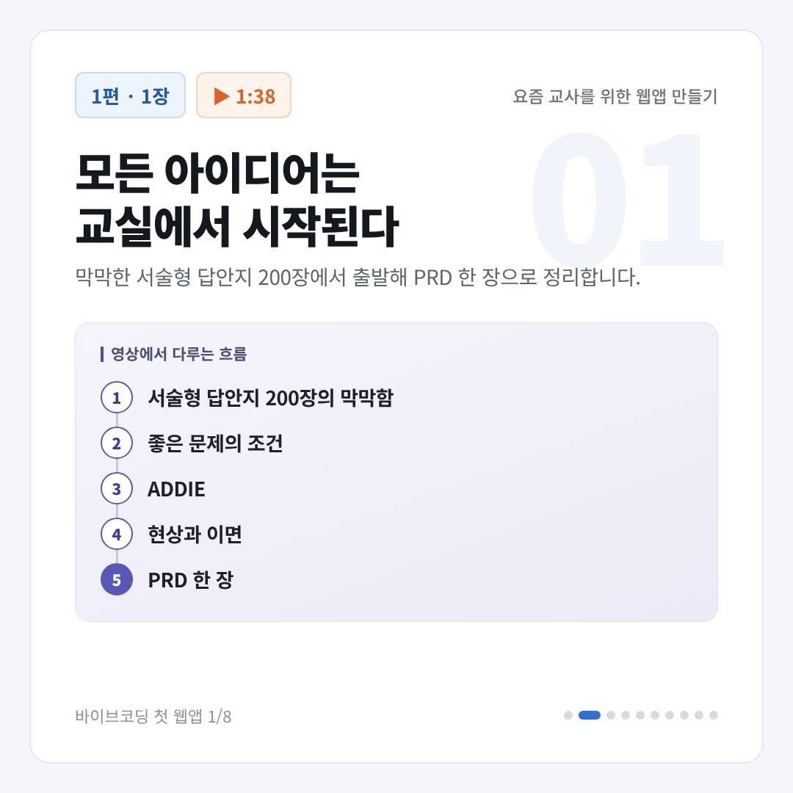
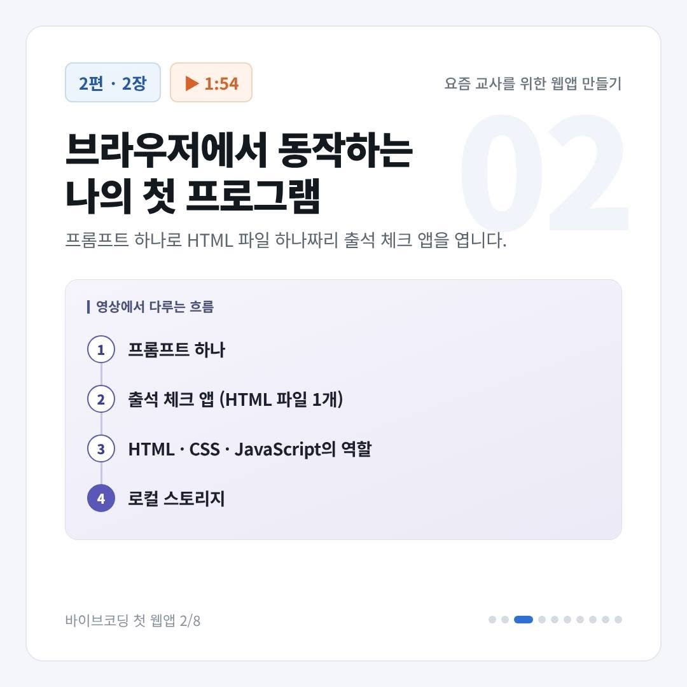
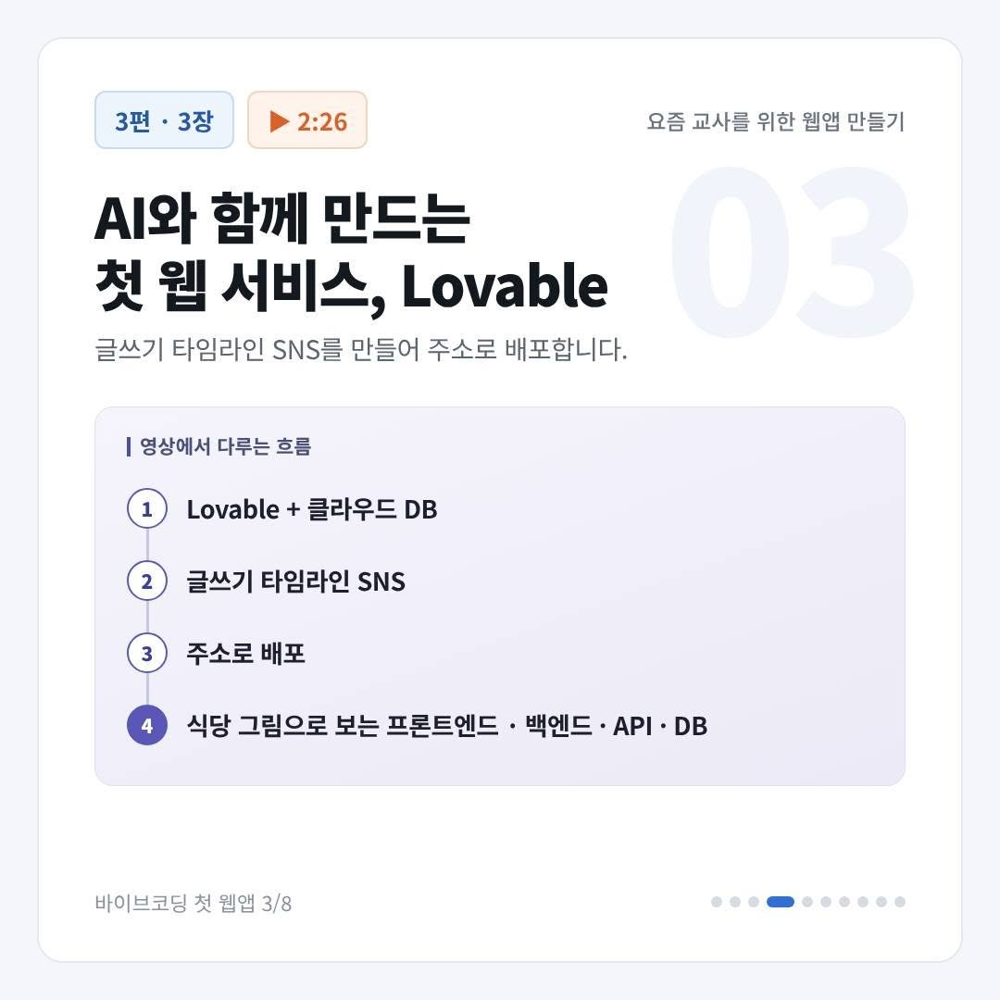
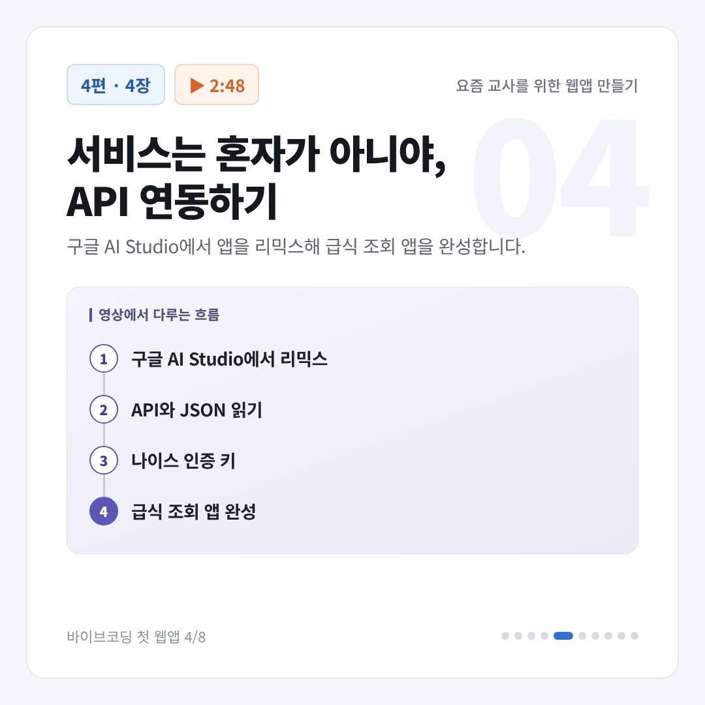
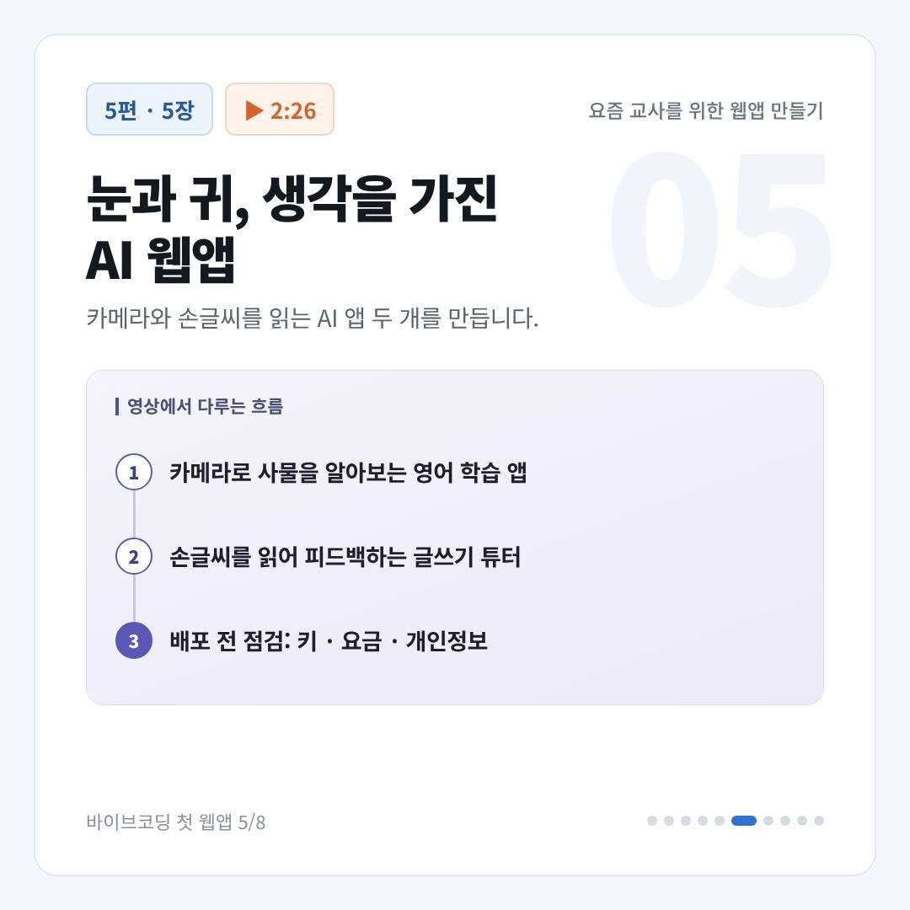
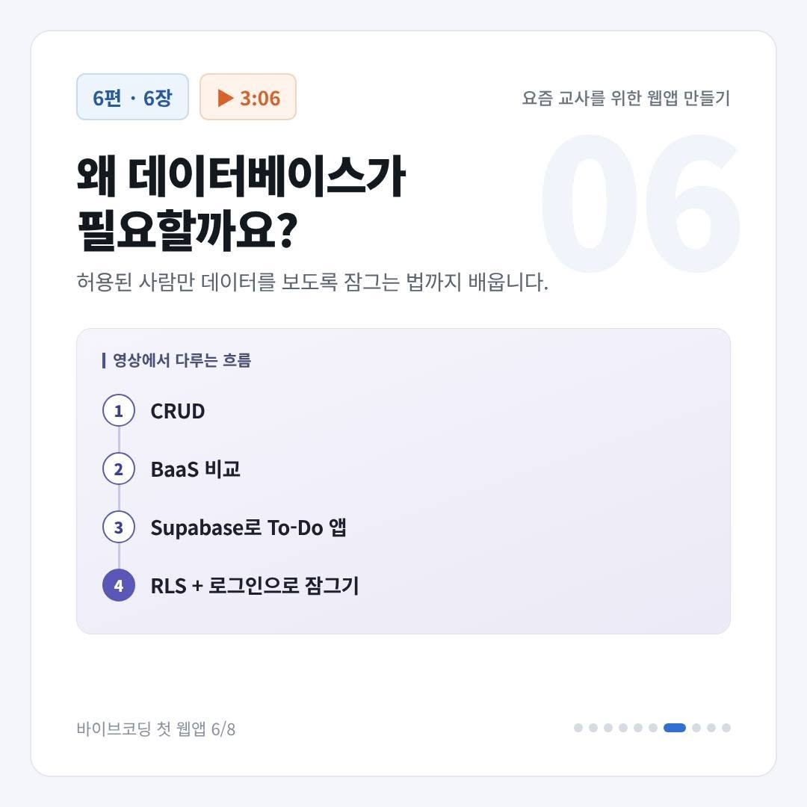
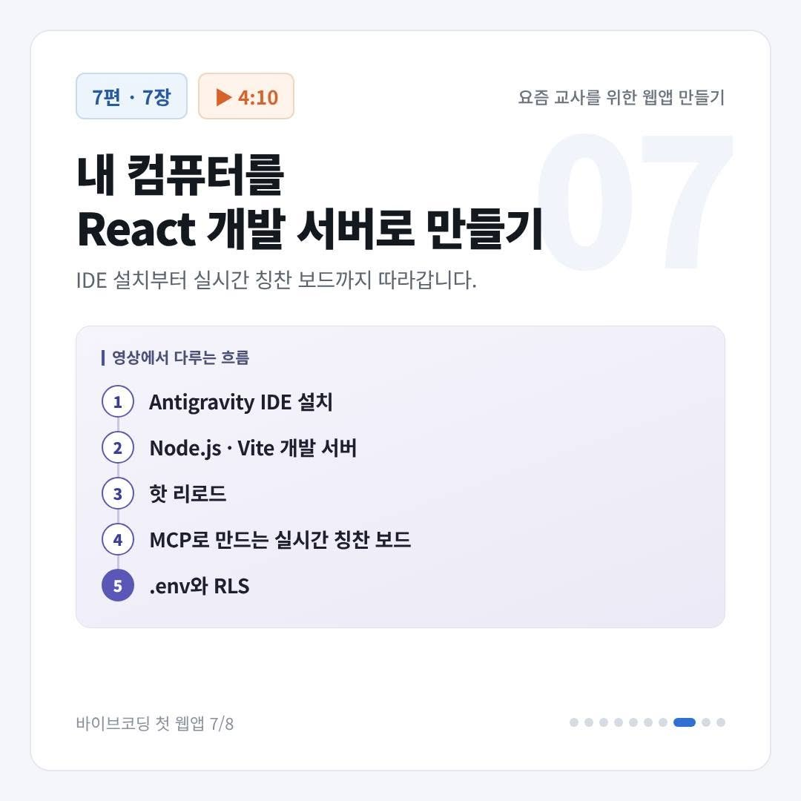

운영하는 AITS 커뮤니티에 &lt;요즘 교사를 위한 웹앱 만들기 with 바이브코딩 &gt;책을 기반으로 4회 정도의 저자 직강 스터디 제안을 드렸었습니다. 온라인 월간 세미나와 연계하여 진행해보고자 했으나 (11월 이후는 개인적으로 여유가 없어 11월 안쪽으로 기여해보면 어떨까 생각을 품었었는데) 커뮤니티 자체 추진이 늦어져 시간이 더 지나 어느덧 11월 중순이 지나가고 있습니다.

송구하게도 스터디 운영이 어려운 상황이지만, 책의 8개 장을 한 편에 4분 안쪽으로 정리한 영상으로 기여하였고, 독자분들과 관심이 있는 분들을 위해서 댓글에도 이를 공유드립니다.

> 영상 모음 보기: [lifeofpi-ux.github.io/vibecode-for-teacher/#videos](https://lifeofpi-ux.github.io/vibecode-for-teacher/#videos)

## 장별 영상 구성

<figure>

<figcaption>1장. 모든 아이디어는 교실에서 시작된다 (1분 38초)</figcaption>
</figure>

<figure>

<figcaption>2장. 브라우저에서 동작하는 나의 첫 프로그램 (1분 54초)</figcaption>
</figure>

<figure>

<figcaption>3장. AI와 함께 만드는 첫 웹 서비스, Lovable (2분 26초)</figcaption>
</figure>

<figure>

<figcaption>4장. 서비스는 혼자가 아니야, API 연동하기 (2분 48초)</figcaption>
</figure>

<figure>

<figcaption>5장. 눈과 귀, 생각을 가진 AI 웹앱 (2분 26초)</figcaption>
</figure>

<figure>

<figcaption>6장. 왜 데이터베이스가 필요할까요? (3분 6초)</figcaption>
</figure>

<figure>

<figcaption>7장. 내 컴퓨터를 React 개발 서버로 만들기 (4분 10초)</figcaption>
</figure>

<figure>

<figcaption>8장. 개발부터 배포까지, 내 손으로 완성하기 (2분 38초)</figcaption>
</figure>

<figure>

<figcaption>8편, 21분 분량의 영상은 책 사이트에서 모두 볼 수 있다.</figcaption>
</figure>

## 함께 보기

- [책 사이트의 장별 영상 모음](https://lifeofpi-ux.github.io/vibecode-for-teacher/#videos)
- [요즘 교사를 위한 웹앱 만들기 with 바이브 코딩 (정리본)](/lectures/vibecode-for-teacher/)
