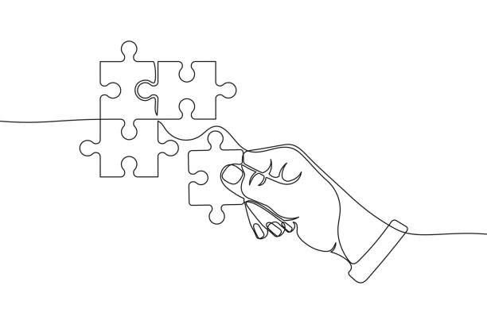

토론 학습지를 나누어 주고 찬반 근거를 적게 하거나, 생각 열기 질문을 촘촘히 배치하는 것만으로도 사고력 수업을 하고 있다는 안도감이 들곤 한다. 하지만 교사의 지시가 없는 일상적 읽기나 낯선 문제 앞에서, 근거 없이 성급히 결론을 내리거나 자기 입장을 정당화하는 데만 급급한 아이들을 볼 때면 교실 안 훈련이 과연 어디까지 이어지고 있는지 묻게 된다. 생각할 줄 아는 능력을 가르치는 것만으로 아이들이 적재적소에 스스로 멈춰 서서 생각하는 사람으로 자랄 수 있을까?

<figure>

</figure>

Ritchhart와 Perkins(2005)는 지난 30여 년간 시도된 주요 사고 교육 프로그램과 사고 성향 연구를 종합하면서, 사고 교육이 마주하는 다섯 가지 핵심 과제를 짚어 내고 교실이 놓치고 있는 세 가지 힌트를 건넨다.

## 교실이 놓치고 있는 세 가지 힌트

첫째, 좋은 사고의 진짜 병목은 사고 능력이 아니라 민감성에 있다. 실증 연구에서 사고 결함이 숨어 있는 이야기를 읽혔을 때, 학생들은 결함의 약 10%밖에 스스로 알아채지 못했다. 그런데 결함 지점을 짚어 주기만 하면 아이들은 곧바로 대안을 떠올리고 반대 논거까지 만들어 냈다. 아이들에게 부족한 것은 생각하는 기술 자체가 아니라, 일상의 흐름 속에서 성급한 일반화나 빈약한 근거를 마주쳤을 때 지금 멈춰서 따져 보아야 한다고 포착하는 민감성이다. 교사가 친절하게 다른 관점도 생각해 보자고 먼저 발문하는 순간, 정작 아이가 스스로 생각의 계기를 알아챌 기회는 교사가 대신 가져가 버리는 셈이 된다.

둘째, 사고의 전이는 저절로 일어나지 않으며 의식적인 추상화와 다리 놓기를 요구한다. 특정 훈련에서 익힌 사고 기능이 낯선 영역으로 옮겨 가는 먼 전이는 기대만큼 쉽게 나타나지 않는다. 저자들은 인간의 사고를 아기와 벽돌을 서로 다르게 쥐는 손에 비유하며, 일반적 사고 전략 역시 맥락에 맞게 조정되고 연결될 때 비로소 힘을 발휘한다고 설명한다. 실제로 효과를 거둔 프로그램들은 문제 풀이 반복에 머물지 않고, 구체적 활동에서 사고 원리를 떼어 내 일반화하는 반성적 추상화 장면과 추상적 연습을 실제 교과 및 일상 문제에 연결하는 교사의 다리 놓기를 수업 안에 의도적으로 설계했다.

셋째, 지시가 없을 때도 작동하는 사고 성향은 분절된 훈련이 아니라 교실 문화에서 자란다. 화요일과 목요일 한 시간씩 따로 떼어 사고 기법을 연습하는 방식만으로는 나머지 수업 시간까지 이어지는 지적 습관을 만들기 어렵다. 직접적인 교수와 연습은 무엇을 어떤 전략으로 생각하라고 지정해 버리기 때문에 오히려 아이의 자발적 성향을 기르기 어렵다. 대신 사고 루틴과 사고할 기회 같은 직접적 장치에 더해, 교사의 사고 모델링, 과정과 상태를 일컫는 사고의 언어, 물리적 환경, 사고에 대한 기대와 지지적 관계라는 일곱 가지 문화적 힘이 교실 일상에 스며들 때 비로소 아이들의 사고가 눈으로 볼 수 있게 드러난다.

## 한 차시 수업과 교실 일상에 녹여내기

그렇다면 이 연구의 시사점을 한 차시 수업과 교실 일상에 어떻게 녹여낼 수 있을까?

첫째, 모든 생각할 지점을 친절한 발문으로 안내하는 대신, 사고 결함이나 숨은 가정이 담긴 자료를 제시하고 무엇이 이상한지 아이들이 먼저 찾아내도록 기다리는 과제를 배치한다.

둘째, 수업에서 다룬 사고 전략을 해당 차시의 활동으로 끝내지 않고, 이 사고의 틀에서 일반화할 수 있는 원리가 무엇이며 다른 교과나 일상 문제에 어떻게 적용할 수 있는지 짚는 짧은 반성적 추상화 시간을 둔다.

셋째, 한 학기 동안 여러 교과와 학급 활동에서 공통된 사고 루틴과 사고의 언어를 일관되게 쓰면서, 교사가 막히고 고쳐 생각하는 과정을 학생 앞에서 직접 모델링해 사고가 일상이 되는 교실 문화를 만든다.

사고 전략을 가르치는 것은 생각의 도구를 쥐여주는 일이고, 교실 문화를 가꾸는 것은 아이가 지시 없이도 스스로 그 도구를 꺼내 들게 하는 일이다.

## 참고문헌

- Ritchhart, R., & Perkins, D. N. (2005). Learning to think: The challenges of teaching thinking. In K. J. Holyoak & R. G. Morrison (Eds.), *The Cambridge handbook of thinking and reasoning* (pp. 775–802). Cambridge University Press.
