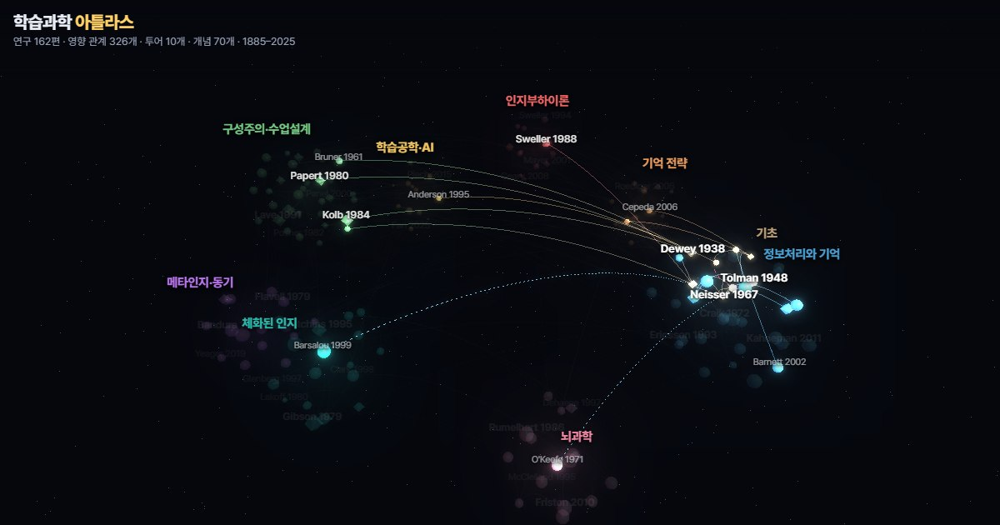

**학습과학 아틀라스 시리즈** · [허브](/post/learning-science-atlas/) · **1 기초** · [2 정보처리](/post/learning-science-atlas-02-information-processing/) · [3 인지부하](/post/learning-science-atlas-03-cognitive-load/) · [4 기억 전략](/post/learning-science-atlas-04-memory-strategies/) · [5 구성주의](/post/learning-science-atlas-05-constructivism-instruction/) · [6 메타인지·동기](/post/learning-science-atlas-06-metacognition-motivation/) · [7 체화된 인지](/post/learning-science-atlas-07-embodied-cognition/) · [8 뇌과학](/post/learning-science-atlas-08-neuroscience/) · [9 학습공학·AI](/post/learning-science-atlas-09-learning-engineering-ai/) · [개념 사전](/post/learning-science-atlas-glossary/) · [3D 지도 열기](/tools/learning-science-atlas/)

학습을 과학으로 다루기 시작한 순간부터, 행동주의가 학교를 지배하던 시기, 그리고 마음의 내부를 다시 연구 대상으로 삼은 인지혁명까지를 다룬다. 듀이의 경험 교육론도 이 출발점에 함께 놓았다. 학습과학 아틀라스의 아홉 클러스터 중 1번째인 이 글은 1885년부터 1967년까지의 연구 8편을 시간순으로 정리했다. 이 분야에서 가장 많이 인용된 연구는 Tolman(1948)의 「쥐와 인간의 인지도」, Bartlett(1932)의 「기억하기」, Dewey(1938)의 「경험과 교육」이다.

<figure>
  
  <figcaption>학습과학 아틀라스에서 행동주의에서 인지혁명으로 클러스터와 그 연결을 강조한 모습</figcaption>
</figure>

<a class="btn btn--primary" href="/tools/learning-science-atlas/?cluster=F" target="_blank">아틀라스에서 이 클러스터 보기</a>

## 한눈에 보는 흐름

| 연도 | 연구 | 한 줄 의의 |
|---|---|---|
| 1885 | 기억에 관하여 (Ebbinghaus) | 기억을 처음으로 실험실에서 정량 측정한 연구다. |
| 1898 | 동물 지능, 연합 과정의 실험 연구 (Thorndike) | 행동주의 학습이론의 뿌리다. |
| 1932 | 기억하기 (Bartlett) | 기억이 녹화가 아니라 재구성이라는 관점을 확립했고 "스키마" 개념을 심리학에 들여왔다. |
| 1938 | 경험과 교육 (Dewey) | 진보주의 교육의 아버지로 불리는 듀이가 전통 교육과 진보주의 교육 양쪽의 극단을 모두 비판한 짧은 책이다. |
| 1948 | 쥐와 인간의 인지도 (Tolman) | 행동주의 전성기에 "머릿속 표상"을 다시 불러온 논문이다. |
| 1954 | 학습의 과학과 교수의 기술 (Skinner) | 실험실 학습 원리를 교실에 적용하자고 주장한 선언문이다. |
| 1959 | 스키너 「언어 행동」 서평 (Chomsky) | 행동주의에 결정타를 날린 서평으로, 1950년대 인지혁명의 상징이 되었다. |
| 1967 | 인지심리학 (Neisser) | "인지심리학"이라는 분야 이름을 처음 내건 교과서다. |

## 연구별 요약

### 기억에 관하여

*Hermann Ebbinghaus (1885). Memory: A Contribution to Experimental Psychology* (단행본)

기억을 처음으로 실험실에서 정량 측정한 연구다. 학습과학이 "측정 가능한 과학"이 된 출발점으로 꼽힌다. 에빙하우스는 무의미 철자 목록을 스스로 외우고, 다시 외우는 데 드는 시간이 얼마나 줄었는지(절약법)로 기억을 측정했다. 학습 직후 망각이 가장 가파르고 시간이 지날수록 완만해지는 망각곡선을 그렸다. 같은 횟수라도 반복을 여러 날에 나누면 더 오래 남는다는 사실도 이미 이 책에 나온다.

> 물을 부은 모래성이 처음 몇 분 동안 가장 많이 무너지고, 남은 부분은 오래 버티는 모습과 비슷하다.

교실에서는 새 개념을 배운 당일과 다음 날, 일주일 뒤에 짧게 다시 꺼내 보는 복습 주기를 설계한다.

### 동물 지능, 연합 과정의 실험 연구

*Edward L. Thorndike (1898). Animal intelligence: An experimental study of the associative processes in animals*

행동주의 학습이론의 뿌리다. "결과가 행동을 강화한다"는 효과의 법칙은 이후 스키너의 조작적 조건화로 이어진다. 고양이를 문제 상자에 넣고 탈출하는 데 걸리는 시간을 반복 측정했다. 고양이는 통찰로 한 번에 깨닫기보다 시행착오를 거치며 점진적으로 빨라졌다. 만족스러운 결과를 낳은 반응은 상황과의 연결이 강해진다는 원리를 처음 제시했다. 이 원리는 1905년 "효과의 법칙"이라는 이름을 얻었고 1911년 저서에서 정식화되었다.

> 자판기 버튼을 이것저것 누르다 음료가 나온 버튼을 다음부터 바로 누르게 되는 것과 같다.

교실에서는 즉각적이고 구체적인 피드백이 행동 변화를 만든다는 원리를 연습 활동 설계에 활용한다.

### 기억하기

*Frederic C. Bartlett (1932). Remembering: A Study in Experimental and Social Psychology* (단행본)

기억이 녹화가 아니라 재구성이라는 관점을 확립했고 "스키마" 개념을 심리학에 들여왔다. 인지부하이론과 선행조직자 연구가 모두 이 개념 위에 서 있다. 영국 학생들에게 낯선 북미 원주민 설화 "유령들의 전쟁"을 읽히고 반복해서 회상하게 했다. 회상할수록 이야기는 짧아지고, 낯선 요소는 익숙한 문화적 틀에 맞게 바뀌었다. 사람은 기존 지식 구조(스키마)로 정보를 해석하고 다시 만들어 낸다는 결론을 냈다.

> 전화 게임처럼 이야기가 전달될수록 듣는 사람의 상식에 맞게 다듬어진다.

교실에서는 새 내용을 가르치기 전에 학생이 가진 선지식과 오개념을 먼저 확인한다.

### 경험과 교육

*John Dewey (1938). Experience and Education* (단행본)

진보주의 교육의 아버지로 불리는 듀이가 전통 교육과 진보주의 교육 양쪽의 극단을 모두 비판한 짧은 책이다. 경험 중심 학습, 프로젝트 학습 논의의 출발점이다. 듀이는 모든 경험이 교육적이지는 않으며, 이후의 성장을 막는 "비교육적 경험"도 있다고 경고했다. 좋은 경험은 이전 경험 위에 쌓여 다음 경험을 열어 주고(연속성), 학습자의 내적 조건과 환경이 맞물려야 한다(상호작용). 교사의 역할은 아이를 방임하는 것이 아니라 성장으로 이어질 경험을 설계하는 것이다.

> "체험학습을 했다"는 사실보다 그 체험이 다음 배움으로 이어지는 다리가 되었는지가 중요하다.

교실에서는 활동 중심 수업을 설계할 때 "이 경험이 다음 차시의 어떤 배움으로 이어지는가"를 먼저 적어 본다.

### 쥐와 인간의 인지도

*Edward C. Tolman (1948). Cognitive maps in rats and men*

행동주의 전성기에 "머릿속 표상"을 다시 불러온 논문이다. 인지혁명의 전조이자 해마 공간 기억 연구의 출발점이 되었다. 보상 없이 미로를 돌아다닌 쥐가 나중에 보상이 생기자 곧바로 빠른 길을 찾았다(잠재학습). 막힌 길이 생기면 처음 보는 지름길도 골랐다. 톨먼은 쥐가 자극-반응 연결이 아니라 환경의 지도를 머릿속에 만든다고 해석했다.

> 동네를 산책만 해 둔 사람이 처음 가는 가게도 쉽게 찾아가는 것과 같다.

교실에서는 점수가 없는 탐색 활동도 나중의 수행을 위한 학습이 될 수 있다는 근거가 된다.

### 학습의 과학과 교수의 기술

*B. F. Skinner (1954). The science of learning and the art of teaching*

실험실 학습 원리를 교실에 적용하자고 주장한 선언문이다. 티칭 머신과 프로그램 학습은 오늘날 적응형 학습과 지능형 튜터의 조상이다. 딸의 산수 수업을 참관한 스키너는 교사 한 명이 30명에게 즉각적 강화를 줄 수 없다는 점을 문제로 보았다. 학습을 아주 작은 단계로 쪼개고 각 단계마다 즉시 정오 피드백을 주는 기계를 제안했다. 학생은 자기 속도로 나아가고 틀리면 바로 교정받는다.

> 한 단계 깰 때마다 바로 보상이 나오는 게임 레벨 디자인과 같다.

교실에서는 큰 과제를 작은 단계로 나누고 단계별로 즉시 확인할 수 있는 자기점검 장치를 둔다.

### 스키너 「언어 행동」 서평

*Noam Chomsky (1959). A review of B. F. Skinner's Verbal Behavior*

행동주의에 결정타를 날린 서평으로, 1950년대 인지혁명의 상징이 되었다. 마음의 내부 구조를 연구하는 인지과학의 문을 열었다. 촘스키는 강화와 자극 같은 행동주의 개념이 언어에 적용되면 의미가 모호해진다고 비판했다. 아이들은 들어 본 적 없는 문장을 무한히 만들고, 부족한 입력만으로 복잡한 문법을 익힌다. 따라서 언어 학습에는 강화 이력만으로 설명할 수 없는 내적 구조가 필요하다고 주장했다.

> 앵무새 흉내만으로는 처음 듣는 질문에 새 문장으로 답하는 아이를 설명할 수 없다는 지적이다.

교실에서는 학습자를 자극에 반응하는 존재가 아니라 규칙을 추론하는 능동적 존재로 보는 관점의 근거다.

### 인지심리학

*Ulric Neisser (1967). Cognitive Psychology* (단행본)

"인지심리학"이라는 분야 이름을 처음 내건 교과서다. 흩어져 있던 지각, 주의, 기억 연구를 하나의 학문으로 묶었다. 나이서는 인지를 "감각 입력이 변환되고, 축약되고, 정교화되고, 저장되고, 인출되고, 사용되는 모든 과정"으로 정의했다. 지각은 수동적 복사가 아니라 능동적 구성이라는 관점을 강조했고, 컴퓨터 프로그램 비유로 마음의 처리 단계를 설명했다.

> "마음 안에서 정보가 어떤 공정을 거치는가"를 연구하는 학문의 설립 선언문이다.

교실에서는 학생의 머릿속에서 정보가 어떤 단계를 거치는지 생각하며 수업 흐름을 설계하는 관점의 출발점이다.

**함께 알아 둘 점** 나이서는 1976년 『인지와 실재』에서 실험실 중심 정보처리 접근을 스스로 비판하며 생태학적 관점으로 기울었다.

## 이 분야의 핵심 개념

- **스키마**(schema). 경험에서 추려진 지식의 틀. 새 정보를 해석하는 렌즈이자 빈칸을 채우는 기본값 역할을 한다.
- **분산 효과**(spacing effect). 같은 양을 공부해도 몰아서 하기보다 간격을 두고 나누어 할 때 오래 기억된다는 효과.

## 다른 분야와 이어지는 다리

이 클러스터는 다른 분야와 19개의 선으로 이어진다.

- 기억에 관하여(1885, 기초) → 인간 기억, 제안된 체계와 통제 과정(1968, 정보처리와 기억). 실험적 기억 연구 전통
- 기억에 관하여(1885, 기초) → 분산 연습 메타분석(2006, 기억 전략). 분산 반복 효과의 원조
- 기억에 관하여(1885, 기초) → 인간 훈련에서의 기억과 메타기억 고려사항(1994, 기억 전략). 망각과 재학습
- 동물 지능, 연합 과정의 실험 연구(1898, 기초) → 원전이의 분류 체계(2002, 정보처리와 기억). 손다이크 전이 전통에서 전이 분류로
- 기억하기(1932, 기초) → 유의미 언어 자료의 학습에서 선행조직자 사용(1960, 구성주의·수업설계). 스키마와 선행 지식
- 기억하기(1932, 기초) → 문제해결 중 인지부하와 학습(1988, 인지부하이론). 스키마 개념
- 기억하기(1932, 기초) → 지각적 기호 체계(1999, 체화된 인지). 재구성적 기억에서 시뮬레이션으로
- 기억하기(1932, 기초) → 스키마, 인지의 구성 요소(1980, 정보처리와 기억). 스키마의 이론화
- 경험과 교육(1938, 기초) → 발견의 행위(1961, 구성주의·수업설계). 경험과 탐구 중심 교육
- 경험과 교육(1938, 기초) → 경험학습(1984, 구성주의·수업설계). 경험학습의 뿌리
- 경험과 교육(1938, 기초) → 마인드스톰(1980, 구성주의·수업설계). 만들며 배우기
- 쥐와 인간의 인지도(1948, 기초) → 인간 문제해결(1972, 정보처리와 기억). 목적 지향적 인지
- 쥐와 인간의 인지도(1948, 기초) → 공간 지도로서의 해마(1971, 뇌과학). 인지도의 신경 기반
- 학습의 과학과 교수의 기술(1954, 기초) → 인지 튜터, 얻은 교훈(1995, 학습공학·AI). 티칭 머신에서 인지 튜터로
- 마법의 수 7±2(1956, 정보처리와 기억) → 인지심리학(1967, 기초). 정보처리 관점
- 지각과 의사소통(1958, 정보처리와 기억) → 인지심리학(1967, 기초). 주의와 지각
- 스키너 「언어 행동」 서평(1959, 기초) → 인간 문제해결(1972, 정보처리와 기억). 인지혁명
- 짧은 시각 제시에서 이용 가능한 정보(1960, 정보처리와 기억) → 인지심리학(1967, 기초). 영상 기억 개념화
- 인지심리학(1967, 기초) → 인간 기억, 제안된 체계와 통제 과정(1968, 정보처리와 기억). 인지심리학의 틀

## 이 분야가 나오는 투어

- [인출 연습과 바람직한 어려움](/tools/learning-science-atlas/?tour=retrieval). "꺼내 보는 것이 넣는 것보다 강하다"는 생각이 140년에 걸쳐 증명된 과정.
- [튜터의 꿈, 티칭 머신에서 AI 튜터까지](/tools/learning-science-atlas/?tour=tutor). 모든 학생에게 좋은 개인 교사를. 70년 동안 이어진 꿈과 그 최신 실험 결과.

## 참고 자료

- Hermann Ebbinghaus (1885). *Memory: A Contribution to Experimental Psychology*.
- Edward L. Thorndike (1898). *Animal intelligence: An experimental study of the associative processes in animals*. <https://doi.org/10.1037/h0092987>
- Frederic C. Bartlett (1932). *Remembering: A Study in Experimental and Social Psychology*. <https://doi.org/10.1111/j.2044-8279.1933.tb02913.x>
- John Dewey (1938). *Experience and Education*.
- Edward C. Tolman (1948). *Cognitive maps in rats and men*. <https://doi.org/10.1037/h0061626>
- B. F. Skinner (1954). *The science of learning and the art of teaching*. <https://doi.org/10.1037/11324-010>
- Noam Chomsky (1959). *A review of B. F. Skinner's Verbal Behavior*. <https://doi.org/10.2307/411334>
- Ulric Neisser (1967). *Cognitive Psychology*.
- 인용 수: OpenAlex (2026년 11월 수집) <https://openalex.org>
