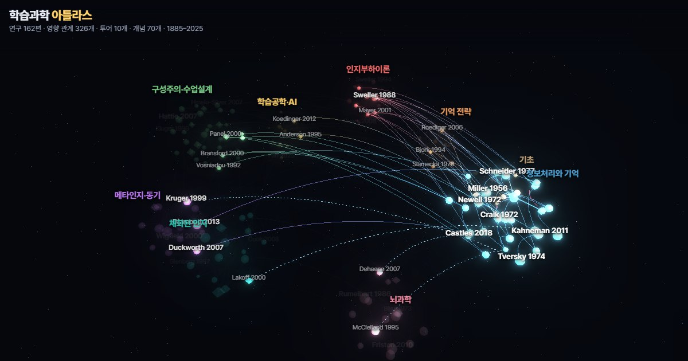

인간을 정보를 받아들이고 저장하고 꺼내 쓰는 체계로 본 전통이다. 감각기억과 작업기억, 장기기억의 구조, 주의와 자동화, 스키마와 유추, 전문성, 판단의 편향, 그리고 읽기의 인지 과정까지 여기에 모인다. 인지부하이론과 기억 전략 연구의 뿌리가 대부분 이 클러스터에 있다. 학습과학 아틀라스의 아홉 클러스터 중 2번째인 이 글은 1956년부터 2018년까지의 연구 29편을 시간순으로 정리했다. 이 분야에서 가장 많이 인용된 연구는 Tversky(1974)의 「불확실성 속의 판단, 휴리스틱과 편향」, Miller(1956)의 「마법의 수 7±2」, Kahneman(2011)의 「생각에 관한 생각」이다.

<figure>
  
  <figcaption>학습과학 아틀라스에서 정보처리 이론과 기억 체계 클러스터와 그 연결을 강조한 모습</figcaption>
</figure>

<a class="btn btn--primary" href="/tools/learning-science-atlas/?cluster=I" target="_blank">아틀라스에서 이 클러스터 보기</a>

## 한눈에 보는 흐름

| 연도 | 연구 | 한 줄 의의 |
|---|---|---|
| 1956 | 마법의 수 7±2 (Miller) | 심리학에서 가장 많이 인용된 논문 중 하나다. |
| 1958 | 지각과 의사소통 (Broadbent) | 인간을 정보가 흐르는 통신 채널로 그린 최초의 정보처리 모형을 제시했다. |
| 1960 | 짧은 시각 제시에서 이용 가능한 정보 (Sperling) | 감각기억(영상기억)의 존재를 독창적인 실험 설계로 증명했다. |
| 1968 | 인간 기억, 제안된 체계와 통제 과정 (Atkinson) | 감각기억-단기기억-장기기억의 "모달 모형"을 정식화했다. |
| 1972 | 처리 수준, 기억 연구의 틀 (Craik) | 기억은 저장 장소가 아니라 처리 방식에 달려 있다는 관점 전환을 이끌었다. |
| 1972 | 일화기억과 의미기억 (Tulving) | 장기기억을 "언제 어디서"의 일화기억과 일반 지식의 의미기억으로 나눈 고전이다. |
| 1972 | 인간 문제해결 (Newell) | 인지과학과 인공지능을 함께 세운 기념비적 저작이다. |
| 1973 | 부호화 특수성 원리 (Tulving) | 기억이 잘 떠오르려면 인출할 때의 단서가 학습할 때의 부호화와 맞아야 한다는 원리를 세웠다. |
| 1973 | 체스에서의 지각 (Chase) | 전문성의 핵심이 뛰어난 일반 지능이 아니라 장기기억에 저장된 방대한 패턴이라는 것을 보였다. |
| 1973 | 주의와 노력 (Kahneman) | 주의를 "걸러내는 필터"가 아니라 "나누어 쓰는 한정된 자원"으로 재정의했다. |
| 1974 | 작업기억 (Baddeley) | 단기기억을 수동적 저장고가 아니라 여러 하위 체계로 이루어진 "작업 공간"으로 재정의했다. |
| 1974 | 불확실성 속의 판단, 휴리스틱과 편향 (Tversky) | 인간의 판단이 체계적으로 어긋나는 방식을 보여 준 인지심리학의 고전이다. |
| 1975 | 확산 활성화 이론 (Collins) | 개념들이 연결망을 이루고, 한 개념이 떠오르면 활성화가 이웃 개념으로 퍼진다는 모형을 제시했다. |
| 1977 | 통제적 처리와 자동적 처리 (Schneider) | 충분히 연습한 처리는 주의 자원을 거의 쓰지 않는 "자동적 처리"가 된다는 것을 실험으로 정립했다. |
| 1980 | 스키마, 인지의 구성 요소 (Rumelhart) | 바틀릿의 스키마 개념을 인지과학의 정식 이론으로 다듬었다. |
| 1980 | 유추적 문제해결 (Gick) | 사람들이 비슷한 구조의 이야기를 방금 읽고도 새 문제에 거의 활용하지 못한다는 것을 보여 주었다. |
| 1980 | 특징 통합 이론 (Treisman) | 주의가 색, 모양 같은 개별 특징을 하나의 대상으로 묶는 "접착제"라는 이론을 세웠다. |
| 1981 | 전문가와 초보자의 물리 문제 범주화 (Chi) | 전문가와 초보자는 같은 문제를 다르게 "본다"는 것을 실증했다. |
| 1983 | 구조 사상 이론 (Gentner) | 좋은 유추는 겉모습이 아니라 관계 구조를 옮기는 것이라는 이론을 세웠다. |
| 1986 | 해독, 읽기, 읽기 장애 (읽기의 단순 관점) (Gough) | 읽기 이해를 "해독 × 언어 이해"라는 단순한 곱셈으로 설명한 "읽기의 단순 관점(Simple View of Reading)"을 제시했다. |
| 1993 | 전문적 수행 획득에서 의도적 연습의 역할 (Ericsson) | 재능보다 체계적 연습이 전문성을 만든다는 주장으로 교육계와 대중 담론에 큰 영향을 주었다. |
| 1996 | ACT, 복잡한 인지에 대한 단순한 이론 (Anderson) | 복잡한 인지를 수많은 작은 지식 단위의 학습으로 설명하는 인지 아키텍처 ACT-R의 핵심 주장을 정리했다. |
| 2000 | 일화적 완충기 (Baddeley) | 26년 만에 작업기억 모형에 네 번째 요소를 추가했다. |
| 2001 | 단기기억의 마법의 수 4 (Cowan) | 밀러의 7±2를 대체해 현재 가장 널리 받아들여지는 작업기억 용량 추정치(약 4청크)를 제시했다. |
| 2002 | 원전이의 분류 체계 (Barnett) | 100년 가까이 혼란스럽던 "전이" 연구를 내용과 맥락 차원으로 정리한 분류 체계다. |
| 2002 | 실행 주의로서의 작업기억 용량 (Engle) | 작업기억 용량의 개인차가 단순 저장량이 아니라 방해를 이기고 주의를 통제하는 능력이라는 관점을 정리했다. |
| 2009 | 미디어 멀티태스커의 인지 통제 (Ophir) | 여러 미디어를 동시에 많이 쓰는 사람이 오히려 방해 자극을 걸러내는 능력이 떨어진다는 결과로, 디지털 환경의 주의 문제 논쟁을 촉발했다. |
| 2011 | 생각에 관한 생각 (Kahneman) | 빠르고 직관적인 "시스템 1"과 느리고 신중한 "시스템 2"라는 틀로 인간 판단을 설명해 세계적 베스트셀러가 된 책이다. |
| 2018 | 읽기 전쟁을 끝내자 (Castles) | 수십 년 이어진 "파닉스 대 총체적 언어" 논쟁을 인지과학 증거로 정리한 종합 개관이다. |

## 연구별 요약

### 마법의 수 7±2

*George A. Miller (1956). The magical number seven, plus or minus two: Some limits on our capacity for processing information*

심리학에서 가장 많이 인용된 논문 중 하나다. 작업기억 용량 제한과 청킹 개념은 인지부하이론의 출발점이 되었다. 밀러는 절대판단 실험과 기억폭 실험 모두에서 7 안팎의 숫자가 나타난다는 점에 주목했지만, 이것이 우연의 일치일 수 있다고 보았다. 그는 두 한계를 구분해, 절대판단은 정보량(비트)에, 즉시기억은 항목 수(청크)에 제한된다고 결론지었다. 그래서 항목을 의미 있는 덩어리(청크)로 묶으면 즉시기억에 담을 수 있는 정보량이 크게 늘어난다.

> 010-1234-5678을 열한 개 숫자가 아니라 세 덩어리로 외우는 것이 청킹이다.

교실에서는 새 정보를 한 번에 너무 많이 제시하지 말고, 의미 단위로 묶어 보여 준다.

**함께 알아 둘 점** 이후 Cowan(2001)은 실제 용량을 약 4청크로 재추정했다.

### 지각과 의사소통

*Donald E. Broadbent (1958). Perception and Communication* (단행본)

인간을 정보가 흐르는 통신 채널로 그린 최초의 정보처리 모형을 제시했다. 정보처리 이론의 흐름도 전통이 여기서 시작된다. 양쪽 귀에 서로 다른 메시지를 들려주는 양분 청취 실험을 바탕으로, 감각 정보가 용량이 제한된 채널로 들어가기 전에 필터에서 선택된다는 모형을 제안했다. 주의를 받지 못한 정보는 의미 처리 전에 걸러진다고 보았다.

> 시끄러운 파티에서 한 사람 목소리만 골라 듣는 라디오 주파수 맞추기와 같다.

교실에서는 중요한 설명을 할 때는 경쟁하는 자극(소음, 동시 화면)을 줄인다.

**함께 알아 둘 점** 이후 칵테일파티 효과 등으로 늦은 선택 모형, 감쇠 모형이 제시되며 수정되었다.

### 짧은 시각 제시에서 이용 가능한 정보

*George Sperling (1960). The information available in brief visual presentations*

감각기억(영상기억)의 존재를 독창적인 실험 설계로 증명했다. 다중저장 모형의 첫 단계가 이 연구로 실증되었다. 문자 12개를 50ms 동안 보여 주면 사람들은 4개 정도만 보고했다. 그러나 화면이 사라진 직후 소리 신호로 한 줄만 보고하게 하자 어느 줄이든 대부분 맞혔다. 순간적으로는 거의 전부가 저장되지만 1초도 안 되어 사라진다는 뜻이다.

> 불꽃놀이가 사라진 뒤에도 잠깐 눈에 잔상이 남아 있는 상태다.

교실에서는 중요한 시각 정보는 잠깐 띄우고 넘기지 말고, 처리할 시간을 충분히 준다.

### 인간 기억, 제안된 체계와 통제 과정

*Richard C. Atkinson & Richard M. Shiffrin (1968). Human memory: A proposed system and its control processes*

감각기억-단기기억-장기기억의 "모달 모형"을 정식화했다. 교과서에 나오는 정보처리 이론 그림의 원형이다. 기억을 감각등록기, 단기저장고, 장기저장고라는 구조와 시연, 부호화, 인출 같은 통제 과정으로 나누었다. 단기저장고에서 정보를 되뇌면(시연) 장기저장고로 옮겨질 확률이 높아진다. 구조와 과정을 분리해 기억 연구에 수리 모형의 틀을 제공했다.

> 현관(감각기억), 책상 위(단기기억), 서재 책장(장기기억)으로 물건이 옮겨지는 집과 같다.

교실에서는 수업에서 정보가 "책상 위"에 머무는 동안 정리하고 연결할 시간을 준다.

### 처리 수준, 기억 연구의 틀

*Fergus I. M. Craik & Robert S. Lockhart (1972). Levels of processing: A framework for memory research*

기억은 저장 장소가 아니라 처리 방식에 달려 있다는 관점 전환을 이끌었다. "깊이 생각한 것이 오래 남는다"는 교육 원리의 이론적 근거다. 단어의 글자 모양을 판단하는 얕은 처리보다 의미를 생각하는 깊은 처리가 훨씬 잘 기억된다. 크레이크와 록하트는 단기와 장기의 저장고 구분 대신, 처리의 깊이가 기억 흔적의 지속성을 결정한다는 틀을 제시했다.

> "사과"가 몇 글자인지 세는 것보다 "사과로 무엇을 만들까"를 떠올릴 때 더 오래 기억난다.

교실에서는 단순 반복 암기 대신 "왜 그럴까?", "내 경험과 어떻게 연결될까?" 같은 질문을 붙인다.

**함께 알아 둘 점** "깊이"를 독립적으로 측정하기 어렵다는 순환론 비판을 받았다.

### 일화기억과 의미기억

*Endel Tulving (1972). Episodic and semantic memory*

장기기억을 "언제 어디서"의 일화기억과 일반 지식의 의미기억으로 나눈 고전이다. 이후 기억 시스템 연구의 기본 분류가 되었다. 털빙은 개인이 경험한 사건을 시공간 맥락과 함께 저장하는 일화기억과, 맥락과 분리된 사실과 개념의 의미기억을 구분했다. 두 체계는 저장 방식과 인출 조건이 다르다. 이 구분은 신경과학에서 해마와 피질의 역할 연구로 이어졌다.

> "작년 수학여행 때 경주에서 본 첨성대"는 일화기억, "첨성대는 신라 유물"은 의미기억이다.

교실에서는 개념(의미기억)을 기억에 남는 구체적 경험(일화기억)과 함께 가르치면 인출 단서가 늘어난다.

### 인간 문제해결

*Allen Newell & Herbert A. Simon (1972). Human Problem Solving* (단행본)

인지과학과 인공지능을 함께 세운 기념비적 저작이다. 사고를 기호 처리로 모델링하는 전통과 인지부하이론의 "수단-목표 분석" 개념이 여기서 나온다. 사람에게 생각을 말하게 하는 사고구술법으로 체스, 논리, 암호 문제를 푸는 과정을 분석했다. 문제해결을 초기 상태에서 목표 상태로 가는 문제공간 탐색으로 정의하고, 현재와 목표의 차이를 줄이는 수단-목표 분석을 핵심 전략으로 보았다.

> 내비게이션이 "목적지까지 남은 거리"를 줄이는 길을 계속 고르는 방식과 같다.

교실에서는 학생에게 풀이 과정을 소리 내어 말하게 하면 사고 과정을 진단할 수 있다.

### 부호화 특수성 원리

*Endel Tulving & Donald M. Thomson (1973). Encoding specificity and retrieval processes in episodic memory*

기억이 잘 떠오르려면 인출할 때의 단서가 학습할 때의 부호화와 맞아야 한다는 원리를 세웠다. 시험 상황과 학습 상황을 맞추는 논의의 이론적 근거다. 약한 연합 단서와 함께 외운 단어는 강한 연합 단서를 주어도 잘 떠오르지 않았다. 심지어 재인보다 단서 회상이 더 나은 경우도 있었다. 무엇이 좋은 단서인지는 단서 자체가 아니라 부호화할 때 함께 저장된 정보에 달려 있다.

> 노래 가사는 첫 소절이 들려야 술술 나오는데, 가사만 따로 물으면 막히는 것과 같다.

교실에서는 개념을 여러 맥락과 표현으로 익히게 해서 다양한 인출 단서를 만들어 준다.

### 체스에서의 지각

*William G. Chase & Herbert A. Simon (1973). Perception in chess*

전문성의 핵심이 뛰어난 일반 지능이 아니라 장기기억에 저장된 방대한 패턴이라는 것을 보였다. 전문가-초보자 연구와 인지부하이론의 스키마 개념에 직접 영향을 주었다. 실제 대국 배치를 5초 본 뒤 첫 시도에서 마스터는 평균 약 16개의 말을 맞게 놓아 A급 선수(약 8개)와 초보자(약 4개)를 크게 앞섰다. 반면 말을 무작위로 놓은 배치에서는 실력에 따른 차이가 없었다(참가자는 수준별 1명씩 3명). 마스터는 수만 개의 의미 있는 패턴(청크)을 장기기억에 저장하고 있어 배치를 몇 덩어리로 인식한다.

> 우리는 한글 문장을 한눈에 읽지만, 처음 보는 문자는 한 획씩 봐야 하는 것과 같다.

교실에서는 전문가처럼 생각하는 능력은 영역 지식이 쌓여야 생긴다. 일반적 "사고력"만 따로 훈련하는 접근을 경계한다.

### 주의와 노력

*Daniel Kahneman (1973). Attention and Effort* (단행본)

주의를 "걸러내는 필터"가 아니라 "나누어 쓰는 한정된 자원"으로 재정의했다. 인지부하와 정신적 노력 측정 연구의 이론적 조상이다. 카너먼은 사람이 쓸 수 있는 정신적 노력의 총량이 제한되어 있고, 과제 요구에 따라 그 자원이 배분된다고 보았다. 어려운 암산을 할수록 동공이 커지는 현상을 노력의 생리적 지표로 제시했다. 각성 수준, 과제 요구, 의도가 자원 배분을 결정한다.

> 정해진 용돈(주의 자원)을 여러 군데 나누어 쓰는 것과 같아서, 한곳에 많이 쓰면 다른 곳이 모자란다.

교실에서는 새 개념을 설명할 때는 동시에 처리해야 할 다른 과제(필기, 자료 찾기)를 줄여 노력이 한곳에 모이게 한다.

### 작업기억

*Alan D. Baddeley & Graham Hitch (1974). Working memory*

단기기억을 수동적 저장고가 아니라 여러 하위 체계로 이루어진 "작업 공간"으로 재정의했다. 멀티미디어 학습의 양식 효과와 인지부하이론이 이 모형에 기대고 있다. 숫자를 외우면서 추론 과제를 해도 수행이 생각보다 크게 무너지지 않았다. 배들리와 히치는 말소리 정보를 다루는 음운 루프, 시각 공간 정보를 다루는 시공간 잡기장, 이를 조율하는 중앙 집행기로 이루어진 작업기억 모형을 제안했다.

> 한 사람이 왼손(소리)과 오른손(그림)을 따로 쓰고, 머리(집행기)가 두 손을 지휘하는 모습이다.

교실에서는 그림을 보여 줄 때 설명은 화면 글보다 말로 하면 두 채널을 나누어 쓸 수 있다.

### 불확실성 속의 판단, 휴리스틱과 편향

*Amos Tversky & Daniel Kahneman (1974). Judgment under uncertainty: Heuristics and biases*

인간의 판단이 체계적으로 어긋나는 방식을 보여 준 인지심리학의 고전이다. 행동경제학과 의사결정 연구를 열었다. 사람은 확률을 정확히 계산하는 대신 대표성(전형적인 모습과 닮았는가), 가용성(얼마나 쉽게 떠오르는가), 기준점과 조정(처음 본 숫자에서 조금 움직이기) 같은 어림법을 쓴다. 이 어림법은 대체로 쓸모 있지만 기저율 무시, 표본 크기 무시 같은 예측 가능한 오류를 낳는다.

> 비행기 사고 뉴스를 많이 보면 자동차보다 비행기가 더 위험하다고 느끼는 것이 가용성 휴리스틱이다.

교실에서는 학생이 "느낌상 맞는 답"과 실제 근거를 구분하도록, 직관 예측 뒤 자료로 확인하는 활동을 넣는다.

### 확산 활성화 이론

*Allan M. Collins & Elizabeth F. Loftus (1975). A spreading-activation theory of semantic processing*

개념들이 연결망을 이루고, 한 개념이 떠오르면 활성화가 이웃 개념으로 퍼진다는 모형을 제시했다. 점화 효과와 연상 기억 연구의 기본 틀이다. 장기기억 속 개념은 의미적 거리에 따라 연결된 그물망을 이룬다. "빨강"이 활성화되면 "불", "사과", "장미"처럼 가까운 개념이 함께 활성화되어 더 빨리 인식된다. 연결이 많고 강할수록 활성화가 잘 퍼진다.

> "여름"을 들으면 바다, 수박, 방학이 줄줄이 떠오르는 머릿속 거미줄이다.

교실에서는 새 개념을 가르칠 때 이미 아는 여러 개념과 명시적으로 연결해 주면 인출 경로가 늘어난다.

### 통제적 처리와 자동적 처리

*Walter Schneider & Richard M. Shiffrin (1977). Controlled and automatic human information processing: I. Detection, search, and attention*

충분히 연습한 처리는 주의 자원을 거의 쓰지 않는 "자동적 처리"가 된다는 것을 실험으로 정립했다. 기초 기능의 자동화가 왜 중요한지에 대한 근거다. 참가자들이 화면에서 목표 문자를 찾는 과제를 수천 번 연습했다. 목표와 방해 자극의 역할이 늘 같은 "일관된 대응" 조건에서는 탐색이 자동화되어 항목 수가 늘어도 속도가 거의 떨어지지 않았다. 역할이 계속 바뀌는 조건에서는 끝까지 느리고 노력이 드는 통제적 처리가 필요했다.

> 처음엔 기어 변속에 온 신경을 쓰지만, 익숙해지면 대화하면서도 저절로 손이 움직인다.

교실에서는 구구단, 해독, 기본 연산처럼 상위 사고의 재료가 되는 기능은 자동화될 때까지 짧고 잦게 연습시킨다.

### 스키마, 인지의 구성 요소

*David E. Rumelhart (1980). Schemata: The building blocks of cognition*

바틀릿의 스키마 개념을 인지과학의 정식 이론으로 다듬었다. 읽기 이해 교육과 배경지식 활성화 전략의 이론적 기반이다. 스키마는 대상, 사건, 행동에 대한 일반 지식의 묶음으로, 빈칸(변수)과 기본값을 가진다. "식당" 스키마에는 손님, 메뉴, 주문, 계산 같은 칸이 있어, 글에 없는 내용도 기본값으로 채워 이해한다. 이해란 입력에 맞는 스키마를 찾아 칸을 채우는 과정이다.

> "식당에 갔다"는 한 문장만 들어도 메뉴판과 계산서가 떠오르는 것이 스키마의 힘이다.

교실에서는 글을 읽기 전에 관련 경험을 떠올리게 하면 학생이 빈칸을 채울 스키마를 미리 꺼내 놓는다.

### 유추적 문제해결

*Mary L. Gick & Keith J. Holyoak (1980). Analogical problem solving*

사람들이 비슷한 구조의 이야기를 방금 읽고도 새 문제에 거의 활용하지 못한다는 것을 보여 주었다. "전이는 저절로 일어나지 않는다"는 교육적 교훈의 고전 근거다. 참가자들은 병력을 나누어 여러 방향에서 요새를 공격하는 이야기를 읽은 뒤, 방사선을 여러 방향에서 약하게 쏘아 종양을 치료하는 문제(던커의 방사선 문제)를 풀었다. 이야기를 활용하라는 힌트가 없을 때는 약 30%만 해법을 찾았지만, 힌트를 주자 약 75%가 해결했다. 두 사례를 비교하게 하면 추상적 원리(스키마)가 생겨 전이가 늘어난다는 결과는 후속 연구(Gick & Holyoak, 1983)에서 나왔다.

> 요리법을 알고도 재료가 바뀌면 같은 원리를 못 알아보는 것과 같다.

교실에서는 겉모습이 다른 두 사례를 나란히 놓고 "공통 원리는 무엇인가"를 직접 비교하게 한다.

### 특징 통합 이론

*Anne M. Treisman & Garry Gelade (1980). A feature-integration theory of attention*

주의가 색, 모양 같은 개별 특징을 하나의 대상으로 묶는 "접착제"라는 이론을 세웠다. 시각 주의 연구의 중심 이론이다. 빨간 원들 사이의 파란 원은 개수와 상관없이 즉시 튀어나와 보인다(특징 탐색). 그러나 빨간 사각형과 파란 원 사이에서 파란 사각형을 찾으려면 하나씩 살펴야 해 개수가 늘수록 오래 걸렸다(결합 탐색). 주의가 주어지지 않으면 특징이 잘못 결합되는 착각 결합도 나타났다.

> 흰 셔츠 무리 속 빨간 셔츠는 바로 보이지만, "빨간 모자에 파란 셔츠"를 입은 친구는 한 명씩 훑어야 찾는다.

교실에서는 자료에서 꼭 봐야 할 부분은 색이나 굵기 하나로 튀게 표시해 학생이 찾느라 주의를 쓰지 않게 한다.

### 전문가와 초보자의 물리 문제 범주화

*Michelene T. H. Chi 외 (1981). Categorization and representation of physics problems by experts and novices*

전문가와 초보자는 같은 문제를 다르게 "본다"는 것을 실증했다. 전이와 개념 이해 연구의 고전이다. 물리 문제를 비슷한 것끼리 분류하게 하자 초보자는 "경사면", "도르래" 같은 표면 특징으로 묶었다. 전문가는 "에너지 보존", "뉴턴 제2법칙" 같은 원리로 묶었다. 전문가의 지식은 원리 중심으로 조직되어 있어 문제를 보자마자 풀이 전략이 활성화된다.

> 초보 요리사는 "빨간 음식"끼리, 셰프는 "볶음 요리"끼리 묶는 것과 같다.

교실에서는 겉모습은 다르지만 원리가 같은 문제를 나란히 비교하게 하는 활동이 심층 구조를 보게 한다.

### 구조 사상 이론

*Dedre Gentner (1983). Structure-mapping: A theoretical framework for analogy*

좋은 유추는 겉모습이 아니라 관계 구조를 옮기는 것이라는 이론을 세웠다. 비유와 모형을 활용한 과학 교육의 이론적 기반이다. "원자는 태양계와 같다"는 유추에서 옮겨지는 것은 "노랗다", "뜨겁다" 같은 속성이 아니라 "중심 물체가 주변 물체를 끌어당기며 돈다"는 관계다. 겐트너는 서로 연결된 관계 체계를 많이 옮길수록 좋은 유추라는 체계성 원리를 제시했다.

> 전기 회로를 물 흐르는 관에 비유할 때 중요한 것은 "물이 젖는다"가 아니라 "압력 차가 흐름을 만든다"는 관계다.

교실에서는 비유를 쓸 때 무엇이 대응되고 무엇은 대응되지 않는지 표로 정리하게 한다.

### 해독, 읽기, 읽기 장애 (읽기의 단순 관점)

*Philip B. Gough & William E. Tunmer (1986). Decoding, reading, and reading disability*

읽기 이해를 "해독 × 언어 이해"라는 단순한 곱셈으로 설명한 "읽기의 단순 관점(Simple View of Reading)"을 제시했다. 읽기 교육과 진단의 가장 영향력 있는 틀 중 하나다. 읽기 이해는 글자를 소리와 단어로 바꾸는 해독 능력과, 들어서 이해하는 언어 이해 능력의 곱이다. 둘 중 하나라도 0이면 읽기 이해도 0이 된다. 그래서 읽기 부진은 해독 문제, 언어 이해 문제, 또는 둘 다의 문제로 나누어 진단해야 한다.

> 글자를 술술 읽어도 뜻을 모르면, 뜻을 알아도 글자를 못 읽으면 결국 읽지 못한 것이다.

교실에서는 읽기 부진 학생은 소리 내어 읽기(해독)와 들려주고 질문하기(언어 이해)를 따로 확인해 원인을 나눈다.

### 전문적 수행 획득에서 의도적 연습의 역할

*K. Anders Ericsson 외 (1993). The role of deliberate practice in the acquisition of expert performance*

재능보다 체계적 연습이 전문성을 만든다는 주장으로 교육계와 대중 담론에 큰 영향을 주었다. 말콤 글래드웰이 대중화한 "1만 시간의 법칙"의 근거 자료가 되었지만, 저자들은 정해진 마법의 숫자는 없다고 밝혔다. 베를린 음악원 바이올린 전공생을 수준별로 나누어 비교하자, 18세까지 누적 혼자 연습 시간은 최상위 집단이 평균 약 7,410시간으로 우수 집단(약 5,301시간)과 음악교사 집단(약 3,420시간)보다 많았다. 1만 시간은 그래프상 20세 무렵의 추정치다. 연구진은 단순 반복이 아니라 약점을 겨냥하고 즉각 피드백을 받으며 집중하는 "의도적 연습"이 핵심이라고 보았다.

> 좋아하는 곡만 반복 연주하는 것이 아니라 틀리는 소절만 골라 천천히 고치는 연습이다.

교실에서는 연습 과제는 학생 수준보다 약간 어렵게, 구체적 목표와 피드백을 함께 설계한다.

**함께 알아 둘 점** Macnamara 등(2014) 메타분석은 연습이 수행 차이의 일부만 설명한다고 보고해 논쟁이 이어졌다.

### ACT, 복잡한 인지에 대한 단순한 이론

*John R. Anderson (1996). ACT: A simple theory of complex cognition*

복잡한 인지를 수많은 작은 지식 단위의 학습으로 설명하는 인지 아키텍처 ACT-R의 핵심 주장을 정리했다. 인지 튜터와 지식 요소(KC) 기반 학습공학의 이론적 토대다. 앤더슨은 인지를 "무엇"에 대한 선언적 지식(청크)과 "어떻게"에 대한 절차적 지식(산출 규칙)으로 나누었다. 복잡한 기술은 수많은 작은 규칙의 합이며, 각 규칙은 연습을 통해 하나씩 습득되고 강화된다. 그래서 충분한 연습만 있으면 복잡한 능력도 습득 가능하다는 낙관적 결론을 냈다.

> 운전이라는 복잡한 기술도 "빨간불이면 멈춘다" 같은 수백 개 규칙이 자동화된 결과다.

교실에서는 목표 기술을 작은 지식 요소로 쪼개고 요소별 숙달 정도를 추적한다.

### 일화적 완충기

*Alan D. Baddeley (2000). The episodic buffer: a new component of working memory?*

26년 만에 작업기억 모형에 네 번째 요소를 추가했다. 작업기억과 장기기억이 어떻게 만나는지 설명하는 연결고리를 제공했다. 기존 모형으로는 사람이 문장을 단어 목록보다 훨씬 많이 기억하는 현상이나, 서로 다른 감각 정보를 하나의 장면으로 묶는 능력을 설명하기 어려웠다. 배들리는 여러 출처의 정보를 통합된 일화로 묶어 잠시 유지하는 일화적 완충기를 제안했다.

> 소리와 그림 재료를 한 장면으로 엮어 잠깐 펼쳐 두는 작은 무대다.

교실에서는 말, 그림, 몸동작을 하나의 이야기로 엮어 제시하면 통합된 기억을 만들기 쉽다.

### 단기기억의 마법의 수 4

*Nelson Cowan (2001). The magical number 4 in short-term memory: A reconsideration of mental storage capacity*

밀러의 7±2를 대체해 현재 가장 널리 받아들여지는 작업기억 용량 추정치(약 4청크)를 제시했다. 코완은 시연과 청킹을 막은 실험들을 폭넓게 검토해, 순수한 저장 용량은 3~5청크, 평균 약 4청크라고 결론지었다. 7이라는 숫자는 사람들이 몰래 묶거나 되뇌어 부풀려진 값이라는 것이다. 이 한계는 주의의 초점이 동시에 붙잡을 수 있는 대상 수로 해석된다.

> 손으로 한 번에 쥘 수 있는 공은 7개가 아니라 4개 정도라는 이야기다.

교실에서는 한 번에 새로 도입하는 요소는 3~4개 이내로 제한한다.

### 원전이의 분류 체계

*Susan M. Barnett & Stephen J. Ceci (2002). When and where do we apply what we learn? A taxonomy for far transfer*

100년 가까이 혼란스럽던 "전이" 연구를 내용과 맥락 차원으로 정리한 분류 체계다. 전이 연구를 비교 가능하게 만든 기준점이다. 전이를 "무엇이 전이되는가"(기술의 종류, 수행의 변화, 기억 요구)와 "어디로 전이되는가"(지식 영역, 물리적 맥락, 시간, 기능, 사회적 맥락, 양식)의 아홉 차원으로 나누었다. 같은 "전이 성공" 연구라도 이 차원에서 얼마나 멀리 갔는지가 크게 다르다는 점을 보였다.

> 교실에서 배운 분수를 다음 날 같은 교실 시험에 쓰는 것과, 몇 년 뒤 부엌에서 레시피를 반으로 줄일 때 쓰는 것은 다른 거리의 전이다.

교실에서는 평가 문항을 만들 때 맥락, 시간, 형식을 조금씩 바꾼 "먼 전이" 문항을 일부러 넣는다.

### 실행 주의로서의 작업기억 용량

*Randall W. Engle (2002). Working memory capacity as executive attention*

작업기억 용량의 개인차가 단순 저장량이 아니라 방해를 이기고 주의를 통제하는 능력이라는 관점을 정리했다. 작업기억 용량이 큰 사람은 읽기 이해, 추론, 유동 지능 과제를 더 잘한다. 엥글은 그 이유가 기억 칸 수보다, 자동적 반응을 억제하고 목표를 유지하는 실행 주의에 있다고 보았다. 예컨대 화면에 불빛이 번쩍인 반대쪽을 보라는 과제에서 용량이 큰 사람이 덜 끌려갔다.

> 책상이 넓어서가 아니라 쓸데없는 물건을 잘 치우는 사람이 일을 잘하는 것과 비슷하다.

교실에서는 작업기억이 약한 학생에게는 방해 요소를 줄이고, 목표를 눈에 보이게 적어 두는 지원이 효과적이다.

### 미디어 멀티태스커의 인지 통제

*Eyal Ophir 외 (2009). Cognitive control in media multitaskers*

여러 미디어를 동시에 많이 쓰는 사람이 오히려 방해 자극을 걸러내는 능력이 떨어진다는 결과로, 디지털 환경의 주의 문제 논쟁을 촉발했다. 대학생들의 미디어 동시 사용 정도를 조사해 상위 집단과 하위 집단을 비교했다. 멀티태스킹을 많이 하는 집단은 무관한 자극을 무시하는 과제, 기억 속 방해 정보를 걸러내는 과제, 심지어 과제 전환에서도 더 나쁜 수행을 보였다. 저자들은 이들이 주의를 넓게 펼치는 대신 걸러내는 통제가 약하다고 해석했다.

> 여러 창을 띄워 놓고 일하는 습관이 "집중력 근육"을 오히려 약하게 만들 수 있다.

교실에서는 과제 시간에는 알림과 다른 탭을 닫는 "한 가지만 하기" 규칙을 함께 정한다.

**함께 알아 둘 점** 후속 연구들의 결과는 엇갈려, 멀티태스킹과 주의 통제의 관계와 인과 방향은 아직 논쟁 중이다.

### 생각에 관한 생각

*Daniel Kahneman (2011). Thinking, Fast and Slow* (단행본)

빠르고 직관적인 "시스템 1"과 느리고 신중한 "시스템 2"라는 틀로 인간 판단을 설명해 세계적 베스트셀러가 된 책이다. 수십 년의 휴리스틱과 편향 연구를 집대성했다. 시스템 1은 자동적이고 노력이 들지 않으며 패턴과 인상으로 빠르게 판단한다. 시스템 2는 주의와 노력을 들여 계산하고 검토하지만 게을러서 시스템 1의 판단을 그대로 승인하기 쉽다. 기준점 효과, 가용성, 손실 회피, 계획 오류 등 다양한 편향이 이 두 체계의 상호작용에서 나온다.

> "2+2=?"은 시스템 1이, "17×24=?"는 시스템 2가 푼다.

교실에서는 학생이 직관적 답을 낸 뒤 "정말 그런가?"를 따져 보는 단계를 넣어 시스템 2를 깨우는 습관을 기른다.

**함께 알아 둘 점** 책에 소개된 점화(priming) 연구 일부는 재현에 실패했으며, 카너먼 자신도 이를 인정했다.

### 읽기 전쟁을 끝내자

*Anne Castles 외 (2018). Ending the reading wars: Reading acquisition from novice to expert*

수십 년 이어진 "파닉스 대 총체적 언어" 논쟁을 인지과학 증거로 정리한 종합 개관이다. 초기 해독 교육과 이후의 지식·언어 교육을 함께 강조한다. 알파벳 문자 체계를 배우는 초기에는 체계적인 파닉스 교육이 강력한 근거를 가진다. 그러나 숙련된 독자가 되려면 많은 읽기 경험을 통해 단어를 즉시 알아보는 능력을 키우고, 어휘와 배경지식, 글 구조 이해까지 갖춰야 한다. 저자들은 초보에서 전문가까지의 단계마다 필요한 교육이 다르다고 정리했다.

> 자전거를 배울 때 보조바퀴(파닉스)가 꼭 필요하지만, 평생 보조바퀴만 달고 다니지는 않는다.

교실에서는 저학년은 해독을 체계적으로 가르치고, 고학년으로 갈수록 폭넓은 독서, 어휘, 배경지식 교육의 비중을 늘린다.

## 이 분야의 핵심 개념

- **작업기억**(working memory). 지금 이 순간 정보를 붙잡아 두고 조작하는 머릿속 작업대. 용량이 매우 작아(약 4개 덩어리) 학습의 병목이 된다.
- **청킹**(chunking). 여러 정보를 의미 있는 한 덩어리로 묶는 것. 전문가는 큰 덩어리로 묶어 좁은 작업기억을 넓게 쓴다.
- **장기기억**(long-term memory). 사실상 용량 제한이 없는 지식의 저장소. 학습이란 결국 장기기억의 변화다.
- **일화기억과 의미기억**(episodic & semantic memory). "언제, 어디서"가 붙은 개인 경험의 기억과, 맥락에서 떨어진 일반 지식의 기억.
- **스키마**(schema). 경험에서 추려진 지식의 틀. 새 정보를 해석하는 렌즈이자 빈칸을 채우는 기본값 역할을 한다.
- **처리 수준**(levels of processing). 얼마나 깊이(의미 중심으로) 생각했는지가 기억의 지속성을 좌우한다는 원리.
- **부호화 특수성**(encoding specificity). 배울 때 함께 저장된 단서가 인출할 때 주어져야 잘 떠오른다는 원리.
- **확산 활성화**(spreading activation). 한 개념이 떠오르면 연결된 개념들도 함께 활성화되는 머릿속 그물망의 작동 방식.
- **자동화**(automaticity). 충분히 연습한 처리가 주의를 거의 쓰지 않고 저절로 일어나는 상태. 기초 기능의 자동화가 고차 사고의 여유를 만든다.
- **주의**(attention). 한정된 처리 자원을 어디에 쓸지 고르는 기능. 필터, 자원, 특징을 묶는 접착제 등으로 설명된다.
- **시스템 1과 시스템 2**(dual process). 빠르고 직관적인 사고와 느리고 신중한 사고의 두 방식.
- **양식 효과와 이중 채널**(modality effect). 그림을 볼 때 설명은 화면 글보다 말로 들려줄 때 두 채널을 나눠 써서 더 잘 배운다는 효과.
- **유추와 전이**(analogy & transfer). 배운 것을 새 상황에 적용하는 것. 겉모습이 아니라 관계 구조를 볼 때 일어나며 저절로 일어나지 않는다.
- **실행기능**(executive functions). 억제 통제, 작업기억, 인지적 유연성으로 이루어진 마음의 관제 기능.
- **읽기의 단순 관점과 파닉스**(simple view of reading). 읽기 이해 = 해독 × 언어 이해. 초기에는 소리-글자 대응을 체계적으로 가르치는 파닉스가 핵심이다.
- **지식 요소**(knowledge component). 학습 대상을 이루는 작은 지식 단위. 단위마다 맞는 교수법이 다르다.

## 다른 분야와 이어지는 다리

이 클러스터는 다른 분야와 44개의 선으로 이어진다.

- 기억에 관하여(1885, 기초) → 인간 기억, 제안된 체계와 통제 과정(1968, 정보처리와 기억). 실험적 기억 연구 전통
- 동물 지능, 연합 과정의 실험 연구(1898, 기초) → 원전이의 분류 체계(2002, 정보처리와 기억). 손다이크 전이 전통에서 전이 분류로
- 기억하기(1932, 기초) → 스키마, 인지의 구성 요소(1980, 정보처리와 기억). 스키마의 이론화
- 쥐와 인간의 인지도(1948, 기초) → 인간 문제해결(1972, 정보처리와 기억). 목적 지향적 인지
- 마법의 수 7±2(1956, 정보처리와 기억) → 문제해결 중 인지부하와 학습(1988, 인지부하이론). 작업기억 한계
- 마법의 수 7±2(1956, 정보처리와 기억) → 인지심리학(1967, 기초). 정보처리 관점
- 지각과 의사소통(1958, 정보처리와 기억) → 인지심리학(1967, 기초). 주의와 지각
- 스키너 「언어 행동」 서평(1959, 기초) → 인간 문제해결(1972, 정보처리와 기억). 인지혁명
- 짧은 시각 제시에서 이용 가능한 정보(1960, 정보처리와 기억) → 인지심리학(1967, 기초). 영상 기억 개념화
- 인지심리학(1967, 기초) → 인간 기억, 제안된 체계와 통제 과정(1968, 정보처리와 기억). 인지심리학의 틀
- 인간 기억, 제안된 체계와 통제 과정(1968, 정보처리와 기억) → 인지 구조와 교수설계(1998, 인지부하이론). 인지 구조 가정
- 처리 수준, 기억 연구의 틀(1972, 정보처리와 기억) → 생성 효과(1978, 기억 전략). 깊은 처리와 생성
- 처리 수준, 기억 연구의 틀(1972, 정보처리와 기억) → 인간 훈련에서의 기억과 메타기억 고려사항(1994, 기억 전략). 처리 방식이 기억을 결정
- 일화기억과 의미기억(1972, 정보처리와 기억) → 상보적 학습 시스템 이론(1995, 뇌과학). 일화기억과 해마
- 인간 문제해결(1972, 정보처리와 기억) → 문제해결 중 인지부하와 학습(1988, 인지부하이론). 수단-목표 분석
- 인간 문제해결(1972, 정보처리와 기억) → 인지 튜터, 얻은 교훈(1995, 학습공학·AI). 산출 시스템 기반 튜터
- 처리 수준, 기억 연구의 틀(1972, 정보처리와 기억) → 펜은 키보드보다 강하다(2014, 기억 전략). 깊은 처리와 필기
- 부호화 특수성 원리(1973, 정보처리와 기억) → 시험을 통한 학습 증진(2006, 기억 전략). 인출 과정 중심 기억관
- 체스에서의 지각(1973, 정보처리와 기억) → 문제해결 중 인지부하와 학습(1988, 인지부하이론). 장기기억 스키마
- 주의와 노력(1973, 정보처리와 기억) → 문제해결 중 인지부하와 학습(1988, 인지부하이론). 한정된 정신 자원
- 주의와 노력(1973, 정보처리와 기억) → 통계 문제해결 전이를 위한 훈련 전략(1992, 인지부하이론). 정신적 노력 측정
- 체스에서의 지각(1973, 정보처리와 기억) → 사람은 어떻게 학습하는가(2000, 구성주의·수업설계). 전문가의 패턴 재인
- 작업기억(1974, 정보처리와 기억) → 멀티미디어 학습에서 인지부하를 줄이는 아홉 가지 방법(2003, 인지부하이론). 이중 채널과 양식 효과
- 작업기억(1974, 정보처리와 기억) → 문제해결 중 인지부하와 학습(1988, 인지부하이론). 작업기억 과부하
- 불확실성 속의 판단, 휴리스틱과 편향(1974, 정보처리와 기억) → 무능하면서 그것을 모른다(1999, 메타인지·동기). 판단의 체계적 편향
- 작업기억(1974, 정보처리와 기억) → 멀티미디어 학습(2001, 인지부하이론). 이중 채널 가정
- 통제적 처리와 자동적 처리(1977, 정보처리와 기억) → 인지 구조와 교수설계(1998, 인지부하이론). 스키마 자동화
- 스키마, 인지의 구성 요소(1980, 정보처리와 기억) → 문제해결 중 인지부하와 학습(1988, 인지부하이론). 스키마 획득
- 스키마, 인지의 구성 요소(1980, 정보처리와 기억) → 지구에 대한 정신 모형(1992, 구성주의·수업설계). 지식 구조와 이해
- 유추적 문제해결(1980, 정보처리와 기억) → 설명할 때(1998, 구성주의·수업설계). 사례 비교와 전이
- 전문가와 초보자의 물리 문제 범주화(1981, 정보처리와 기억) → 자기 설명, 학생이 예제를 공부하고 활용하는 방식(1989, 구성주의·수업설계). 예제 학습과 자기 설명
- 전문가와 초보자의 물리 문제 범주화(1981, 정보처리와 기억) → 전문성 역전 효과(2003, 인지부하이론). 전문성에 따른 차이
- 전문가와 초보자의 물리 문제 범주화(1981, 정보처리와 기억) → 사람은 어떻게 학습하는가(2000, 구성주의·수업설계). 전문가와 초보자의 차이
- 구조 사상 이론(1983, 정보처리와 기억) → 수학은 어디에서 오는가(2000, 체화된 인지). 관계 구조와 은유
- 해독, 읽기, 읽기 장애 (읽기의 단순 관점)(1986, 정보처리와 기억) → 미국 국가읽기위원회 보고서(2000, 구성주의·수업설계). 해독과 이해
- 전문적 수행 획득에서 의도적 연습의 역할(1993, 정보처리와 기억) → 전문성 역전 효과(2003, 인지부하이론). 전문성 발달
- 전문적 수행 획득에서 의도적 연습의 역할(1993, 정보처리와 기억) → 그릿, 장기 목표를 향한 끈기와 열정(2007, 메타인지·동기). 장기적 노력
- ACT, 복잡한 인지에 대한 단순한 이론(1996, 정보처리와 기억) → 지식-학습-교수(KLI) 프레임워크(2012, 학습공학·AI). 지식 요소 모형
- 일화적 완충기(2000, 정보처리와 기억) → 인지 구조와 교수설계, 20년 후(2019, 인지부하이론). 작업기억 개정 반영
- 미국 국가읽기위원회 보고서(2000, 구성주의·수업설계) → 읽기 전쟁을 끝내자(2018, 정보처리와 기억). 파닉스 근거
- 단기기억의 마법의 수 4(2001, 정보처리와 기억) → 인지 구조와 교수설계, 20년 후(2019, 인지부하이론). 작업기억 용량
- 실행 주의로서의 작업기억 용량(2002, 정보처리와 기억) → 인지 구조와 교수설계, 20년 후(2019, 인지부하이론). 작업기억과 주의 통제
- 실행 주의로서의 작업기억 용량(2002, 정보처리와 기억) → 실행기능(2013, 메타인지·동기). 작업기억과 실행 통제
- 피질 지도의 문화적 재활용(2007, 뇌과학) → 읽기 전쟁을 끝내자(2018, 정보처리와 기억). 읽기의 뇌

## 이 분야가 나오는 투어

- [작업기억에서 인지부하이론까지](/tools/learning-science-atlas/?tour=clt). 머릿속 작업 공간이 좁다는 발견이 어떻게 교실 수업 설계의 원리가 되었는지 따라간다.
- [읽고 셈하는 뇌, 읽기와 수의 과학](/tools/learning-science-atlas/?tour=readmath). 말하기는 저절로 배우지만 읽기와 수학은 가르쳐야 한다. 문화적 발명을 배우는 뇌의 과학.

## 참고 자료

- George A. Miller (1956). *The magical number seven, plus or minus two: Some limits on our capacity for processing information*. <https://doi.org/10.1037/h0043158>
- Donald E. Broadbent (1958). *Perception and Communication*. <https://doi.org/10.1037/10037-000>
- George Sperling (1960). *The information available in brief visual presentations*. <https://doi.org/10.1037/h0093759>
- Richard C. Atkinson & Richard M. Shiffrin (1968). *Human memory: A proposed system and its control processes*. <https://doi.org/10.1016/S0079-7421(08)60422-3>
- Fergus I. M. Craik & Robert S. Lockhart (1972). *Levels of processing: A framework for memory research*. <https://doi.org/10.1016/S0022-5371(72)80001-X>
- Endel Tulving (1972). *Episodic and semantic memory*. <https://doi.org/10.1002/(sici)1098-1063(1998)8:3<205::aid-hipo3>3.0.co;2-i>
- Allen Newell & Herbert A. Simon (1972). *Human Problem Solving*.
- Endel Tulving & Donald M. Thomson (1973). *Encoding specificity and retrieval processes in episodic memory*. <https://doi.org/10.1037/h0020071>
- William G. Chase & Herbert A. Simon (1973). *Perception in chess*. <https://doi.org/10.1016/0010-0285(73)90004-2>
- Daniel Kahneman (1973). *Attention and Effort*.
- Alan D. Baddeley & Graham Hitch (1974). *Working memory*. <https://doi.org/10.1016/S0079-7421(08)60452-1>
- Amos Tversky & Daniel Kahneman (1974). *Judgment under uncertainty: Heuristics and biases*. <https://doi.org/10.1126/science.185.4157.1124>
- Allan M. Collins & Elizabeth F. Loftus (1975). *A spreading-activation theory of semantic processing*. <https://doi.org/10.1037/0033-295X.82.6.407>
- Walter Schneider & Richard M. Shiffrin (1977). *Controlled and automatic human information processing: I. Detection, search, and attention*. <https://doi.org/10.1037/0033-295X.84.1.1>
- David E. Rumelhart (1980). *Schemata: The building blocks of cognition*.
- Mary L. Gick & Keith J. Holyoak (1980). *Analogical problem solving*. <https://doi.org/10.1016/0010-0285(80)90013-4>
- Anne M. Treisman & Garry Gelade (1980). *A feature-integration theory of attention*. <https://doi.org/10.1016/0010-0285(80)90005-5>
- Michelene T. H. Chi, Paul J. Feltovich & Robert Glaser (1981). *Categorization and representation of physics problems by experts and novices*. <https://doi.org/10.1207/s15516709cog0502_2>
- Dedre Gentner (1983). *Structure-mapping: A theoretical framework for analogy*. <https://doi.org/10.1207/s15516709cog0702_3>
- Philip B. Gough & William E. Tunmer (1986). *Decoding, reading, and reading disability*. <https://doi.org/10.1177/074193258600700104>
- K. Anders Ericsson, Ralf T. Krampe & Clemens Tesch-Römer (1993). *The role of deliberate practice in the acquisition of expert performance*. <https://doi.org/10.1037/0033-295X.100.3.363>
- John R. Anderson (1996). *ACT: A simple theory of complex cognition*. <https://doi.org/10.1037/0003-066X.51.4.355>
- Alan D. Baddeley (2000). *The episodic buffer: a new component of working memory?*. <https://doi.org/10.1016/S1364-6613(00)01538-2>
- Nelson Cowan (2001). *The magical number 4 in short-term memory: A reconsideration of mental storage capacity*. <https://doi.org/10.1017/S0140525X01003922>
- Susan M. Barnett & Stephen J. Ceci (2002). *When and where do we apply what we learn? A taxonomy for far transfer*. <https://doi.org/10.1037/0033-2909.128.4.612>
- Randall W. Engle (2002). *Working memory capacity as executive attention*. <https://doi.org/10.1111/1467-8721.00160>
- Eyal Ophir, Clifford Nass & Anthony D. Wagner (2009). *Cognitive control in media multitaskers*. <https://doi.org/10.1073/pnas.0903620106>
- Daniel Kahneman (2011). *Thinking, Fast and Slow*.
- Anne Castles, Kathleen Rastle & Kate Nation (2018). *Ending the reading wars: Reading acquisition from novice to expert*. <https://doi.org/10.1177/1529100618772271>
- 인용 수: OpenAlex (2026년 11월 수집) <https://openalex.org>
