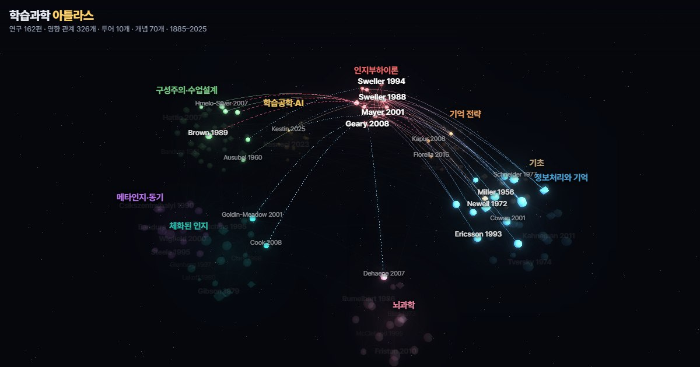

**학습과학 아틀라스 시리즈** · [허브](/post/learning-science-atlas/) · [1 기초](/post/learning-science-atlas-01-foundations/) · [2 정보처리](/post/learning-science-atlas-02-information-processing/) · **3 인지부하** · [4 기억 전략](/post/learning-science-atlas-04-memory-strategies/) · [5 구성주의](/post/learning-science-atlas-05-constructivism-instruction/) · [6 메타인지·동기](/post/learning-science-atlas-06-metacognition-motivation/) · [7 체화된 인지](/post/learning-science-atlas-07-embodied-cognition/) · [8 뇌과학](/post/learning-science-atlas-08-neuroscience/) · [9 학습공학·AI](/post/learning-science-atlas-09-learning-engineering-ai/) · [개념 사전](/post/learning-science-atlas-glossary/) · [3D 지도 열기](/tools/learning-science-atlas/)

작업기억이 좁다는 사실을 수업 설계의 출발점으로 삼은 이론군이다. 풀이 예제, 주의 분산, 양식, 중복, 전문성 역전 효과처럼 교재와 슬라이드를 만들 때 바로 쓸 수 있는 원리가 이 계보에서 나왔다. 학습과학 아틀라스의 아홉 클러스터 중 3번째인 이 글은 1985년부터 2019년까지의 연구 15편을 시간순으로 정리했다. 이 분야에서 가장 많이 인용된 연구는 Sweller(1988)의 「문제해결 중 인지부하와 학습」, Kirschner(2006)의 「최소 안내 교수가 효과가 없는 이유」, Sweller(1998)의 「인지 구조와 교수설계」이다.

<figure>
  
  <figcaption>학습과학 아틀라스에서 인지부하이론과 멀티미디어 학습 클러스터와 그 연결을 강조한 모습</figcaption>
</figure>

<a class="btn btn--primary" href="/tools/learning-science-atlas/?cluster=C" target="_blank">아틀라스에서 이 클러스터 보기</a>

## 한눈에 보는 흐름

| 연도 | 연구 | 한 줄 의의 |
|---|---|---|
| 1985 | 대수 학습에서 문제풀이 대신 풀이 예제 사용 (Sweller) | "문제를 많이 풀어야 실력이 는다"는 상식을 뒤집은 실험이다. |
| 1988 | 문제해결 중 인지부하와 학습 (Sweller) | 인지부하이론(CLT)을 처음 공식화한 논문이다. |
| 1991 | 인지부하이론과 교수 자료 형식 (Chandler) | 자료의 "배치"만 바꿔도 학습이 달라진다는 것을 보여 준 연구다. |
| 1991 | 이중부호화 이론과 교육 (Clark) | 파이비오의 이중부호화 이론을 교육 전반에 적용한 종합 논문이다. |
| 1992 | 통계 문제해결 전이를 위한 훈련 전략 (Paas) | 인지부하를 측정하는 9점 주관적 정신적 노력 척도를 도입했다. |
| 1994 | 인지부하이론, 학습 난이도, 교수설계 (Sweller) | "요소 상호작용성" 개념으로 어떤 내용이 왜 본질적으로 어려운지를 설명했다. |
| 1998 | 인지 구조와 교수설계 (Sweller) | 인지부하이론의 표준 교과서 역할을 한 종합 논문이다. |
| 2001 | 멀티미디어 학습 (Mayer) | 멀티미디어 학습 인지이론(CTML)을 체계화한 책이다. |
| 2002 | 복합 학습을 위한 설계도, 4C/ID 모형 (van Merriënboer) | 인지부하이론을 실제 교육과정 설계 모형으로 확장했다. |
| 2003 | 멀티미디어 학습에서 인지부하를 줄이는 아홉 가지 방법 (Mayer) | 메이어의 멀티미디어 학습 인지이론을 실천 원리 아홉 가지로 압축했다. |
| 2003 | 전문성 역전 효과 (Kalyuga) | "좋은 설계"가 학습자 수준에 따라 나쁜 설계로 뒤집힌다는 것을 정리했다. |
| 2006 | 최소 안내 교수가 효과가 없는 이유 (Kirschner) | 구성주의 계열 수업(발견, 문제기반, 탐구)을 정면 비판해 학습과학계 최대 논쟁 중 하나를 촉발했다. |
| 2008 | 진화론에 기반한 교육과학 (Geary) | 왜 말하기는 저절로 배우는데 읽기와 수학은 가르쳐야 하는지를 진화론으로 설명했다. |
| 2012 | 인지부하이론의 진화적 업그레이드 (Paas) | 인지부하이론과 체화된 인지를 연결한 다리 논문이다. |
| 2019 | 인지 구조와 교수설계, 20년 후 (Sweller) | 1998년 논문 이후 20년의 연구를 집대성한 인지부하이론의 최신 정식판이다. |

## 연구별 요약

### 대수 학습에서 문제풀이 대신 풀이 예제 사용

*John Sweller & Graham A. Cooper (1985). The use of worked examples as a substitute for problem solving in learning algebra*

"문제를 많이 풀어야 실력이 는다"는 상식을 뒤집은 실험이다. 인지부하이론에서 가장 탄탄하게 재현된 풀이 예제 효과의 원조다. 대수 문제를 처음 배우는 학생 중 풀이가 완성된 예제를 공부한 집단이 같은 문제를 직접 푼 집단보다 학습 시간이 짧았고, 비슷한 문제를 더 빠르고 정확하게 풀었다. 초보자에게 문제풀이는 목표에 도달하는 데 인지 자원을 써 버려 스키마를 만들 여유를 남기지 않는다.

> 처음 요리를 배울 때는 혼자 실험하는 것보다 레시피 영상을 따라 보는 편이 빨리 는다.

교실에서는 새 유형은 풀이 예제 → 일부 단계가 빈 완성 문제 → 독립 문제 순으로 넘어간다.

### 문제해결 중 인지부하와 학습

*John Sweller (1988). Cognitive load during problem solving: Effects on learning*

인지부하이론(CLT)을 처음 공식화한 논문이다. 교수설계 연구에서 가장 영향력 있는 이론 중 하나가 여기서 시작되었다. 스웰러는 초보자가 쓰는 수단-목표 분석이 현재 상태, 목표, 그 차이, 하위목표를 동시에 붙잡게 해 작업기억을 과부하시킨다고 보았다. 그래서 문제는 풀려도 일반화 가능한 스키마는 남지 않는다. 구체적 목표 대신 "구할 수 있는 것을 모두 구하라"는 목표 자유 문제가 학습에 더 효과적임을 보였다.

> 길을 찾느라 지도만 보며 걷다 보면 동네 구조는 하나도 기억에 남지 않는 것과 같다.

교실에서는 초보 단계에서는 "x를 구하라" 대신 "이 그림에서 알 수 있는 값을 모두 구하라"는 과제를 써 본다.

### 인지부하이론과 교수 자료 형식

*Paul Chandler & John Sweller (1991). Cognitive load theory and the format of instruction*

자료의 "배치"만 바꿔도 학습이 달라진다는 것을 보여 준 연구다. 교재와 슬라이드 디자인에 바로 적용되는 원리를 제공했다. 그림과 설명 글이 떨어져 있으면 학습자는 둘을 머릿속에서 맞춰 보느라 부하가 생긴다(주의 분산). 설명을 그림 속 해당 위치에 통합하자 학습이 좋아졌다. 반대로 그림만으로 이해되는 내용에 글을 덧붙이면 오히려 방해가 되었다(중복 효과).

> 조립 설명서 그림과 번호 설명이 다른 페이지에 있으면 앞뒤로 넘기다 지치는 것과 같다.

교실에서는 도표의 범례를 따로 두지 말고 해당 부분에 직접 라벨을 붙인다. 이미 분명한 그림에 같은 말을 반복하지 않는다.

### 이중부호화 이론과 교육

*James M. Clark & Allan Paivio (1991). Dual coding theory and education*

파이비오의 이중부호화 이론을 교육 전반에 적용한 종합 논문이다. 멀티미디어 학습 이론의 두 축 중 하나다. 인간의 인지는 언어 정보를 처리하는 체계와 비언어(심상) 정보를 처리하는 체계로 이루어져 있다. 두 체계에 모두 부호화된 정보는 인출 경로가 두 개라 더 잘 기억된다. 구체적인 단어가 추상적인 단어보다 잘 기억되는 이유도 심상을 떠올리기 쉬워서다.

> "코끼리"는 글자와 그림 두 개의 열쇠로 열 수 있지만 "정의"는 열쇠가 하나뿐이다.

교실에서는 추상 개념에는 구체적 이미지나 사례를 짝지어 준다.

### 통계 문제해결 전이를 위한 훈련 전략

*Fred G. W. C. Paas (1992). Training strategies for attaining transfer of problem-solving skill in statistics: A cognitive-load approach*

인지부하를 측정하는 9점 주관적 정신적 노력 척도를 도입했다. 이후 수천 편의 CLT 연구가 이 척도를 쓴다. 통계 문제를 배울 때 풀이 예제나 완성 문제로 공부한 집단은 문제만 푼 집단과 훈련 시간, 훈련 중 정신적 노력에서는 차이가 없었지만, 전이 문제를 더 잘 풀었고 전이 검사에서 든 노력도 더 적었다. 학습자가 느낀 노력을 한 문항으로 물어 인지부하를 측정할 수 있음을 보였다.

> "방금 문제를 푸는 데 얼마나 힘들었나요?"라는 한 문항이 인지부하의 온도계가 되었다.

교실에서는 과제 뒤에 1~9점 노력 점수를 적게 하면 난이도 조절의 근거가 된다.

### 인지부하이론, 학습 난이도, 교수설계

*John Sweller (1994). Cognitive load theory, learning difficulty, and instructional design*

"요소 상호작용성" 개념으로 어떤 내용이 왜 본질적으로 어려운지를 설명했다. 내재적 부하 개념이 이 논문에서 자리 잡았다. 외국어 단어 뜻처럼 하나씩 따로 배울 수 있는 내용은 요소 상호작용성이 낮아 양이 많아도 이해는 쉽다. 대수 방정식처럼 여러 요소를 동시에 고려해야 하는 내용은 요소 상호작용성이 높아 작업기억 부담이 크다. 교수설계는 이 내재적 어려움을 고려해 외재적 부하를 더 엄격히 줄여야 한다.

> 단어 100개 외우기는 양이 많을 뿐이고, 체스 한 수를 두는 것은 동시에 고려할 관계가 많아서 어렵다.

교실에서는 관계가 복잡한 내용은 요소를 먼저 따로 익히게 한 뒤 전체 관계를 다룬다.

### 인지 구조와 교수설계

*John Sweller 외 (1998). Cognitive architecture and instructional design*

인지부하이론의 표준 교과서 역할을 한 종합 논문이다. 세 가지 부하 유형과 주요 효과 목록을 정리했다. 인간 인지 구조를 용량이 제한된 작업기억과 사실상 무한한 장기기억으로 요약하고, 학습은 장기기억에 스키마를 만들고 자동화하는 일이라고 정의했다. 부하를 내용 자체의 복잡성에서 오는 내재적 부하, 나쁜 설계에서 오는 외재적 부하, 스키마 형성에 쓰이는 본유적 부하로 나누었다. 목표 자유, 풀이 예제, 완성 문제, 주의 분산, 양식, 중복, 변이성 효과를 정리했다.

> 짐의 무게(내재적), 불편한 가방(외재적), 근육을 키우는 운동(본유적)으로 나누어 보는 것이다.

교실에서는 내용은 그대로 두고 외재적 부하(불필요한 장식, 흩어진 정보)부터 줄인다.

**함께 알아 둘 점** 본유적 부하 개념은 이후 측정과 구분이 어렵다는 비판으로 2019년 개정에서 재정의되었다.

### 멀티미디어 학습

*Richard E. Mayer (2001). Multimedia Learning* (단행본)

멀티미디어 학습 인지이론(CTML)을 체계화한 책이다. 교육 영상, 이러닝, 교과서 디자인 연구의 표준 참고서가 되었다. 사람은 글만 볼 때보다 글과 그림을 함께 볼 때 더 깊이 배운다(멀티미디어 원리). 메이어는 이중 채널, 제한된 용량, 능동적 처리라는 세 가정에서 출발해, 학습자가 단어와 그림을 선택하고 각각 조직한 뒤 선지식과 통합하는 과정을 모형화했다. 수십 건의 실험으로 일관성, 신호, 공간·시간 근접 등의 설계 원리를 도출했다.

> 번개가 생기는 원리를 글로만 읽는 것보다, 단계별 그림과 짧은 설명을 함께 볼 때 훨씬 잘 이해된다.

교실에서는 설명에는 관련 그림을 붙이되, 장식용 사진이나 배경 음악처럼 관련 없는 요소는 뺀다.

### 복합 학습을 위한 설계도, 4C/ID 모형

*Jeroen J. G. van Merriënboer 외 (2002). Blueprints for complex learning: The 4C/ID-model*

인지부하이론을 실제 교육과정 설계 모형으로 확장했다. 직업교육과 의학교육에서 널리 쓰인다. 복합적 기술은 조각내 가르치면 통합과 전이가 일어나지 않는다. 4C/ID 모형은 실제와 같은 전체 학습 과제, 비정형적 측면을 돕는 지원 정보, 반복적 측면을 위한 절차 정보(필요할 때 즉시 제공), 자동화가 필요한 부분 과제 연습의 네 요소로 설계한다. 과제는 쉬운 것부터 어려운 것으로, 지원은 많은 것에서 적은 것으로 줄인다.

> 운전 교육을 이론-핸들-브레이크로 따로 하지 않고, 빈 주차장에서 전체 운전을 해 보며 점점 복잡한 도로로 나가는 방식이다.

교실에서는 프로젝트 수업을 쉬운 전체 과제부터 시작하고 단계마다 비계를 줄여 간다.

### 멀티미디어 학습에서 인지부하를 줄이는 아홉 가지 방법

*Richard E. Mayer & Roxana Moreno (2003). Nine ways to reduce cognitive load in multimedia learning*

메이어의 멀티미디어 학습 인지이론을 실천 원리 아홉 가지로 압축했다. 교육 영상과 슬라이드 제작의 사실상 표준 지침이다. 학습자는 언어와 시각 두 채널로 정보를 처리하고, 각 채널의 용량은 제한되며, 의미 있는 학습에는 선택-조직-통합의 능동적 처리가 필요하다. 이를 바탕으로 양식 전환(글 대신 내레이션), 분절, 사전훈련, 잡음 제거, 신호 주기, 공간 정렬, 중복 제거, 동기화, 개인차 고려(심상을 붙잡아 둘 공간 능력을 갖추었는지 확인하기)의 아홉 방법을 제시했다.

> 좋은 다큐멘터리는 화면에 자막을 빽빽이 띄우지 않고, 장면과 내레이션을 딱 맞춰 보여 준다.

교실에서는 슬라이드에 읽을 문장을 가득 쓰는 대신 핵심 그림과 말 설명을 짝지어 짧게 끊어 제시한다.

### 전문성 역전 효과

*Slava Kalyuga 외 (2003). The expertise reversal effect*

"좋은 설계"가 학습자 수준에 따라 나쁜 설계로 뒤집힌다는 것을 정리했다. 적응형 학습과 비계 제거(페이딩)의 이론적 근거다. 초보자에게 효과적인 풀이 예제나 통합 설명이 숙련자에게는 이미 아는 정보를 다시 처리하게 해 외재적 부하가 된다. 숙련자는 문제를 직접 풀 때 더 많이 배운다. 따라서 교수 방법은 학습자의 현재 지식 수준에 맞춰 바뀌어야 한다.

> 운전을 처음 배울 때는 옆자리 강사의 설명이 고맙지만, 능숙해지면 오히려 방해가 된다.

교실에서는 같은 반에서도 빠른 학생에게는 예제를 건너뛰고 바로 문제를 풀게 하는 선택지를 준다.

### 최소 안내 교수가 효과가 없는 이유

*Paul A. Kirschner 외 (2006). Why minimal guidance during instruction does not work: An analysis of the failure of constructivist, discovery, problem-based, experiential, and inquiry-based teaching*

구성주의 계열 수업(발견, 문제기반, 탐구)을 정면 비판해 학습과학계 최대 논쟁 중 하나를 촉발했다. "명시적 교수 대 탐구" 논쟁의 기준점이다. 인간 인지 구조를 고려하면, 초보자에게 최소한의 안내만 주고 스스로 발견하게 하면 작업기억 과부하로 학습이 비효율적이 된다. 저자들은 수십 년의 실증 연구가 강한 안내(풀이 예제, 명시적 설명)의 우위를 일관되게 보여 준다고 주장했다. 탐구는 목표가 아니라 전문성이 생긴 뒤의 수단이라는 입장이다.

> 수영을 처음 배우는 아이를 깊은 물에 넣고 "스스로 발견해 봐"라고 하지 않는 것과 같다.

교실에서는 탐구 수업에도 초반 명시적 설명, 풀이 예시, 단계별 안내를 충분히 넣는다.

**함께 알아 둘 점** Hmelo-Silver, Duncan & Chinn(2007)은 문제기반, 탐구 학습도 실제로는 상당한 비계를 제공한다고 반박했다.

### 진화론에 기반한 교육과학

*David C. Geary (2008). An evolutionarily informed education science*

왜 말하기는 저절로 배우는데 읽기와 수학은 가르쳐야 하는지를 진화론으로 설명했다. 인지부하이론의 2010년대 재구성에 핵심 개념을 제공했다. 기어리는 인간이 진화 과정에서 자연스럽게 익히도록 준비된 일차 지식(모국어 말하기, 얼굴 인식, 기초 수 감각)과, 문화가 최근에 만든 이차 지식(읽기, 쓰기, 대수)을 구분했다. 일차 지식은 놀이와 몰입으로 쉽게 습득되지만 이차 지식은 명시적 교수와 노력이 필요하다.

> 걷기는 누가 가르치지 않아도 배우지만 자전거 타기는 누군가 잡아 줘야 하는 것과 비슷하다.

교실에서는 읽기, 수학 같은 교과 지식은 아이가 "자연스럽게" 깨치길 기다리기보다 체계적으로 가르친다.

### 인지부하이론의 진화적 업그레이드

*Fred Paas & John Sweller (2012). An evolutionary upgrade of cognitive load theory: Using the human motor system and collaboration to support the learning of complex cognitive tasks*

인지부하이론과 체화된 인지를 연결한 다리 논문이다. 몸의 움직임과 협력이라는 "공짜" 일차 능력을 이차 지식 학습에 끌어 쓰자고 제안했다. 몸짓, 손으로 짚기, 몸을 움직이며 배우기, 다른 사람과 함께 생각하기는 진화적으로 익숙한 일차 능력이라 작업기억을 크게 쓰지 않는다. 저자들은 이 능력을 활용하면 수학, 과학 같은 이차 지식 학습의 부하를 줄일 수 있다고 보았다. 실제로 예제를 손가락으로 따라가며 보는 것만으로 학습이 좋아진 연구들이 이어졌다.

> 숫자를 셀 때 손가락을 쓰면 머리가 덜 피곤한 이유를 이론으로 정리한 셈이다.

교실에서는 도형 문제를 볼 때 손가락으로 각을 짚게 하고, 어려운 과제는 짝과 함께 풀게 한다.

### 인지 구조와 교수설계, 20년 후

*John Sweller 외 (2019). Cognitive architecture and instructional design: 20 years later*

1998년 논문 이후 20년의 연구를 집대성한 인지부하이론의 최신 정식판이다. 오픈 액세스로 공개되어 입문 문헌으로도 좋다. 진화적 관점(일차/이차 지식)을 이론의 기초로 들이고, 모든 부하를 "요소 상호작용성"이라는 단일 개념으로 정리했다. 본유적 부하는 별도 부하가 아니라 내재적 부하를 다루는 데 쓰이는 작업기억 자원으로 재정의했다. 일시적 정보 효과, 집단 작업기억 효과, 인간 움직임 효과, 자기관리 효과 같은 새 효과도 정리했다.

> 20년 동안 쓰던 지도를 새 측량 결과에 맞춰 다시 그린 개정판이다.

교실에서는 동영상처럼 금방 사라지는 정보는 일시 정지와 요약 화면을 넣어 부하를 줄인다.

## 이 분야의 핵심 개념

- **장기기억**(long-term memory). 사실상 용량 제한이 없는 지식의 저장소. 학습이란 결국 장기기억의 변화다.
- **스키마**(schema). 경험에서 추려진 지식의 틀. 새 정보를 해석하는 렌즈이자 빈칸을 채우는 기본값 역할을 한다.
- **인지부하**(cognitive load). 학습 중 작업기억에 걸리는 부담. 내용 자체의 복잡성(내재적)과 나쁜 설계에서 오는 부담(외재적)으로 나눈다.
- **요소 상호작용성**(element interactivity). 동시에 함께 고려해야 하는 요소의 수. 이것이 많을수록 내용이 본질적으로 어렵다.
- **풀이 예제 효과**(worked example effect). 초보자는 문제를 직접 푸는 것보다 완성된 풀이를 공부할 때 더 잘 배운다는 효과.
- **주의 분산 효과**(split-attention effect). 서로 참조해야 하는 그림과 글이 떨어져 있으면 머릿속에서 맞추느라 학습이 방해된다는 효과.
- **양식 효과와 이중 채널**(modality effect). 그림을 볼 때 설명은 화면 글보다 말로 들려줄 때 두 채널을 나눠 써서 더 잘 배운다는 효과.
- **이중부호화**(dual coding). 말과 이미지 두 방식으로 함께 저장된 정보가 더 잘 기억된다는 이론.
- **전문성 역전 효과**(expertise reversal). 초보자에게 좋은 안내가 숙련자에게는 오히려 방해가 되는 현상. 비계를 점차 걷어내야 하는 이유다.
- **명시적 교수**(explicit instruction). 목표를 분명히 하고 시범, 안내된 연습, 독립 연습으로 체계적으로 가르치는 방식.

## 다른 분야와 이어지는 다리

이 클러스터는 다른 분야와 33개의 선으로 이어진다.

- 기억하기(1932, 기초) → 문제해결 중 인지부하와 학습(1988, 인지부하이론). 스키마 개념
- 마법의 수 7±2(1956, 정보처리와 기억) → 문제해결 중 인지부하와 학습(1988, 인지부하이론). 작업기억 한계
- 유의미 언어 자료의 학습에서 선행조직자 사용(1960, 구성주의·수업설계) → 멀티미디어 학습에서 인지부하를 줄이는 아홉 가지 방법(2003, 인지부하이론). 사전훈련과 신호
- 발견의 행위(1961, 구성주의·수업설계) → 최소 안내 교수가 효과가 없는 이유(2006, 인지부하이론). 최소 안내 비판 (비판)
- 인간 기억, 제안된 체계와 통제 과정(1968, 정보처리와 기억) → 인지 구조와 교수설계(1998, 인지부하이론). 인지 구조 가정
- 인간 문제해결(1972, 정보처리와 기억) → 문제해결 중 인지부하와 학습(1988, 인지부하이론). 수단-목표 분석
- 체스에서의 지각(1973, 정보처리와 기억) → 문제해결 중 인지부하와 학습(1988, 인지부하이론). 장기기억 스키마
- 주의와 노력(1973, 정보처리와 기억) → 문제해결 중 인지부하와 학습(1988, 인지부하이론). 한정된 정신 자원
- 주의와 노력(1973, 정보처리와 기억) → 통계 문제해결 전이를 위한 훈련 전략(1992, 인지부하이론). 정신적 노력 측정
- 작업기억(1974, 정보처리와 기억) → 멀티미디어 학습에서 인지부하를 줄이는 아홉 가지 방법(2003, 인지부하이론). 이중 채널과 양식 효과
- 작업기억(1974, 정보처리와 기억) → 문제해결 중 인지부하와 학습(1988, 인지부하이론). 작업기억 과부하
- 작업기억(1974, 정보처리와 기억) → 멀티미디어 학습(2001, 인지부하이론). 이중 채널 가정
- 통제적 처리와 자동적 처리(1977, 정보처리와 기억) → 인지 구조와 교수설계(1998, 인지부하이론). 스키마 자동화
- 스키마, 인지의 구성 요소(1980, 정보처리와 기억) → 문제해결 중 인지부하와 학습(1988, 인지부하이론). 스키마 획득
- 전문가와 초보자의 물리 문제 범주화(1981, 정보처리와 기억) → 전문성 역전 효과(2003, 인지부하이론). 전문성에 따른 차이
- 대수 학습에서 문제풀이 대신 풀이 예제 사용(1985, 인지부하이론) → 자기 설명, 학생이 예제를 공부하고 활용하는 방식(1989, 구성주의·수업설계). 예제로 배우기
- 문제해결 중 인지부하와 학습(1988, 인지부하이론) → 생산적 실패(2008, 기억 전략). 인지부하 이론에 대한 생산적 실패의 도전 (비판)
- 상황인지와 학습의 문화(1989, 구성주의·수업설계) → 최소 안내 교수가 효과가 없는 이유(2006, 인지부하이론). 상황적 접근 비판 (비판)
- 전문적 수행 획득에서 의도적 연습의 역할(1993, 정보처리와 기억) → 전문성 역전 효과(2003, 인지부하이론). 전문성 발달
- 일화적 완충기(2000, 정보처리와 기억) → 인지 구조와 교수설계, 20년 후(2019, 인지부하이론). 작업기억 개정 반영
- 단기기억의 마법의 수 4(2001, 정보처리와 기억) → 인지 구조와 교수설계, 20년 후(2019, 인지부하이론). 작업기억 용량
- 수학 설명하기, 몸짓은 부하를 덜어 준다(2001, 체화된 인지) → 인지부하이론의 진화적 업그레이드(2012, 인지부하이론). 몸짓이 부하를 줄인다
- 멀티미디어 학습(2001, 인지부하이론) → 생성적 학습을 촉진하는 여덟 가지 방법(2016, 기억 전략). 선택-조직-통합
- 실행 주의로서의 작업기억 용량(2002, 정보처리와 기억) → 인지 구조와 교수설계, 20년 후(2019, 인지부하이론). 작업기억과 주의 통제
- 순수 발견학습에 삼진아웃을 적용해야 하는가?(2004, 구성주의·수업설계) → 최소 안내 교수가 효과가 없는 이유(2006, 인지부하이론). 안내된 학습 옹호
- 최소 안내 교수가 효과가 없는 이유(2006, 인지부하이론) → 생산적 실패(2008, 기억 전략). 안내 대 탐색 논쟁 (비판)
- 최소 안내 교수가 효과가 없는 이유(2006, 인지부하이론) → 수업의 원리, 모든 교사가 알아야 할 연구 기반 전략(2012, 구성주의·수업설계). 명시적 교수
- 최소 안내 교수가 효과가 없는 이유(2006, 인지부하이론) → AI 튜터링이 교실 능동학습보다 효과적이다(2025, 학습공학·AI). 구조화된 안내를 AI에
- 최소 안내 교수가 효과가 없는 이유(2006, 인지부하이론) → 문제기반·탐구 학습의 비계와 성취(2007, 구성주의·수업설계). 최소 안내 비판에 대한 반론 (비판)
- 최소 안내 교수가 효과가 없는 이유(2006, 인지부하이론) → 학습자가 정말 가장 잘 알까? 교육의 도시 전설(2013, 기억 전략). 학습자 통제의 한계
- 피질 지도의 문화적 재활용(2007, 뇌과학) → 진화론에 기반한 교육과학(2008, 인지부하이론). 문화적 발명과 뇌
- 몸짓은 학습을 오래가게 한다(2008, 체화된 인지) → 인지부하이론의 진화적 업그레이드(2012, 인지부하이론). 인간 움직임 효과
- 인지 구조와 교수설계, 20년 후(2019, 인지부하이론) → AI 튜터링이 교실 능동학습보다 효과적이다(2025, 학습공학·AI). 인지부하 관리 원리

## 이 분야가 나오는 투어

- [작업기억에서 인지부하이론까지](/tools/learning-science-atlas/?tour=clt). 머릿속 작업 공간이 좁다는 발견이 어떻게 교실 수업 설계의 원리가 되었는지 따라간다.
- [몸으로 생각하기](/tools/learning-science-atlas/?tour=embodied). 생각은 머릿속 계산만이 아니라 몸과 행동과 환경에 걸쳐 일어난다는 체화된 인지의 흐름.
- [안내냐 탐구냐, 가장 뜨거운 논쟁](/tools/learning-science-atlas/?tour=debate). "가르쳐 줄 것인가, 발견하게 할 것인가." 학습과학에서 가장 오래되고 뜨거운 논쟁을 따라간다.

## 참고 자료

- John Sweller & Graham A. Cooper (1985). *The use of worked examples as a substitute for problem solving in learning algebra*. <https://doi.org/10.1207/s1532690xci0201_3>
- John Sweller (1988). *Cognitive load during problem solving: Effects on learning*. <https://doi.org/10.1207/s15516709cog1202_4>
- Paul Chandler & John Sweller (1991). *Cognitive load theory and the format of instruction*. <https://doi.org/10.1207/s1532690xci0804_2>
- James M. Clark & Allan Paivio (1991). *Dual coding theory and education*. <https://doi.org/10.1007/BF01320076>
- Fred G. W. C. Paas (1992). *Training strategies for attaining transfer of problem-solving skill in statistics: A cognitive-load approach*. <https://doi.org/10.1037/0022-0663.84.4.429>
- John Sweller (1994). *Cognitive load theory, learning difficulty, and instructional design*. <https://doi.org/10.1016/0959-4752(94)90003-5>
- John Sweller, Jeroen J. G. van Merriënboer & Fred G. W. C. Paas (1998). *Cognitive architecture and instructional design*. <https://doi.org/10.1023/A:1022193728205>
- Richard E. Mayer (2001). *Multimedia Learning*. <https://doi.org/10.1017/CBO9781139164603>
- Jeroen J. G. van Merriënboer, Richard E. Clark & Marcel B. M. de Croock (2002). *Blueprints for complex learning: The 4C/ID-model*. <https://doi.org/10.1007/BF02504993>
- Richard E. Mayer & Roxana Moreno (2003). *Nine ways to reduce cognitive load in multimedia learning*. <https://doi.org/10.1207/S15326985EP3801_6>
- Slava Kalyuga, Paul Ayres, Paul Chandler & John Sweller (2003). *The expertise reversal effect*. <https://doi.org/10.1207/S15326985EP3801_4>
- Paul A. Kirschner, John Sweller & Richard E. Clark (2006). *Why minimal guidance during instruction does not work: An analysis of the failure of constructivist, discovery, problem-based, experiential, and inquiry-based teaching*. <https://doi.org/10.1207/s15326985ep4102_1>
- David C. Geary (2008). *An evolutionarily informed education science*. <https://doi.org/10.1080/00461520802392133>
- Fred Paas & John Sweller (2012). *An evolutionary upgrade of cognitive load theory: Using the human motor system and collaboration to support the learning of complex cognitive tasks*. <https://doi.org/10.1007/s10648-011-9179-2>
- John Sweller, Jeroen J. G. van Merriënboer & Fred Paas (2019). *Cognitive architecture and instructional design: 20 years later*. <https://doi.org/10.1007/s10648-019-09465-5>
- 인용 수: OpenAlex (2026년 11월 수집) <https://openalex.org>
