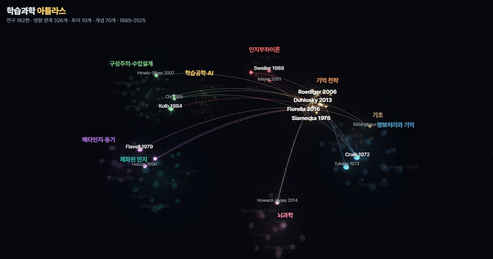

당장은 어렵게 느껴지지만 오래 남는 공부법에 관한 연구들이다. 인출 연습, 분산, 교차, 생성 효과가 실험실과 교실에서 어떻게 검증되었는지, 그리고 학습 양식이나 손 필기, 디지털 네이티브처럼 널리 퍼진 믿음이 어떻게 검토되었는지 따라간다. 학습과학 아틀라스의 아홉 클러스터 중 4번째인 이 글은 1978년부터 2016년까지의 연구 16편을 시간순으로 정리했다. 이 분야에서 가장 많이 인용된 연구는 Dunlosky(2013)의 「효과적인 학습 기법으로 학생 학습 향상하기」, Roediger(2006)의 「시험을 통한 학습 증진」, Pashler(2008)의 「학습 양식, 개념과 증거」이다.

<figure>
  
  <figcaption>학습과학 아틀라스에서 기억 전략과 바람직한 어려움 클러스터와 그 연결을 강조한 모습</figcaption>
</figure>

<a class="btn btn--primary" href="/tools/learning-science-atlas/?cluster=M" target="_blank">아틀라스에서 이 클러스터 보기</a>

## 한눈에 보는 흐름

| 연도 | 연구 | 한 줄 의의 |
|---|---|---|
| 1978 | 생성 효과 (Slamecka) | 스스로 만들어 낸 정보가 읽기만 한 정보보다 잘 기억된다는 생성 효과를 정립했다. |
| 1994 | 인간 훈련에서의 기억과 메타기억 고려사항 (Bjork) | "바람직한 어려움(desirable difficulties)"이라는 개념을 세상에 내놓은 글이다. |
| 2006 | 시험을 통한 학습 증진 (Roediger) | 시험이 평가 도구일 뿐 아니라 강력한 학습 도구라는 시험 효과를 현대적으로 재조명했다. |
| 2006 | 분산 연습 메타분석 (Cepeda) | 100년 넘게 쌓인 간격 효과 연구를 정량 종합한 대표 메타분석이다. |
| 2007 | 수학 문제 섞기가 학습을 향상시킨다 (Rohrer) | 수학 교과서의 "유형별 연습"보다 "유형 섞기"가 시험 성적을 크게 높인다는 것을 보여 준 대표 연구다. |
| 2008 | 개념과 범주 학습, 간격은 귀납의 적인가? (Kornell) | 같은 유형을 몰아 보는 것보다 섞어 보는 교차 학습이 범주 학습에 더 낫다는 것을 보였다. |
| 2008 | 생산적 실패 (Kapur) | 명시적 교수를 먼저 하는 것이 항상 최선은 아니라는 반론의 대표 연구다. |
| 2008 | 학습 양식, 개념과 증거 (Pashler) | 시각형, 청각형 같은 학습 양식 맞춤 교육에 과학적 근거가 없다는 것을 정리한 결정적 논문이다. |
| 2008 | 학습에서 인출의 결정적 중요성 (Karpicke) | 한 번 맞힌 항목도 계속 인출해야 오래 남는다는 것을 보여 준 Science 논문이다. |
| 2011 | 인출 연습은 개념도 작성보다 더 많은 학습을 낳는다 (Karpicke) | Science에 실려 큰 반향을 일으켰다. |
| 2011 | 교실에서의 시험 효과 (Roediger) | 실험실의 시험 효과가 실제 중학교 교실에서도 나타난다는 것을 보여 준 현장 연구다. |
| 2013 | 효과적인 학습 기법으로 학생 학습 향상하기 (Dunlosky) | 학생들이 실제로 쓰는 10가지 공부법의 효과를 증거 기반으로 등급 매긴 종합 보고서다. |
| 2013 | 학습자가 정말 가장 잘 알까? 교육의 도시 전설 (Kirschner) | "디지털 네이티브", "학습 양식", "학습자가 스스로 가장 잘 안다" 같은 교육계의 도시 전설을 연구 근거로 반박한 논문이다. |
| 2014 | 펜은 키보드보다 강하다 (Mueller) | 손 필기가 노트북 필기보다 개념 이해에 유리하다는 주장으로 교실 기기 정책 논쟁에 큰 영향을 주었다. |
| 2014 | 어떻게 공부할 것인가 (Brown) | 인출, 분산, 교차, 정교화 같은 학습과학 연구를 일반 독자와 교사를 위해 풀어 쓴 대표 대중서다. |
| 2016 | 생성적 학습을 촉진하는 여덟 가지 방법 (Fiorella) | 학습자가 스스로 의미를 만들어 내게 하는 "생성적 학습" 전략 여덟 가지를 실증 근거와 함께 정리했다. |

## 연구별 요약

### 생성 효과

*Norman J. Slamecka & Peter Graf (1978). The generation effect: Delineation of a phenomenon*

스스로 만들어 낸 정보가 읽기만 한 정보보다 잘 기억된다는 생성 효과를 정립했다. 바람직한 어려움 연구의 출발점 중 하나다. "빠른-빠?"처럼 규칙에 따라 단어를 직접 완성한 경우가 "빠른-빠름"을 읽기만 한 경우보다 회상과 재인 모두에서 잘 기억되었다. 이 효과는 동의어, 반의어, 운율 규칙 등 다양한 조건에서 나타났다.

> 친구가 알려 준 길보다 내가 직접 찾아간 길이 더 잘 기억나는 것과 같다.

교실에서는 빈칸 채우기, 핵심어 직접 떠올리기처럼 학생이 답을 "만들어 내는" 활동을 넣는다.

### 인간 훈련에서의 기억과 메타기억 고려사항

*Robert A. Bjork (1994). Memory and metamemory considerations in the training of human beings*

"바람직한 어려움(desirable difficulties)"이라는 개념을 세상에 내놓은 글이다. 학습과학을 교실로 옮긴 가장 영향력 있는 아이디어 중 하나다. 비요크는 연습 중의 수행과 장기적 학습이 다르다고 강조했다. 분산, 교차, 인출 연습, 맥락 변화처럼 연습을 어렵게 만드는 조건은 당장의 수행을 떨어뜨리지만 오래 남는 학습을 만든다. 학습자와 교사 모두 쉬운 연습을 "잘 배우고 있다"고 착각하기 쉽다는 메타기억 문제도 지적했다.

> 헬스장에서 가벼운 무게를 들면 기분은 좋지만 근육은 무거운 무게에서 자란다.

교실에서는 "잘 안 되는 느낌"이 곧 학습 실패가 아니라는 점을 학생들에게 직접 설명해 준다.

### 시험을 통한 학습 증진

*Henry L. Roediger III & Jeffrey D. Karpicke (2006). Test-enhanced learning: Taking memory tests improves long-term retention*

시험이 평가 도구일 뿐 아니라 강력한 학습 도구라는 시험 효과를 현대적으로 재조명했다. 인출 연습 붐의 기폭제가 된 논문이다. 대학생이 산문을 네 번 읽은 집단(SSSS)과 한 번 읽고 세 번 회상 시험을 본 집단(STTT)을 비교했다. 5분 뒤에는 반복 읽기가 앞섰지만 일주일 뒤에는 시험 집단이 훨씬 많이 기억했다. 학생들은 반복 읽기를 더 효과적이라고 예측해 메타인지 착각도 확인되었다.

> 운동 영상을 네 번 보는 것보다 한 번 보고 세 번 따라 해 보는 편이 오래 간다.

교실에서는 수업 끝 3분 "백지에 오늘 배운 것 적기"나 저부담 퀴즈를 정례화한다.

### 분산 연습 메타분석

*Nicholas J. Cepeda 외 (2006). Distributed practice in verbal recall tasks: A review and quantitative synthesis*

100년 넘게 쌓인 간격 효과 연구를 정량 종합한 대표 메타분석이다. "얼마나 간격을 두어야 하는가"에 대한 데이터를 제공했다. 184편 논문의 317개 실험을 분석한 결과, 같은 양을 공부해도 몰아서 하는 것보다 나누어 하는 것이 장기 기억에 확실히 유리했다. 기억해야 하는 기간이 길수록 최적 학습 간격도 길어졌다.

> 화분에 물을 하루에 한 번 몰아 주기보다 나누어 주는 편이 뿌리가 깊어진다.

교실에서는 단원 끝 총정리 대신 이전 단원 문제를 몇 주에 걸쳐 섞어 다시 다룬다.

### 수학 문제 섞기가 학습을 향상시킨다

*Doug Rohrer & Kelli Taylor (2007). The shuffling of mathematics problems improves learning*

수학 교과서의 "유형별 연습"보다 "유형 섞기"가 시험 성적을 크게 높인다는 것을 보여 준 대표 연구다. 대학생들이 낯선 입체(쐐기, 회전 타원체 등)의 부피 공식을 익혔다. 같은 유형을 몰아서 연습한 집단은 연습 중 정답률이 89%로 더 높았지만, 일주일 뒤 시험에서는 20%에 그쳤다. 여러 유형을 섞어 연습한 집단은 연습 중 60%였지만 시험에서는 63%를 맞혔다. 섞으면 "어떤 공식을 써야 하는지" 고르는 연습까지 하게 된다.

> 연습 때는 쉬워 보이던 몰아서 풀기가 시험장에서는 "이건 무슨 유형이지?"라는 벽에 부딪힌다.

교실에서는 단원 연습문제 끝에 이전 단원 유형을 섞은 "혼합 세트"를 매번 붙인다.

### 개념과 범주 학습, 간격은 귀납의 적인가?

*Nate Kornell & Robert A. Bjork (2008). Learning concepts and categories: Is spacing the "enemy of induction"?*

같은 유형을 몰아 보는 것보다 섞어 보는 교차 학습이 범주 학습에 더 낫다는 것을 보였다. 교차 연습 연구를 대중화했다. 참가자들이 여러 화가의 그림을 화가별로 몰아서 보거나 섞어서 본 뒤, 처음 보는 그림의 화가를 맞혔다. 섞어서 본 집단의 정답률이 높았지만, 참가자 대다수는 몰아서 보는 방식이 더 좋았다고 답했다.

> "이건 모네, 이건 고흐"를 번갈아 볼 때 두 화풍의 차이가 선명해진다.

교실에서는 수학 연습문제를 한 유형씩 묶지 말고 여러 유형을 섞어 "어떤 방법을 써야 하는지"부터 고르게 한다.

### 생산적 실패

*Manu Kapur (2008). Productive failure*

명시적 교수를 먼저 하는 것이 항상 최선은 아니라는 반론의 대표 연구다. "탐색 후 교수(PS-I)" 설계의 근거가 되었다. 인도 수도권 7개 고교의 11학년 학생 309명이 뉴턴 운동학 문제를 3인 모둠으로 채팅하며 풀었다. 비구조화 문제를 아무 지원 없이 푼 모둠은 해답의 질이 낮았다(실패). 그러나 이후 모든 학생이 개별로 문제를 풀었을 때, 이 집단은 처음부터 구조화된 문제를 받은 집단보다 구조화 문제와 비구조화 문제 모두에서 더 잘했다. 실패 과정에서 문제를 다양하게 표상하고 탐색한 경험이 이후 수행의 밑거름이 된다는 해석이다.

> 먼저 혼자 끙끙대며 여러 방법을 시도해 본 경험이, 나중에 비슷한 문제를 만났을 때 쓸 수 있는 재료가 된다.

교실에서는 새 개념 수업 전에 10~15분 정도 학생이 자기 방식으로 먼저 시도해 보게 한 뒤 정식 설명을 한다.

**함께 알아 둘 점** 2008년 연구에는 실패 뒤 교수 단계가 없었다. 실패 뒤 체계적 교수를 붙이는 "탐색 후 교수(PS-I)" 설계는 이후 연구에서 정립되었고, 그 설계에서는 뒤따르는 교수가 핵심이다.

### 학습 양식, 개념과 증거

*Harold Pashler 외 (2008). Learning styles: Concepts and evidence*

시각형, 청각형 같은 학습 양식 맞춤 교육에 과학적 근거가 없다는 것을 정리한 결정적 논문이다. 학습 양식에 맞춰 가르치면 효과가 있다는 "맞춤 가설"을 검증하려면 양식별로 무작위 배정해 상호작용을 확인해야 한다. 저자들이 검토한 결과 이런 설계를 갖춘 연구는 거의 없었고, 있는 연구도 가설을 지지하지 않았다. 교육 자원을 학습 양식 진단에 쓰는 것은 정당화되지 않는다고 결론지었다.

> "나는 시각형이라 그림으로만 배워야 해"는 혈액형 성격론과 비슷한 수준의 근거라는 뜻이다.

교실에서는 학생 유형보다 내용 유형에 맞춰 표현 방식을 고른다. 지도는 그림으로, 발음은 소리로 가르친다.

### 학습에서 인출의 결정적 중요성

*Jeffrey D. Karpicke & Henry L. Roediger III (2008). The critical importance of retrieval for learning*

한 번 맞힌 항목도 계속 인출해야 오래 남는다는 것을 보여 준 Science 논문이다. 플래시카드를 "외웠으면 빼는" 습관에 정면으로 반대되는 결과다. 대학생들이 스와힐리어-영어 단어쌍 40개를 학습과 시험을 번갈아 하며 익혔다. 한 번 맞힌 단어를 이후 시험에서 빼 버린 조건은 일주일 뒤 약 35%만 기억했지만, 계속 시험을 본 조건은 약 80%를 기억했다. 반면 맞힌 단어를 다시 공부하는 것은 효과가 거의 없었다. 학생들의 예측은 조건과 상관없이 비슷해, 이 차이를 전혀 알아차리지 못했다.

> 정답을 맞혔다고 단어장에서 지우는 순간 그 단어는 잊히기 시작한다.

교실에서는 퀴즈 앱이나 플래시카드에서 이미 맞힌 문항도 간격을 두고 다시 등장하게 설정한다.

### 인출 연습은 개념도 작성보다 더 많은 학습을 낳는다

*Jeffrey D. Karpicke & Janell R. Blunt (2011). Retrieval practice produces more learning than elaborative studying with concept mapping*

Science에 실려 큰 반향을 일으켰다. 인출 연습이 단순 암기뿐 아니라 추론과 이해에도 유리하다는 것을 보였다. 과학 글을 읽은 뒤 자유 회상(인출 연습)을 한 집단이 개념도를 그리며 공부한 집단보다 일주일 뒤 사실 문제와 추론 문제 모두에서 높은 점수를 받았다. 최종 평가가 개념도 그리기였을 때도 인출 연습 집단이 앞섰다.

> 노트를 예쁘게 정리하는 것보다 책을 덮고 떠올려 보는 것이 이해에도 더 좋다는 결과다.

교실에서는 개념도 활동도 "책을 덮고 기억에서 그리기"로 바꾸면 인출 연습이 된다.

### 교실에서의 시험 효과

*Henry L. Roediger III 외 (2011). Test-enhanced learning in the classroom: Long-term improvements from quizzing*

실험실의 시험 효과가 실제 중학교 교실에서도 나타난다는 것을 보여 준 현장 연구다. 인출 연습의 교실 적용을 이끈 대표 근거다. 미국 중학교 6학년 사회 수업에서 일부 내용은 수업 전후 저부담 퀴즈로 복습하고, 일부는 퀴즈 없이 또는 다시 읽기로만 복습했다. 퀴즈로 복습한 내용은 단원 시험과 학기말 시험에서 더 높은 점수를 받았다. 단순히 같은 내용을 다시 읽게 한 것으로는 이 효과가 나지 않았다.

> 같은 시간을 써도 교과서를 다시 읽히는 것보다 짧은 퀴즈를 내는 편이 학기말까지 남는다.

교실에서는 성적에 반영하지 않는 짧은 퀴즈를 수업 시작과 끝에 정례화한다.

### 효과적인 학습 기법으로 학생 학습 향상하기

*John Dunlosky 외 (2013). Improving students' learning with effective learning techniques: Promising directions from cognitive and educational psychology*

학생들이 실제로 쓰는 10가지 공부법의 효과를 증거 기반으로 등급 매긴 종합 보고서다. 교사와 학부모에게 가장 널리 읽힌 학습과학 문헌 중 하나다. 연습 시험과 분산 연습은 "높은 효용", 정교화 질문, 자기 설명, 교차 연습은 "중간 효용"으로 평가했다. 요약, 밑줄 긋기, 키워드 기억술, 심상화, 반복 읽기는 "낮은 효용"이었다. 학생들이 가장 많이 쓰는 방법이 가장 효과가 낮다는 점이 충격을 주었다.

> 형광펜과 반복 읽기는 "공부한 느낌"을 주지만, 떠올려 보기와 나누어 공부하기가 실제 실력을 만든다.

교실에서는 학기 초에 이 10가지 기법 등급표를 학생과 함께 보고 자기 공부법을 점검하게 한다.

### 학습자가 정말 가장 잘 알까? 교육의 도시 전설

*Paul A. Kirschner & Jeroen J. G. van Merriënboer (2013). Do learners really know best? Urban legends in education*

"디지털 네이티브", "학습 양식", "학습자가 스스로 가장 잘 안다" 같은 교육계의 도시 전설을 연구 근거로 반박한 논문이다. 요즘 학생들이 디지털 기기와 함께 자라 멀티태스킹에 능하고 새로운 방식으로 배운다는 "디지털 네이티브" 주장은 근거가 약하다. 학습 양식에 맞춘 교육도 효과가 입증되지 않았다. 학습자에게 학습 순서와 내용 선택을 전적으로 맡기는 것도, 학습자가 무엇이 자신에게 효과적인지 잘 모르기 때문에 대개 비효율적이다.

> 스마트폰을 잘 다루는 것과 스마트폰으로 잘 배우는 것은 다른 능력이다.

교실에서는 "요즘 아이들은 원래 그렇게 배운다"는 말을 들으면 그 주장의 연구 근거부터 확인한다.

### 펜은 키보드보다 강하다

*Pam A. Mueller & Daniel M. Oppenheimer (2014). The pen is mightier than the keyboard: Advantages of longhand over laptop note taking*

손 필기가 노트북 필기보다 개념 이해에 유리하다는 주장으로 교실 기기 정책 논쟁에 큰 영향을 주었다. 동시에 재현성 논쟁의 대표 사례가 되었다. 노트북으로 필기한 학생들은 더 많은 단어를 강의 내용 그대로 받아 적었고, 개념 이해 문항에서 손으로 필기한 학생보다 낮은 점수를 받았다. 저자들은 손 필기는 느려서 내용을 요약하고 재구성하게 만들기 때문이라고 해석했다.

> 속기사처럼 받아 적기만 하면 머리를 거치지 않고 손가락만 바쁘다.

교실에서는 기기 종류보다 "자기 말로 요약하며 적기"를 가르치는 것이 핵심이다.

**함께 알아 둘 점** Morehead, Dunlosky & Rawson(2019), Urry 외(2021)의 재현 연구에서는 손 필기의 이해 우위가 일관되게 나타나지 않았다.

### 어떻게 공부할 것인가

*Peter C. Brown 외 (2014). Make It Stick: The Science of Successful Learning* (단행본)

인출, 분산, 교차, 정교화 같은 학습과학 연구를 일반 독자와 교사를 위해 풀어 쓴 대표 대중서다. 학습과학 대중화의 기폭제가 되었다. 인지심리학자 두 명과 작가가 함께 쓴 책으로, 반복 읽기와 벼락치기가 "익숙함의 착각"을 만든다고 설명한다. 대신 스스로 시험 보기, 간격 두기, 섞어서 연습하기, 새 내용을 아는 것과 연결하기, 배운 것을 돌아보기를 권한다. 의대생, 비행 조종사, 군인 등 실제 사례로 연구를 풀었다.

> 학습과학 연구실의 결과를 공부법 안내서로 번역한 책이다.

교실에서는 교사 연수나 학부모 안내에서 학습 전략을 소개할 때 입문서로 쓰기 좋다.

### 생성적 학습을 촉진하는 여덟 가지 방법

*Logan Fiorella & Richard E. Mayer (2016). Eight ways to promote generative learning*

학습자가 스스로 의미를 만들어 내게 하는 "생성적 학습" 전략 여덟 가지를 실증 근거와 함께 정리했다. 교실에서 바로 쓸 수 있는 전략 목록이다. 요약하기, 개념도 그리기, 그림 그리기, 머릿속으로 그려 보기, 스스로 시험 보기, 자기 설명하기, 남에게 가르치기, 몸으로 표현하기의 여덟 전략을 검토했다. 공통점은 새 정보를 선택하고 조직해 기존 지식과 통합하게 만든다는 것이다. 다만 각 전략은 학습자가 그 전략을 잘 수행할 수 있을 때, 그리고 내용의 성격에 맞을 때 효과가 컸다.

> 읽은 내용을 그림으로 다시 그려 보면, 머릿속에 흩어진 조각들이 하나의 그림으로 맞춰진다.

교실에서는 "한 문단 요약", "그림으로 설명하기", "짝에게 가르치기" 중 하나를 골라 수업 마무리 활동으로 쓴다. 처음에는 전략 사용법을 연습시킨다.

## 이 분야의 핵심 개념

- **생산적 실패**(productive failure). 정식 설명 전에 먼저 문제와 씨름하며 실패해 보는 경험이 이후 학습의 밑거름이 된다는 관점.
- **인출 연습 (시험 효과)**(retrieval practice). 다시 읽기보다 기억에서 꺼내 보는 연습이 훨씬 오래 남는다는 원리.
- **분산 효과**(spacing effect). 같은 양을 공부해도 몰아서 하기보다 간격을 두고 나누어 할 때 오래 기억된다는 효과.
- **교차 연습**(interleaving). 같은 유형을 몰아 연습하지 않고 여러 유형을 섞어 연습하는 방법. "무엇을 써야 하는지" 고르는 힘이 생긴다.
- **바람직한 어려움**(desirable difficulties). 당장은 수행을 떨어뜨리지만 장기 학습을 높이는 어려움(인출, 분산, 교차 등).
- **생성 효과와 생성적 학습**(generation effect). 스스로 만들어 낸 정보가 읽기만 한 정보보다 잘 기억된다는 효과와, 이를 활용한 요약, 그리기, 가르치기 같은 전략.
- **학습 착각**(illusions of competence). 술술 읽히는 느낌(유창성)을 실제로 아는 것으로 착각하는 현상.
- **학습 양식 신화**(learning styles myth). 시각형, 청각형처럼 개인 양식에 맞춰 가르치면 효과가 있다는 믿음. 실증 근거가 없다.
- **자기 설명**(self-explanation). 예제나 글을 공부하며 "왜 그런지" 스스로 설명하는 활동. 깊은 이해를 만든다.
- **신경 신화**(neuromyths). "뇌의 10%만 쓴다", "좌뇌형·우뇌형" 같은 근거 없는 뇌 관련 믿음.

## 다른 분야와 이어지는 다리

이 클러스터는 다른 분야와 20개의 선으로 이어진다.

- 기억에 관하여(1885, 기초) → 분산 연습 메타분석(2006, 기억 전략). 분산 반복 효과의 원조
- 기억에 관하여(1885, 기초) → 인간 훈련에서의 기억과 메타기억 고려사항(1994, 기억 전략). 망각과 재학습
- 처리 수준, 기억 연구의 틀(1972, 정보처리와 기억) → 생성 효과(1978, 기억 전략). 깊은 처리와 생성
- 처리 수준, 기억 연구의 틀(1972, 정보처리와 기억) → 인간 훈련에서의 기억과 메타기억 고려사항(1994, 기억 전략). 처리 방식이 기억을 결정
- 처리 수준, 기억 연구의 틀(1972, 정보처리와 기억) → 펜은 키보드보다 강하다(2014, 기억 전략). 깊은 처리와 필기
- 부호화 특수성 원리(1973, 정보처리와 기억) → 시험을 통한 학습 증진(2006, 기억 전략). 인출 과정 중심 기억관
- 메타인지와 인지적 점검(1979, 메타인지·동기) → 인간 훈련에서의 기억과 메타기억 고려사항(1994, 기억 전략). 메타기억 착각
- 경험학습(1984, 구성주의·수업설계) → 학습 양식, 개념과 증거(2008, 기억 전략). 학습 양식 검사 비판 (비판)
- 문제해결 중 인지부하와 학습(1988, 인지부하이론) → 생산적 실패(2008, 기억 전략). 인지부하 이론에 대한 생산적 실패의 도전 (비판)
- 자기 설명, 학생이 예제를 공부하고 활용하는 방식(1989, 구성주의·수업설계) → 효과적인 학습 기법으로 학생 학습 향상하기(2013, 기억 전략). 자기 설명: 중간 효용
- 자기 설명, 학생이 예제를 공부하고 활용하는 방식(1989, 구성주의·수업설계) → 생성적 학습을 촉진하는 여덟 가지 방법(2016, 기억 전략). 자기 설명
- 메타기억, 이론적 틀과 새로운 발견(1990, 메타인지·동기) → 인간 훈련에서의 기억과 메타기억 고려사항(1994, 기억 전략). 메타기억
- 인간 훈련에서의 기억과 메타기억 고려사항(1994, 기억 전략) → 자기조절 학습, 믿음, 기법, 착각(2013, 메타인지·동기). 학습 착각
- 설명할 때(1998, 구성주의·수업설계) → 생산적 실패(2008, 기억 전략). 먼저 탐색, 나중 설명
- 멀티미디어 학습(2001, 인지부하이론) → 생성적 학습을 촉진하는 여덟 가지 방법(2016, 기억 전략). 선택-조직-통합
- 최소 안내 교수가 효과가 없는 이유(2006, 인지부하이론) → 생산적 실패(2008, 기억 전략). 안내 대 탐색 논쟁 (비판)
- 최소 안내 교수가 효과가 없는 이유(2006, 인지부하이론) → 학습자가 정말 가장 잘 알까? 교육의 도시 전설(2013, 기억 전략). 학습자 통제의 한계
- 문제기반·탐구 학습의 비계와 성취(2007, 구성주의·수업설계) → 생산적 실패(2008, 기억 전략). 안내된 탐구
- 학습 양식, 개념과 증거(2008, 기억 전략) → 신경과학과 교육, 신화와 메시지(2014, 뇌과학). 학습 양식 신화
- 학습자가 정말 가장 잘 알까? 교육의 도시 전설(2013, 기억 전략) → 신경과학과 교육, 신화와 메시지(2014, 뇌과학). 교육 신화 비판

## 이 분야가 나오는 투어

- [인출 연습과 바람직한 어려움](/tools/learning-science-atlas/?tour=retrieval). "꺼내 보는 것이 넣는 것보다 강하다"는 생각이 140년에 걸쳐 증명된 과정.
- [안내냐 탐구냐, 가장 뜨거운 논쟁](/tools/learning-science-atlas/?tour=debate). "가르쳐 줄 것인가, 발견하게 할 것인가." 학습과학에서 가장 오래되고 뜨거운 논쟁을 따라간다.
- [평가와 피드백, 배움을 보이게 하기](/tools/learning-science-atlas/?tour=feedback). 시험은 성적표일 뿐인가? 평가와 피드백이 배움의 엔진이 되기까지의 흐름.

## 참고 자료

- Norman J. Slamecka & Peter Graf (1978). *The generation effect: Delineation of a phenomenon*. <https://doi.org/10.1037/0278-7393.4.6.592>
- Robert A. Bjork (1994). *Memory and metamemory considerations in the training of human beings*. <https://doi.org/10.7551/mitpress/4561.003.0011>
- Henry L. Roediger III & Jeffrey D. Karpicke (2006). *Test-enhanced learning: Taking memory tests improves long-term retention*. <https://doi.org/10.1111/j.1467-9280.2006.01693.x>
- Nicholas J. Cepeda, Harold Pashler, Edward Vul, John T. Wixted & Doug Rohrer (2006). *Distributed practice in verbal recall tasks: A review and quantitative synthesis*. <https://doi.org/10.1037/0033-2909.132.3.354>
- Doug Rohrer & Kelli Taylor (2007). *The shuffling of mathematics problems improves learning*. <https://doi.org/10.1007/s11251-007-9015-8>
- Nate Kornell & Robert A. Bjork (2008). *Learning concepts and categories: Is spacing the "enemy of induction"?*. <https://doi.org/10.1111/j.1467-9280.2008.02127.x>
- Manu Kapur (2008). *Productive failure*. <https://doi.org/10.1080/07370000802212669>
- Harold Pashler, Mark McDaniel, Doug Rohrer & Robert Bjork (2008). *Learning styles: Concepts and evidence*. <https://doi.org/10.1111/j.1539-6053.2009.01038.x>
- Jeffrey D. Karpicke & Henry L. Roediger III (2008). *The critical importance of retrieval for learning*. <https://doi.org/10.1126/science.1152408>
- Jeffrey D. Karpicke & Janell R. Blunt (2011). *Retrieval practice produces more learning than elaborative studying with concept mapping*. <https://doi.org/10.1126/science.1199327>
- Henry L. Roediger III, Pooja K. Agarwal, Mark A. McDaniel & Kathleen B. McDermott (2011). *Test-enhanced learning in the classroom: Long-term improvements from quizzing*. <https://doi.org/10.1037/a0026252>
- John Dunlosky, Katherine A. Rawson, Elizabeth J. Marsh, Mitchell J. Nathan & Daniel T. Willingham (2013). *Improving students' learning with effective learning techniques: Promising directions from cognitive and educational psychology*. <https://doi.org/10.1177/1529100612453266>
- Paul A. Kirschner & Jeroen J. G. van Merriënboer (2013). *Do learners really know best? Urban legends in education*. <https://doi.org/10.1080/00461520.2013.804395>
- Pam A. Mueller & Daniel M. Oppenheimer (2014). *The pen is mightier than the keyboard: Advantages of longhand over laptop note taking*. <https://doi.org/10.1177/0956797614524581>
- Peter C. Brown, Henry L. Roediger III & Mark A. McDaniel (2014). *Make It Stick: The Science of Successful Learning*.
- Logan Fiorella & Richard E. Mayer (2016). *Eight ways to promote generative learning*. <https://doi.org/10.1007/s10648-015-9348-9>
- 인용 수: OpenAlex (2026년 11월 수집) <https://openalex.org>
