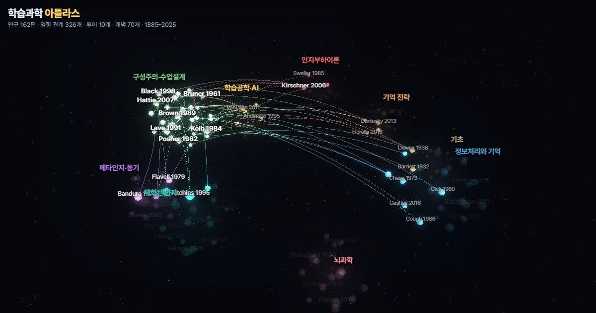

**학습과학 아틀라스 시리즈** · [허브](/post/learning-science-atlas/) · [1 기초](/post/learning-science-atlas-01-foundations/) · [2 정보처리](/post/learning-science-atlas-02-information-processing/) · [3 인지부하](/post/learning-science-atlas-03-cognitive-load/) · [4 기억 전략](/post/learning-science-atlas-04-memory-strategies/) · **5 구성주의** · [6 메타인지·동기](/post/learning-science-atlas-06-metacognition-motivation/) · [7 체화된 인지](/post/learning-science-atlas-07-embodied-cognition/) · [8 뇌과학](/post/learning-science-atlas-08-neuroscience/) · [9 학습공학·AI](/post/learning-science-atlas-09-learning-engineering-ai/) · [개념 사전](/post/learning-science-atlas-glossary/) · [3D 지도 열기](/learning-science-atlas/)

피아제와 비고츠키, 브루너에서 출발해 비계, 인지적 도제, 상황학습, 개념 변화, 형성평가와 피드백, 협동 학습, 능동적 학습으로 이어지는 흐름이다. 학습을 지식의 구성과 공동체 참여로 보는 관점과, 그 관점을 둘러싼 "안내냐 탐구냐" 논쟁이 함께 담겨 있다. 학습과학 아틀라스의 아홉 클러스터 중 5번째인 이 글은 1956년부터 2014년까지의 연구 32편을 시간순으로 정리했다. 이 분야에서 가장 많이 인용된 연구는 Lave(1991)의 「상황학습, 합법적 주변 참여」, Vygotsky(1978)의 「사회 속의 마음」, Kolb(1984)의 「경험학습」이다.

<figure>
  
  <figcaption>학습과학 아틀라스에서 구성주의, 사회문화이론, 수업설계 클러스터와 그 연결을 강조한 모습</figcaption>
</figure>

<a class="btn btn--primary" href="/tools/learning-science-atlas/?cluster=S" target="_blank">아틀라스에서 이 클러스터 보기</a>

## 한눈에 보는 흐름

| 연도 | 연구 | 한 줄 의의 |
|---|---|---|
| 1956 | 교육목표 분류학 (Bloom) | 교육목표를 사고 수준에 따라 위계적으로 분류한 틀로, 전 세계 교육과정과 평가 문항 설계의 공용어가 되었다. |
| 1960 | 유의미 언어 자료의 학습에서 선행조직자 사용 (Ausubel) | "학습에 가장 중요한 단일 요인은 학습자가 이미 알고 있는 것"이라는 아우수벨 학습이론의 대표 실험이다. |
| 1961 | 발견의 행위 (Bruner) | 발견학습 운동의 선언문이다. |
| 1961 | 공격적 모델의 모방을 통한 공격성의 전이 (보보 인형 실험) (Bandura) | 직접 보상을 받지 않아도 남을 보는 것만으로 행동을 배운다는 관찰 학습을 보여 준 "보보 인형 실험"이다. |
| 1964 | 발달과 학습 (Piaget) | 피아제가 미국 교육자들에게 자신의 발달 이론과 학습관을 직접 설명한 강연문이다. |
| 1976 | 문제해결에서 튜터링의 역할 (Wood) | "비계(scaffolding)"라는 용어를 처음 쓴 논문이다. |
| 1978 | 사회 속의 마음 (Vygotsky) | 1930년대 비고츠키의 글을 영어권에 소개한 편집본으로, 사회문화적 학습이론의 원천이다. |
| 1980 | 마인드스톰 (Papert) | 아이가 컴퓨터를 프로그래밍하며 배운다는 비전을 제시한 고전이다. |
| 1982 | 과학 개념의 조절, 개념 변화 이론 (Posner) | 과학 교육에서 오개념이 어떻게 바뀌는지 설명하는 개념 변화 모형의 고전이다. |
| 1984 | 2 시그마 문제 (Bloom) | 1:1 튜터링이 일반 수업보다 2 표준편차 높은 성취를 낸다는 주장으로 교육공학의 "성배"를 정의했다. |
| 1984 | 경험학습 (Kolb) | 듀이, 레빈, 피아제를 잇는 경험학습 순환 모형을 제시해 연수, 직업교육, 성인교육에서 널리 쓰인다. |
| 1989 | 상황인지와 학습의 문화 (Brown) | 지식이 활동과 맥락에서 분리될 수 없다는 상황인지론을 교육계에 불러온 논문이다. |
| 1989 | 자기 설명, 학생이 예제를 공부하고 활용하는 방식 (Chi) | 같은 예제로 공부해도 "스스로 설명하는" 학생이 훨씬 많이 배운다는 자기 설명 효과를 발견했다. |
| 1989 | 인지적 도제 (Collins) | 전통 도제식 교육의 원리를 보이지 않는 "생각의 기술"에 적용한 교수 모형이다. |
| 1991 | 상황학습, 합법적 주변 참여 (Lave) | "실천 공동체(community of practice)" 개념을 탄생시킨 책이다. |
| 1992 | 지구에 대한 정신 모형 (Vosniadou) | 아이들이 새 정보를 기존 생각과 섞어 독특한 "종합 모형"을 만든다는 것을 보여 주었다. |
| 1994 | 지식 구축 공동체를 위한 컴퓨터 지원 (Scardamalia) | 학급을 연구자 공동체처럼 아이디어를 함께 발전시키는 곳으로 바꾸자는 지식 구축 이론과 그 플랫폼(CSILE, 이후 Knowledge Forum)을 소개했다. |
| 1996 | 피드백 개입이 수행에 미치는 효과 (Kluger) | 피드백이 평균적으로는 수행을 높이지만, 셋 중 하나 이상은 오히려 수행을 떨어뜨린다는 것을 보여 준 메타분석이다. |
| 1996 | 떠오르는 마음, 아동 사고의 변화 과정 (Siegler) | 아이의 사고가 계단처럼 단계별로 바뀐다는 피아제식 관점 대신, 여러 전략이 파도처럼 겹치며 서서히 바뀐다는 "중첩 파도 이론"을 제시했다. |
| 1998 | 설명할 때 (Schwartz) | "설명은 언제 해야 효과적인가"에 답한 연구다. |
| 1998 | 평가와 교실 학습 (형성평가) (Black) | 형성평가가 학업 성취를 크게 높인다는 것을 대규모 문헌 검토로 보여, 전 세계 "학습을 위한 평가" 운동을 일으켰다. |
| 2000 | 사람은 어떻게 학습하는가 (Bransford) | 미국 국립연구회의(NRC)가 학습과학 연구를 집대성한 보고서로, "학습과학" 분야의 정체성을 세웠다. |
| 2000 | 미국 국가읽기위원회 보고서 (Panel) | 읽기 교육 연구를 체계적으로 검토해 효과적인 읽기 교육의 다섯 기둥을 제시한 보고서로, "읽기의 과학" 논의의 기준점이다. |
| 2001 | 동료 교수법 10년의 경험과 결과 (Crouch) | 대형 강의에서도 학생끼리 설명하게 하면 개념 이해가 크게 좋아진다는 것을 10년 데이터로 보여 준 동료 교수법(Peer Instruction)의 대표 논문이다. |
| 2004 | 순수 발견학습에 삼진아웃을 적용해야 하는가? (Mayer) | "구성주의 학습 이론"과 "구성주의 교수법"을 구분해야 한다는 핵심 주장을 담았다. |
| 2007 | 피드백의 힘 (Hattie) | 교육학에서 가장 많이 인용된 피드백 연구다. |
| 2007 | 문제기반·탐구 학습의 비계와 성취 (Hmelo-Silver) | Kirschner 등(2006)의 "최소 안내" 비판에 대한 대표 반론이다. |
| 2009 | 성공적인 학습의 비밀(Visible Learning) (Hattie) | 800편이 넘는 메타분석을 종합해 교육 요인 138개의 효과크기를 서열화했다. |
| 2009 | 사회적 상호의존 이론과 협동 학습 (Johnson) | 협동 학습의 이론과 수많은 실증 연구를 정리한 대표 개관이다. |
| 2012 | 수업의 원리, 모든 교사가 알아야 할 연구 기반 전략 (Rosenshine) | 인지과학, 우수 교사 관찰, 인지 지원 연구를 바탕으로 수업 원리 10가지를 정리했다. |
| 2014 | ICAP 프레임워크 (Chi) | "능동적 학습"이라는 모호한 말을 관찰 가능한 행동 수준으로 구분했다. |
| 2014 | 능동적 학습이 STEM 성취를 높인다 (Freeman) | 대학 STEM 수업에서 강의식 대비 능동적 학습의 효과를 보여 준 대규모 메타분석이다. |

## 연구별 요약

### 교육목표 분류학

*Benjamin S. Bloom (Ed.) 외 (1956). Taxonomy of Educational Objectives, Handbook I: Cognitive Domain* (단행본)

교육목표를 사고 수준에 따라 위계적으로 분류한 틀로, 전 세계 교육과정과 평가 문항 설계의 공용어가 되었다. 인지적 영역의 목표를 지식, 이해, 적용, 분석, 종합, 평가의 여섯 수준으로 나누었다. 여러 대학의 시험 출제자들이 같은 교육목표를 재는 문항을 공유하고 문항 은행을 만들 수 있도록 공통의 분류 틀을 마련하려는 목적에서 출발했다. 2001년 Anderson과 Krathwohl의 개정판은 기억하기, 이해하기, 적용하기, 분석하기, 평가하기, 창안하기로 동사형 범주를 바꾸고 지식 차원을 따로 두었다.

> "광합성의 정의를 쓰라"와 "광합성 실험을 직접 설계하라"는 서로 다른 층의 사고를 요구한다.

교실에서는 평가 문항을 만든 뒤 각 문항이 어느 수준의 사고를 요구하는지 표시해, 한쪽에 몰리지 않았는지 점검한다.

**함께 알아 둘 점** 수준들이 엄격한 위계를 이룬다는 가정은 실증적으로 약하다는 비판이 있다. 기억 수준의 지식이 고차원적 사고의 재료라는 점도 함께 기억할 필요가 있다.

### 유의미 언어 자료의 학습에서 선행조직자 사용

*David P. Ausubel (1960). The use of advance organizers in the learning and retention of meaningful verbal material*

"학습에 가장 중요한 단일 요인은 학습자가 이미 알고 있는 것"이라는 아우수벨 학습이론의 대표 실험이다. 대학생들이 낯선 금속공학 글을 읽기 전에 더 일반적이고 추상적인 개관 글(선행조직자)을 읽자, 역사적 배경 글을 읽은 집단보다 내용을 더 잘 기억했다. 새 지식을 붙일 수 있는 상위 개념의 "고리"를 먼저 제공하면 의미 있는 학습이 일어난다는 것이다.

> 퍼즐을 맞추기 전에 상자 겉면의 완성 그림을 먼저 보는 것과 같다.

교실에서는 단원 시작에 전체 구조를 보여 주는 개념 지도나 큰 질문을 먼저 제시한다.

### 발견의 행위

*Jerome S. Bruner (1961). The act of discovery*

발견학습 운동의 선언문이다. 1960년대 교육과정 개혁과 이후 탐구 수업 전통에 큰 영향을 주었다. 브루너는 학생이 스스로 원리를 발견할 때 지적 능력이 늘고, 외적 보상보다 내적 동기가 생기며, 발견의 방법(휴리스틱)을 배우고, 기억이 잘 조직된다고 주장했다. 학습자를 지식의 수용자가 아니라 탐구자로 보는 관점이다.

> 정답지를 받는 대신 직접 실험해서 법칙을 찾아낸 과학자의 기쁨을 학생에게 주자는 제안이다.

교실에서는 개념을 바로 알려 주기 전에 학생이 패턴을 찾아볼 수 있는 사례들을 먼저 제시한다.

**함께 알아 둘 점** 이후 Mayer(2004), Kirschner 등(2006)이 "순수 발견학습"의 한계를 실증적으로 비판했다.

### 공격적 모델의 모방을 통한 공격성의 전이 (보보 인형 실험)

*Albert Bandura 외 (1961). Transmission of aggression through imitation of aggressive models*

직접 보상을 받지 않아도 남을 보는 것만으로 행동을 배운다는 관찰 학습을 보여 준 "보보 인형 실험"이다. 사회학습이론과 이후 사회인지이론의 출발점이다. 생후 37~69개월(약 3~5세) 유아 72명(남녀 각 36명)이 어른이 커다란 오뚝이 인형(보보)을 때리고 던지는 장면, 조용히 노는 장면, 또는 아무 장면도 보지 않은 뒤 놀이방에 들어갔다. 공격적 모델을 본 아이들은 그 행동을 그대로, 때로는 새로운 공격 행동까지 만들어 냈다. 강화 없이도 관찰만으로 학습이 일어난다는 증거였다.

> 아이는 "하지 마"라는 말보다 어른이 하는 행동을 보고 배운다.

교실에서는 풀이 시범, 토론 태도, 실수에 대처하는 모습까지 교사의 행동이 곧 교육 내용이라는 점을 의식한다.

**함께 알아 둘 점** 실험 상황(인형은 때리라고 만든 장난감)의 생태학적 타당도에 대한 비판이 있다.

### 발달과 학습

*Jean Piaget (1964). Development and learning*

피아제가 미국 교육자들에게 자신의 발달 이론과 학습관을 직접 설명한 강연문이다. 구성주의 교육관의 핵심 텍스트다. 피아제는 지식을 대상에 작용하고 변형하는 "조작"으로 보았다. 발달은 성숙, 물리적 경험, 사회적 전달, 그리고 이들을 조율하는 평형화의 네 요인으로 설명된다. 학습은 발달에 종속되며, 아이는 외부에서 주입된 구조가 아니라 스스로 구성한 구조로 이해한다고 주장했다.

> 같은 양의 물을 길쭉한 컵에 옮기면 "더 많아졌다"고 하던 아이가 스스로 따져 보며 생각을 고쳐 가는 과정이다.

교실에서는 학생의 틀린 답을 바로 고치기보다 그렇게 생각한 이유를 묻고 모순을 경험하게 한다.

### 문제해결에서 튜터링의 역할

*David Wood 외 (1976). The role of tutoring in problem solving*

"비계(scaffolding)"라는 용어를 처음 쓴 논문이다. 교육학에서 가장 많이 쓰이는 개념 중 하나가 여기서 나왔다. 3~5세 아이가 블록 피라미드를 쌓을 때 튜터가 어떻게 돕는지 분석했다. 효과적인 튜터는 흥미 끌기, 과제 단순화, 방향 유지, 핵심 특징 표시, 좌절 관리, 시범의 여섯 기능을 수행했다. 도움은 아이가 할 수 없는 부분만 맡고 할 수 있게 되면 줄어들었다.

> 건물을 지을 때 세우는 비계(공사용 발판)처럼, 다 지으면 걷어 내는 임시 지지대다.

교실에서는 처음엔 문장 틀, 예시, 체크리스트를 주고 학생이 익숙해지면 하나씩 걷어 낸다.

### 사회 속의 마음

*Lev S. Vygotsky (1978). Mind in Society: The Development of Higher Psychological Processes* (단행본)

1930년대 비고츠키의 글을 영어권에 소개한 편집본으로, 사회문화적 학습이론의 원천이다. 근접발달영역(ZPD) 개념이 여기서 널리 알려졌다. 고등 정신 기능은 먼저 사람들 사이(사회적 수준)에서 나타나고 나중에 개인 안(심리적 수준)으로 내면화된다. 언어와 도구 같은 문화적 매개물이 사고를 형성한다. 아이가 혼자 할 수 있는 수준과 도움을 받아 할 수 있는 수준 사이의 근접발달영역에서 가르침이 발달을 이끈다.

> 혼자는 못 넘는 담장도 친구가 손을 받쳐 주면 넘을 수 있고, 몇 번 넘다 보면 혼자서도 넘는다.

교실에서는 학생이 혼자서는 어렵지만 도움을 받으면 해낼 수 있는 수준으로 과제를 설정하고 모둠을 구성한다.

### 마인드스톰

*Seymour Papert (1980). Mindstorms: Children, Computers, and Powerful Ideas* (단행본)

아이가 컴퓨터를 프로그래밍하며 배운다는 비전을 제시한 고전이다. 코딩 교육, 메이커 교육, 스크래치의 사상적 뿌리다. 페퍼트는 피아제의 구성주의를 이어받아, 아이가 컴퓨터를 프로그래밍하며 스스로 지식을 구성하는 학습을 제안했다. "공유 가능한 것을 만들며 배운다"는 constructionism이라는 용어와 정의는 이후(Papert & Harel, 1991) 정식화되었다. LOGO 언어로 화면 속 거북이를 움직이며 아이들은 자기 몸의 움직임을 기하로 옮긴다("몸과 동조된" 학습). 오류는 고칠 수 있는 "버그"가 된다.

> "앞으로 100, 오른쪽으로 90"을 직접 걸어 보고 거북이에게 시키면 정사각형의 원리가 몸으로 이해된다.

교실에서는 개념을 설명만 하지 말고 학생이 그 개념으로 무언가를 만들어 보게 한다.

### 과학 개념의 조절, 개념 변화 이론

*George J. Posner 외 (1982). Accommodation of a scientific conception: Toward a theory of conceptual change*

과학 교육에서 오개념이 어떻게 바뀌는지 설명하는 개념 변화 모형의 고전이다. 수십 년간 과학 수업 설계의 기준이 되었다. 학생이 기존 개념을 버리고 새 개념을 받아들이려면 네 조건이 필요하다. 기존 개념에 대한 불만족, 새 개념의 이해 가능성, 그럴듯함, 그리고 새 문제를 푸는 데 쓸모 있다는 생산성이다. 과학사에서 패러다임이 바뀌는 과정과 학생의 개념 변화를 나란히 보았다.

> "무거운 물체가 더 빨리 떨어진다"는 생각은 반례를 보고, 새 설명이 이해되고, 그 설명으로 다른 현상까지 풀릴 때 비로소 바뀐다.

교실에서는 오개념을 바로 고쳐 주기보다 예측-관찰-설명 활동으로 기존 생각의 한계를 먼저 경험하게 한다.

### 2 시그마 문제

*Benjamin S. Bloom (1984). The 2 sigma problem: The search for methods of group instruction as effective as one-to-one tutoring*

1:1 튜터링이 일반 수업보다 2 표준편차 높은 성취를 낸다는 주장으로 교육공학의 "성배"를 정의했다. 지능형 튜터와 AI 튜터 연구가 지금도 이 기준을 인용한다. 블룸의 학생들의 연구에서, 튜터링을 받은 학생의 평균은 일반 학급 학생의 98번째 백분위수에 해당했다(2σ). 완전학습은 약 1σ의 효과를 냈다. 블룸은 교실 한 반 규모에서 튜터링만큼 효과적인 방법을 찾는 것이 교육 연구의 과제라고 제시했다.

> 반 평균 학생도 개인 과외를 받으면 상위 2%까지 올라갈 수 있다는 주장이다.

교실에서는 형성평가와 교정 학습(완전학습)을 결합하면 교실에서도 튜터링 효과의 상당 부분을 얻을 수 있다.

**함께 알아 둘 점** 이후 재분석(VanLehn 2011 등)에서는 인간 튜터링 효과가 약 0.8σ로 추정되어 2σ는 과대평가라는 지적이 있다.

### 경험학습

*David A. Kolb (1984). Experiential Learning: Experience as the Source of Learning and Development* (단행본)

듀이, 레빈, 피아제를 잇는 경험학습 순환 모형을 제시해 연수, 직업교육, 성인교육에서 널리 쓰인다. 학습은 구체적 경험, 성찰적 관찰, 추상적 개념화, 능동적 실험의 네 단계를 도는 순환이다. 경험만으로는 학습이 되지 않고, 경험을 돌아보고 개념으로 정리한 뒤 새 상황에서 시험해 볼 때 배움이 완성된다고 보았다.

> 요리를 해 보고(경험), 왜 짰는지 돌아보고(성찰), "간은 마지막에"라는 원리를 세우고(개념화), 다음 요리에 적용하는(실험) 순환이다.

교실에서는 체험 활동 뒤에 반드시 성찰 질문과 원리 정리, 새 상황 적용 단계를 붙인다.

**함께 알아 둘 점** 콜브의 학습 양식 검사(LSI)는 학습 양식 맞춤 교육의 근거로 쓰였지만, 그 맞춤 효과는 실증적으로 지지되지 않는다(Pashler 외, 2008).

### 상황인지와 학습의 문화

*John Seely Brown 외 (1989). Situated cognition and the culture of learning*

지식이 활동과 맥락에서 분리될 수 없다는 상황인지론을 교육계에 불러온 논문이다. 인지적 도제 모형의 기반이다. 학교는 지식을 맥락에서 떼어내 추상적으로 가르치지만, 실제 지식은 그것이 쓰이는 활동과 문화 안에서 의미를 갖는다. 사전 정의만 외운 아이들이 단어를 엉뚱하게 쓰는 사례를 들었다. 학습은 실천 공동체의 활동에 참여하며 도구를 쓰는 방식을 익히는 인지적 도제 과정이어야 한다고 주장했다.

> 요리책만 읽은 사람보다 주방에서 셰프 옆에서 일한 사람이 진짜 요리를 배운다.

교실에서는 개념을 실제 그 분야 사람들이 쓰는 방식(과학자의 실험 노트, 기자의 취재)으로 사용해 보게 한다.

### 자기 설명, 학생이 예제를 공부하고 활용하는 방식

*Michelene T. H. Chi 외 (1989). Self-explanations: How students study and use examples in learning to solve problems*

같은 예제로 공부해도 "스스로 설명하는" 학생이 훨씬 많이 배운다는 자기 설명 효과를 발견했다. 물리 풀이 예제를 공부하는 대학생들의 사고구술을 분석하자, 성적이 좋은 학생은 각 단계가 왜 그런지 스스로 설명하고 자기 이해의 빈틈을 더 자주 알아차렸다. 성적이 낮은 학생은 예제를 그냥 읽거나 반복했다.

> 레시피를 읽으며 "왜 여기서 소금을 먼저 넣지?"라고 스스로 묻는 사람이 요리 원리를 배운다.

교실에서는 풀이 예제를 줄 때 "이 단계는 왜 필요한가?"를 학생이 직접 적게 한다.

### 인지적 도제

*Allan Collins 외 (1989). Cognitive apprenticeship: Teaching the crafts of reading, writing, and mathematics*

전통 도제식 교육의 원리를 보이지 않는 "생각의 기술"에 적용한 교수 모형이다. 사고 과정을 드러내 가르치는 수업 설계의 고전이다. 목공 도제는 스승의 손놀림을 볼 수 있지만, 읽기와 수학의 전문가 사고는 눈에 보이지 않는다. 저자들은 사고를 밖으로 드러내는 여섯 방법을 제시했다. 시범(모델링), 코칭, 비계 설정과 제거, 학생이 자기 생각을 말로 표현하는 명료화, 전문가와 자기 과정을 비교하는 성찰, 스스로 문제를 찾는 탐색이다.

> 선생님이 문제를 풀며 "나는 지금 이걸 먼저 확인하는 중이야"라고 생각을 소리 내어 보여 주는 수업이다.

교실에서는 풀이 시범을 보일 때 판단의 이유와 막혔을 때의 대처까지 소리 내어 말한다.

### 상황학습, 합법적 주변 참여

*Jean Lave & Etienne Wenger (1991). Situated Learning: Legitimate Peripheral Participation* (단행본)

"실천 공동체(community of practice)" 개념을 탄생시킨 책이다. 학습을 개인 머릿속 변화가 아니라 공동체 참여의 변화로 재정의했다. 산파, 재단사, 해군 조타수, 정육점 견습생 같은 도제 사례를 분석했다. 신참은 처음에 주변적이지만 정당한 작업에 참여하고, 점차 중심적 역할로 이동하며 기술과 정체성을 함께 얻는다. 학습은 공동체 안에서 "누가 되어 가는" 과정이다.

> 동아리 신입이 처음엔 짐 나르기를 하다가 어느새 행사를 기획하는 선배가 되는 과정이다.

교실에서는 학급 프로젝트에서 모든 학생이 실제로 의미 있는 역할을 맡도록 역할을 나누고 점차 책임을 넓힌다.

### 지구에 대한 정신 모형

*Stella Vosniadou & William F. Brewer (1992). Mental models of the earth: A study of conceptual change in childhood*

아이들이 새 정보를 기존 생각과 섞어 독특한 "종합 모형"을 만든다는 것을 보여 주었다. 오개념이 단순한 오류가 아니라 나름의 논리를 가진 구조라는 관점을 확산시켰다. 초등학생들에게 지구의 모양과 사람들이 어디에 사는지 물었다. "지구는 둥글다"는 말을 들은 아이 중 일부는 둥근 지구 안 평평한 땅에 산다고 그리거나(속이 빈 구), 하늘에 떠 있는 둥근 지구와 우리가 사는 평평한 땅이 따로 있다고 그렸다(이중 지구). 어른이 알려 준 사실과 "땅은 평평하다"는 경험이 결합된 결과였다.

> "지구는 공 모양"이라는 말과 "땅은 평평해 보인다"는 경험을 둘 다 살리려다 생긴 아이 나름의 해결책이다.

교실에서는 학생에게 생각을 그림으로 그리게 하면 말로는 드러나지 않는 종합 모형을 발견할 수 있다.

### 지식 구축 공동체를 위한 컴퓨터 지원

*Marlene Scardamalia & Carl Bereiter (1994). Computer support for knowledge-building communities*

학급을 연구자 공동체처럼 아이디어를 함께 발전시키는 곳으로 바꾸자는 지식 구축 이론과 그 플랫폼(CSILE, 이후 Knowledge Forum)을 소개했다. 컴퓨터 지원 협력 학습(CSCL)의 선구적 연구다. 학교는 대개 개인이 이미 있는 지식을 습득하는 곳이지만, 저자들은 공동체가 함께 아이디어를 개선하고 새 지식을 만드는 "지식 구축"을 목표로 삼아야 한다고 주장했다. 학생들은 공유 데이터베이스에 질문, 가설, 근거를 올리고 서로의 노트에 덧붙이며 이론을 다듬었다.

> 반 전체가 함께 쓰는 위키에서 "내 생각은 이렇다", "그 근거는 부족하다"를 주고받으며 이론을 키워 가는 방식이다.

교실에서는 공유 문서나 게시판에 "나의 이론", "새로 알게 된 것", "더 알아야 할 것" 같은 사고 틀을 주고 아이디어를 함께 고치게 한다.

### 피드백 개입이 수행에 미치는 효과

*Avraham N. Kluger & Angelo DeNisi (1996). The effects of feedback interventions on performance: A historical review, a meta-analysis, and a preliminary feedback intervention theory*

피드백이 평균적으로는 수행을 높이지만, 셋 중 하나 이상은 오히려 수행을 떨어뜨린다는 것을 보여 준 메타분석이다. "피드백은 무조건 좋다"는 믿음을 깨뜨렸다. 607개 효과크기를 분석한 결과 피드백의 평균 효과는 d=0.41이었지만, 38%의 경우 피드백이 수행을 낮췄다. 피드백이 과제 자체에서 "나 자신"(칭찬, 비교, 자존감)으로 주의를 옮길수록 효과가 떨어졌고, 과제의 세부와 개선 방법에 주의를 묶어 둘수록 효과가 컸다.

> "너는 머리가 좋구나"는 과제에서 눈을 떼게 하고, "세 번째 단계에서 부호를 놓쳤어"는 과제로 눈을 돌리게 한다.

교실에서는 피드백은 사람이 아니라 과제와 과정을 향하게 하고, 다른 학생과의 비교는 피하며, 다음에 할 행동을 구체적으로 준다.

### 떠오르는 마음, 아동 사고의 변화 과정

*Robert S. Siegler (1996). Emerging Minds: The Process of Change in Children's Thinking* (단행본)

아이의 사고가 계단처럼 단계별로 바뀐다는 피아제식 관점 대신, 여러 전략이 파도처럼 겹치며 서서히 바뀐다는 "중첩 파도 이론"을 제시했다. 같은 아이도 같은 유형의 문제를 풀 때 여러 전략(손가락 세기, 기억에서 꺼내기, 큰 수부터 세기 등)을 섞어 쓰며, 시간이 지나며 효율적인 전략의 비중이 늘어난다. 이 전략의 다양성 자체가 학습이 일어나고 있다는 신호이며, 변이가 큰 시기에 배움이 빠르다.

> 아이가 어제는 손가락으로, 오늘은 머리로 더하는 것은 퇴보가 아니라 전략들이 경쟁하는 과정이다.

교실에서는 학생이 쓰는 여러 풀이 전략을 공유하고 비교하게 하면 효율적인 전략으로의 이동이 빨라진다.

### 설명할 때

*Daniel L. Schwartz & John D. Bransford (1998). A time for telling*

"설명은 언제 해야 효과적인가"에 답한 연구다. 대조 사례 분석으로 준비시킨 뒤 설명하는 방식이 생산적 실패, 탐색 후 교수 연구의 원형이 되었다. 대학생들이 기억 실험의 대조 사례 자료를 분석한 뒤 강의를 들은 집단은, 교재를 요약한 뒤 강의를 들은 집단이나 사례 분석만 두 번 한 집단보다 새 실험 결과를 더 잘 예측했다. 사례 비교가 학생에게 "무엇을 들어야 할지" 알려 주는 준비를 시킨 것이다.

> 와인 맛을 여러 잔 비교해 본 사람이 소믈리에의 설명을 들으면 그 차이를 바로 알아듣는다.

교실에서는 개념 설명 전에 미묘하게 다른 사례 두세 개를 비교하게 하고, 그다음에 설명한다.

### 평가와 교실 학습 (형성평가)

*Paul Black & Dylan Wiliam (1998). Assessment and classroom learning*

형성평가가 학업 성취를 크게 높인다는 것을 대규모 문헌 검토로 보여, 전 세계 "학습을 위한 평가" 운동을 일으켰다. 약 250편의 연구를 검토한 결과, 교사가 수업 중 학생의 이해 상태를 확인하고 그 정보로 가르침을 조정하는 형성평가는 상당한 성취 향상(효과크기 약 0.4~0.7)을 낳았고, 특히 저성취 학생에게 효과가 컸다. 점수와 등급만 주는 평가는 오히려 학습 동기를 해칠 수 있었다. 교사용 요약본 「블랙박스 안에서(Inside the Black Box)」가 널리 읽혔다.

> 시험이 끝난 뒤의 성적표가 아니라, 요리하는 중간에 맛을 보고 간을 맞추는 것이 형성평가다.

교실에서는 수업 중 미니 화이트보드, 출구 카드, 신호등 카드로 이해를 확인하고 그 결과로 다음 설명을 바꾼다.

### 사람은 어떻게 학습하는가

*John D. Bransford 외 (2000). How People Learn: Brain, Mind, Experience, and School (Expanded Edition)* (단행본)

미국 국립연구회의(NRC)가 학습과학 연구를 집대성한 보고서로, "학습과학" 분야의 정체성을 세웠다. 무료 PDF로 공개되어 있다. 세 가지 핵심 발견을 제시한다. 학생은 선개념을 가지고 오며 이를 다루지 않으면 새 지식이 제대로 자리 잡지 못한다. 역량을 키우려면 사실 지식의 깊은 기초와 개념 틀 속의 조직, 인출 가능한 형태가 모두 필요하다. 메타인지적 접근이 학생 스스로 학습을 통제하게 돕는다. 학습 환경은 학습자, 지식, 평가, 공동체 중심이어야 한다고 정리했다.

> 학습과학의 "지도책" 같은 책이다. 이 아틀라스의 여러 대륙이 이 책 한 권에 요약되어 있다.

교실에서는 수업 설계 때 "학생의 선개념 확인 → 개념 틀 속 지식 조직 → 메타인지 성찰"을 점검표로 쓴다.

### 미국 국가읽기위원회 보고서

*National Reading Panel (NICHD) (2000). Teaching Children to Read: An Evidence-Based Assessment of the Scientific Research Literature on Reading and Its Implications for Reading Instruction* (단행본)

읽기 교육 연구를 체계적으로 검토해 효과적인 읽기 교육의 다섯 기둥을 제시한 보고서로, "읽기의 과학" 논의의 기준점이다. 음소 인식, 파닉스(체계적인 소리-글자 대응 교육), 유창성, 어휘, 이해 전략 등의 영역에서 효과적인 교수법을 검토했다. 메타분석은 음소 인식, 파닉스, 유창성(일부)에 적용되었고, 어휘와 이해 영역은 질적으로 검토했다. 특히 체계적이고 명시적인 파닉스 교육이 유치원과 1학년에서 읽기 발달에 뚜렷한 효과가 있다는 결론이 이후 미국과 영국의 읽기 정책에 큰 영향을 주었다.

> 아이가 글자를 소리로 바꾸는 열쇠를 체계적으로 받으면, 그다음부터는 혼자서도 문을 열 수 있다.

교실에서는 저학년 읽기 지도에서 소리와 글자의 대응을 체계적으로 가르치고, 유창성과 어휘, 이해를 함께 다룬다.

**함께 알아 둘 점** 영어 연구 중심이며, 한글처럼 소리-글자 대응이 규칙적인 문자에서는 해독 습득이 빨라 강조점이 다를 수 있다.

### 동료 교수법 10년의 경험과 결과

*Catherine H. Crouch & Eric Mazur (2001). Peer Instruction: Ten years of experience and results*

대형 강의에서도 학생끼리 설명하게 하면 개념 이해가 크게 좋아진다는 것을 10년 데이터로 보여 준 동료 교수법(Peer Instruction)의 대표 논문이다. 하버드 물리학 강의에서 교사는 짧게 설명한 뒤 개념 질문을 던지고, 학생은 혼자 답을 고른 다음 옆 사람과 서로 설득하고 다시 답한다. 토론 뒤 정답률이 크게 올랐고, 물리 개념 검사(FCI)의 향상 폭도 전통 강의보다 뚜렷하게 컸다. 방법은 다른 대학과 교과로 널리 퍼졌다.

> 방금 이해한 친구가 설명해 주면, 오래전에 이해한 교수보다 더 잘 통할 때가 있다.

교실에서는 오개념을 겨냥한 선택형 질문을 던지고 "혼자 답하기 → 짝과 설득하기 → 다시 답하기" 순서로 진행한다.

### 순수 발견학습에 삼진아웃을 적용해야 하는가?

*Richard E. Mayer (2004). Should there be a three-strikes rule against pure discovery learning?*

"구성주의 학습 이론"과 "구성주의 교수법"을 구분해야 한다는 핵심 주장을 담았다. 탐구 수업 논쟁의 균형점 역할을 한다. 메이어는 문제해결 규칙, 보존 개념, 프로그래밍 학습이라는 세 분야의 연구를 검토해, 순수 발견학습이 안내된 발견학습보다 일관되게 효과가 낮았다고 정리했다. 학습자가 인지적으로 능동적인 것이 중요하지, 행동적으로 활발한 것이 중요한 것은 아니라고 주장했다.

> 손을 바쁘게 움직이는 것과 머리를 바쁘게 움직이는 것은 다르다.

교실에서는 활동 중심 수업에서 "학생들이 무엇을 생각하게 되는가"를 기준으로 활동을 점검한다.

### 피드백의 힘

*John Hattie & Helen Timperley (2007). The power of feedback*

교육학에서 가장 많이 인용된 피드백 연구다. 피드백의 효과가 크지만 종류에 따라 크게 달라진다는 것을 정리했다. 효과적인 피드백은 세 질문에 답해야 한다. 나는 어디로 가고 있는가(목표), 나는 어떻게 하고 있는가(현재 위치), 다음은 무엇인가(다음 단계). 피드백은 과제, 처리 과정, 자기조절, 자기(칭찬)의 네 수준에서 작동하는데, "착하다", "똑똑하다" 같은 자기 수준 피드백은 학습 효과가 가장 낮았다.

> 내비게이션처럼 목적지, 현재 위치, 다음 회전 방향을 알려 주는 피드백이 좋은 피드백이다.

교실에서는 "잘했어" 대신 "근거 문장을 두 개 찾은 점이 좋아. 다음엔 반대 근거도 하나 찾아보자"처럼 말한다.

### 문제기반·탐구 학습의 비계와 성취

*Cindy E. Hmelo-Silver 외 (2007). Scaffolding and achievement in problem-based and inquiry learning: A response to Kirschner, Sweller, and Clark (2006)*

Kirschner 등(2006)의 "최소 안내" 비판에 대한 대표 반론이다. 안내 대 탐구 논쟁이 "얼마나, 어떻게 안내하는가"로 옮겨 가는 계기가 되었다. 저자들은 문제기반학습과 탐구학습이 실제로는 최소 안내가 아니라 질문 촉진, 과정 구조화, 필요할 때의 직접 설명 같은 상당한 비계를 포함한다고 반박했다. 의학교육과 과학교육 연구를 근거로, 잘 설계된 탐구 수업은 지식 습득에서 뒤지지 않고 추론과 자기주도 학습 능력에서 이점이 있다고 정리했다.

> "아무것도 안 가르치는 탐구"와 "길잡이가 있는 탐구"는 다르다는 반론이다.

교실에서는 탐구 수업에도 탐구 질문 틀, 단계별 체크포인트, 필요한 순간의 짧은 직접 설명을 넣는다.

### 성공적인 학습의 비밀(Visible Learning)

*John Hattie (2009). Visible Learning: A Synthesis of Over 800 Meta-Analyses Relating to Achievement* (단행본)

800편이 넘는 메타분석을 종합해 교육 요인 138개의 효과크기를 서열화했다. 전 세계 교육 정책과 교사 연수에 가장 큰 영향을 준 책 중 하나다. 해티는 거의 모든 교육 개입이 어느 정도 효과가 있으므로, 평균 효과크기 0.40을 넘는 것에 주목해야 한다는 "경첩점"을 제안했다. 피드백, 교사의 명료성, 형성평가, 메타인지 전략 등이 상위에 올랐고, 학급 규모 축소, 능력별 편성 등은 상대적으로 낮았다. 핵심 메시지는 교사가 자기 수업의 효과를 학생의 눈으로 "보이게" 확인하라는 것이다.

> 수많은 교육 연구 성적표를 한 장의 순위표로 정리한 책이다.

교실에서는 새 교수법을 도입할 때 "효과가 있다"가 아니라 "다른 선택지보다 얼마나 더 효과적인가"를 묻는다.

**함께 알아 둘 점** 성격이 다른 메타분석의 효과크기를 평균 내 비교하는 방법에 대해 통계적 비판(Simpson, 2017 등)이 있다.

### 사회적 상호의존 이론과 협동 학습

*David W. Johnson & Roger T. Johnson (2009). An educational psychology success story: Social interdependence theory and cooperative learning*

협동 학습의 이론과 수많은 실증 연구를 정리한 대표 개관이다. 협동 학습이 효과를 내는 조건을 구체적으로 제시했다. 구성원의 목표가 서로 얽혀 있는 사회적 상호의존 관계에서, 협동적 구조는 경쟁적, 개인적 구조보다 성취, 관계, 심리적 건강에서 대체로 더 나은 결과를 냈다. 효과적인 협동에는 긍정적 상호의존, 개별 책무성, 촉진적 상호작용, 사회적 기술, 모둠 성찰의 다섯 요소가 필요하다.

> 모둠 과제에서 한 명이 다 하고 나머지는 이름만 올리는 것은 협동 학습이 아니다.

교실에서는 모둠 활동에 역할 분담과 개인별 확인 장치(무작위 발표자 등)를 함께 넣어 무임승차를 막는다.

### 수업의 원리, 모든 교사가 알아야 할 연구 기반 전략

*Barak Rosenshine (2012). Principles of instruction: Research-based strategies that all teachers should know*

인지과학, 우수 교사 관찰, 인지 지원 연구를 바탕으로 수업 원리 10가지를 정리했다. 영국과 호주에서 교사 연수의 필독서가 되었다. 매일 복습으로 시작하기, 새 내용은 작은 단계로 제시하기, 질문을 많이 하기, 모델 제공하기, 안내된 연습, 이해 확인하기, 높은 성공률 확보하기, 어려운 과제에 비계 제공하기, 독립 연습, 주간·월간 복습을 제시했다. 각 원리는 작업기억의 한계와 장기기억 형성 원리에 기대고 있다.

> 학습과학 연구를 교사용 체크리스트 한 장으로 번역한 글이다.

교실에서는 수업 계획서 옆에 10대 원리를 두고 오늘 수업이 몇 개를 담고 있는지 확인한다.

### ICAP 프레임워크

*Michelene T. H. Chi & Ruth Wylie (2014). The ICAP framework: Linking cognitive engagement to active learning outcomes*

"능동적 학습"이라는 모호한 말을 관찰 가능한 행동 수준으로 구분했다. 수업 활동 설계와 평가에 바로 쓸 수 있는 틀이다. 학습자의 참여를 수동적(Passive, 듣기만), 능동적(Active, 밑줄·따라 하기), 구성적(Constructive, 설명·질문 만들기), 상호작용적(Interactive, 서로의 생각을 이어 만들기)으로 나누었다. 많은 연구를 검토한 결과 I > C > A > P 순서로 학습이 깊어지는 경향이 있었다.

> 강의 듣기 < 필기하기 < 내 말로 정리하기 < 친구와 토론하며 새 아이디어 만들기.

교실에서는 활동지를 만들 때 "따라 쓰기" 문항을 "자기 말로 설명하기", "짝과 비교해 보완하기"로 바꾼다.

### 능동적 학습이 STEM 성취를 높인다

*Scott Freeman et al. (2014). Active learning increases student performance in science, engineering, and mathematics*

대학 STEM 수업에서 강의식 대비 능동적 학습의 효과를 보여 준 대규모 메타분석이다. "강의만 하는 수업은 비윤리적일 수 있다"는 논쟁을 불러왔다. 225편의 연구를 분석한 결과, 능동적 학습 수업의 시험 점수는 평균 약 0.47 표준편차 높았고, 전통적 강의 수업의 낙제율은 능동적 학습 수업보다 약 1.5배 높았다(33.8% 대 21.8%). 효과는 분야와 수업 규모를 가리지 않고 나타났고, 50명 이하 소규모 수업에서 가장 컸다.

> 강의 중간중간 학생이 문제를 풀고 토론하게만 해도 낙제생이 3분의 1가량 줄어든다.

교실에서는 50분 수업을 10~15분 단위로 끊고 사이사이 클리커 질문, 짝 토론, 짧은 문제를 넣는다.

## 이 분야의 핵심 개념

- **명시적 교수**(explicit instruction). 목표를 분명히 하고 시범, 안내된 연습, 독립 연습으로 체계적으로 가르치는 방식.
- **생산적 실패**(productive failure). 정식 설명 전에 먼저 문제와 씨름하며 실패해 보는 경험이 이후 학습의 밑거름이 된다는 관점.
- **구성주의**(constructivism). 지식은 전달되는 것이 아니라 학습자가 기존 지식 위에 스스로 구성하는 것이라는 관점.
- **근접발달영역**(zone of proximal development). 혼자서는 못 하지만 도움을 받으면 할 수 있는 영역. 가르침이 발달을 이끄는 지점이다.
- **비계**(scaffolding). 학습자가 혼자 할 수 없는 부분만 임시로 돕고, 할 수 있게 되면 걷어 내는 지원.
- **인지적 도제**(cognitive apprenticeship). 전문가의 보이지 않는 사고 과정을 시범, 코칭, 명료화로 드러내 가르치는 방법.
- **상황학습과 실천 공동체**(situated learning). 학습은 지식이 실제로 쓰이는 공동체의 활동에 참여하며 일어난다는 관점.
- **개념 변화**(conceptual change). 기존의 오개념이 과학적 개념으로 바뀌는 과정. 불만족, 이해 가능성, 그럴듯함, 생산성이 조건이다.
- **자기 설명**(self-explanation). 예제나 글을 공부하며 "왜 그런지" 스스로 설명하는 활동. 깊은 이해를 만든다.
- **ICAP**(ICAP framework). 참여를 수동적, 능동적, 구성적, 상호작용적으로 나누고 뒤로 갈수록 학습이 깊어진다는 틀.
- **협동 학습**(cooperative learning). 긍정적 상호의존과 개별 책무성이 갖춰진 모둠 학습.
- **관찰 학습**(observational learning). 직접 보상을 받지 않아도 남의 행동을 보는 것만으로 배우는 학습.
- **형성평가**(formative assessment). 수업 중 학생의 이해를 확인하고 그 정보로 가르침을 조정하는 평가.
- **피드백**(feedback). 현재 수행과 목표의 차이를 줄이는 정보. 과제와 과정을 향할 때 효과적이고, "나"를 향할 때 역효과가 날 수 있다.
- **교육목표 분류학**(Bloom's taxonomy). 기억에서 창안까지 사고 수준에 따라 교육목표를 분류한 틀.
- **읽기의 단순 관점과 파닉스**(simple view of reading). 읽기 이해 = 해독 × 언어 이해. 초기에는 소리-글자 대응을 체계적으로 가르치는 파닉스가 핵심이다.
- **2 시그마 문제**(2 sigma problem). 1:1 튜터링 수준의 효과를 교실 규모에서 내는 방법을 찾는 교육공학의 오랜 과제.

## 다른 분야와 이어지는 다리

이 클러스터는 다른 분야와 41개의 선으로 이어진다.

- 기억하기(1932, 기초) → 유의미 언어 자료의 학습에서 선행조직자 사용(1960, 구성주의·수업설계). 스키마와 선행 지식
- 경험과 교육(1938, 기초) → 발견의 행위(1961, 구성주의·수업설계). 경험과 탐구 중심 교육
- 경험과 교육(1938, 기초) → 경험학습(1984, 구성주의·수업설계). 경험학습의 뿌리
- 경험과 교육(1938, 기초) → 마인드스톰(1980, 구성주의·수업설계). 만들며 배우기
- 유의미 언어 자료의 학습에서 선행조직자 사용(1960, 구성주의·수업설계) → 멀티미디어 학습에서 인지부하를 줄이는 아홉 가지 방법(2003, 인지부하이론). 사전훈련과 신호
- 발견의 행위(1961, 구성주의·수업설계) → 최소 안내 교수가 효과가 없는 이유(2006, 인지부하이론). 최소 안내 비판 (비판)
- 공격적 모델의 모방을 통한 공격성의 전이 (보보 인형 실험)(1961, 구성주의·수업설계) → 자기효능감, 행동 변화의 통합 이론(1977, 메타인지·동기). 관찰 학습에서 자기효능감으로
- 공격적 모델의 모방을 통한 공격성의 전이 (보보 인형 실험)(1961, 구성주의·수업설계) → 거울 뉴런 시스템(2004, 체화된 인지). 관찰을 통한 행동 이해
- 체스에서의 지각(1973, 정보처리와 기억) → 사람은 어떻게 학습하는가(2000, 구성주의·수업설계). 전문가의 패턴 재인
- 문제해결에서 튜터링의 역할(1976, 구성주의·수업설계) → 인간 튜터링과 지능형 튜터링 시스템의 상대적 효과(2011, 학습공학·AI). 튜터링 연구
- 문제해결에서 튜터링의 역할(1976, 구성주의·수업설계) → AI 튜터링이 교실 능동학습보다 효과적이다(2025, 학습공학·AI). 비계 원리를 AI 튜터에
- 사회 속의 마음(1978, 구성주의·수업설계) → 야생의 인지(1995, 체화된 인지). 매개된 인지
- 사회 속의 마음(1978, 구성주의·수업설계) → 자기조절 학습자 되기(2002, 메타인지·동기). 타인 조절에서 자기조절로
- 메타인지와 인지적 점검(1979, 메타인지·동기) → 사람은 어떻게 학습하는가(2000, 구성주의·수업설계). 메타인지적 접근
- 스키마, 인지의 구성 요소(1980, 정보처리와 기억) → 지구에 대한 정신 모형(1992, 구성주의·수업설계). 지식 구조와 이해
- 유추적 문제해결(1980, 정보처리와 기억) → 설명할 때(1998, 구성주의·수업설계). 사례 비교와 전이
- 전문가와 초보자의 물리 문제 범주화(1981, 정보처리와 기억) → 자기 설명, 학생이 예제를 공부하고 활용하는 방식(1989, 구성주의·수업설계). 예제 학습과 자기 설명
- 전문가와 초보자의 물리 문제 범주화(1981, 정보처리와 기억) → 사람은 어떻게 학습하는가(2000, 구성주의·수업설계). 전문가와 초보자의 차이
- 2 시그마 문제(1984, 구성주의·수업설계) → 인지 튜터, 얻은 교훈(1995, 학습공학·AI). 2시그마를 기계로
- 2 시그마 문제(1984, 구성주의·수업설계) → 인간 튜터링과 지능형 튜터링 시스템의 상대적 효과(2011, 학습공학·AI). 튜터링 효과 재검토
- 2 시그마 문제(1984, 구성주의·수업설계) → AI 튜터링이 교실 능동학습보다 효과적이다(2025, 학습공학·AI). AI 튜터의 목표
- 2 시그마 문제(1984, 구성주의·수업설계) → 튜터 코파일럿, 인간-AI 협업 튜터링(2024, 학습공학·AI). 튜터링의 확장
- 경험학습(1984, 구성주의·수업설계) → 학습 양식, 개념과 증거(2008, 기억 전략). 학습 양식 검사 비판 (비판)
- 대수 학습에서 문제풀이 대신 풀이 예제 사용(1985, 인지부하이론) → 자기 설명, 학생이 예제를 공부하고 활용하는 방식(1989, 구성주의·수업설계). 예제로 배우기
- 해독, 읽기, 읽기 장애 (읽기의 단순 관점)(1986, 정보처리와 기억) → 미국 국가읽기위원회 보고서(2000, 구성주의·수업설계). 해독과 이해
- 상황인지와 학습의 문화(1989, 구성주의·수업설계) → 야생의 인지(1995, 체화된 인지). 현장 속 인지
- 상황인지와 학습의 문화(1989, 구성주의·수업설계) → 최소 안내 교수가 효과가 없는 이유(2006, 인지부하이론). 상황적 접근 비판 (비판)
- 자기 설명, 학생이 예제를 공부하고 활용하는 방식(1989, 구성주의·수업설계) → 효과적인 학습 기법으로 학생 학습 향상하기(2013, 기억 전략). 자기 설명: 중간 효용
- 자기 설명, 학생이 예제를 공부하고 활용하는 방식(1989, 구성주의·수업설계) → 인간 튜터링과 지능형 튜터링 시스템의 상대적 효과(2011, 학습공학·AI). 설명과 튜터링
- 자기 설명, 학생이 예제를 공부하고 활용하는 방식(1989, 구성주의·수업설계) → 생성적 학습을 촉진하는 여덟 가지 방법(2016, 기억 전략). 자기 설명
- 떠오르는 마음, 아동 사고의 변화 과정(1996, 구성주의·수업설계) → 숫자 보드게임으로 저소득층 아동의 수 지식 높이기(2008, 체화된 인지). 수 지식 발달
- 설명할 때(1998, 구성주의·수업설계) → 생산적 실패(2008, 기억 전략). 먼저 탐색, 나중 설명
- 사람은 어떻게 학습하는가(2000, 구성주의·수업설계) → 지식-학습-교수(KLI) 프레임워크(2012, 학습공학·AI). 학습과학과 교실의 연결
- 미국 국가읽기위원회 보고서(2000, 구성주의·수업설계) → 읽기 전쟁을 끝내자(2018, 정보처리와 기억). 파닉스 근거
- 자기조절 학습자 되기(2002, 메타인지·동기) → 피드백의 힘(2007, 구성주의·수업설계). 자기조절 수준 피드백
- 순수 발견학습에 삼진아웃을 적용해야 하는가?(2004, 구성주의·수업설계) → 최소 안내 교수가 효과가 없는 이유(2006, 인지부하이론). 안내된 학습 옹호
- 최소 안내 교수가 효과가 없는 이유(2006, 인지부하이론) → 수업의 원리, 모든 교사가 알아야 할 연구 기반 전략(2012, 구성주의·수업설계). 명시적 교수
- 최소 안내 교수가 효과가 없는 이유(2006, 인지부하이론) → 문제기반·탐구 학습의 비계와 성취(2007, 구성주의·수업설계). 최소 안내 비판에 대한 반론 (비판)
- 문제기반·탐구 학습의 비계와 성취(2007, 구성주의·수업설계) → 생산적 실패(2008, 기억 전략). 안내된 탐구
- ICAP 프레임워크(2014, 구성주의·수업설계) → 안전장치 없는 생성형 AI는 학습을 해칠 수 있다(2025, 학습공학·AI). 수동적 AI 사용의 위험
- 능동적 학습이 STEM 성취를 높인다(2014, 구성주의·수업설계) → AI 튜터링이 교실 능동학습보다 효과적이다(2025, 학습공학·AI). 능동학습을 넘어선 비교 기준

## 이 분야가 나오는 투어

- [안내냐 탐구냐, 가장 뜨거운 논쟁](/tools/learning-science-atlas/?tour=debate). "가르쳐 줄 것인가, 발견하게 할 것인가." 학습과학에서 가장 오래되고 뜨거운 논쟁을 따라간다.
- [튜터의 꿈, 티칭 머신에서 AI 튜터까지](/tools/learning-science-atlas/?tour=tutor). 모든 학생에게 좋은 개인 교사를. 70년 동안 이어진 꿈과 그 최신 실험 결과.
- [평가와 피드백, 배움을 보이게 하기](/tools/learning-science-atlas/?tour=feedback). 시험은 성적표일 뿐인가? 평가와 피드백이 배움의 엔진이 되기까지의 흐름.
- [읽고 셈하는 뇌, 읽기와 수의 과학](/tools/learning-science-atlas/?tour=readmath). 말하기는 저절로 배우지만 읽기와 수학은 가르쳐야 한다. 문화적 발명을 배우는 뇌의 과학.

## 참고 자료

- Benjamin S. Bloom, Max D. Engelhart, Edward J. Furst, Walker H. Hill & David R. Krathwohl (1956). *Taxonomy of Educational Objectives, Handbook I: Cognitive Domain*.
- David P. Ausubel (1960). *The use of advance organizers in the learning and retention of meaningful verbal material*. <https://doi.org/10.1037/h0046669>
- Jerome S. Bruner (1961). *The act of discovery*.
- Albert Bandura, Dorothea Ross & Sheila A. Ross (1961). *Transmission of aggression through imitation of aggressive models*. <https://doi.org/10.1037/h0045925>
- Jean Piaget (1964). *Development and learning*. <https://doi.org/10.1002/tea.3660020306>
- David Wood, Jerome S. Bruner & Gail Ross (1976). *The role of tutoring in problem solving*. <https://doi.org/10.1111/j.1469-7610.1976.tb00381.x>
- Lev S. Vygotsky (1978). *Mind in Society: The Development of Higher Psychological Processes*.
- Seymour Papert (1980). *Mindstorms: Children, Computers, and Powerful Ideas*.
- George J. Posner, Kenneth A. Strike, Peter W. Hewson & William A. Gertzog (1982). *Accommodation of a scientific conception: Toward a theory of conceptual change*. <https://doi.org/10.1002/sce.3730660207>
- Benjamin S. Bloom (1984). *The 2 sigma problem: The search for methods of group instruction as effective as one-to-one tutoring*. <https://doi.org/10.3102/0013189X013006004>
- David A. Kolb (1984). *Experiential Learning: Experience as the Source of Learning and Development*.
- John Seely Brown, Allan Collins & Paul Duguid (1989). *Situated cognition and the culture of learning*. <https://doi.org/10.3102/0013189X018001032>
- Michelene T. H. Chi, Miriam Bassok, Matthew W. Lewis, Peter Reimann & Robert Glaser (1989). *Self-explanations: How students study and use examples in learning to solve problems*. <https://doi.org/10.1207/s15516709cog1302_1>
- Allan Collins, John Seely Brown & Susan E. Newman (1989). *Cognitive apprenticeship: Teaching the crafts of reading, writing, and mathematics*.
- Jean Lave & Etienne Wenger (1991). *Situated Learning: Legitimate Peripheral Participation*. <https://doi.org/10.1017/cbo9780511815355>
- Stella Vosniadou & William F. Brewer (1992). *Mental models of the earth: A study of conceptual change in childhood*. <https://doi.org/10.1016/0010-0285(92)90018-W>
- Marlene Scardamalia & Carl Bereiter (1994). *Computer support for knowledge-building communities*. <https://doi.org/10.1207/s15327809jls0303_3>
- Avraham N. Kluger & Angelo DeNisi (1996). *The effects of feedback interventions on performance: A historical review, a meta-analysis, and a preliminary feedback intervention theory*. <https://doi.org/10.1037/0033-2909.119.2.254>
- Robert S. Siegler (1996). *Emerging Minds: The Process of Change in Children's Thinking*.
- Daniel L. Schwartz & John D. Bransford (1998). *A time for telling*. <https://doi.org/10.1207/s1532690xci1604_4>
- Paul Black & Dylan Wiliam (1998). *Assessment and classroom learning*. <https://doi.org/10.1080/0969595980050102>
- John D. Bransford, Ann L. Brown & Rodney R. Cocking (2000). *How People Learn: Brain, Mind, Experience, and School (Expanded Edition)*. <https://doi.org/10.17226/9853>
- National Reading Panel (NICHD) (2000). *Teaching Children to Read: An Evidence-Based Assessment of the Scientific Research Literature on Reading and Its Implications for Reading Instruction*.
- Catherine H. Crouch & Eric Mazur (2001). *Peer Instruction: Ten years of experience and results*. <https://doi.org/10.1119/1.1374249>
- Richard E. Mayer (2004). *Should there be a three-strikes rule against pure discovery learning?*. <https://doi.org/10.1037/0003-066X.59.1.14>
- John Hattie & Helen Timperley (2007). *The power of feedback*. <https://doi.org/10.3102/003465430298487>
- Cindy E. Hmelo-Silver, Ravit Golan Duncan & Clark A. Chinn (2007). *Scaffolding and achievement in problem-based and inquiry learning: A response to Kirschner, Sweller, and Clark (2006)*. <https://doi.org/10.1080/00461520701263368>
- John Hattie (2009). *Visible Learning: A Synthesis of Over 800 Meta-Analyses Relating to Achievement*.
- David W. Johnson & Roger T. Johnson (2009). *An educational psychology success story: Social interdependence theory and cooperative learning*. <https://doi.org/10.3102/0013189X09339057>
- Barak Rosenshine (2012). *Principles of instruction: Research-based strategies that all teachers should know*.
- Michelene T. H. Chi & Ruth Wylie (2014). *The ICAP framework: Linking cognitive engagement to active learning outcomes*. <https://doi.org/10.1080/00461520.2014.965823>
- Scott Freeman et al. (2014). *Active learning increases student performance in science, engineering, and mathematics*. <https://doi.org/10.1073/pnas.1319030111>
- 인용 수: OpenAlex (2026년 11월 수집) <https://openalex.org>
