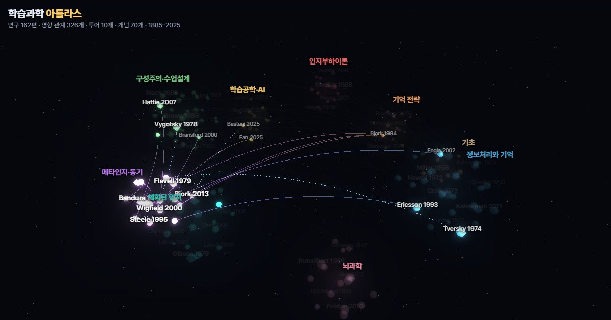

**학습과학 아틀라스 시리즈** · [허브](/post/learning-science-atlas/) · [1 기초](/post/learning-science-atlas-01-foundations/) · [2 정보처리](/post/learning-science-atlas-02-information-processing/) · [3 인지부하](/post/learning-science-atlas-03-cognitive-load/) · [4 기억 전략](/post/learning-science-atlas-04-memory-strategies/) · [5 구성주의](/post/learning-science-atlas-05-constructivism-instruction/) · **6 메타인지·동기** · [7 체화된 인지](/post/learning-science-atlas-07-embodied-cognition/) · [8 뇌과학](/post/learning-science-atlas-08-neuroscience/) · [9 학습공학·AI](/post/learning-science-atlas-09-learning-engineering-ai/) · [개념 사전](/post/learning-science-atlas-glossary/) · [3D 지도 열기](/learning-science-atlas/)

생각에 대한 생각(메타인지), 해낼 수 있다는 믿음(자기효능감), 하고 싶은 마음(동기), 그리고 그것을 받치는 실행기능에 관한 연구들이다. 마인드셋, 그릿, 고정관념 위협처럼 대중적 개념이 실제로 얼마나 효과가 있는지도 함께 본다. 학습과학 아틀라스의 아홉 클러스터 중 6번째인 이 글은 1977년부터 2019년까지의 연구 15편을 시간순으로 정리했다. 이 분야에서 가장 많이 인용된 연구는 Bandura(1977)의 「자기효능감, 행동 변화의 통합 이론」, Ryan(2000)의 「자기결정성 이론과 내적 동기」, Diamond(2013)의 「실행기능」이다.

<figure>
  
  <figcaption>학습과학 아틀라스에서 메타인지, 동기, 자기조절 클러스터와 그 연결을 강조한 모습</figcaption>
</figure>

<a class="btn btn--primary" href="/tools/learning-science-atlas/?cluster=R" target="_blank">아틀라스에서 이 클러스터 보기</a>

## 한눈에 보는 흐름

| 연도 | 연구 | 한 줄 의의 |
|---|---|---|
| 1977 | 자기효능감, 행동 변화의 통합 이론 (Bandura) | "나는 해낼 수 있다"는 믿음이 행동과 성취를 예측한다는 자기효능감 이론을 처음 제시했다. |
| 1979 | 메타인지와 인지적 점검 (Flavell) | "메타인지"라는 용어와 연구 분야를 정립한 논문이다. |
| 1988 | 동기와 성격에 대한 사회인지적 접근 (Dweck) | 실패 앞에서 어떤 학생은 무너지고 어떤 학생은 더 도전하는 이유를 목표와 지능관으로 설명했다. |
| 1990 | 메타기억, 이론적 틀과 새로운 발견 (Nelson) | 메타인지를 "점검"과 "통제"의 두 흐름으로 구조화한 이론 틀이다. |
| 1990 | 몰입 (Csikszentmihalyi) | 사람이 시간 가는 줄 모르고 활동에 빠져드는 "몰입" 경험을 체계화했다. |
| 1995 | 고정관념 위협과 지적 수행 (Steele) | 부정적 고정관념이 떠오르는 상황 자체가 수행을 떨어뜨린다는 "고정관념 위협"을 처음 실험으로 보였다. |
| 1999 | 무능하면서 그것을 모른다 (Kruger) | "더닝-크루거 효과"로 대중에게 가장 잘 알려진 심리학 연구 중 하나다. |
| 2000 | 자기결정성 이론과 내적 동기 (Ryan) | 자기결정성 이론(SDT)을 가장 널리 읽히는 형태로 정리한 논문이다. |
| 2000 | 성취 동기의 기대-가치 이론 (Wigfield) | 학생의 선택과 노력을 "할 수 있을까"(성공 기대)와 "할 가치가 있을까"(과제 가치)로 설명하는 기대-가치 이론의 대표 정리다. |
| 2002 | 자기조절 학습자 되기 (Zimmerman) | 자기조절학습(SRL)의 순환 모형을 교사용으로 압축한 대표 개관이다. |
| 2007 | 지능에 대한 암묵적 이론과 성취 (Blackwell) | 성장 마인드셋 연구의 대표 실증 논문이다. |
| 2007 | 그릿, 장기 목표를 향한 끈기와 열정 (Duckworth) | "그릿"이라는 개념과 척도를 제시해 교육계의 비인지 능력 열풍을 이끌었다. |
| 2013 | 자기조절 학습, 믿음, 기법, 착각 (Bjork) | 학생들이 자기 학습을 판단할 때 빠지는 착각을 정리한 Annual Review다. |
| 2013 | 실행기능 (Diamond) | 실행기능의 구조와 발달, 그리고 교육적 개입을 정리한 Annual Review 대표 개관이다. |
| 2019 | 전국 실험으로 본 성장 마인드셋의 효과 (Yeager) | 미국 전국 대표 표본으로 성장 마인드셋 개입의 효과를 검증한 Nature 논문이다. |

## 연구별 요약

### 자기효능감, 행동 변화의 통합 이론

*Albert Bandura (1977). Self-efficacy: Toward a unifying theory of behavioral change*

"나는 해낼 수 있다"는 믿음이 행동과 성취를 예측한다는 자기효능감 이론을 처음 제시했다. 사회과학 전체에서 손꼽히게 많이 인용된 논문이다. 반두라는 결과 기대(이 행동이 좋은 결과를 낳을까)와 효능 기대(내가 이 행동을 해낼 수 있을까)를 구분했다. 효능 기대는 직접 성공 경험, 다른 사람의 성공을 보는 대리 경험, 언어적 설득, 생리적·정서적 상태라는 네 원천에서 나온다. 이 중 직접 성공 경험이 가장 강력하다.

> "공부하면 성적이 오른다"는 알지만 "내가 그만큼 공부할 수 있을까"가 진짜 관건이다.

교실에서는 어려운 단원 초반에 "작지만 확실한 성공"을 설계하고, 비슷한 또래의 성공 사례를 보여 준다.

### 메타인지와 인지적 점검

*John H. Flavell (1979). Metacognition and cognitive monitoring: A new area of cognitive-developmental inquiry*

"메타인지"라는 용어와 연구 분야를 정립한 논문이다. 자기조절학습, 학습 전략 교육의 이론적 출발점이다. 플라벨은 아이들이 자기 기억과 이해를 점검하는 능력이 나이와 함께 발달한다는 연구를 바탕으로 메타인지 모형을 제시했다. 메타인지적 지식(사람, 과제, 전략에 대한 지식), 메타인지적 경험(이해가 잘 안 된다는 느낌 등), 목표, 전략이 서로 작용한다. 어린 아이일수록 자신이 이해하지 못했다는 것을 알아차리지 못한다.

> "내가 지금 이걸 이해하고 있나?"를 스스로 묻는 생각에 대한 생각이다.

교실에서는 읽기 활동 중간에 "지금까지 이해한 것 한 줄, 헷갈리는 것 한 줄"을 적게 한다.

### 동기와 성격에 대한 사회인지적 접근

*Carol S. Dweck & Ellen L. Leggett (1988). A social-cognitive approach to motivation and personality*

실패 앞에서 어떤 학생은 무너지고 어떤 학생은 더 도전하는 이유를 목표와 지능관으로 설명했다. 성장 마인드셋 연구의 이론적 출발점이다. 실패 상황에서 학생들은 포기하고 자기 능력을 탓하는 무기력 반응이나, 전략을 바꾸며 도전을 즐기는 숙달 지향 반응을 보인다. 이 차이는 능력을 증명하려는 수행 목표와 능력을 키우려는 학습 목표의 차이에서 오고, 그 밑에는 지능이 고정되어 있다는 믿음과 키울 수 있다는 믿음이 있다.

> 시험을 "내가 똑똑한지 판정받는 자리"로 보는 학생과 "모르는 걸 찾는 기회"로 보는 학생의 차이다.

교실에서는 평가의 목적을 "현재 위치 확인과 다음 배움"으로 안내하고, 오답 분석을 수업의 정식 활동으로 만든다.

### 메타기억, 이론적 틀과 새로운 발견

*Thomas O. Nelson & Louis Narens (1990). Metamemory: A theoretical framework and new findings*

메타인지를 "점검"과 "통제"의 두 흐름으로 구조화한 이론 틀이다. 이후 메타인지 연구의 공통 언어가 되었다. 인지는 대상 수준(실제 기억하기)과 메타 수준(그 기억에 대한 모형)으로 나뉜다. 정보가 대상 수준에서 메타 수준으로 올라가는 것이 점검(학습 판단, 앓의 느낌 판단 등)이고, 메타 수준이 대상 수준을 조절하는 것이 통제(공부 시간 배분, 학습 중단 결정 등)다. 점검이 부정확하면 통제도 잘못된다.

> 운전자(메타 수준)가 계기판(점검)을 보고 핸들과 페달을 조작(통제)하는 구조다.

교실에서는 학생에게 "얼마나 알았나"를 점검하게 한 뒤, 그 판단으로 다음 공부 계획을 세우게 하는 두 단계를 연습시킨다.

### 몰입

*Mihaly Csikszentmihalyi (1990). Flow: The Psychology of Optimal Experience* (단행본)

사람이 시간 가는 줄 모르고 활동에 빠져드는 "몰입" 경험을 체계화했다. 게임 디자인, 교육, 일의 심리학에 두루 영향을 주었다. 경험 표집법으로 수많은 사람의 일상 경험을 조사한 결과, 과제의 도전 수준과 자신의 기술 수준이 모두 높고 균형을 이룰 때 몰입이 일어났다. 분명한 목표, 즉각적 피드백, 행동과 의식의 합일, 자의식의 소멸, 시간 감각의 변화가 특징이다. 너무 쉬우면 지루하고 너무 어려우면 불안해진다.

> 게임이 레벨마다 조금씩 어려워지며 손을 놓지 못하게 만드는 원리다.

교실에서는 과제 난이도를 학생 수준보다 약간 높게, 목표와 피드백은 분명하게 설계한다.

### 고정관념 위협과 지적 수행

*Claude M. Steele & Joshua Aronson (1995). Stereotype threat and the intellectual test performance of African Americans*

부정적 고정관념이 떠오르는 상황 자체가 수행을 떨어뜨린다는 "고정관념 위협"을 처음 실험으로 보였다. 평가 상황의 공정성 논의에 큰 영향을 주었다. 어려운 언어 시험을 "지적 능력을 진단하는 시험"이라고 소개하자 흑인 대학생의 점수가 백인 대학생보다 낮았지만, "능력과 무관한 문제해결 과제"라고 소개하자 차이가 사라졌다(입학 시험 점수를 통제한 결과). 자기 집단에 대한 부정적 고정관념을 확인시킬지 모른다는 걱정이 수행을 방해한다는 해석이다.

> "여자는 수학을 못한다"는 말을 의식하는 순간, 그 걱정이 작업기억을 차지해 실제 실력이 덜 나온다.

교실에서는 평가 전에 특정 집단의 능력에 대한 언급을 피하고, 시험을 "배움을 확인하는 기회"로 안내한다.

**함께 알아 둘 점** 이후 메타분석(Flore & Wicherts, 2015 등)은 출판 편향 가능성과 효과 과대 추정을 지적해, 효과의 크기와 일반성은 논쟁 중이다.

### 무능하면서 그것을 모른다

*Justin Kruger & David Dunning (1999). Unskilled and unaware of it: How difficulties in recognizing one's own incompetence lead to inflated self-assessments*

"더닝-크루거 효과"로 대중에게 가장 잘 알려진 심리학 연구 중 하나다. 낮은 수행자가 자기 능력을 과대평가하는 현상을 보고했다. 유머, 논리 추론, 문법 시험에서 하위 25% 참가자들은 자신이 상위 40% 정도라고 추정했다. 저자들은 과제를 잘하는 데 필요한 기술과 자기 수행을 평가하는 데 필요한 기술이 같기 때문에, 능력이 부족한 사람은 자기 실수를 알아보지 못한다고 해석했다. 훈련으로 능력이 오르자 자기평가도 정확해졌다.

> 맞춤법을 모르는 사람은 자기 글의 맞춤법 오류도 찾지 못한다.

교실에서는 자기평가 전에 채점 기준표와 우수 예시를 보여 주면 자기평가의 정확도가 높아진다.

**함께 알아 둘 점** 일부 패턴은 평균 회귀 같은 통계적 효과로도 설명된다는 비판이 있다.

### 자기결정성 이론과 내적 동기

*Richard M. Ryan & Edward L. Deci (2000). Self-determination theory and the facilitation of intrinsic motivation, social development, and well-being*

자기결정성 이론(SDT)을 가장 널리 읽히는 형태로 정리한 논문이다. 동기 연구와 교육 현장에서 표준 틀로 쓰인다. 인간에게는 자율성, 유능감, 관계성이라는 세 가지 기본 심리 욕구가 있으며, 이 욕구가 충족될 때 내적 동기와 웰빙이 높아진다. 외적 동기도 외적 조절에서 내사, 동일시, 통합으로 이어지는 연속선 위에 있어, 환경이 지지적이면 외부 가치가 점점 자기 것이 된다.

> "선생님이 시켜서"에서 "중요하니까"를 거쳐 "내가 원해서"로 옮겨 가는 사다리다.

교실에서는 과제 선택권(자율성), 도전 가능한 난이도(유능감), 서로 돕는 학급 분위기(관계성)를 함께 설계한다.

### 성취 동기의 기대-가치 이론

*Allan Wigfield & Jacquelynne S. Eccles (2000). Expectancy-value theory of achievement motivation*

학생의 선택과 노력을 "할 수 있을까"(성공 기대)와 "할 가치가 있을까"(과제 가치)로 설명하는 기대-가치 이론의 대표 정리다. 진로 선택과 과목 선택 연구의 표준 틀이다. 성취 행동은 성공 기대와 과제 가치에 의해 결정된다. 과제 가치는 자기 정체성에 중요한가(달성 가치), 재미있는가(내재 가치), 쓸모 있는가(효용 가치), 그리고 치러야 할 대가(비용)로 나뉜다. 아동기에서 청소년기로 갈수록 기대와 가치가 모두 낮아지는 경향이 있다.

> "할 수 있다"는 믿음과 "할 가치가 있다"는 믿음이 함께 높을 때 가장 열심히 움직인다.

교실에서는 배움이 학생의 삶과 진로에 어떤 쓸모가 있는지 스스로 적어 보게 하는 효용 가치 개입을 활용한다.

### 자기조절 학습자 되기

*Barry J. Zimmerman (2002). Becoming a self-regulated learner: An overview*

자기조절학습(SRL)의 순환 모형을 교사용으로 압축한 대표 개관이다. SRL 연구에서 가장 많이 인용되는 입문 문헌이다. 자기조절은 지능이나 학업 기술이 아니라 학습자가 생각, 감정, 행동을 목표를 향해 스스로 조절하는 과정이다. 사전숙고(목표 설정, 계획, 자기효능감), 수행(자기 통제, 자기 관찰), 자기성찰(자기 평가, 원인 귀인, 적응)의 세 단계가 순환한다. 이 기술은 가르칠 수 있다.

> 운동선수가 경기 전 작전을 세우고, 경기 중 몸 상태를 살피고, 경기 후 영상을 보며 고치는 과정과 같다.

교실에서는 과제마다 "목표-점검-돌아보기" 세 칸짜리 학습 일지를 쓰게 한다.

### 지능에 대한 암묵적 이론과 성취

*Lisa S. Blackwell 외 (2007). Implicit theories of intelligence predict achievement across an adolescent transition: A longitudinal study and an intervention*

성장 마인드셋 연구의 대표 실증 논문이다. 지능을 변할 수 있다고 보는 학생의 성적이 시간이 갈수록 올라간다는 것을 보였다. 미국 중학생 373명을 2년간 추적하자, 지능이 노력으로 성장한다고 믿는 학생은 학습 목표, 노력에 대한 긍정적 신념을 보이며 수학 성적이 상승했고, 고정된 지능관 학생은 정체했다. 두 번째 연구에서 "뇌는 근육처럼 자란다"는 개입을 받은 학생들은 수학 성적 하락이 멈췄다.

> "나는 수학 머리가 없어"와 "아직 수학 근육이 덜 자랐어"의 차이가 시간이 갈수록 벌어진다.

교실에서는 결과보다 전략과 노력의 과정을 구체적으로 칭찬하고, 실수를 학습의 일부로 다룬다.

**함께 알아 둘 점** 이후 대규모 메타분석(Sisk et al., 2018)은 평균 효과가 작다고 보고했고, 효과는 저성취 학생에게서 더 컸다.

### 그릿, 장기 목표를 향한 끈기와 열정

*Angela L. Duckworth 외 (2007). Grit: Perseverance and passion for long-term goals*

"그릿"이라는 개념과 척도를 제시해 교육계의 비인지 능력 열풍을 이끌었다. 장기 목표를 향한 열정과 끈기를 재는 그릿 척도를 만들고, 그릿이 높은 사람이 교육 수준이 높고, 미 육군사관학교 첫 여름 훈련을 끝까지 버틸 가능성이 크며, 철자 맞히기 대회에서 더 높은 라운드까지 진출한다는 것을 보였다. 그릿은 지능과 거의 상관이 없었다.

> 단거리 달리기 실력보다 마라톤을 끝까지 달리는 힘이 장기적 성취를 예측한다는 주장이다.

교실에서는 끈기를 성격으로 칭찬하기보다 장기 프로젝트에서 중간 목표와 회복 전략을 함께 설계한다.

**함께 알아 둘 점** Credé 외(2017) 메타분석은 그릿이 성실성과 거의 겹치며 성취 예측력이 기대보다 작다고 보고했다.

### 자기조절 학습, 믿음, 기법, 착각

*Robert A. Bjork 외 (2013). Self-regulated learning: Beliefs, techniques, and illusions*

학생들이 자기 학습을 판단할 때 빠지는 착각을 정리한 Annual Review다. 왜 학생들이 비효율적인 공부법을 고집하는지 설명한다. 학생들은 내용이 술술 읽히는 "유창성"을 학습의 증거로 착각한다. 그래서 반복 읽기와 몰아서 공부하기를 선호하고, 인출 연습과 분산처럼 당장 어렵게 느껴지는 방법을 피한다. 많은 학생이 효과적인 학습 전략을 배운 적이 없으며, 전략과 함께 "어려움의 의미"를 가르쳐야 한다고 저자들은 주장한다.

> 교과서가 술술 읽히면 다 아는 것 같지만, 책을 덮고 설명해 보면 막히는 경험이 그 착각이다.

교실에서는 공부 직후 "얼마나 기억할 것 같은가" 예측과 실제 시험 결과를 비교하게 해 착각을 직접 체험시킨다.

### 실행기능

*Adele Diamond (2013). Executive functions*

실행기능의 구조와 발달, 그리고 교육적 개입을 정리한 Annual Review 대표 개관이다. 실행기능이 학업과 삶의 성공을 예측한다는 관점을 널리 알렸다. 실행기능은 억제 통제(충동과 방해를 누르기), 작업기억(정보를 붙잡고 조작하기), 인지적 유연성(관점과 규칙을 바꾸기)의 세 핵심 요소로 이루어지며, 이를 바탕으로 추론, 문제해결, 계획 같은 고차 기능이 생긴다. 실행기능은 스트레스, 수면 부족, 외로움, 운동 부족에 특히 취약하다. 반복 연습과 점점 높아지는 도전이 있는 활동이 실행기능 향상에 도움이 될 수 있다.

> 머릿속 교통경찰이 충동을 멈춰 세우고(억제), 신호를 기억하고(작업기억), 상황이 바뀌면 신호 체계를 바꾸는(유연성) 일이다.

교실에서는 규칙이 바뀌는 놀이, 계획-실행-점검 활동, 충분한 신체 활동과 수면 안내로 실행기능을 지원한다.

### 전국 실험으로 본 성장 마인드셋의 효과

*David S. Yeager et al. (2019). A national experiment reveals where a growth mindset improves achievement*

미국 전국 대표 표본으로 성장 마인드셋 개입의 효과를 검증한 Nature 논문이다. "효과가 있는가"를 넘어 "누구에게, 어떤 학교에서"를 보여 주었다. 미국 공립 고등학교 9학년 약 1만 2천 명이 25분짜리 온라인 개입을 두 번 받았다. 저성취 학생의 평균 학점이 약 0.1점 올랐고, 상급 수학 과목 수강도 늘었다. 효과는 또래 문화가 도전을 지지하는 학교에서 더 컸다. 짧고 값싼 개입이 의미 있는 효과를 낼 수 있지만 맥락이 중요하다는 결론이다.

> 같은 씨앗이라도 토양(학교 문화)에 따라 싹트는 정도가 다르다.

교실에서는 마인드셋 메시지는 한 번의 강연보다, 도전을 칭찬하고 실수를 허용하는 학급 문화와 함께 가야 효과가 있다.

**함께 알아 둘 점** 효과크기는 작은 편이며, 개입 효과는 저성취 학생과 지지적 학교 맥락에 집중되었다.

## 이 분야의 핵심 개념

- **바람직한 어려움**(desirable difficulties). 당장은 수행을 떨어뜨리지만 장기 학습을 높이는 어려움(인출, 분산, 교차 등).
- **학습 착각**(illusions of competence). 술술 읽히는 느낌(유창성)을 실제로 아는 것으로 착각하는 현상.
- **메타인지**(metacognition). 자기 생각과 학습을 점검하고 조절하는 "생각에 대한 생각".
- **자기조절학습**(self-regulated learning). 계획, 수행 중 점검, 성찰을 스스로 순환하며 학습을 이끄는 과정.
- **실행기능**(executive functions). 억제 통제, 작업기억, 인지적 유연성으로 이루어진 마음의 관제 기능.
- **자기효능감**(self-efficacy). 특정 과제를 해낼 수 있다는 믿음. 직접 성공 경험이 가장 강력한 원천이다.
- **내적 동기와 자기결정성**(self-determination). 자율성, 유능감, 관계성이 채워질 때 스스로 하고 싶은 마음이 자란다는 이론.
- **기대-가치**(expectancy-value). "할 수 있을까"와 "할 가치가 있을까"가 선택과 노력을 이끈다는 동기 이론.
- **성장 마인드셋**(growth mindset). 능력은 노력과 전략으로 자란다는 믿음. 효과는 작지만 저성취 학생과 지지적 학교에서 의미가 있다.
- **고정관념 위협**(stereotype threat). 자기 집단에 대한 부정적 고정관념을 의식할 때 수행이 떨어지는 현상. 효과 크기는 논쟁 중이다.

## 다른 분야와 이어지는 다리

이 클러스터는 다른 분야와 13개의 선으로 이어진다.

- 공격적 모델의 모방을 통한 공격성의 전이 (보보 인형 실험)(1961, 구성주의·수업설계) → 자기효능감, 행동 변화의 통합 이론(1977, 메타인지·동기). 관찰 학습에서 자기효능감으로
- 불확실성 속의 판단, 휴리스틱과 편향(1974, 정보처리와 기억) → 무능하면서 그것을 모른다(1999, 메타인지·동기). 판단의 체계적 편향
- 사회 속의 마음(1978, 구성주의·수업설계) → 자기조절 학습자 되기(2002, 메타인지·동기). 타인 조절에서 자기조절로
- 메타인지와 인지적 점검(1979, 메타인지·동기) → 인간 훈련에서의 기억과 메타기억 고려사항(1994, 기억 전략). 메타기억 착각
- 메타인지와 인지적 점검(1979, 메타인지·동기) → 사람은 어떻게 학습하는가(2000, 구성주의·수업설계). 메타인지적 접근
- 메타인지와 인지적 점검(1979, 메타인지·동기) → 인지적 오프로딩(2016, 체화된 인지). 오프로딩의 메타인지 판단
- 메타기억, 이론적 틀과 새로운 발견(1990, 메타인지·동기) → 인간 훈련에서의 기억과 메타기억 고려사항(1994, 기억 전략). 메타기억
- 전문적 수행 획득에서 의도적 연습의 역할(1993, 정보처리와 기억) → 그릿, 장기 목표를 향한 끈기와 열정(2007, 메타인지·동기). 장기적 노력
- 인간 훈련에서의 기억과 메타기억 고려사항(1994, 기억 전략) → 자기조절 학습, 믿음, 기법, 착각(2013, 메타인지·동기). 학습 착각
- 자기조절 학습자 되기(2002, 메타인지·동기) → 피드백의 힘(2007, 구성주의·수업설계). 자기조절 수준 피드백
- 자기조절 학습자 되기(2002, 메타인지·동기) → 메타인지적 게으름을 경계하라(2025, 학습공학·AI). 자기조절 학습 과정
- 실행 주의로서의 작업기억 용량(2002, 정보처리와 기억) → 실행기능(2013, 메타인지·동기). 작업기억과 실행 통제
- 자기조절 학습, 믿음, 기법, 착각(2013, 메타인지·동기) → 안전장치 없는 생성형 AI는 학습을 해칠 수 있다(2025, 학습공학·AI). AI가 키우는 유창성 착각

## 이 분야가 나오는 투어

- [AI 시대, 생각을 어디까지 맡길 것인가](/tools/learning-science-atlas/?tour=offload). 마음은 도구로 확장된다. 그렇다면 AI에 맡겨도 되는 것과 머릿속에 남겨야 하는 것의 경계는 어디인가.
- [학습자 마음의 엔진, 메타인지와 동기](/tools/learning-science-atlas/?tour=motivation). 무엇을 아는지 아는 힘, 해낼 수 있다는 믿음, 하고 싶은 마음. 학습을 움직이는 엔진들.

## 참고 자료

- Albert Bandura (1977). *Self-efficacy: Toward a unifying theory of behavioral change*. <https://doi.org/10.1037/0033-295X.84.2.191>
- John H. Flavell (1979). *Metacognition and cognitive monitoring: A new area of cognitive-developmental inquiry*. <https://doi.org/10.1037/0003-066X.34.10.906>
- Carol S. Dweck & Ellen L. Leggett (1988). *A social-cognitive approach to motivation and personality*. <https://doi.org/10.1037/0033-295X.95.2.256>
- Thomas O. Nelson & Louis Narens (1990). *Metamemory: A theoretical framework and new findings*. <https://doi.org/10.1016/S0079-7421(08)60053-5>
- Mihaly Csikszentmihalyi (1990). *Flow: The Psychology of Optimal Experience*.
- Claude M. Steele & Joshua Aronson (1995). *Stereotype threat and the intellectual test performance of African Americans*. <https://doi.org/10.1037/0022-3514.69.5.797>
- Justin Kruger & David Dunning (1999). *Unskilled and unaware of it: How difficulties in recognizing one's own incompetence lead to inflated self-assessments*. <https://doi.org/10.1037/0022-3514.77.6.1121>
- Richard M. Ryan & Edward L. Deci (2000). *Self-determination theory and the facilitation of intrinsic motivation, social development, and well-being*. <https://doi.org/10.1037/0003-066X.55.1.68>
- Allan Wigfield & Jacquelynne S. Eccles (2000). *Expectancy-value theory of achievement motivation*. <https://doi.org/10.1006/ceps.1999.1015>
- Barry J. Zimmerman (2002). *Becoming a self-regulated learner: An overview*. <https://doi.org/10.1207/s15430421tip4102_2>
- Lisa S. Blackwell, Kali H. Trzesniewski & Carol S. Dweck (2007). *Implicit theories of intelligence predict achievement across an adolescent transition: A longitudinal study and an intervention*. <https://doi.org/10.1111/j.1467-8624.2007.00995.x>
- Angela L. Duckworth, Christopher Peterson, Michael D. Matthews & Dennis R. Kelly (2007). *Grit: Perseverance and passion for long-term goals*. <https://doi.org/10.1037/0022-3514.92.6.1087>
- Robert A. Bjork, John Dunlosky & Nate Kornell (2013). *Self-regulated learning: Beliefs, techniques, and illusions*. <https://doi.org/10.1146/annurev-psych-113011-143823>
- Adele Diamond (2013). *Executive functions*. <https://doi.org/10.1146/annurev-psych-113011-143750>
- David S. Yeager et al. (2019). *A national experiment reveals where a growth mindset improves achievement*. <https://doi.org/10.1038/s41586-019-1466-y>
- 인용 수: OpenAlex (2026년 11월 수집) <https://openalex.org>
