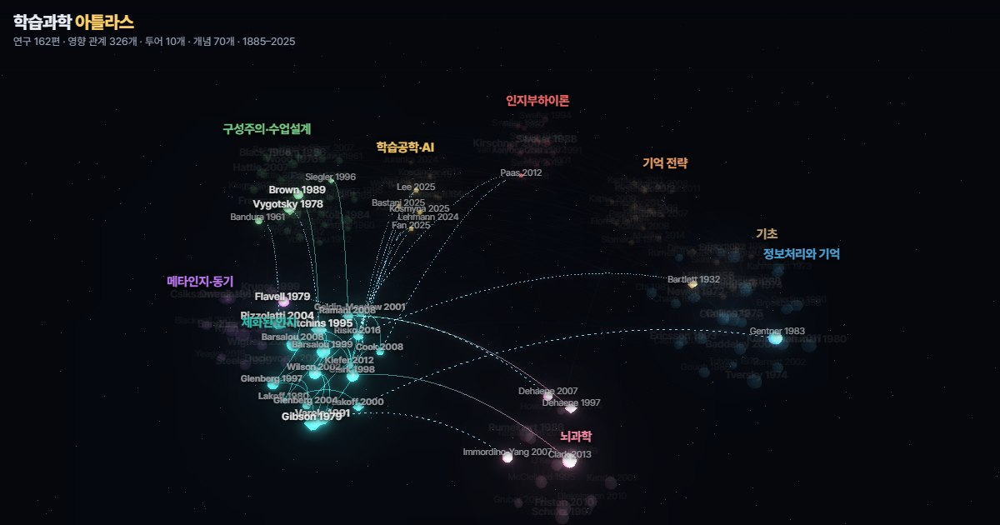

**학습과학 아틀라스 시리즈** · [허브](/post/learning-science-atlas/) · [1 기초](/post/learning-science-atlas-01-foundations/) · [2 정보처리](/post/learning-science-atlas-02-information-processing/) · [3 인지부하](/post/learning-science-atlas-03-cognitive-load/) · [4 기억 전략](/post/learning-science-atlas-04-memory-strategies/) · [5 구성주의](/post/learning-science-atlas-05-constructivism-instruction/) · [6 메타인지·동기](/post/learning-science-atlas-06-metacognition-motivation/) · **7 체화된 인지** · [8 뇌과학](/post/learning-science-atlas-08-neuroscience/) · [9 학습공학·AI](/post/learning-science-atlas-09-learning-engineering-ai/) · [개념 사전](/post/learning-science-atlas-glossary/) · [3D 지도 열기](/learning-science-atlas/)

생각은 머릿속 계산만이 아니라 몸, 행동, 도구, 환경에 걸쳐 일어난다는 관점이다. 어포던스와 개념적 은유에서 시작해 지각적 기호, 제스처 연구, 체화된 수학, 그리고 AI 시대의 핵심 개념이 된 인지적 오프로딩까지 이어진다. 학습과학 아틀라스의 아홉 클러스터 중 7번째인 이 글은 1979년부터 2016년까지의 연구 17편을 시간순으로 정리했다. 이 분야에서 가장 많이 인용된 연구는 Gibson(1979)의 「시지각에 대한 생태학적 접근」, Hutchins(1995)의 「야생의 인지」, Varela(1991)의 「몸의 인지과학」이다.

<figure>
  
  <figcaption>학습과학 아틀라스에서 체화된, 상황적, 확장된 인지 클러스터와 그 연결을 강조한 모습</figcaption>
</figure>

<a class="btn btn--primary" href="/tools/learning-science-atlas/?cluster=E" target="_blank">아틀라스에서 이 클러스터 보기</a>

## 한눈에 보는 흐름

| 연도 | 연구 | 한 줄 의의 |
|---|---|---|
| 1979 | 시지각에 대한 생태학적 접근 (Gibson) | "어포던스(affordance)" 개념을 탄생시킨 책이다. |
| 1980 | 삶으로서의 은유 (Lakoff) | 추상적 사고가 몸의 경험에서 나온 은유에 기반한다는 주장으로 인지언어학과 체화된 인지의 초석이 되었다. |
| 1991 | 몸의 인지과학 (Varela) | "체화된 마음(embodied mind)"이라는 말을 대중화하고 행화주의(enactivism)를 시작한 책이다. |
| 1995 | 야생의 인지 (Hutchins) | 인지가 개인의 머릿속이 아니라 사람, 도구, 환경에 분산되어 일어난다는 분산 인지 이론의 대표작이다. |
| 1997 | 기억은 무엇을 위한 것인가 (Glenberg) | 기억이 정보를 저장하는 창고가 아니라 행동을 위한 것이라는 체화된 기억 이론을 제시했다. |
| 1998 | 확장된 마음 (Clark) | 마음이 두개골과 피부 밖으로 확장될 수 있다는 도발적 주장으로 철학과 인지과학에 큰 논쟁을 일으켰다. |
| 1999 | 지각적 기호 체계 (Barsalou) | 개념이 감각운동 경험의 재활성화(시뮬레이션)로 표상된다는 이론으로, 체화된 인지의 대표적 인지과학 이론이 되었다. |
| 2000 | 수학은 어디에서 오는가 (Lakoff) | 가장 추상적인 학문인 수학조차 몸의 경험에서 나온 은유 위에 세워졌다고 주장한 도발적 저작이다. |
| 2001 | 수학 설명하기, 몸짓은 부하를 덜어 준다 (Goldin-Meadow) | 몸짓이 말하는 사람의 인지부하를 줄인다는 것을 실험으로 보였다. |
| 2002 | 체화된 인지의 여섯 가지 관점 (Wilson) | 혼란스럽던 "체화된 인지" 주장들을 여섯 가지로 나누어 비판적으로 정리했다. |
| 2004 | 조작 활동과 상상 활동이 어린이 읽기 이해를 높인다 (Glenberg) | 체화된 인지 이론을 교실 읽기 지도로 옮긴 대표 실험이다. |
| 2004 | 거울 뉴런 시스템 (Rizzolatti) | 남의 행동을 보기만 해도 내가 그 행동을 할 때와 같은 뉴런이 활성화된다는 발견을 정리한 대표 개관이다. |
| 2008 | 근거 기반 인지 (Barsalou) | 체화, 상황, 시뮬레이션 연구를 "근거 기반 인지(grounded cognition)"라는 이름으로 통합한 Annual Review 개관이다. |
| 2008 | 숫자 보드게임으로 저소득층 아동의 수 지식 높이기 (Ramani) | 일직선 숫자 보드게임 몇 판만으로 유아의 수 감각이 크게 좋아진다는 것을 보였다. |
| 2008 | 몸짓은 학습을 오래가게 한다 (Cook) | 학습자가 직접 몸짓을 하면 배운 내용이 더 오래 남는다는 것을 보였다. |
| 2012 | 체화 이론과 교육 (Kiefer) | 체화된 인지의 신경과학 증거를 교육 현장 시사점과 직접 연결한 개관이다. |
| 2016 | 인지적 오프로딩 (Risko) | 메모, 알림, 검색처럼 생각의 부담을 외부로 넘기는 행동을 체계적으로 정리했다. |

## 연구별 요약

### 시지각에 대한 생태학적 접근

*James J. Gibson (1979). The Ecological Approach to Visual Perception* (단행본)

"어포던스(affordance)" 개념을 탄생시킨 책이다. 체화된 인지, 인터페이스 디자인, 로봇공학에 두루 영향을 주었다. 깁슨은 지각이 망막 이미지를 머릿속에서 복잡하게 재구성하는 과정이 아니라, 움직이는 유기체가 환경의 정보를 직접 집어내는 과정이라고 보았다. 환경은 행위 가능성(어포던스)을 제공한다. 의자는 "앉을 수 있음"을, 손잡이는 "잡을 수 있음"을 직접 드러낸다.

> 문 손잡이 모양만 보고도 밀지 당길지 아는 것이 어포던스다.

교실에서는 교구와 학습 도구는 설명 없이도 "어떻게 써야 할지 보이게" 디자인한다.

### 삶으로서의 은유

*George Lakoff & Mark Johnson (1980). Metaphors We Live By* (단행본)

추상적 사고가 몸의 경험에서 나온 은유에 기반한다는 주장으로 인지언어학과 체화된 인지의 초석이 되었다. 우리는 "시간은 돈이다(시간을 아끼다, 낭비하다)", "논쟁은 전쟁이다(논리를 공격하다, 방어하다)", "많음은 위(물가가 오르다)" 같은 개념적 은유로 생각한다. 이런 은유는 말장식이 아니라 사고 구조 자체이며, 대부분 신체적 경험(위-아래, 안-밖, 앞-뒤)에서 나온다.

> "기분이 업됐다", "가라앉았다"라는 말은 몸의 위-아래 경험이 감정을 이해하는 틀이라는 증거다.

교실에서는 추상 개념(분수, 전류, 민주주의)을 가르칠 때 학생이 몸으로 겪어 본 비유를 의도적으로 고르고 그 한계도 함께 다룬다.

### 몸의 인지과학

*Francisco J. Varela 외 (1991). The Embodied Mind: Cognitive Science and Human Experience* (단행본)

"체화된 마음(embodied mind)"이라는 말을 대중화하고 행화주의(enactivism)를 시작한 책이다. 인지를 외부 세계의 표상을 계산하는 과정이 아니라, 몸을 가진 존재가 환경과 상호작용하며 세계를 "만들어 내는(enact)" 과정으로 보았다. 인지과학, 현상학, 불교 명상 전통을 연결해, 경험 자체를 과학의 대상으로 삼자고 제안했다.

> 박쥐의 세계와 사람의 세계가 다른 것은 같은 세상을 다른 몸으로 살아가기 때문이다.

교실에서는 학습을 정보 전달이 아니라 학생이 몸으로 세계와 관계 맺는 방식의 변화로 보는 관점을 제공한다.

### 야생의 인지

*Edwin Hutchins (1995). Cognition in the Wild* (단행본)

인지가 개인의 머릿속이 아니라 사람, 도구, 환경에 분산되어 일어난다는 분산 인지 이론의 대표작이다. 허친스는 미 해군 함정의 항해팀을 현장 연구했다. 배의 위치 계산은 어느 한 사람의 머릿속에서 일어나지 않고, 여러 승무원, 해도, 각도기, 통신 절차가 맞물린 체계 전체가 계산을 수행했다. 인지의 단위를 개인에서 사회기술적 시스템으로 넓혔다.

> 주방에서 요리 한 접시는 셰프 혼자가 아니라 주방 동선, 칼, 오더 시스템이 함께 만든다.

교실에서는 모둠 학습을 역할, 도구, 기록 방식까지 포함한 하나의 "생각하는 시스템"으로 설계한다.

### 기억은 무엇을 위한 것인가

*Arthur M. Glenberg (1997). What memory is for*

기억이 정보를 저장하는 창고가 아니라 행동을 위한 것이라는 체화된 기억 이론을 제시했다. 이후 읽기 이해의 체화 연구로 이어졌다. 글렌버그는 기억이 세계와 상호작용하는 방식을 부호화하며, 개념의 의미는 그 대상으로 할 수 있는 행동(어포던스)의 패턴이라고 주장했다. 문장 이해는 기호를 조작하는 것이 아니라 묘사된 행동이 가능한지 몸의 수준에서 "맞물려 보는" 과정이다.

> "신문지를 펴서 바람을 막았다"가 말이 되는 이유는 신문지로 할 수 있는 일을 몸이 알고 있기 때문이다.

교실에서는 읽은 내용을 몸으로 재현하거나 사물로 시뮬레이션해 보게 하면 이해가 깊어진다.

### 확장된 마음

*Andy Clark & David Chalmers (1998). The extended mind*

마음이 두개골과 피부 밖으로 확장될 수 있다는 도발적 주장으로 철학과 인지과학에 큰 논쟁을 일으켰다. 스마트폰과 AI 시대에 다시 주목받고 있다. 알츠하이머를 앓는 오토는 노트에 적힌 주소를 보고 미술관에 가고, 잉가는 기억에서 주소를 떠올린다. 저자들은 외부 자원이 머릿속 과정과 같은 역할을 하고 믿을 만하게 쓰인다면 그것도 인지의 일부로 봐야 한다는 동등성 원리를 제시했다.

> 늘 쓰는 스마트폰 메모장은 어떤 의미에서 내 기억의 일부다.

교실에서는 노트, 계산기, AI를 "생각의 일부"로 쓰는 방법과, 무엇은 머릿속에 남겨야 하는지를 함께 가르친다.

### 지각적 기호 체계

*Lawrence W. Barsalou (1999). Perceptual symbol systems*

개념이 감각운동 경험의 재활성화(시뮬레이션)로 표상된다는 이론으로, 체화된 인지의 대표적 인지과학 이론이 되었다. 전통 인지과학은 개념을 감각과 무관한 추상 기호로 보았다. 바살로우는 대상을 경험할 때 활성화된 감각운동 상태의 일부가 저장되고, 개념을 떠올리면 이를 부분적으로 재현(시뮬레이션)한다고 주장했다. 이런 지각적 기호로도 추상 개념과 조합적 사고를 설명할 수 있다고 보였다.

> "레몬"을 생각하면 침이 고이는 것은 머릿속 레몬이 맛과 향의 재현이기 때문이다.

교실에서는 개념을 처음 배울 때 실제 감각 경험을 제공하면 이후 떠올릴 수 있는 "시뮬레이션 재료"가 풍부해진다.

### 수학은 어디에서 오는가

*George Lakoff & Rafael E. Núñez (2000). Where Mathematics Comes From: How the Embodied Mind Brings Mathematics into Being* (단행본)

가장 추상적인 학문인 수학조차 몸의 경험에서 나온 은유 위에 세워졌다고 주장한 도발적 저작이다. 저자들은 산수를 "물건 모으기", "길 따라 움직이기" 같은 몸의 경험에 근거한 은유로 설명한다. 덧셈은 모으기, 뺄셈은 덜어 내기, 수직선은 걸어가는 길이다. 이런 근거 은유가 층층이 쌓여 집합, 무한, 미적분 같은 추상 개념이 만들어진다고 보았다.

> "0보다 작은 수"가 이해되는 것은 수를 길 위의 위치로 생각하는 몸의 경험 덕분이다.

교실에서는 추상 개념을 가르칠 때 그 개념의 뿌리가 되는 몸의 경험(모으기, 움직이기, 나누기)부터 시작한다.

**함께 알아 둘 점** 수학 철학자들로부터 수학적 엄밀성을 지나치게 단순화했다는 비판을 받았다.

### 수학 설명하기, 몸짓은 부하를 덜어 준다

*Susan Goldin-Meadow 외 (2001). Explaining math: Gesturing lightens the load*

몸짓이 말하는 사람의 인지부하를 줄인다는 것을 실험으로 보였다. 체화된 인지와 인지부하이론을 잇는 핵심 증거다. 아동과 성인이 수학 문제 풀이를 설명하는 동안 단어나 글자 목록을 기억하게 했다. 설명하며 몸짓을 한 경우가 몸짓을 못 하게 한 경우보다 목록을 더 많이 기억했다. 몸짓이 생각의 일부를 몸으로 옮겨 작업기억 자원을 아껴 준다는 해석이다.

> 길을 설명할 때 손짓을 하면 말이 더 술술 나오는 이유다.

교실에서는 학생이 설명할 때 손짓을 막지 말고, 교사도 핵심 관계를 몸짓으로 함께 보여 준다.

### 체화된 인지의 여섯 가지 관점

*Margaret Wilson (2002). Six views of embodied cognition*

혼란스럽던 "체화된 인지" 주장들을 여섯 가지로 나누어 비판적으로 정리했다. 이 분야 입문의 필독 논문이다. (1) 인지는 상황적이다, (2) 시간 압박을 받는다, (3) 인지적 일을 환경에 떠넘긴다, (4) 환경은 인지 체계의 일부다, (5) 인지는 행동을 위한 것이다, (6) 오프라인 인지(지금 여기 없는 것을 생각하기)도 몸에 기반한다. 윌슨은 (4)가 가장 문제가 많고 (6)이 가장 강력하지만 덜 주목받았다고 평가했다.

> "체화"라는 한 단어 안에 서로 다른 여섯 주장이 섞여 있다는 지도를 그려 준 논문이다.

교실에서는 체화 학습을 설계할 때 어느 주장(환경에 부담 넘기기인지, 몸 기반 시뮬레이션인지)을 활용하는지 분명히 한다.

### 조작 활동과 상상 활동이 어린이 읽기 이해를 높인다

*Arthur M. Glenberg 외 (2004). Activity and imagined activity can enhance young children's reading comprehension*

체화된 인지 이론을 교실 읽기 지도로 옮긴 대표 실험이다. 초등 1~2학년생이 농장 이야기를 읽으며 장난감으로 문장 내용을 직접 움직여 보게 했다. 조작한 아이들은 다시 읽기만 한 아이들보다 기억과 추론이 크게 좋아졌다. 나중에 장난감 없이 "머릿속으로 움직여 보기"를 해도 효과가 이어졌다.

> "트랙터가 헛간으로 간다"를 읽고 장난감 트랙터를 직접 움직여 보면 문장이 머릿속 장면이 된다.

교실에서는 저학년 읽기에서 문장을 손 인형이나 블록으로 재현하는 활동을 넣고, 점차 "머릿속 재현"으로 옮긴다.

### 거울 뉴런 시스템

*Giacomo Rizzolatti & Laila Craighero (2004). The mirror-neuron system*

남의 행동을 보기만 해도 내가 그 행동을 할 때와 같은 뉴런이 활성화된다는 발견을 정리한 대표 개관이다. 원숭이 전운동피질의 특정 뉴런은 원숭이가 물건을 잡을 때와 다른 개체가 잡는 것을 볼 때 모두 활성화된다. 사람에게도 비슷한 시스템이 있으며, 연구진은 이것이 행동 이해와 모방의 기반이라고 제안했다.

> 다른 사람이 레몬을 깨무는 모습만 봐도 내 얼굴이 찡그려지는 것과 연결된다.

교실에서는 시범 보이기, 모델링이 왜 강력한지에 대한 신경 수준의 설명 중 하나로 활용한다.

**함께 알아 둘 점** 공감, 언어, 자폐까지 거울 뉴런으로 설명하려는 대중적 주장은 과장되었다는 비판(Hickok, 2014)이 있다.

### 근거 기반 인지

*Lawrence W. Barsalou (2008). Grounded cognition*

체화, 상황, 시뮬레이션 연구를 "근거 기반 인지(grounded cognition)"라는 이름으로 통합한 Annual Review 개관이다. 인지가 추상 기호가 아니라 감각운동 시뮬레이션, 상황적 행동, 신체 상태에 근거한다는 증거를 지각, 기억, 언어, 사고, 사회 인지 전반에서 검토했다. "체화"는 몸 자체보다 몸과 환경의 경험이 재현된다는 점이 핵심이라 "근거 인지"가 더 정확한 용어라고 제안했다.

> "망치질"이라는 단어를 읽을 때 뇌의 운동 영역이 살짝 깨어나는 것이 근거 인지의 증거다.

교실에서는 추상 개념도 그것이 실제로 쓰이는 상황과 행동 속에서 소개하면 이해의 뿌리가 생긴다.

### 숫자 보드게임으로 저소득층 아동의 수 지식 높이기

*Geetha B. Ramani & Robert S. Siegler (2008). Promoting broad and stable improvements in low-income children's numerical knowledge through playing number board games*

일직선 숫자 보드게임 몇 판만으로 유아의 수 감각이 크게 좋아진다는 것을 보였다. 수를 공간과 몸의 움직임으로 연결하는 체화된 수학 교육의 대표 근거다. 저소득층 유치원생들이 1부터 10까지 일렬로 놓인 칸을 말로 이동하며 숫자를 소리 내어 세는 게임을 2주 동안 15~20분씩 네 번 했다. 이 아이들은 수직선 추정, 크기 비교, 세기, 숫자 읽기에서 모두 향상되었고, 효과는 9주 뒤에도 유지되었다. 숫자 대신 색깔 칸으로 된 게임을 한 아이들은 향상되지 않았다.

> "뱀 사다리" 같은 놀이판에서 칸을 하나씩 옮길 때마다 수의 크기가 거리로 몸에 새겨진다.

교실에서는 유아와 저학년 수 학습에 일직선 숫자판 게임을 넣고, 이동할 때 숫자를 소리 내어 세게 한다.

### 몸짓은 학습을 오래가게 한다

*Susan Wagner Cook 외 (2008). Gesturing makes learning last*

학습자가 직접 몸짓을 하면 배운 내용이 더 오래 남는다는 것을 보였다. 제스처를 학습 도구로 쓰는 연구의 대표 실험이다. 초등학생들이 "3+2+8=__+8" 같은 등식 문제의 풀이 전략을 배우며 말로만, 몸짓으로만, 말과 몸짓을 함께 따라 하게 했다. 수업 직후에는 세 집단의 성적이 비슷했지만, 4주 뒤에는 몸짓을 한 두 집단만 배운 내용을 유지했다.

> "양쪽을 똑같이 맞춰야 해"라고 말하며 양손으로 저울을 그리는 동작이 개념을 몸에 붙여 둔다.

교실에서는 개념을 설명할 때 의미 있는 손동작을 함께 정하고, 학생이 그 동작을 따라 하며 설명하게 한다.

### 체화 이론과 교육

*Markus Kiefer & Natalie M. Trumpp (2012). Embodiment theory and education: The foundations of cognition in perception and action*

체화된 인지의 신경과학 증거를 교육 현장 시사점과 직접 연결한 개관이다. 개념이 지각과 행동 체계에 근거한다는 뇌영상 연구를 정리하고, 교육적 함의를 논의했다. 예를 들어 글자를 손으로 써 본 아이가 키보드로 친 아이보다 글자를 더 잘 인식하고, 손가락 수 세기는 수 개념 발달과 관련된다. 감각운동이 풍부한 학습이 개념 표상을 강화한다고 제안했다.

> 글자를 손으로 써 보는 경험이 뇌 속 "글자 지도"를 더 선명하게 만든다.

교실에서는 저학년 문자, 수 학습에서 손글씨와 손가락 사용을 성급히 디지털로 대체하지 않는다.

### 인지적 오프로딩

*Evan F. Risko & Sam J. Gilbert (2016). Cognitive offloading*

메모, 알림, 검색처럼 생각의 부담을 외부로 넘기는 행동을 체계적으로 정리했다. 생성형 AI 시대 학습 연구의 핵심 개념이 되었다. 사람은 머리를 기울여 회전된 그림을 보거나, 할 일을 알림에 맡기는 등 신체 행동과 외부 도구로 인지 요구를 줄인다. 오프로딩 여부는 내 기억과 능력에 대한 메타인지적 판단에 좌우된다. 오프로딩은 즉각적 수행을 높이지만, 맡긴 정보 자체의 기억은 약해질 수 있다.

> 전화번호를 스마트폰에 저장한 뒤로 가족 번호도 못 외우게 된 경험이 오프로딩의 대가다.

교실에서는 AI나 검색에 맡겨도 되는 것과 머릿속에 반드시 남겨야 할 핵심 지식을 학생과 함께 구분한다.

## 이 분야의 핵심 개념

- **관찰 학습**(observational learning). 직접 보상을 받지 않아도 남의 행동을 보는 것만으로 배우는 학습.
- **체화된 인지**(embodied cognition). 생각은 머릿속 계산만이 아니라 몸의 감각과 행동에 뿌리를 둔다는 관점.
- **어포던스**(affordance). 환경이 행위자에게 제공하는 행동 가능성. 손잡이는 "잡을 수 있음"을 드러낸다.
- **개념적 은유**(conceptual metaphor). 추상적 개념을 몸의 경험(위-아래, 안-밖, 움직임)에 빗대어 이해하는 사고 방식.
- **근거 인지와 시뮬레이션**(grounded cognition). 개념을 떠올리는 것은 그 대상을 경험할 때의 감각운동 상태를 부분적으로 재현하는 것이라는 이론.
- **제스처와 학습**(gesture). 몸짓이 말하는 사람의 작업기억 부담을 덜고, 배운 내용을 오래 남게 한다.
- **확장된 마음**(extended mind). 노트, 도구처럼 믿을 만하게 쓰이는 외부 자원도 인지의 일부일 수 있다는 주장.
- **분산 인지**(distributed cognition). 인지가 개인의 머리가 아니라 사람, 도구, 절차가 맞물린 체계 전체에서 일어난다는 관점.
- **인지적 오프로딩**(cognitive offloading). 메모, 검색, AI처럼 생각의 부담을 외부로 넘기는 것. 수행은 돕지만 맡긴 것은 머리에 덜 남는다.

## 다른 분야와 이어지는 다리

이 클러스터는 다른 분야와 19개의 선으로 이어진다.

- 기억하기(1932, 기초) → 지각적 기호 체계(1999, 체화된 인지). 재구성적 기억에서 시뮬레이션으로
- 공격적 모델의 모방을 통한 공격성의 전이 (보보 인형 실험)(1961, 구성주의·수업설계) → 거울 뉴런 시스템(2004, 체화된 인지). 관찰을 통한 행동 이해
- 사회 속의 마음(1978, 구성주의·수업설계) → 야생의 인지(1995, 체화된 인지). 매개된 인지
- 메타인지와 인지적 점검(1979, 메타인지·동기) → 인지적 오프로딩(2016, 체화된 인지). 오프로딩의 메타인지 판단
- 구조 사상 이론(1983, 정보처리와 기억) → 수학은 어디에서 오는가(2000, 체화된 인지). 관계 구조와 은유
- 상황인지와 학습의 문화(1989, 구성주의·수업설계) → 야생의 인지(1995, 체화된 인지). 현장 속 인지
- 몸의 인지과학(1991, 체화된 인지) → 우리는 느낀다, 그러므로 배운다(2007, 뇌과학). 몸과 정서의 인지
- 떠오르는 마음, 아동 사고의 변화 과정(1996, 구성주의·수업설계) → 숫자 보드게임으로 저소득층 아동의 수 지식 높이기(2008, 체화된 인지). 수 지식 발달
- 수 감각(1997, 뇌과학) → 숫자 보드게임으로 저소득층 아동의 수 지식 높이기(2008, 체화된 인지). 수 감각과 수직선
- 확장된 마음(1998, 체화된 인지) → 다음은 무엇? 예측하는 뇌, 상황 속 행위자(2013, 뇌과학). 예측하는 확장된 마음
- 확장된 마음(1998, 체화된 인지) → 생성형 AI가 비판적 사고에 미치는 영향(2025, 학습공학·AI). 도구와 결합된 사고
- 수학 설명하기, 몸짓은 부하를 덜어 준다(2001, 체화된 인지) → 인지부하이론의 진화적 업그레이드(2012, 인지부하이론). 몸짓이 부하를 줄인다
- 피질 지도의 문화적 재활용(2007, 뇌과학) → 숫자 보드게임으로 저소득층 아동의 수 지식 높이기(2008, 체화된 인지). 수 감각과 공간
- 몸짓은 학습을 오래가게 한다(2008, 체화된 인지) → 인지부하이론의 진화적 업그레이드(2012, 인지부하이론). 인간 움직임 효과
- 인지적 오프로딩(2016, 체화된 인지) → 안전장치 없는 생성형 AI는 학습을 해칠 수 있다(2025, 학습공학·AI). AI로의 인지적 오프로딩
- 인지적 오프로딩(2016, 체화된 인지) → ChatGPT를 쓴 뇌, 인지적 부채의 누적(2025, 학습공학·AI). 인지적 부채
- 인지적 오프로딩(2016, 체화된 인지) → 메타인지적 게으름을 경계하라(2025, 학습공학·AI). AI에 메타인지 맡기기
- 인지적 오프로딩(2016, 체화된 인지) → 생성형 AI가 비판적 사고에 미치는 영향(2025, 학습공학·AI). 비판적 사고의 오프로딩
- 인지적 오프로딩(2016, 체화된 인지) → AI가 교실을 만날 때, LLM은 언제 학습을 해치는가?(2024, 학습공학·AI). 대체로서의 오프로딩

## 이 분야가 나오는 투어

- [몸으로 생각하기](/tools/learning-science-atlas/?tour=embodied). 생각은 머릿속 계산만이 아니라 몸과 행동과 환경에 걸쳐 일어난다는 체화된 인지의 흐름.
- [AI 시대, 생각을 어디까지 맡길 것인가](/tools/learning-science-atlas/?tour=offload). 마음은 도구로 확장된다. 그렇다면 AI에 맡겨도 되는 것과 머릿속에 남겨야 하는 것의 경계는 어디인가.
- [읽고 셈하는 뇌, 읽기와 수의 과학](/tools/learning-science-atlas/?tour=readmath). 말하기는 저절로 배우지만 읽기와 수학은 가르쳐야 한다. 문화적 발명을 배우는 뇌의 과학.

## 참고 자료

- James J. Gibson (1979). *The Ecological Approach to Visual Perception*. <https://doi.org/10.2307/429816>
- George Lakoff & Mark Johnson (1980). *Metaphors We Live By*. <https://doi.org/10.2307/430414>
- Francisco J. Varela, Evan Thompson & Eleanor Rosch (1991). *The Embodied Mind: Cognitive Science and Human Experience*. <https://doi.org/10.7551/mitpress/6730.001.0001>
- Edwin Hutchins (1995). *Cognition in the Wild*. <https://doi.org/10.7551/mitpress/1881.001.0001>
- Arthur M. Glenberg (1997). *What memory is for*. <https://doi.org/10.1017/S0140525X97000010>
- Andy Clark & David Chalmers (1998). *The extended mind*. <https://doi.org/10.1093/analys/58.1.7>
- Lawrence W. Barsalou (1999). *Perceptual symbol systems*. <https://doi.org/10.1017/S0140525X99002149>
- George Lakoff & Rafael E. Núñez (2000). *Where Mathematics Comes From: How the Embodied Mind Brings Mathematics into Being*.
- Susan Goldin-Meadow, Howard Nusbaum, Spencer D. Kelly & Susan Wagner (2001). *Explaining math: Gesturing lightens the load*. <https://doi.org/10.1111/1467-9280.00395>
- Margaret Wilson (2002). *Six views of embodied cognition*. <https://doi.org/10.3758/BF03196322>
- Arthur M. Glenberg, Tiana Gutierrez, Joel R. Levin, Sandra Japuntich & Michael P. Kaschak (2004). *Activity and imagined activity can enhance young children's reading comprehension*. <https://doi.org/10.1037/0022-0663.96.3.424>
- Giacomo Rizzolatti & Laila Craighero (2004). *The mirror-neuron system*. <https://doi.org/10.1146/annurev.neuro.27.070203.144230>
- Lawrence W. Barsalou (2008). *Grounded cognition*. <https://doi.org/10.1146/annurev.psych.59.103006.093639>
- Geetha B. Ramani & Robert S. Siegler (2008). *Promoting broad and stable improvements in low-income children's numerical knowledge through playing number board games*. <https://doi.org/10.1111/j.1467-8624.2007.01131.x>
- Susan Wagner Cook, Zachary Mitchell & Susan Goldin-Meadow (2008). *Gesturing makes learning last*. <https://doi.org/10.1016/j.cognition.2007.04.010>
- Markus Kiefer & Natalie M. Trumpp (2012). *Embodiment theory and education: The foundations of cognition in perception and action*. <https://doi.org/10.1016/j.tine.2012.07.002>
- Evan F. Risko & Sam J. Gilbert (2016). *Cognitive offloading*. <https://doi.org/10.1016/j.tics.2016.07.002>
- 인용 수: OpenAlex (2026년 11월 수집) <https://openalex.org>
