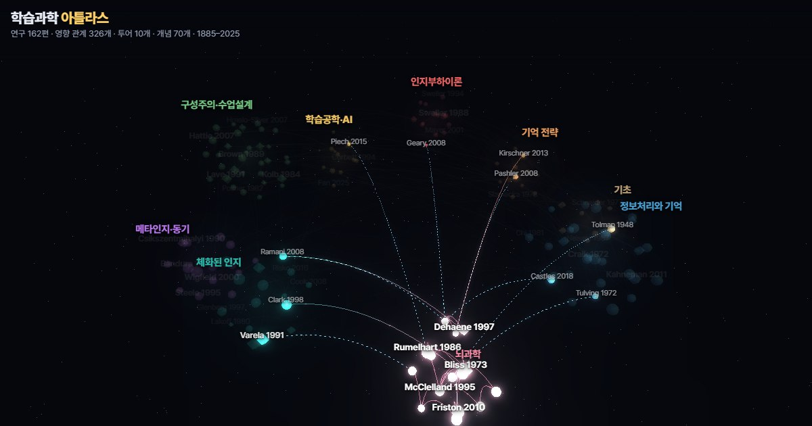

**학습과학 아틀라스 시리즈** · [허브](/post/learning-science-atlas/) · [1 기초](/post/learning-science-atlas-01-foundations/) · [2 정보처리](/post/learning-science-atlas-02-information-processing/) · [3 인지부하](/post/learning-science-atlas-03-cognitive-load/) · [4 기억 전략](/post/learning-science-atlas-04-memory-strategies/) · [5 구성주의](/post/learning-science-atlas-05-constructivism-instruction/) · [6 메타인지·동기](/post/learning-science-atlas-06-metacognition-motivation/) · [7 체화된 인지](/post/learning-science-atlas-07-embodied-cognition/) · **8 뇌과학** · [9 학습공학·AI](/post/learning-science-atlas-09-learning-engineering-ai/) · [개념 사전](/post/learning-science-atlas-glossary/) · [3D 지도 열기](/learning-science-atlas/)

학습을 뇌 수준에서 설명하려는 연구들이다. 헵의 가설과 장기 강화, 해마의 장소 세포, 기억의 분자 기전, 수면과 기억 응고화, 도파민 예측 오류와 호기심, 정서와 학습, 수 감각, 예측하는 뇌 이론, 그리고 교실에 퍼진 신경 신화에 대한 경고까지 담았다. 학습과학 아틀라스의 아홉 클러스터 중 8번째인 이 글은 1949년부터 2014년까지의 연구 16편을 시간순으로 정리했다. 이 분야에서 가장 많이 인용된 연구는 Rumelhart(1986)의 「오차 역전파로 표상 학습하기」, Friston(2010)의 「자유에너지 원리」, Schultz(1997)의 「예측과 보상의 신경 기질」이다.

<figure>
  
  <figcaption>학습과학 아틀라스에서 뇌과학과 예측하는 뇌 클러스터와 그 연결을 강조한 모습</figcaption>
</figure>

<a class="btn btn--primary" href="/tools/learning-science-atlas/?cluster=N" target="_blank">아틀라스에서 이 클러스터 보기</a>

## 한눈에 보는 흐름

| 연도 | 연구 | 한 줄 의의 |
|---|---|---|
| 1949 | 행동의 조직 (Hebb) | "함께 발화하는 뉴런은 함께 연결된다"로 요약되는 헵의 학습 규칙을 제시했다. |
| 1971 | 공간 지도로서의 해마 (O'Keefe) | 쥐가 특정 장소에 있을 때만 발화하는 해마의 "장소 세포"를 처음 보고했다. |
| 1973 | 장기 강화(LTP)의 발견 (Bliss) | 짧은 고빈도 자극이 시냅스 연결을 오래 강화한다는 장기 강화(LTP)를 처음 보고했다. |
| 1986 | 오차 역전파로 표상 학습하기 (Rumelhart) | 다층 신경망이 오차를 거꾸로 전파하며 스스로 내부 표상을 학습할 수 있음을 보인 Nature 논문이다. |
| 1995 | 상보적 학습 시스템 이론 (McClelland) | 뇌가 왜 빠른 학습(해마)과 느린 학습(신피질)이라는 두 시스템을 갖는지를 계산 모형으로 설명했다. |
| 1997 | 예측과 보상의 신경 기질 (Schultz) | 도파민 뉴런이 "보상 그 자체"가 아니라 "예측과 실제의 차이"를 신호한다는 것을 보였다. |
| 1997 | 수 감각 (Dehaene) | 인간과 동물, 아기가 타고나는 "어림 수 감각"과 그 뇌 기반을 소개해 수학 인지 연구와 수 학습 교육에 큰 영향을 준 책이다. |
| 2001 | 기억 저장의 분자생물학 (Kandel) | 단기기억과 장기기억이 분자 수준에서 다른 기전을 가진다는 것을 밝힌 노벨상 강연 논문이다. |
| 2007 | 피질 지도의 문화적 재활용 (Dehaene) | 읽기와 산수처럼 최근에 발명된 문화적 능력이 어떻게 진화적으로 오래된 뇌 회로를 "재활용"하는지 설명하는 신경 재활용 가설을 제시했다. |
| 2007 | 우리는 느낀다, 그러므로 배운다 (Immordino-Yang) | 정서가 학습을 방해하는 잡음이 아니라 사고와 학습의 토대라는 신경과학적 관점을 교육계에 소개해, 정서 교육과 교육신경과학 논의를 크게 바꾸었다. |
| 2010 | 자유에너지 원리 (Friston) | 지각, 학습, 행동을 "예측 오류 최소화"라는 하나의 원리로 통합하려는 야심 찬 이론이다. |
| 2010 | 수면의 기억 기능 (Diekelmann) | 잠이 낮에 배운 것을 굳히고 재조직한다는 연구를 집대성한 대표 개관이다. |
| 2011 | 마음을 키우는 법, 통계, 구조, 추상화 (Tenenbaum) | 아이들이 몇 개의 예시만으로 단어와 개념을 배우는 능력을 베이지안 확률 추론과 구조화된 표상으로 설명한 Science 개관이다. |
| 2013 | 다음은 무엇? 예측하는 뇌, 상황 속 행위자 (Clark) | 예측 처리 이론을 체화·상황 인지와 연결한 영향력 있는 BBS 표적 논문이다. |
| 2014 | 신경과학과 교육, 신화와 메시지 (Howard-Jones) | 여러 나라의 교사 조사 결과를 모아 교사들 사이에 퍼진 뇌 신화를 보여 주고, 신경과학이 교육에 줄 수 있는 실제 메시지를 정리했다. |
| 2014 | 호기심은 도파민 회로를 통해 해마 학습을 조절한다 (Gruber) | 호기심이 높은 상태에서는 궁금했던 답뿐 아니라 그 순간 함께 본 무관한 정보까지 더 잘 기억된다는 것을 보인 Neuron 논문이다. |

## 연구별 요약

### 행동의 조직

*Donald O. Hebb (1949). The Organization of Behavior: A Neuropsychological Theory* (단행본)

"함께 발화하는 뉴런은 함께 연결된다"로 요약되는 헵의 학습 규칙을 제시했다. 신경과학의 학습 이론과 인공신경망의 공통 조상이다. 헵은 한 뉴런이 다른 뉴런을 반복적으로 흥분시키면 둘 사이 연결이 강해진다고 제안했다. 이렇게 함께 활성화되는 뉴런 집단(세포 집합체)이 지각과 개념, 기억의 신경 기반이 된다. 이 가설은 1970년대 장기강화(LTP) 발견으로 실험적 지지를 얻었다.

> 풀밭을 여러 번 걸으면 길이 나듯, 자주 함께 쓰인 뇌 회로가 굵어진다.

교실에서는 반복과 연결이 학습의 물리적 기반임을 학생에게 설명할 때 쓰기 좋은 원리다.

### 공간 지도로서의 해마

*John O'Keefe & Jonathan Dostrovsky (1971). The hippocampus as a spatial map: Preliminary evidence from unit activity in the freely-moving rat*

쥐가 특정 장소에 있을 때만 발화하는 해마의 "장소 세포"를 처음 보고했다. 톨먼의 인지도가 뇌에 실재한다는 증거로, 2014년 노벨 생리의학상으로 이어졌다. 자유롭게 움직이는 쥐의 해마 뉴런 활동을 기록하자, 일부 뉴런은 쥐가 공간의 특정 위치에 있을 때만 강하게 발화했다. 저자들은 해마가 환경의 공간 지도를 만든다고 제안했다. 이후 격자 세포 발견으로 뇌의 위치 측정 체계가 밝혀졌다.

> 뇌 속에 "지금 여기"를 표시하는 지도 핀이 있다는 발견이다.

교실에서는 장소법(기억의 궁전) 같은 공간 기반 기억술이 왜 강력한지에 대한 신경과학적 배경이다.

### 장기 강화(LTP)의 발견

*Tim V. P. Bliss & Terje Lømo (1973). Long-lasting potentiation of synaptic transmission in the dentate area of the anaesthetized rabbit following stimulation of the perforant path*

짧은 고빈도 자극이 시냅스 연결을 오래 강화한다는 장기 강화(LTP)를 처음 보고했다. 헵의 가설에 생리학적 근거를 준, 학습의 세포 기전 연구의 출발점이다. 마취한 토끼의 해마 경로에 짧은 고빈도 전기 자극을 주자, 이후 같은 자극에 대한 반응이 30분에서 최대 10시간까지 강하게 유지되었다(마취하지 않은 토끼를 대상으로 한 동반 연구에서는 며칠까지 유지되었다). 경험이 시냅스의 효율을 지속적으로 바꿀 수 있다는 것을 보인 결과로, 기억의 세포 수준 기전으로 널리 연구되었다.

> 자주 쓰는 길이 넓게 포장되듯, 강하게 함께 쓰인 연결은 오래 굵어진다.

교실에서는 반복과 연습이 실제로 뇌의 연결을 바꾼다는 것을 학생들에게 설명할 때 쓸 수 있는 생물학적 근거다.

### 오차 역전파로 표상 학습하기

*David E. Rumelhart 외 (1986). Learning representations by back-propagating errors*

다층 신경망이 오차를 거꾸로 전파하며 스스로 내부 표상을 학습할 수 있음을 보인 Nature 논문이다. 연결주의 인지과학과 오늘날 딥러닝, 생성형 AI의 공통 뿌리다. 출력과 정답의 차이(오차)를 출력층에서 입력층 방향으로 거꾸로 전달하며 연결 가중치를 조금씩 고치는 역전파 학습 절차를 제시했다. 이 과정에서 은닉층이 과제에 유용한 특징을 스스로 만들어 냈다. 규칙을 직접 넣지 않아도 예시로부터 구조를 배우는 학습 모형이 가능해졌다.

> 다트를 던질 때마다 빗나간 정도를 보고 팔 각도를 조금씩 고쳐 가는 학습을 수학으로 만든 것이다.

교실에서는 생성형 AI가 "예시에서 패턴을 배운 시스템"이라는 점을 학생에게 설명할 때 역사적 출발점으로 쓸 수 있다.

### 상보적 학습 시스템 이론

*James L. McClelland 외 (1995). Why there are complementary learning systems in the hippocampus and neocortex*

뇌가 왜 빠른 학습(해마)과 느린 학습(신피질)이라는 두 시스템을 갖는지를 계산 모형으로 설명했다. 수면, 분산 학습, 인공신경망 연구까지 영향을 미쳤다. 인공신경망은 새 정보를 한꺼번에 학습하면 기존 지식을 덮어써 버리는 파국적 간섭을 겪는다. 연구진은 해마가 새 경험을 빠르게 저장한 뒤, 신피질이 이를 기존 지식과 섞어 천천히 통합한다고 제안했다. 이 교차 재생이 장기 기억의 구조화를 가능하게 한다.

> 메모장(해마)에 빠르게 적어 두었다가 밤마다 백과사전(피질)에 조금씩 옮겨 적는 방식이다.

교실에서는 새 내용을 기존 내용과 섞어 다시 다루는 누적 복습과 충분한 수면이 학습 통합에 중요하다.

### 예측과 보상의 신경 기질

*Wolfram Schultz 외 (1997). A neural substrate of prediction and reward*

도파민 뉴런이 "보상 그 자체"가 아니라 "예측과 실제의 차이"를 신호한다는 것을 보였다. 신경과학과 강화학습 AI를 연결한 기념비적 논문이다. 원숭이에게 예상하지 못한 주스를 주면 도파민 뉴런이 크게 반응했다. 신호 뒤에 주스가 온다는 것을 학습하면 반응은 주스가 아닌 신호 시점으로 옮겨 갔고, 예상한 주스가 오지 않으면 반응이 줄었다. 이 패턴은 기계학습의 시간차(TD) 학습 알고리즘의 예측 오류와 정확히 일치했다.

> 기대보다 좋은 성적표에 기쁘고, 기대한 만큼이면 덤덤하고, 기대보다 나쁘면 실망하는 것과 같다.

교실에서는 학습은 "예측이 틀릴 때" 일어난다. 결과를 먼저 예측하게 한 뒤 확인하는 활동이 효과적인 이유다.

### 수 감각

*Stanislas Dehaene (1997). The Number Sense: How the Mind Creates Mathematics* (단행본)

인간과 동물, 아기가 타고나는 "어림 수 감각"과 그 뇌 기반을 소개해 수학 인지 연구와 수 학습 교육에 큰 영향을 준 책이다. 쥐, 원숭이, 그리고 갓난아기도 적은 수의 차이와 대략적인 양의 차이를 알아챈다. 이 어림 수 감각은 두정엽(특히 두정내구)에 기반하며, 정확한 계산과 수 기호는 문화와 교육이 이 기초 위에 쌓은 것이다. 수 감각이 약하면 수학 학습 장애(난산증)로 이어질 수 있다.

> 우리는 사과 8개와 9개는 헷갈려도 3개와 9개는 세지 않고도 바로 구분한다.

교실에서는 초기 수 학습에서 수 크기를 공간(수직선), 양(블록), 기호(숫자)로 연결하는 활동을 충분히 한다.

### 기억 저장의 분자생물학

*Eric R. Kandel (2001). The molecular biology of memory storage: A dialogue between genes and synapses*

단기기억과 장기기억이 분자 수준에서 다른 기전을 가진다는 것을 밝힌 노벨상 강연 논문이다. 캔델은 바다 달팽이 군소의 단순한 반사 학습을 연구했다. 한 번의 자극은 기존 단백질의 화학적 변화로 몇 분 지속되는 단기기억을 만들지만, 반복된 자극은 유전자 발현과 새 단백질 합성을 거쳐 새로운 시냅스 연결을 키우는 장기기억을 만든다. 반복이 기억을 "구조적으로" 바꾸는 이유가 여기에 있다.

> 단기기억은 연필 메모, 장기기억은 벽돌을 새로 쌓는 공사에 가깝다.

교실에서는 한 번에 몰아 하기보다 간격을 두고 반복하는 것이 장기기억 형성에 유리하다는 생물학적 배경이다.

### 피질 지도의 문화적 재활용

*Stanislas Dehaene & Laurent Cohen (2007). Cultural recycling of cortical maps*

읽기와 산수처럼 최근에 발명된 문화적 능력이 어떻게 진화적으로 오래된 뇌 회로를 "재활용"하는지 설명하는 신경 재활용 가설을 제시했다. 문자는 수천 년 전에 발명되어 읽기 전용 뇌 영역이 진화할 시간이 없었다. 그런데도 모든 문화권에서 읽기는 같은 좌측 후두-측두 영역(시각 단어 형태 영역)을 쓴다. 저자들은 원래 사물과 얼굴 인식에 쓰이던 회로가 문화 학습으로 용도 변경되며, 원래 회로의 제약이 문화적 발명의 형태까지 제한한다고 주장했다.

> 원래 다른 용도로 지은 창고를 리모델링해 도서관으로 쓰는 것과 같다.

교실에서는 읽기는 자연적으로 생기지 않으므로 체계적인 파닉스와 해독 교육이 필요하다는 근거가 된다.

### 우리는 느낀다, 그러므로 배운다

*Mary Helen Immordino-Yang & Antonio Damasio (2007). We feel, therefore we learn: The relevance of affective and social neuroscience to education*

정서가 학습을 방해하는 잡음이 아니라 사고와 학습의 토대라는 신경과학적 관점을 교육계에 소개해, 정서 교육과 교육신경과학 논의를 크게 바꾸었다. 전전두엽 일부가 손상된 환자들은 지능 검사 점수는 정상이지만 정서 신호를 활용하지 못해 경험에서 배우지 못하고 일상의 결정을 잘못 내렸다. 저자들은 이성적 사고조차 정서와 신체 반응에 기대고 있으며, 학교에서 배운 지식이 실제 삶으로 전이되려면 정서적 의미가 결합되어야 한다고 주장했다.

> "재미있다", "중요하다"는 느낌이 기억에 붙는 꼬리표 역할을 한다.

교실에서는 개념을 학생에게 의미 있는 문제, 이야기, 사람과 연결해 정서적 관련성을 만든다.

### 자유에너지 원리

*Karl Friston (2010). The free-energy principle: a unified brain theory?*

지각, 학습, 행동을 "예측 오류 최소화"라는 하나의 원리로 통합하려는 야심 찬 이론이다. 예측하는 뇌 패러다임의 이론적 중심이다. 뇌는 세계에 대한 생성 모형을 가지고 감각 입력을 예측하며, 예측과 실제 입력의 차이(자유에너지, 예측 오류)를 줄이도록 작동한다. 예측 오류는 모형을 고치거나(지각과 학습), 세계를 바꾸어(행동, 능동적 추론) 줄일 수 있다. 베이지안 뇌, 예측 부호화, 강화학습을 한 틀로 묶으려 했다.

> 뇌는 계속 "다음엔 이럴 거야"라고 예측하고, 틀릴 때만 놀라며 배우는 예측 기계다.

교실에서는 학생의 예측과 결과가 어긋나는 "인지적 놀람"의 순간을 수업에 의도적으로 설계한다.

**함께 알아 둘 점** 수학적으로 난해하고 반증 가능성이 낮다는 비판도 함께 받는다.

### 수면의 기억 기능

*Susanne Diekelmann & Jan Born (2010). The memory function of sleep*

잠이 낮에 배운 것을 굳히고 재조직한다는 연구를 집대성한 대표 개관이다. 잠자는 동안, 특히 깊은 서파 수면에서 해마에 임시 저장된 기억이 재활성화되며 신피질로 옮겨져 장기 기억으로 통합된다(능동적 체계 응고화). 수면은 단순히 망각을 막는 것이 아니라 기억을 선택적으로 강화하고, 숨은 규칙을 발견하게 돕는다.

> 낮에 쌓인 메모를 밤사이 정리해 서랍장(피질)에 분류해 넣는 야간 정리 작업이다.

교실에서는 시험 전날 밤샘보다 충분한 수면이 기억에 유리하다는 점을 학생과 학부모에게 근거와 함께 안내한다.

### 마음을 키우는 법, 통계, 구조, 추상화

*Joshua B. Tenenbaum 외 (2011). How to grow a mind: Statistics, structure, and abstraction*

아이들이 몇 개의 예시만으로 단어와 개념을 배우는 능력을 베이지안 확률 추론과 구조화된 표상으로 설명한 Science 개관이다. 아이는 말 세 마리를 보고 "말"이라는 단어의 범위를 짐작한다. 저자들은 마음이 가능한 가설들에 대한 사전 지식(구조)과 관찰 증거를 결합해 확률적으로 추론한다고 보았다. 계층적 베이지안 모형은 구체적 사례에서 추상적 원리까지 동시에 배우는 과정을 설명한다.

> 탐정이 몇 가지 단서와 사전 지식을 결합해 가장 그럴듯한 범인을 추론하는 방식으로 개념을 배운다.

교실에서는 다양한 예시와 비예시를 적은 수라도 잘 골라 보여 주면 학생이 개념의 경계를 빠르게 추론한다.

### 다음은 무엇? 예측하는 뇌, 상황 속 행위자

*Andy Clark (2013). Whatever next? Predictive brains, situated agents, and the future of cognitive science*

예측 처리 이론을 체화·상황 인지와 연결한 영향력 있는 BBS 표적 논문이다. 예측하는 뇌와 확장된 마음을 잇는 다리 역할을 한다. 클라크는 뇌를 위계적 예측 기계로 보는 예측 처리 이론을 정리하고, 이 틀이 지각, 주의, 행동, 상상을 통합적으로 설명한다고 주장했다. 동시에 예측은 몸과 환경을 적극 활용하는 행위자 속에서 일어나므로, 예측 처리와 체화된 인지가 서로 보완적이라고 보았다.

> 어두운 계단에서 마지막 칸이 있을 거라 예측하고 발을 디뎠다가 휘청하는 순간, 뇌의 예측이 드러난다.

교실에서는 학습자가 가진 기존 예측(선개념)을 드러내고 시험할 기회를 주는 것이 개념 변화의 출발점이다.

### 신경과학과 교육, 신화와 메시지

*Paul A. Howard-Jones (2014). Neuroscience and education: myths and messages*

여러 나라의 교사 조사 결과를 모아 교사들 사이에 퍼진 뇌 신화를 보여 주고, 신경과학이 교육에 줄 수 있는 실제 메시지를 정리했다. 영국, 네덜란드, 터키, 그리스, 중국에서 이루어진 기존 교사 조사를 모아 보면, "학습 양식에 맞춰 가르치면 효과가 있다", "사람은 뇌의 10%만 쓴다", "좌뇌형·우뇌형이 있다" 같은 신화를 믿는 비율이 높았다. 저자는 신화가 퍼지는 원인을 분석하고, 신경과학과 교육 사이의 대화가 필요하다고 제안했다.

> "뇌 기반"이라는 말이 붙은 교육 상품이 모두 과학인 것은 아니라는 경고다.

교실에서는 연수나 교육 상품에서 뇌과학 주장을 들으면 원 연구와 효과 크기를 먼저 확인한다.

### 호기심은 도파민 회로를 통해 해마 학습을 조절한다

*Matthias J. Gruber 외 (2014). States of curiosity modulate hippocampus-dependent learning via the dopaminergic circuit*

호기심이 높은 상태에서는 궁금했던 답뿐 아니라 그 순간 함께 본 무관한 정보까지 더 잘 기억된다는 것을 보인 Neuron 논문이다. 참가자들이 상식 퀴즈 문제마다 답이 얼마나 궁금한지 평정한 뒤, 답을 기다리는 동안 무관한 얼굴 사진을 보았다. 호기심이 높았던 문제의 답이 더 잘 기억되었고, 그때 본 얼굴 사진도 더 잘 기억되었다. 뇌영상에서는 호기심이 클수록 도파민 회로(중뇌, 측좌핵)와 해마의 활동과 연결이 강해졌다.

> 궁금증이 켜진 순간 뇌의 "녹화 버튼"이 눌려, 그때 지나가던 장면까지 함께 저장된다.

교실에서는 수업 도입에서 답이 궁금해지는 질문을 먼저 던지고, 답을 알려 주기 전 그 사이에 핵심 내용을 배치한다.

## 이 분야의 핵심 개념

- **일화기억과 의미기억**(episodic & semantic memory). "언제, 어디서"가 붙은 개인 경험의 기억과, 맥락에서 떨어진 일반 지식의 기억.
- **학습 양식 신화**(learning styles myth). 시각형, 청각형처럼 개인 양식에 맞춰 가르치면 효과가 있다는 믿음. 실증 근거가 없다.
- **호기심**(curiosity). 정보의 빈틈을 채우고 싶은 상태. 도파민 회로를 통해 기억을 강화한다.
- **시냅스 가소성과 장기 강화**(synaptic plasticity, LTP). 경험에 따라 뉴런 사이 연결의 세기가 바뀌는 성질. 학습의 세포 수준 기반이다.
- **기억 응고화**(consolidation). 갓 배운 기억이 해마에서 피질로 옮겨지며 안정되는 과정. 수면 중에 활발하다.
- **예측 오류**(prediction error). 예측과 실제의 차이. 뇌는 예측이 틀릴 때 배운다.
- **신경 재활용**(neuronal recycling). 읽기, 셈하기 같은 문화적 능력이 원래 다른 기능을 하던 뇌 회로를 재사용해 자리 잡는다는 가설.
- **베이지안 인지**(Bayesian cognition). 사전 지식과 새 증거를 확률적으로 결합해 추론하고 배운다는 관점.
- **연결주의**(connectionism). 단순한 단위들의 연결 강도가 학습되며 지식이 표상된다는 관점. 딥러닝의 뿌리다.
- **신경 신화**(neuromyths). "뇌의 10%만 쓴다", "좌뇌형·우뇌형" 같은 근거 없는 뇌 관련 믿음.

## 다른 분야와 이어지는 다리

이 클러스터는 다른 분야와 11개의 선으로 이어진다.

- 쥐와 인간의 인지도(1948, 기초) → 공간 지도로서의 해마(1971, 뇌과학). 인지도의 신경 기반
- 일화기억과 의미기억(1972, 정보처리와 기억) → 상보적 학습 시스템 이론(1995, 뇌과학). 일화기억과 해마
- 오차 역전파로 표상 학습하기(1986, 뇌과학) → 딥 지식 추적(2015, 학습공학·AI). 신경망 학습 모형
- 몸의 인지과학(1991, 체화된 인지) → 우리는 느낀다, 그러므로 배운다(2007, 뇌과학). 몸과 정서의 인지
- 수 감각(1997, 뇌과학) → 숫자 보드게임으로 저소득층 아동의 수 지식 높이기(2008, 체화된 인지). 수 감각과 수직선
- 확장된 마음(1998, 체화된 인지) → 다음은 무엇? 예측하는 뇌, 상황 속 행위자(2013, 뇌과학). 예측하는 확장된 마음
- 피질 지도의 문화적 재활용(2007, 뇌과학) → 진화론에 기반한 교육과학(2008, 인지부하이론). 문화적 발명과 뇌
- 피질 지도의 문화적 재활용(2007, 뇌과학) → 숫자 보드게임으로 저소득층 아동의 수 지식 높이기(2008, 체화된 인지). 수 감각과 공간
- 피질 지도의 문화적 재활용(2007, 뇌과학) → 읽기 전쟁을 끝내자(2018, 정보처리와 기억). 읽기의 뇌
- 학습 양식, 개념과 증거(2008, 기억 전략) → 신경과학과 교육, 신화와 메시지(2014, 뇌과학). 학습 양식 신화
- 학습자가 정말 가장 잘 알까? 교육의 도시 전설(2013, 기억 전략) → 신경과학과 교육, 신화와 메시지(2014, 뇌과학). 교육 신화 비판

## 이 분야가 나오는 투어

- [학습하는 뇌, 시냅스에서 예측까지](/tools/learning-science-atlas/?tour=brain). "함께 발화하는 뉴런은 함께 연결된다"에서 "뇌는 예측 기계다"까지, 학습의 신경과학.
- [읽고 셈하는 뇌, 읽기와 수의 과학](/tools/learning-science-atlas/?tour=readmath). 말하기는 저절로 배우지만 읽기와 수학은 가르쳐야 한다. 문화적 발명을 배우는 뇌의 과학.

## 참고 자료

- Donald O. Hebb (1949). *The Organization of Behavior: A Neuropsychological Theory*. <https://doi.org/10.1037/h0049612>
- John O'Keefe & Jonathan Dostrovsky (1971). *The hippocampus as a spatial map: Preliminary evidence from unit activity in the freely-moving rat*. <https://doi.org/10.1016/0006-8993(71)90358-1>
- Tim V. P. Bliss & Terje Lømo (1973). *Long-lasting potentiation of synaptic transmission in the dentate area of the anaesthetized rabbit following stimulation of the perforant path*. <https://doi.org/10.1113/jphysiol.1973.sp010273>
- David E. Rumelhart, Geoffrey E. Hinton & Ronald J. Williams (1986). *Learning representations by back-propagating errors*. <https://doi.org/10.1038/323533a0>
- James L. McClelland, Bruce L. McNaughton & Randall C. O'Reilly (1995). *Why there are complementary learning systems in the hippocampus and neocortex*. <https://doi.org/10.1037/0033-295X.102.3.419>
- Wolfram Schultz, Peter Dayan & P. Read Montague (1997). *A neural substrate of prediction and reward*. <https://doi.org/10.1126/science.275.5306.1593>
- Stanislas Dehaene (1997). *The Number Sense: How the Mind Creates Mathematics*.
- Eric R. Kandel (2001). *The molecular biology of memory storage: A dialogue between genes and synapses*. <https://doi.org/10.1126/science.1067020>
- Stanislas Dehaene & Laurent Cohen (2007). *Cultural recycling of cortical maps*. <https://doi.org/10.1016/j.neuron.2007.10.004>
- Mary Helen Immordino-Yang & Antonio Damasio (2007). *We feel, therefore we learn: The relevance of affective and social neuroscience to education*. <https://doi.org/10.1111/j.1751-228X.2007.00004.x>
- Karl Friston (2010). *The free-energy principle: a unified brain theory?*. <https://doi.org/10.1038/nrn2787>
- Susanne Diekelmann & Jan Born (2010). *The memory function of sleep*. <https://doi.org/10.1038/nrn2762>
- Joshua B. Tenenbaum, Charles Kemp, Thomas L. Griffiths & Noah D. Goodman (2011). *How to grow a mind: Statistics, structure, and abstraction*. <https://doi.org/10.1126/science.1192788>
- Andy Clark (2013). *Whatever next? Predictive brains, situated agents, and the future of cognitive science*. <https://doi.org/10.1017/S0140525X12000477>
- Paul A. Howard-Jones (2014). *Neuroscience and education: myths and messages*. <https://doi.org/10.1038/nrn3817>
- Matthias J. Gruber, Bernard D. Gelman & Charan Ranganath (2014). *States of curiosity modulate hippocampus-dependent learning via the dopaminergic circuit*. <https://doi.org/10.1016/j.neuron.2014.08.060>
- 인용 수: OpenAlex (2026년 11월 수집) <https://openalex.org>
