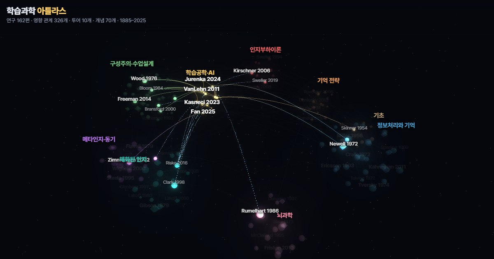

**학습과학 아틀라스 시리즈** · [허브](/post/learning-science-atlas/) · [1 기초](/post/learning-science-atlas-01-foundations/) · [2 정보처리](/post/learning-science-atlas-02-information-processing/) · [3 인지부하](/post/learning-science-atlas-03-cognitive-load/) · [4 기억 전략](/post/learning-science-atlas-04-memory-strategies/) · [5 구성주의](/post/learning-science-atlas-05-constructivism-instruction/) · [6 메타인지·동기](/post/learning-science-atlas-06-metacognition-motivation/) · [7 체화된 인지](/post/learning-science-atlas-07-embodied-cognition/) · [8 뇌과학](/post/learning-science-atlas-08-neuroscience/) · **9 학습공학·AI** · [개념 사전](/post/learning-science-atlas-glossary/) · [3D 지도 열기](/tools/learning-science-atlas/)

모든 학생에게 좋은 개인 교사를 붙여 주려는 꿈의 계보다. 지식 추적과 인지 튜터, 튜터링 메타분석을 거쳐 2023년 이후 생성형 AI가 학습에 미치는 영향을 검증한 최신 실험과, 학습과학을 AI 설계 기준으로 삼으려는 시도로 이어진다. 학습과학 아틀라스의 아홉 클러스터 중 9번째인 이 글은 1994년부터 2025년까지의 연구 14편을 시간순으로 정리했다. 이 분야에서 가장 많이 인용된 연구는 Kasneci(2023)의 「교육을 위한 ChatGPT? 대규모 언어모델의 기회와 과제」, VanLehn(2011)의 「인간 튜터링과 지능형 튜터링 시스템의 상대적 효과」, Corbett(1994)의 「지식 추적」이다.

<figure>
  
  <figcaption>학습과학 아틀라스에서 학습공학과 AI 시대의 학습 클러스터와 그 연결을 강조한 모습</figcaption>
</figure>

<a class="btn btn--primary" href="/tools/learning-science-atlas/?cluster=A" target="_blank">아틀라스에서 이 클러스터 보기</a>

## 한눈에 보는 흐름

| 연도 | 연구 | 한 줄 의의 |
|---|---|---|
| 1994 | 지식 추적 (Corbett) | 학생이 각 기술을 숙달했을 확률을 실시간으로 추정하는 베이지안 지식 추적(BKT)을 제시했다. |
| 1995 | 인지 튜터, 얻은 교훈 (Anderson) | 인지 이론(ACT-R)을 바탕으로 실제 학교에 보급된 지능형 튜터링 시스템의 10년 경험을 정리했다. |
| 2011 | 인간 튜터링과 지능형 튜터링 시스템의 상대적 효과 (VanLehn) | 블룸의 2시그마 주장을 재검토하고, 단계 기반 지능형 튜터가 인간 튜터에 근접한다는 것을 보여 준 메타분석이다. |
| 2012 | 지식-학습-교수(KLI) 프레임워크 (Koedinger) | 어떤 교수법이 언제 효과적인지를 "어떤 종류의 지식을 배우는가"로 설명하는 통합 틀이다. |
| 2015 | 딥 지식 추적 (Piech) | 순환신경망으로 학생의 학습 궤적을 모델링한 연구로, 교육 데이터 마이닝에 딥러닝 시대를 열었다. |
| 2023 | 교육을 위한 ChatGPT? 대규모 언어모델의 기회와 과제 (Kasneci) | ChatGPT 등장 직후 교육계의 기회와 위험을 종합한 대표 입장 논문으로, 생성형 AI 교육 연구에서 가장 많이 인용되는 문헌 중 하나다. |
| 2024 | 튜터 코파일럿, 인간-AI 협업 튜터링 (Wang) | AI가 학생을 직접 가르치는 대신 초보 튜터에게 전문가 수준의 조언을 실시간으로 제공하는 방식을 대규모 RCT로 검증했다. |
| 2024 | 교육용 생성형 AI의 책임 있는 개발 (LearnLM-Tutor) (Jurenka) | 학습과학의 교수 원리를 LLM 개발의 평가 기준으로 삼은 구글 딥마인드의 기술 보고서다. |
| 2024 | AI가 교실을 만날 때, LLM은 언제 학습을 해치는가? (Lehmann) | 사전등록된 두 실험에서는 LLM 사용 자체가 전체 학습 성과에 영향을 주지 않았지만, 탐색적 분석과 현장 연구에서 LLM의 효과가 "어떻게 쓰느냐"에 따라 달라진다는 증거를 제시한 연구다. |
| 2025 | 안전장치 없는 생성형 AI는 학습을 해칠 수 있다 (Bastani) | 생성형 AI가 연습 성적은 올리지만 실제 학습은 해칠 수 있다는 것을 약 1,000명 대상 현장 실험으로 보였다. |
| 2025 | AI 튜터링이 교실 능동학습보다 효과적이다 (Kestin) | 학습과학 원리로 설계한 AI 튜터가 우수한 능동학습 수업보다 더 많은 학습을 낳았다는 하버드 RCT다. |
| 2025 | ChatGPT를 쓴 뇌, 인지적 부채의 누적 (Kosmyna) | LLM으로 글을 쓸 때 뇌 연결성과 글에 대한 소유감, 기억이 줄어든다는 MIT 미디어랩의 EEG 연구다. |
| 2025 | 메타인지적 게으름을 경계하라 (Fan) | 생성형 AI가 과제 결과물은 좋게 만들지만 지식 습득과 전이는 늘리지 못하고, 학습자의 자기조절 과정을 건너뛰게 한다는 "메타인지적 게으름"을 보고했다. |
| 2025 | 생성형 AI가 비판적 사고에 미치는 영향 (Lee) | 생성형 AI에 대한 신뢰가 높을수록 비판적 사고를 덜 한다는 상관을 보고한 마이크로소프트 리서치와 카네기멜런대의 CHI 2025 연구다. |

## 연구별 요약

### 지식 추적

*Albert T. Corbett & John R. Anderson (1994). Knowledge tracing: Modeling the acquisition of procedural knowledge*

학생이 각 기술을 숙달했을 확률을 실시간으로 추정하는 베이지안 지식 추적(BKT)을 제시했다. 적응형 학습 시스템의 핵심 알고리즘으로 30년간 쓰이고 있다. 학생의 정답과 오답 기록으로 각 지식 요소의 숙달 확률을 갱신한다. 모형은 처음부터 알고 있을 확률, 한 번의 기회에 배울 확률, 모르는데 맞힐 확률(추측), 아는데 틀릴 확률(실수)의 네 매개변수를 쓴다. 숙달 확률이 기준을 넘을 때까지 해당 기술 문제를 계속 제공하는 숙달 학습이 가능해졌다.

> "방금 맞혔지만 찍었을 수도 있다"까지 계산하며 학생 실력을 추정하는 계기판이다.

교실에서는 형성평가에서 한 번 맞힌 것으로 숙달을 판단하지 말고 여러 기회에 걸쳐 확인한다.

### 인지 튜터, 얻은 교훈

*John R. Anderson 외 (1995). Cognitive tutors: Lessons learned*

인지 이론(ACT-R)을 바탕으로 실제 학교에 보급된 지능형 튜터링 시스템의 10년 경험을 정리했다. 학습공학과 AI 튜터의 원형이다. LISP 프로그래밍, 기하, 대수 튜터를 만들고 평가하며, 학생의 풀이를 단계마다 인지 모형과 대조하는 모델 추적과, 지식 요소별 숙달 확률을 갱신하는 지식 추적을 개발했다. 튜터를 쓴 학생은 같은 수준에 더 짧은 시간에 도달했다. 문제해결 맥락에서 가르치기, 즉각 피드백, 작업기억 부담 최소화 등 설계 원리 8가지를 제시했다.

> 학생 옆에서 한 줄씩 풀이를 지켜보다 틀린 줄에서 바로 힌트를 주는 과외 선생님을 소프트웨어로 만든 것이다.

교실에서는 AI 튜터를 고를 때 "최종 답만 보는가, 풀이 단계마다 피드백하는가"를 확인한다.

### 인간 튜터링과 지능형 튜터링 시스템의 상대적 효과

*Kurt VanLehn (2011). The relative effectiveness of human tutoring, intelligent tutoring systems, and other tutoring systems*

블룸의 2시그마 주장을 재검토하고, 단계 기반 지능형 튜터가 인간 튜터에 근접한다는 것을 보여 준 메타분석이다. 튜터링 없음 대비 인간 튜터링의 효과는 d=0.79로 2시그마보다 훨씬 작았고, 단계 기반 ITS는 d=0.76으로 인간 튜터와 거의 같았다. 답만 확인하는 시스템은 d=0.31이었다. 상호작용이 세밀할수록 효과가 커진다는 "상호작용 세분성 가설"은 절반만 맞았다. 답 단위에서 단계 단위로 갈 때는 효과가 커졌지만, 그보다 더 세밀해져도 거의 늘지 않는 "상호작용 고원(plateau)"이 나타났다.

> 최종 답에만 빨간 줄을 긋는 채점보다 풀이 한 줄마다 봐 주는 튜터가 훨씬 낫지만, 한 글자마다 간섭할 필요는 없다.

교실에서는 형성평가 피드백은 최종 답보다 풀이 단계 단위로 준다.

### 지식-학습-교수(KLI) 프레임워크

*Kenneth R. Koedinger 외 (2012). The Knowledge-Learning-Instruction framework: Bridging the science-practice chasm to enhance robust student learning*

어떤 교수법이 언제 효과적인지를 "어떤 종류의 지식을 배우는가"로 설명하는 통합 틀이다. 학습공학과 학습 분석의 이론적 기반이다. 학습 대상을 지식 요소(KC)로 정의하고, 그 복잡도에 따라 필요한 학습 과정이 달라진다고 보았다. 단순 사실은 기억과 유창성, 범주와 규칙은 귀납과 정교화, 원리는 이해와 의미 구성이 필요하다. 그래서 인출 연습, 풀이 예제, 자기 설명 같은 교수법은 지식 유형에 맞게 골라야 한다. 이 틀은 수많은 교실 실험 데이터(LearnLab)로 뒷받침된다.

> 단어 외우기에 좋은 방법과 물리 원리 이해에 좋은 방법이 다른 이유를 정리한 지도다.

교실에서는 수업 목표를 사실, 규칙, 원리로 나누고 각각에 맞는 활동(퀴즈, 예제 비교, 설명하기)을 배치한다.

### 딥 지식 추적

*Chris Piech et al. (2015). Deep knowledge tracing*

순환신경망으로 학생의 학습 궤적을 모델링한 연구로, 교육 데이터 마이닝에 딥러닝 시대를 열었다. 학생의 문제 풀이 기록을 순서대로 순환신경망에 넣어 다음 문제를 맞힐 확률을 예측했다. 전문가가 기술 목록을 정하지 않아도 문제들 사이의 관계를 데이터에서 스스로 찾았고, 공개 데이터셋에서 기존 BKT보다 높은 예측 성능을 보고했다.

> 학생의 풀이 이력 전체를 읽고 "다음 문제는 맞힐까?"를 예측하는 AI 담임이다.

교실에서는 학습 플랫폼의 추천 알고리즘이 무엇을 근거로 판단하는지 교사가 확인하고 설명 가능성을 요구한다.

**함께 알아 둘 점** Khajah 외(2016)는 잘 확장한 BKT나 단순 모형도 비슷한 성능을 낸다고 보고해, 성능 우위가 과장되었다는 지적이 있다.

### 교육을 위한 ChatGPT? 대규모 언어모델의 기회와 과제

*Enkelejda Kasneci et al. (2023). ChatGPT for good? On opportunities and challenges of large language models for education*

ChatGPT 등장 직후 교육계의 기회와 위험을 종합한 대표 입장 논문으로, 생성형 AI 교육 연구에서 가장 많이 인용되는 문헌 중 하나다. 초중등과 고등교육, 교사, 학습자 각각에 대해 대규모 언어모델의 활용 가능성(개인화 피드백, 글쓰기 지원, 수업 자료 생성 등)을 정리했다. 동시에 편향, 부정확성, 과의존, 평가의 공정성, 개인정보, 비용 문제를 짚고, 교사와 학생의 AI 리터러시 교육을 핵심 과제로 제시했다.

> 새로 들어온 강력한 도구의 사용 설명서와 경고문을 함께 붙인 문서다.

교실에서는 AI 활용 수업 전에 "AI가 틀릴 수 있다"를 직접 확인하는 검증 활동부터 시작한다.

### 튜터 코파일럿, 인간-AI 협업 튜터링

*Rose E. Wang 외 (2024). Tutor CoPilot: A human-AI approach for scaling real-time expertise*

AI가 학생을 직접 가르치는 대신 초보 튜터에게 전문가 수준의 조언을 실시간으로 제공하는 방식을 대규모 RCT로 검증했다. 튜터 약 900명과 초중등 학생 약 1,800명이 참여한 실험에서, AI 조언 도구를 쓴 튜터의 학생은 주제 숙달 확률이 4%p 높았다. 평가가 낮은 튜터에게서는 효과가 9%p로 더 컸다. AI 지원을 받은 튜터는 정답을 바로 알려 주는 대신 질문으로 이끄는 전략을 더 많이 썼다. 비용은 튜터 1인당 연간 약 20달러였다.

> 초보 선생님 귀에 베테랑 선생님이 "여기서는 힌트를 주세요"라고 속삭여 주는 이어폰이다.

교실에서는 AI를 학생 대체용이 아니라 교사의 판단을 돕는 조수로 쓰는 설계도 함께 고려한다.

**함께 알아 둘 점** 동료 심사 전 워킹페이퍼로 발표되었다.

### 교육용 생성형 AI의 책임 있는 개발 (LearnLM-Tutor)

*Irina Jurenka et al. (Google DeepMind) (2024). Towards responsible development of generative AI for education: An evaluation-driven approach*

학습과학의 교수 원리를 LLM 개발의 평가 기준으로 삼은 구글 딥마인드의 기술 보고서다. "좋은 AI 튜터란 무엇인가"를 측정 가능한 기준으로 만들려는 시도다. 연구진은 교사와 학습자, 학습과학자와 함께 좋은 가르침의 원칙(인지부하 관리, 능동적 학습 촉진, 메타인지 자극, 호기심 유발, 학습자 맞춤 등)을 정리하고, 이를 측정하는 정량·정성 평가 체계를 만들었다. 교수법 데이터로 미세조정한 LearnLM-Tutor는 프롬프트만 준 기본 모델보다 여러 교수법 평가 항목에서 대체로 더 좋은 평가를 받았다.

> "정답을 잘 맞히는 AI"가 아니라 "잘 가르치는 AI"를 만들려면 가르침의 성적표부터 필요하다.

교실에서는 AI 튜터를 고를 때 정답률보다 "바로 답을 주지 않는가, 질문으로 이끄는가, 오개념을 찾아내는가"를 기준으로 평가한다.

**함께 알아 둘 점** 개발사의 기술 보고서이며 독립적인 학습 효과 검증은 제한적이다.

### AI가 교실을 만날 때, LLM은 언제 학습을 해치는가?

*Matthias Lehmann 외 (2024). AI meets the classroom: When do large language models harm learning?*

사전등록된 두 실험에서는 LLM 사용 자체가 전체 학습 성과에 영향을 주지 않았지만, 탐색적 분석과 현장 연구에서 LLM의 효과가 "어떻게 쓰느냐"에 따라 달라진다는 증거를 제시한 연구다. 파이썬 프로그래밍을 배우는 학생들을 대상으로 한 현장 연구(네덜란드 대학원 수업)와 사전등록 실험 두 건에서, LLM 사용 여부는 전체 학습 성과에 유의한 차이를 만들지 않았다. 그러나 탐색적 분석에서 LLM을 학습 활동의 대체물(연습문제 풀이를 생성하게 하기)로 쓴 학생은 다룬 주제 수는 늘었지만 이해는 얕아졌고, 보완물(설명을 요청하기)로 쓴 학생은 이해가 깊어졌다. 대체적 사용만 관찰된 현장 연구에서는 장기 학습 성과가 떨어졌다. 또 LLM은 사전지식에 따른 격차를 벌렸고, LLM을 쓴 학생들은 자신이 배운 정도를 과대평가했다.

> AI에게 숙제를 시키면 숙제는 끝나지만 배움은 시작되지 않고, AI에게 모르는 것을 물으면 배움이 깊어진다.

교실에서는 AI 사용 규칙을 "대신 풀게 하지 않기, 설명과 힌트를 요청하기"로 정하고, AI 사용 뒤에는 AI 없이 확인 문제를 풀게 한다.

**함께 알아 둘 점** 프리프린트 단계의 연구이며 특정 과목(프로그래밍) 맥락의 결과다.

### 안전장치 없는 생성형 AI는 학습을 해칠 수 있다

*Hamsa Bastani 외 (2025). Generative AI without guardrails can harm learning: Evidence from high school mathematics*

생성형 AI가 연습 성적은 올리지만 실제 학습은 해칠 수 있다는 것을 약 1,000명 대상 현장 실험으로 보였다. AI 교육 정책 논의에서 가장 많이 인용되는 최신 연구 중 하나다. 튀르키예 고등학교에서 수학 연습 시간에 일반 GPT-4(GPT Base)와 교사용 힌트를 담고 답을 바로 주지 않도록 설계한 GPT Tutor를 비교했다. 연습 점수는 GPT Base가 48%, GPT Tutor가 127% 올랐지만, AI 없이 본 시험에서 GPT Base 집단은 대조군보다 17% 낮았다. GPT Tutor는 이 피해를 대부분 상쇄했다. 학생들이 AI를 답 베끼기용 "목발"로 쓴 것이 원인으로 분석되었다.

> 계산기를 쓰며 숙제는 다 맞혔는데 시험장에서 계산기를 빼앗기자 손도 못 대는 상황이다.

교실에서는 AI를 수업에 넣을 때 바로 답을 주지 않고 힌트와 질문으로 이끄는 설정을 기본값으로 삼는다.

### AI 튜터링이 교실 능동학습보다 효과적이다

*Gregory Kestin 외 (2025). AI tutoring outperforms in-class active learning: an RCT introducing a novel research-based design in an authentic educational setting*

학습과학 원리로 설계한 AI 튜터가 우수한 능동학습 수업보다 더 많은 학습을 낳았다는 하버드 RCT다. Bastani 연구와 함께 "AI는 설계가 전부"라는 메시지를 준다. 하버드 물리 수업 학생 194명이 교차 설계로 두 주에 걸쳐 한 번은 교실 능동학습, 한 번은 AI 튜터로 배웠다(1주 차 표면장력, 2주 차 유체 흐름). AI 튜터 조건의 학습 향상은 교실 조건의 두 배 이상이었고, 학습 시간은 더 짧았으며, 참여와 동기도 더 높았다. AI 튜터의 시스템 프롬프트는 능동적 학습, 인지부하 관리, 성장 마인드셋을 따르도록 설계되었다. 단계별 비계는 프롬프트만으로 안정적이지 않아 문제를 한 부분씩 안내하는 플랫폼 구조로 구현했고, 정확성을 위해 단계별 모범 풀이를 프롬프트에 넣었다.

> 같은 AI라도 "답 알려 주는 친구"가 아니라 "좋은 과외 선생님"처럼 설계하면 결과가 정반대가 된다.

교실에서는 AI 튜터를 만들 때 이 아틀라스의 원리들(인지부하, 비계, 인출, 피드백)을 시스템 프롬프트에 명시한다.

**함께 알아 둘 점** 단일 대학, 단일 과목, 단기 학습 효과라는 한계가 있다.

### ChatGPT를 쓴 뇌, 인지적 부채의 누적

*Nataliya Kosmyna et al. (2025). Your brain on ChatGPT: Accumulation of cognitive debt when using an AI assistant for essay writing task*

LLM으로 글을 쓸 때 뇌 연결성과 글에 대한 소유감, 기억이 줄어든다는 MIT 미디어랩의 EEG 연구다. "인지적 부채"라는 말을 퍼뜨리며 큰 대중적 반향을 일으켰다. 참가자 54명이 LLM, 검색엔진, 도구 없음 조건 중 하나로 4개월 동안 에세이를 썼다. 뇌파 연결성은 도구 없음 > 검색 > LLM 순으로 높았다. LLM 집단은 방금 쓴 글을 인용하지 못하는 경우가 많았고 글에 대한 소유감도 낮았다. 4회차에 LLM을 빼앗긴 참가자는 낮은 연결성을 보였고, 반대로 처음엔 혼자 쓰다가 LLM을 받은 참가자는 높은 연결성을 유지했다.

> 운전을 내비게이션에만 맡기면 길을 못 외우는 것처럼, 글쓰기를 AI에 맡기면 생각한 흔적이 머리에 남지 않는다.

교실에서는 초안과 핵심 논지는 먼저 학생 스스로 만들고, AI는 그 다음 단계(피드백, 다듬기)에서 쓰게 한다.

**함께 알아 둘 점** 동료 심사 전 프리프린트이며 표본이 작다(최종 세션 18명). 결과를 일반화할 때 주의가 필요하다.

### 메타인지적 게으름을 경계하라

*Yizhou Fan et al. (2025). Beware of metacognitive laziness: Effects of generative artificial intelligence on learning motivation, processes, and performance*

생성형 AI가 과제 결과물은 좋게 만들지만 지식 습득과 전이는 늘리지 못하고, 학습자의 자기조절 과정을 건너뛰게 한다는 "메타인지적 게으름"을 보고했다. 대학생 117명이 글쓰기 과제를 하며 ChatGPT, 인간 전문가, 작문 분석 도구, 지원 없음 중 하나의 도움을 받았다. ChatGPT 집단은 에세이 점수가 가장 많이 올랐지만 지식 습득과 전이에서는 다른 집단과 차이가 없었다. 학습 과정 분석에서 ChatGPT 집단은 계획, 점검, 평가 같은 메타인지 활동을 AI에 의존하는 경향을 보였다.

> AI가 대신 노를 저어 주면 배는 빨리 가지만 내 팔 근육은 그대로다.

교실에서는 AI 도움을 받은 과제에도 "내가 무엇을 계획하고, 어디서 점검했는가"를 적는 성찰 단계를 남긴다.

### 생성형 AI가 비판적 사고에 미치는 영향

*Hao-Ping (Hank) Lee et al. (2025). The impact of generative AI on critical thinking: Self-reported reductions in cognitive effort and confidence effects from a survey of knowledge workers*

생성형 AI에 대한 신뢰가 높을수록 비판적 사고를 덜 한다는 상관을 보고한 마이크로소프트 리서치와 카네기멜런대의 CHI 2025 연구다. 지식 노동자 319명이 생성형 AI를 업무에 쓴 실제 사례 936개를 분석했다. AI의 능력을 신뢰할수록 비판적 사고를 덜 했고, 자기 능력에 대한 확신이 클수록 비판적 사고를 더 했다. 비판적 사고의 초점은 정보 수집과 문제 해결에서 AI 응답의 검증, 통합, 관리 쪽으로 옮겨 갔다.

> 자동 조종을 믿을수록 조종사가 계기판을 덜 보게 되는 것과 같다.

교실에서는 AI 결과물을 그대로 쓰지 않고 "근거 확인, 반례 찾기, 내 말로 고치기"를 필수 단계로 둔다.

**함께 알아 둘 점** 자기 보고 설문에 기반한 상관 연구라 인과를 단정할 수 없다.

## 이 분야의 핵심 개념

- **자기조절학습**(self-regulated learning). 계획, 수행 중 점검, 성찰을 스스로 순환하며 학습을 이끄는 과정.
- **인지적 오프로딩**(cognitive offloading). 메모, 검색, AI처럼 생각의 부담을 외부로 넘기는 것. 수행은 돕지만 맡긴 것은 머리에 덜 남는다.
- **지식 추적**(knowledge tracing). 학생의 응답 기록으로 각 기술의 숙달 확률을 추정하는 방법.
- **지식 요소**(knowledge component). 학습 대상을 이루는 작은 지식 단위. 단위마다 맞는 교수법이 다르다.
- **2 시그마 문제**(2 sigma problem). 1:1 튜터링 수준의 효과를 교실 규모에서 내는 방법을 찾는 교육공학의 오랜 과제.
- **AI 튜터 설계**(AI tutor design). 답을 바로 주지 않고 질문과 힌트로 이끄는 설계가 학습을 지키는 핵심이다.

## 다른 분야와 이어지는 다리

이 클러스터는 다른 분야와 24개의 선으로 이어진다.

- 학습의 과학과 교수의 기술(1954, 기초) → 인지 튜터, 얻은 교훈(1995, 학습공학·AI). 티칭 머신에서 인지 튜터로
- 인간 문제해결(1972, 정보처리와 기억) → 인지 튜터, 얻은 교훈(1995, 학습공학·AI). 산출 시스템 기반 튜터
- 문제해결에서 튜터링의 역할(1976, 구성주의·수업설계) → 인간 튜터링과 지능형 튜터링 시스템의 상대적 효과(2011, 학습공학·AI). 튜터링 연구
- 문제해결에서 튜터링의 역할(1976, 구성주의·수업설계) → AI 튜터링이 교실 능동학습보다 효과적이다(2025, 학습공학·AI). 비계 원리를 AI 튜터에
- 2 시그마 문제(1984, 구성주의·수업설계) → 인지 튜터, 얻은 교훈(1995, 학습공학·AI). 2시그마를 기계로
- 2 시그마 문제(1984, 구성주의·수업설계) → 인간 튜터링과 지능형 튜터링 시스템의 상대적 효과(2011, 학습공학·AI). 튜터링 효과 재검토
- 2 시그마 문제(1984, 구성주의·수업설계) → AI 튜터링이 교실 능동학습보다 효과적이다(2025, 학습공학·AI). AI 튜터의 목표
- 2 시그마 문제(1984, 구성주의·수업설계) → 튜터 코파일럿, 인간-AI 협업 튜터링(2024, 학습공학·AI). 튜터링의 확장
- 오차 역전파로 표상 학습하기(1986, 뇌과학) → 딥 지식 추적(2015, 학습공학·AI). 신경망 학습 모형
- 자기 설명, 학생이 예제를 공부하고 활용하는 방식(1989, 구성주의·수업설계) → 인간 튜터링과 지능형 튜터링 시스템의 상대적 효과(2011, 학습공학·AI). 설명과 튜터링
- ACT, 복잡한 인지에 대한 단순한 이론(1996, 정보처리와 기억) → 지식-학습-교수(KLI) 프레임워크(2012, 학습공학·AI). 지식 요소 모형
- 확장된 마음(1998, 체화된 인지) → 생성형 AI가 비판적 사고에 미치는 영향(2025, 학습공학·AI). 도구와 결합된 사고
- 사람은 어떻게 학습하는가(2000, 구성주의·수업설계) → 지식-학습-교수(KLI) 프레임워크(2012, 학습공학·AI). 학습과학과 교실의 연결
- 자기조절 학습자 되기(2002, 메타인지·동기) → 메타인지적 게으름을 경계하라(2025, 학습공학·AI). 자기조절 학습 과정
- 최소 안내 교수가 효과가 없는 이유(2006, 인지부하이론) → AI 튜터링이 교실 능동학습보다 효과적이다(2025, 학습공학·AI). 구조화된 안내를 AI에
- 자기조절 학습, 믿음, 기법, 착각(2013, 메타인지·동기) → 안전장치 없는 생성형 AI는 학습을 해칠 수 있다(2025, 학습공학·AI). AI가 키우는 유창성 착각
- ICAP 프레임워크(2014, 구성주의·수업설계) → 안전장치 없는 생성형 AI는 학습을 해칠 수 있다(2025, 학습공학·AI). 수동적 AI 사용의 위험
- 능동적 학습이 STEM 성취를 높인다(2014, 구성주의·수업설계) → AI 튜터링이 교실 능동학습보다 효과적이다(2025, 학습공학·AI). 능동학습을 넘어선 비교 기준
- 인지적 오프로딩(2016, 체화된 인지) → 안전장치 없는 생성형 AI는 학습을 해칠 수 있다(2025, 학습공학·AI). AI로의 인지적 오프로딩
- 인지적 오프로딩(2016, 체화된 인지) → ChatGPT를 쓴 뇌, 인지적 부채의 누적(2025, 학습공학·AI). 인지적 부채
- 인지적 오프로딩(2016, 체화된 인지) → 메타인지적 게으름을 경계하라(2025, 학습공학·AI). AI에 메타인지 맡기기
- 인지적 오프로딩(2016, 체화된 인지) → 생성형 AI가 비판적 사고에 미치는 영향(2025, 학습공학·AI). 비판적 사고의 오프로딩
- 인지적 오프로딩(2016, 체화된 인지) → AI가 교실을 만날 때, LLM은 언제 학습을 해치는가?(2024, 학습공학·AI). 대체로서의 오프로딩
- 인지 구조와 교수설계, 20년 후(2019, 인지부하이론) → AI 튜터링이 교실 능동학습보다 효과적이다(2025, 학습공학·AI). 인지부하 관리 원리

## 이 분야가 나오는 투어

- [튜터의 꿈, 티칭 머신에서 AI 튜터까지](/tools/learning-science-atlas/?tour=tutor). 모든 학생에게 좋은 개인 교사를. 70년 동안 이어진 꿈과 그 최신 실험 결과.
- [AI 시대, 생각을 어디까지 맡길 것인가](/tools/learning-science-atlas/?tour=offload). 마음은 도구로 확장된다. 그렇다면 AI에 맡겨도 되는 것과 머릿속에 남겨야 하는 것의 경계는 어디인가.

## 참고 자료

- Albert T. Corbett & John R. Anderson (1994). *Knowledge tracing: Modeling the acquisition of procedural knowledge*. <https://doi.org/10.1007/BF01099821>
- John R. Anderson, Albert T. Corbett, Kenneth R. Koedinger & Ray Pelletier (1995). *Cognitive tutors: Lessons learned*. <https://doi.org/10.1207/s15327809jls0402_2>
- Kurt VanLehn (2011). *The relative effectiveness of human tutoring, intelligent tutoring systems, and other tutoring systems*. <https://doi.org/10.1080/00461520.2011.611369>
- Kenneth R. Koedinger, Albert T. Corbett & Charles Perfetti (2012). *The Knowledge-Learning-Instruction framework: Bridging the science-practice chasm to enhance robust student learning*. <https://doi.org/10.1111/j.1551-6709.2012.01245.x>
- Chris Piech et al. (2015). *Deep knowledge tracing*.
- Enkelejda Kasneci et al. (2023). *ChatGPT for good? On opportunities and challenges of large language models for education*. <https://doi.org/10.1016/j.lindif.2023.102274>
- Rose E. Wang, Ana T. Ribeiro, Carly D. Robinson, Susanna Loeb & Dora Demszky (2024). *Tutor CoPilot: A human-AI approach for scaling real-time expertise*.
- Irina Jurenka et al. (Google DeepMind) (2024). *Towards responsible development of generative AI for education: An evaluation-driven approach*.
- Matthias Lehmann, Philipp B. Cornelius & Fabian J. Sting (2024). *AI meets the classroom: When do large language models harm learning?*.
- Hamsa Bastani, Osbert Bastani, Alp Sungu et al. (2025). *Generative AI without guardrails can harm learning: Evidence from high school mathematics*. <https://doi.org/10.1073/pnas.2422633122>
- Gregory Kestin, Kelly Miller, Anna Klales, Timothy Milbourne & Gregorio Ponti (2025). *AI tutoring outperforms in-class active learning: an RCT introducing a novel research-based design in an authentic educational setting*. <https://doi.org/10.1038/s41598-025-97652-6>
- Nataliya Kosmyna et al. (2025). *Your brain on ChatGPT: Accumulation of cognitive debt when using an AI assistant for essay writing task*. <https://doi.org/10.48550/arxiv.2506.08872>
- Yizhou Fan et al. (2025). *Beware of metacognitive laziness: Effects of generative artificial intelligence on learning motivation, processes, and performance*. <https://doi.org/10.1111/bjet.13544>
- Hao-Ping (Hank) Lee et al. (2025). *The impact of generative AI on critical thinking: Self-reported reductions in cognitive effort and confidence effects from a survey of knowledge workers*. <https://doi.org/10.1145/3706598.3713778>
- 인용 수: OpenAlex (2026년 11월 수집) <https://openalex.org>
