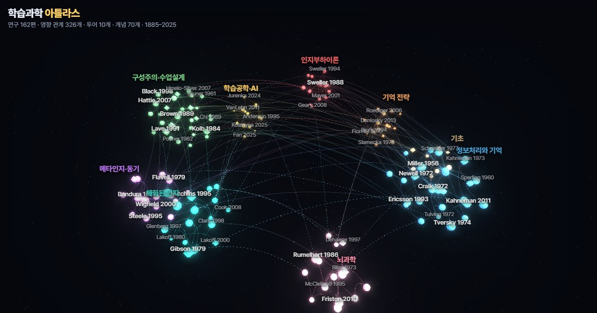

<figure>
  
  <figcaption>학습과학 아틀라스의 클러스터 보기. 별 하나가 연구 한 편이고, 선 위를 흐르는 빛이 영향의 방향이다.</figcaption>
</figure>

교사 연수에서 "인지부하이론"이나 "인출 연습"이라는 말은 이제 낯설지 않다. 그런데 이 개념들이 어디서 왔고 서로 어떻게 이어지는지는 잘 보이지 않는다. 스웰러의 인지부하이론은 밀러의 마법의 수 7과 배들리의 작업기억 모형 위에 서 있고, 체화된 인지 연구는 2012년 파스와 스웰러의 논문을 통해 인지부하이론과 다시 만난다. 2025년 생성형 AI와 학습에 관한 실험들은 이 오래된 계보의 가장 바깥 나이테에 해당한다.

그 연결을 한눈에 보려고 1885년 에빙하우스부터 2025년 AI 튜터 실험까지 학습과학의 고전과 최신 연구 162편을 골라 3D 지도로 만들었다. 연구 사이에는 계승, 비판, 분야 간 다리를 뜻하는 영향 관계 326개를 이었고, 핵심 개념 70개를 사전으로 묶었다. 이름은 학습과학 아틀라스다.

<a class="btn btn--primary btn--large" href="/learning-science-atlas/">학습과학 아틀라스 열기</a> <a class="btn btn--inverse btn--large" href="/tools/learning-science-atlas/" target="_blank">전체 화면</a>

아틀라스는 블로그 상단 메뉴의 "학습과학 아틀라스"에서 언제든 열 수 있다.

  <iframe src="/tools/learning-science-atlas/?embed=1" title="학습과학 아틀라스" loading="lazy" style="position:absolute;inset:0;width:100%;height:100%;border:0"></iframe>

## 아홉 개의 대륙

연구는 이론적 가족에 따라 아홉 개 클러스터로 묶었다. 클러스터마다 연구별 요약을 담은 안내 글을 따로 썼다.

| 클러스터 | 다루는 질문 | 연구 수 |
|---|---|---|
| [1. 기초, 행동주의에서 인지혁명으로](/post/learning-science-atlas-01-foundations/) | 학습을 어떻게 과학적으로 측정하는가 | 8 |
| [2. 정보처리 이론과 기억 체계](/post/learning-science-atlas-02-information-processing/) | 정보는 어떻게 들어오고 저장되고 꺼내지는가 | 29 |
| [3. 인지부하이론과 멀티미디어 학습](/post/learning-science-atlas-03-cognitive-load/) | 작업기억의 한계에 맞춰 어떻게 가르칠 것인가 | 15 |
| [4. 기억 전략과 바람직한 어려움](/post/learning-science-atlas-04-memory-strategies/) | 어떤 공부법이 오래 남는가 | 16 |
| [5. 구성주의, 사회문화이론, 수업설계](/post/learning-science-atlas-05-constructivism-instruction/) | 학습자는 지식을 어떻게 구성하고 참여하는가 | 32 |
| [6. 메타인지, 동기, 자기조절](/post/learning-science-atlas-06-metacognition-motivation/) | 학습자는 자기 학습을 어떻게 조절하는가 | 15 |
| [7. 체화된, 상황적, 확장된 인지](/post/learning-science-atlas-07-embodied-cognition/) | 몸과 도구와 환경은 생각에 어떻게 참여하는가 | 17 |
| [8. 뇌과학과 예측하는 뇌](/post/learning-science-atlas-08-neuroscience/) | 학습은 뇌에서 어떻게 일어나는가 | 16 |
| [9. 학습공학과 AI 시대의 학습](/post/learning-science-atlas-09-learning-engineering-ai/) | 기계는 좋은 튜터가 될 수 있는가 | 14 |

학습과학을 읽을 때 자주 만나는 핵심 개념 70개는 [개념 사전](/post/learning-science-atlas-glossary/)에 따로 정리했다.

## 지도를 읽는 세 가지 방법

**클러스터 보기**는 연구들이 이론적 가족끼리 모인 은하 지도다. 클러스터 사이를 가로지르는 선이 분야를 잇는 다리다. 몸짓이 작업기억 부담을 덜어 준다는 Goldin-Meadow 외(2001)의 실험이 인지부하이론의 "진화적 업그레이드"(Paas & Sweller, 2012)로 이어지는 선이 대표적이다.

**계보 타임라인**은 왼쪽에서 오른쪽으로 흐르는 시간 축이다. 한 줄이 한 클러스터이고, 선을 따라가면 아이디어의 족보가 보인다. 붉은 점선은 비판과 반론, 하늘색 점선은 분야 간 다리를 뜻한다.

**나이테 지도**는 중심이 1880년이고 바깥으로 갈수록 최근이다. 높이 솟은 별일수록 많이 인용된 연구다.

별을 누르면 그 연구의 의의, 핵심 요약, 쉬운 비유, 교실 적용, 주의할 점, 영향을 주고받은 연구가 열리고, 조상과 후손 계보 전체가 빛난다. 카드의 키워드를 누르면 같은 개념을 다룬 연구들이 한꺼번에 강조되고, 아래 연도 막대의 재생 버튼을 누르면 1880년부터 학습과학의 역사가 차례로 켜진다.

## 열 갈래의 투어

처음이라면 투어로 시작하는 편이 좋다. 계보를 따라 카메라가 연구에서 연구로 날아가며 짧은 해설을 보여 준다.

- [작업기억에서 인지부하이론까지](/tools/learning-science-atlas/?tour=clt)
- [인출 연습과 바람직한 어려움](/tools/learning-science-atlas/?tour=retrieval)
- [몸으로 생각하기](/tools/learning-science-atlas/?tour=embodied)
- [안내냐 탐구냐, 가장 뜨거운 논쟁](/tools/learning-science-atlas/?tour=debate)
- [튜터의 꿈, 티칭 머신에서 AI 튜터까지](/tools/learning-science-atlas/?tour=tutor)
- [AI 시대, 생각을 어디까지 맡길 것인가](/tools/learning-science-atlas/?tour=offload)
- [학습하는 뇌, 시냅스에서 예측까지](/tools/learning-science-atlas/?tour=brain)
- [학습자 마음의 엔진, 메타인지와 동기](/tools/learning-science-atlas/?tour=motivation)
- [평가와 피드백, 배움을 보이게 하기](/tools/learning-science-atlas/?tour=feedback)
- [읽고 셈하는 뇌, 읽기와 수의 과학](/tools/learning-science-atlas/?tour=readmath)

투어에 없는 연결이 궁금하다면 투어 메뉴의 경로 찾기에 두 연구를 넣어 보면 된다. 예를 들어 [밀러의 마법의 수 7에서 2025년 생성형 AI 실험까지](/tools/learning-science-atlas/?path=miller1956,bastani2025) 이어지는 계보를 단계별로 따라갈 수 있다.

## 읽고 나서 꺼내 보기

이 지도에 담긴 원리를 지도 자체에도 적용했다. 위쪽 "퀴즈" 버튼을 누르면 비유나 교실 적용 문장을 보고 어떤 연구인지 맞히는 인출 연습이 시작되고, 틀린 연구는 몇 문제 뒤에 다시 나온다. 3D 화면이 버거운 기기에서는 주소 뒤에 `?text=1`을 붙인 [텍스트 버전](/tools/learning-science-atlas/?text=1)으로 같은 내용을 읽을 수 있다.

## 처음 읽는다면 이 열 편

162편을 다 읽기는 어렵다. 교실과 가까운 순서로 열 편을 고르면 다음과 같다.

1. Miller(1956), 마법의 수 7±2. 작업기억 한계라는 출발점
2. Baddeley & Hitch(1974), 작업기억. 소리와 그림을 다루는 두 채널
3. Sweller(1988), 문제해결 중 인지부하. 인지부하이론의 시작
4. Mayer & Moreno(2003), 멀티미디어 학습의 인지부하를 줄이는 아홉 가지 방법
5. Kirschner, Sweller & Clark(2006)와 Hmelo-Silver 외(2007). 안내 대 탐구 논쟁의 양쪽
6. Roediger & Karpicke(2006), 시험을 통한 학습 증진
7. Dunlosky 외(2013), 효과적인 학습 기법 열 가지의 등급표와 Black & Wiliam(1998)의 형성평가
8. Chi & Wylie(2014), ICAP 프레임워크
9. Wilson(2002), 체화된 인지의 여섯 가지 관점
10. Bastani 외(2025), 안전장치 없는 생성형 AI는 학습을 해칠 수 있다

마지막 두 편을 나란히 읽으면 질문 하나가 남는다. 생각의 일부를 몸과 도구에 맡기는 것이 인간 인지의 본성이라면, AI에 맡겨도 되는 것과 머릿속에 남겨야 하는 것의 경계는 어디인가. 같은 해 나온 Kestin 외(2025)의 하버드 실험은 학습과학 원리로 설계한 AI 튜터가 우수한 능동학습 수업보다 두 배 넘는 학습 향상을 보였다고 보고했다. 도구가 같아도 설계가 결과를 가른다는 점에서, 이 지도의 오래된 연구들이 AI 시대에 오히려 더 쓸모 있어질지도 모른다.

## 내려받기

지도 밖에서도 읽고 쓸 수 있도록 세 가지 파일을 함께 공개한다.

| 파일 | 내용 |
|---|---|
| [요약집 PDF](/assets/learning-science-atlas/learning-science-atlas-summary.pdf) | 162편의 의의, 핵심 요약, 쉬운 비유, 교실 적용, 계보와 투어 10개, 개념 사전 70개를 담은 인쇄용 A4 70쪽 |
| [BibTeX 서지](/assets/learning-science-atlas/learning-science-atlas.bib) | Zotero, EndNote 등 문헌 관리 도구로 바로 가져올 수 있는 162편의 서지 |
| [CSV 목록](/assets/learning-science-atlas/learning-science-atlas.csv) | 엑셀에서 여는 전체 목록과 요약, 영향 관계, 무료 전문 링크 |

## 지도를 읽을 때 주의할 점

연구 사이의 선은 원 논문의 인용과 학계의 일반적 해석을 바탕으로 직접 편집한 것이다. 모든 인용을 망라한 서지 네트워크가 아니다. 별의 크기는 OpenAlex 기준 인용 수(2026년 11월 수집)를 로그 척도로 나타냈다. 각 연구 요약의 수치와 사실관계, 연구 사이의 영향 관계는 원문과 대조해 검토했다. 학습 양식, 1만 시간의 법칙, 거울 뉴런, 성장 마인드셋, 그릿, 고정관념 위협, 손 필기처럼 대중적으로 과장되었거나 후속 연구에서 효과가 줄어든 주제는 각 연구 카드의 "함께 알아 둘 점"에 따로 적었다.

## 참고 자료

- Bransford, J. D., Brown, A. L., & Cocking, R. R. (Eds.). (2000). *How People Learn: Brain, Mind, Experience, and School* (Expanded ed.). National Academies Press. <https://doi.org/10.17226/9853>
- Sweller, J., van Merriënboer, J. J. G., & Paas, F. (2019). Cognitive architecture and instructional design: 20 years later. *Educational Psychology Review, 31*, 261–292. <https://doi.org/10.1007/s10648-019-09465-5>
- Dunlosky, J., Rawson, K. A., Marsh, E. J., Nathan, M. J., & Willingham, D. T. (2013). Improving students' learning with effective learning techniques. *Psychological Science in the Public Interest, 14*(1), 4–58. <https://doi.org/10.1177/1529100612453266>
- Wilson, M. (2002). Six views of embodied cognition. *Psychonomic Bulletin & Review, 9*(4), 625–636. <https://doi.org/10.3758/BF03196322>
- Bastani, H., Bastani, O., Sungu, A., Ge, H., Kabakcı, Ö., & Mariman, R. (2025). Generative AI without guardrails can harm learning. *Proceedings of the National Academy of Sciences, 122*. <https://doi.org/10.1073/pnas.2422633122>
- Kestin, G., Miller, K., Klales, A., Milbourne, T., & Ponti, G. (2025). AI tutoring outperforms in-class active learning. *Scientific Reports, 15*. <https://doi.org/10.1038/s41598-025-97652-6>
- 인용 수 데이터: OpenAlex <https://openalex.org>
- 162편 전체의 서지 정보와 요약은 각 클러스터 안내 글과 아틀라스의 "목록·개념"에서 볼 수 있다.
