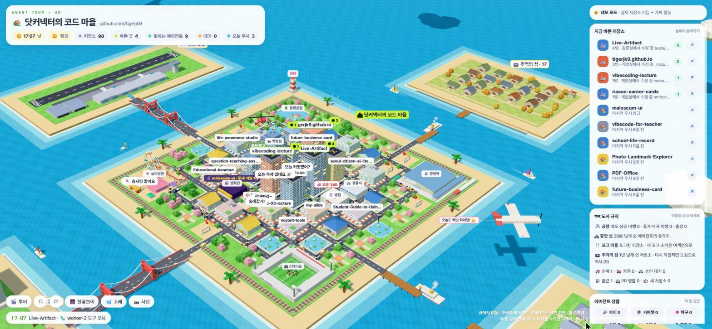
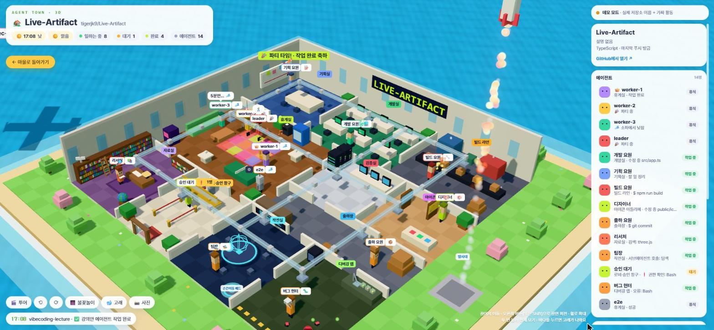
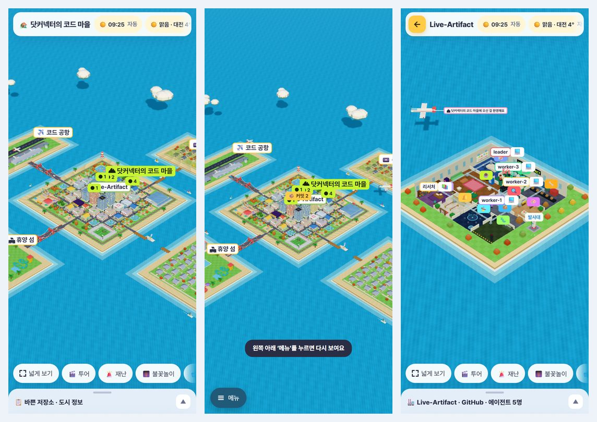

에이전트 타운은 내 GitHub 저장소 전체를 하나의 도시로 그리고, 그 안에서 AI 에이전트가 일하고 쉬는 모습을 실시간으로 보여 주는 대시보드다. 저장소 하나가 건물 하나다. 건물을 누르면 그 저장소의 공장 안이 열리고, 에이전트들이 기획실과 개발실, 검증실 사이를 오가며 일한다. 푸시와 PR, 빌드 실패와 배포 같은 실제 사건은 비행기와 구급차, 불꽃놀이 같은 도시의 움직임으로 나타난다. 주소는 [tigerjk9.github.io/agent-town](https://tigerjk9.github.io/agent-town/)이고, 설치 없이 링크만 열면 된다.

<figure style="margin:0;display:block">
<video controls playsinline preload="none" poster="/assets/agent-town-reel-city-poster.jpg" width="720" height="1280" style="display:block;width:100%;height:auto;aspect-ratio:9/16;object-fit:contain;background:#05070c;border-radius:14px" aria-label="에이전트 타운 소개 영상(1분 30초)">
<source src="/assets/agent-town-reel-city.mp4" type="video/mp4">
<a href="/assets/agent-town-reel-city.mp4">영상 내려받기(MP4)</a>
</video>
<figcaption>2026년 11월 14일 소개 영상(1분 30초). 잔디 심기로 끝나던 GitHub 기록이 도시가 되기까지.</figcaption>
</figure>
<figure style="margin:0;display:block">
<video controls playsinline preload="none" poster="/assets/agent-town-reel-update-poster.jpg" width="720" height="1280" style="display:block;width:100%;height:auto;aspect-ratio:9/16;object-fit:contain;background:#05070c;border-radius:14px" aria-label="에이전트 타운 업데이트 영상(53초)">
<source src="/assets/agent-town-reel-update.mp4" type="video/mp4">
<a href="/assets/agent-town-reel-update.mp4">영상 내려받기(MP4)</a>
</video>
<figcaption>2026년 11월 18일 업데이트 영상(53초). 3D로 다시 지은 도시, 일하는 공장, 재난과 방어 시스템.</figcaption>
</figure>

## 잔디만 심던 기록에서 도시로

GitHub 프로필의 초록 잔디는 오늘 무언가를 했다는 사실만 알려 준다. 어느 저장소에서 무슨 일이 있었는지, 에이전트가 지금 어디서 막혀 있는지는 보이지 않는다. 출발점은 카카오톡으로 받은 영상 한 편이었다. 아이소메트릭 공장 화면에서 에이전트 10명이 기획실, 개발실, 빌드 라인, 검증실, 출하장을 오가며 학습 게임을 만들고 있었다. 이걸 한 프로젝트가 아니라 GitHub 전체로 넓혀 보자는 생각으로 2026년 11월 12일에 만들기 시작했다.

첫 시범판은 방 7개짜리 공장이었다. 이어서 저장소가 건물로 늘어선 마을이 바깥층으로 붙었고, 바닷가 마을과 다운타운, 공항과 휴양 섬이 있는 군도로 커졌다. 11월 17일에는 2D 캔버스를 걷어 내고 three.js로 도시를 다시 지었다. 그림 한 장 위에 차와 사람을 덧그리던 방식이라 건물 뒤의 자동차가 건물 위로 삐져나왔는데, 3D로 바꾸면서 앞뒤가 제대로 가려졌다. 지금은 v0.11이다.

<figure>

<figcaption>마을 전경. 1년 안에 작업한 저장소는 다운타운 섬에, 1년 넘게 쉰 저장소는 오른쪽 위 추억의 섬에 산다.</figcaption>
</figure>

## 도시의 규칙

가장 활발한 저장소 8개는 이름 간판을 단 마천루가 되고, 그다음 14개는 상가, 나머지는 정원이 딸린 주택이 된다. 포크한 저장소는 여객선을 타야 닿는 포크 마을에, 1년 넘게 쉰 저장소는 추억의 섬에 모인다. 오래 쉬던 저장소에 다시 커밋하면 도심으로 이사 온다.

도시 시설마다 맡은 사건이 있다.

| 일어난 일 | 도시에서 |
|---|---|
| 배포 성공·릴리스 | 공항에서 배너를 단 비행기가 뜨고 공장에서 로켓이 발사된다 |
| 빌드·테스트 실패, 도구 오류 | 병원에서 구급차가 출동한다 |
| 두 에이전트가 같은 파일을 동시에 수정 | 소방차가 가서 물을 뿌린다 |
| 권한 승인 대기 | 경찰차가 가서 승인될 때까지 기다린다 |
| PR 병합 | 스타디움에 골인 함성이 터진다 |
| 에이전트가 20분 넘게 쉼 | 휴양 섬으로 휴가 비행을 떠난다 |
| 한 세션이 다른 저장소로 옮겨 일함 | 출장 헬기가 A 건물 옥상에서 B 건물 옥상으로 날아간다 |

시청을 누르면 그날의 푸시, 완료, PR, 실패, 충돌 건수와 MVP가 정리된 시정 보고가 뜬다. 하늘은 실제 시각에 따라 낮에서 노을, 밤으로 바뀌고, 날씨는 대전의 계절을 따라간다. 7월에는 장맛비가, 1월에는 눈이 잦다. 가끔은 지진, 태풍, 운석우, 외계인, 괴수, 해일, 해저 화산이 찾아오는데, 내진 댐퍼와 레이저 포탑, 거대 방어 로봇 같은 방어 시스템이 언제나 막아 낸다. 건물이 부서지거나 기록이 바뀌지는 않는다.

## 공장 안에서 일하는 에이전트

건물을 누르면 그 저장소의 공장으로 들어간다. 방은 11개이고, 에이전트는 하는 일에 맞는 방으로 걸어간다. 파일을 고치면 개발실에서 타자를 치고, `npm install`이나 빌드를 돌리면 빌드 라인에서 렌치를 휘두른다. 테스트를 돌리면 검증실에서 돋보기를 들고, 커밋과 푸시는 출하장에서 상자를 포장한다. 명령이 실패하면 디버깅 랩에 경광등이 돌고 에이전트가 잠자리채로 벌레를 잡는다. 서브에이전트를 부르면 작전실 순간이동 패드로 도착했다가, 일을 마치면 빛기둥과 함께 사라진다.

<figure>

<figcaption>저장소 공장 안. 방을 누르면 그 방과 이어지는 GitHub 페이지(빌드 라인은 Actions, 출하장은 커밋·릴리스)로 바로 갈 수 있다.</figcaption>
</figure>

일이 끝난 에이전트는 휴게실에서 탁구를 치거나 소파에서 낮잠을 잔다. 커피챗 말풍선에는 방금 고친 파일이나 깨진 빌드 같은 실제 작업 기록이 이야깃거리로 올라온다. 작업 완료가 가장 많은 에이전트 머리 위에는 왕관이 뜬다. 모두 화면 속 연출이라 실제 작업에는 영향이 없다.

에이전트는 세 종류로 그려진다. 사람 모양은 내 PC에서 도는 Claude Code 에이전트, 톱니 로봇은 GitHub Actions, 보라 머리는 클라우드에서 일한 Claude다. 클라우드 쪽은 파일 단위 움직임이 보이지 않고 커밋, PR, Actions처럼 GitHub에 남는 흔적만 보인다.

## 보는 방법 두 가지

링크만 열면 저장소 도시와 푸시, PR, 릴리스, Actions 빌드 로봇, 클라우드 Claude의 커밋이 1~2분 간격으로 갱신된다. 토큰을 넣지 않으면 GitHub 비로그인 한도(시간당 60회) 때문에 이 간격보다 빨라지지 않는다. 내 PC의 Claude Code 에이전트가 어느 방에서 무슨 파일을 만지는지까지 실시간으로 보려면 PC 도우미를 설치한다. Windows에서는 저장소를 내려받아 `setup.cmd`를 한 번 더블클릭하면 Claude Code 훅 연결과 도우미 실행까지 끝난다.

| | 링크만 | 링크 + PC 도우미 |
|---|---|---|
| 설치 | 없음 | 처음 한 번 `setup.cmd` |
| 보이는 것 | 저장소 도시, 푸시·PR·릴리스, Actions, 클라우드 Claude | 왼쪽 전부 + 내 PC 에이전트의 파일 단위 움직임 |
| 갱신 | 1~2분 간격 | 에이전트는 즉시, GitHub는 30초~1분 |
| 비공개 저장소 | 토큰을 넣으면 보임 | `gh` 로그인 토큰을 자동으로 사용 |

다른 사람의 도시도 볼 수 있다. 주소 끝에 `?user=아이디`를 붙이면 그 사람의 공개 저장소로 지은 도시가 열리고, `#demo`를 붙이면 가짜 활동으로 움직이는 데모가 돈다. 휴대폰에서는 손가락으로 움직이고, 넓게 보기를 누르면 메뉴가 모두 사라지고 도시만 화면을 채운다.

<figure>

<figcaption>휴대폰 세로 화면. 왼쪽부터 마을, 넓게 보기, 공장 안.</figcaption>
</figure>

## 쓸모 없어 보이는 딴짓

에이전트 타운이 일을 대신 해 주지는 않는다. 그래도 켜 두면 에이전트가 승인 창구에 줄 서 있는 것, 같은 파일을 두 세션이 동시에 고치고 있는 것, 몇 주째 손대지 않은 저장소가 추억의 섬으로 밀려난 것이 한눈에 들어온다. 터미널 로그로는 지나쳤을 일들이다. 업데이트 영상에 적은 말을 그대로 옮긴다. 보기 좋은 도시에서 일이 보이는 도시로 바꾸었고, 쓸모 없어 보이는 딴짓이 의미 찾기에는 더할 나위 없이 좋았다.

## 출처

- 에이전트 타운 <https://tigerjk9.github.io/agent-town/>
- 저장소 tigerjk9/agent-town <https://github.com/tigerjk9/agent-town>
- 소개 영상(2026-11-14)·업데이트 영상(2026-11-18), 김진관 페이스북
