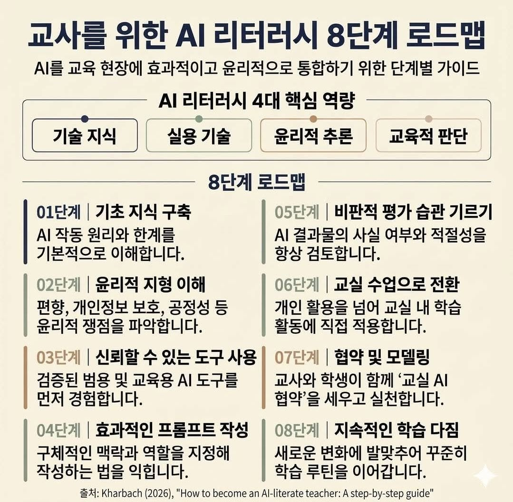

교사 대상 AI 교육 부족과 현장의 활용 부담을 해소하기 위한 방법은 없을까? AI 리터러시 구축을 목표로 하는 실용적인 가이드를 소개한다.

> 전체 글: [교사는 AI 리터러시를 어떻게 키우고 교실에 통합하는가?](/post/ai-literate-teacher-step-by-step-guide/)

<figure>

<figcaption>AI 리터러시 4대 핵심 역량과 8단계 로드맵.</figcaption>
</figure>

## 교사의 AI 리터러시 8단계 로드맵

(1) 1단계(기초 지식): LLM의 작동 방식과 한계를 이해하고 유용한 결과를 구별

(2) 2단계(윤리 숙지): 편향, 프라이버시, 학업 무결성, 공정성의 4대 윤리 영역을 숙지

(3) 3단계(도구 활용): 3~4개의 신뢰할 수 있는 범용 및 교육 특화 도구를 숙달

(4) 4단계(프롬프트): 대상, 어조, 맥락, 페르소나를 지정해 구체적 요청을 작성

(5) 5단계(비판적 평가): 생성된 결과물의 정확성, 편향성, 적절성을 반드시 평가

(6) 6단계(교실 통합): 개인 생산성 활용에 그치지않고 기존 교과 과정에 AI를 통합

(7) 7단계(가이드라인): 학생과 함께 교실 AI 협약을 구성하여 명확한 기준을 제시

(8) 8단계(지속적 학습): 전문적 학습 공동체(PLC) 참가 및 학습 루틴 구축으로 지속 관리

## 참고문헌

- Kharbach, M. (2026). How to become an AI-literate teacher: A step-by-step guide.

## 함께 보기

- [교사는 AI 리터러시를 어떻게 키우고 교실에 통합하는가?](/post/ai-literate-teacher-step-by-step-guide/)
