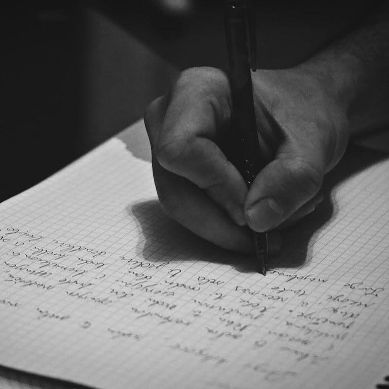

예전에는 질문과 답 사이의 텅 빈 공간에서 막막함을 견디며 생각이 자랐지만, 이제 그 사유의 시간은 단 몇 초로 압축되었다. 결과물은 놀라울 만큼 깔끔하고 논리적이어서 다시 들여다볼 이유조차 주지 않는다. 하지만 도구가 대신 만들어 준 완벽한 초안(이라 말하고 현실은 최종안) 앞에서, 아이들과 교사의 머릿속에도 진짜 이해의 지도가 그려지고 있다고 말할 수 있을까?

<figure>

</figure>

Claude Code 팀의 Addy Osmani(2026)는 일의 대부분을 AI 에이전트에 맡기는 환경에서 인간이 어떻게 비판적 사고를 지켜낼 수 있는지 탐구하며, 자동화의 편리함 뒤에 숨은 세 가지 결정적 함정과 그 해법을 건넨다.

## 자동화의 편리함 뒤에 숨은 세 가지 함정

첫째, 인지적 위임이 인지적 항복으로 미끄러지는 순간 이해 부채가 쌓인다. 작업을 AI에 맡기되 결과의 소유권을 내가 쥐도록 설계하는 것은 건강한 인지적 위임이지만, 도구의 출력을 의심 없이 곧장 다음 입력으로 삼는 유예를 지나, 확인조차 생략하게 되면 와튼스쿨의 Shaw와 Nave가 경고한 인지적 항복에 이른다.

둘째, 생각의 무게중심을 앞단의 의도와 가설로 옮겨야 한다. 과거에는 모호하게 질문하면 상대가 되물어 주었지만, 에이전트는 비어 있는 맥락을 그럴듯한 추측으로 채워 완성된 답을 내놓는다. 바탕의 생각이 흐릿한 채 산출물만 쌓이는 이른바 의도 부채는 누구도 대신 갚아 줄 수 없다. 따라서 AI에게 묻기 전 틀린 추측이라도 자기만의 가설을 먼저 세워야 하며, Andy Clark의 구분처럼 생각을 떠넘기는 위임이 아니라 프롬프트와 출력을 주고받으며 내 머릿속 모델을 날카롭게 다듬는 협업을 선택해야 한다.

셋째, 매끈한 통과 신호 너머를 검증하는 감독의 역설을 직시해야 한다. 병목은 이제 결과물을 만드는 일이 아니라 그것이 옳다고 확신하는 검증으로 옮겨 갔다. 하지만 초록색 통과 표시나 유창한 요약문은 한 가지 단면만 보여 줄 뿐, 무엇을 놓쳤는지는 말해 주지 않는다. Anthropic의 연구가 지적한 감독의 역설처럼, AI를 제대로 감독하려면 결국 AI를 과용할 때 가장 먼저 퇴화하는 바로 그 기초 역량이 살아 있어야 한다. 판돈이 작은 일은 넘겨주더라도, 누군가 결과를 감당해야 하는 일의 책임과 최종 판단은 결코 위임할 수 없다.

## 한 차시 수업과 교사의 일상에 녹여내기

그렇다면 에이전트 시대의 비판적 사고를 한 차시 수업과 교사의 일상에 어떻게 녹여낼 수 있을까?

첫째, 학생이 AI에 프롬프트를 입력하기 전, 자신만의 가설과 뼈대를 종이 위에 먼저 적게 하여 의도 부채 없이 질문을 시작하도록 이끈다.

둘째, AI가 내놓은 답을 곧장 수용하지 않고 이 결론이 틀리려면 무엇이 참이어야 하는지를 물으며, 근거의 출처를 직접 확인하고 반론을 생성해 대조하는 검증 단계를 활동지에 명시한다.

셋째, 수업과 업무에서 AI에 맡길 영역과 끝까지 직접 수행할 핵심 역량을 의도적으로 구분하고, 주기적으로 도구 없이 스스로 문제를 풀어보는 보정 연습의 시간을 확보한다.

에이전트에게 초안을 맡기는 것은 도구 활용이지만, 가설을 세우고 허점을 검증하며 자신의 이름을 걸 수 있는 나름의 해답을 내는 것이 진짜 사고다.

## 참고문헌

- Osmani, A. (2026). Critical thinking when agents do the work. X 아티클(11-03).
