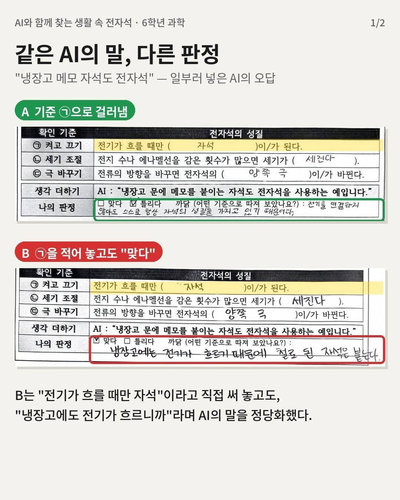
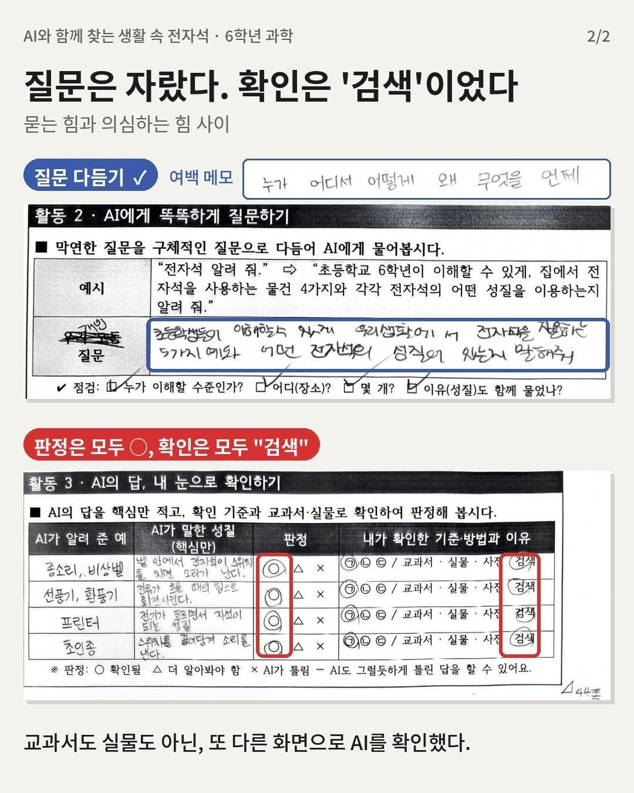

지난번 생각을 지키는 장치를 넣은 학습지로 6학년 과학 생활 속 전자석 수업을 했다. 학습지를 점검하고 나서 든 생각 3가지를 정리해둔다.

## 첫 번째, 질문은 자랐다.

"전자석 알려 줘"가 "초등학생이 이해할 수 있게, 우리 생활에서, 5가지 예와 어떤 성질이 있는지"로 바뀌었다. 한 아이는 질문 바람개비 전략대로 학습지 여백에 '누가, 어디서, 어떻게, 왜, 무엇을, 언제'를 적어 두었다. 좋은 질문에는 무엇이 들어가야 하는지 배운 틀을 기억해내어 세운 것이다. 이렇듯 묻는 힘은 한 차시 만에도 자람을 확인할 수 있었다.

## 두 번째, 같은 AI의 말에 판정이 갈렸다.

학습지 첫머리에 일부러 틀린 AI의 말을 넣어 두었다. "냉장고 문에 메모를 붙이는 자석도 전자석입니다." 한 아이는 "전기를 연결하지 않아도 스스로 항상 자석의 성질을 가지고 있다"며 틀렸다고 썼다. 오늘 배울 기준을 정확히 적용했다. 다른 아이는 "냉장고에는 전기가 흐르기 때문에" 맞다고 했다. 틀린 정보를 쓴 게 아니라, 맞는 사실을 끌어와 AI의 말을 정당화한 것이다. AI가 그럴듯하게 틀릴 때 가장 위험한 건 모르는 아이가 아니라, 근거를 찾아 맞춰 주는 아이일지도 모른다는 생각이 들었다.

<figure>

<figcaption>같은 AI의 말, 다른 판정. 두 아이 모두 '전기가 흐를 때만 자석이 된다'를 적었지만 판정은 갈렸다.</figcaption>
</figure>

## 세 번째, 한번 더 확인(팩트 체크)은 한 번 더 검색이었다.

AI가 알려 준 예의 팩트를 판정하는 칸에 ○ 네 개가 나란히 있었다. 확인 방법은 네 줄 모두 검색에 동그라미를 쳤다. AI의 답을 또 다른 AI(구글 검색)나 인터넷 화면으로 확인한 셈이다.

<figure>

<figcaption>질문은 구체적으로 다듬었지만, 네 가지 예의 판정은 모두 ○, 확인 방법은 모두 검색이었다.</figcaption>
</figure>

## 묻는 힘과 의심하는 힘

이렇게 두고 보니, 묻는 힘은 금방 자라는데 의심하는 힘은 아직 자라는 중임을 확인할 수 있었다. 다음 학습지에서는 확인 방법으로 교과서나 다른 방법을 꼭 하나 고르게 하고, ○에도 근거 한 줄을 쓰게 하면 좋을 것 같다. 생각을 지키는 학습지는 정답을 옮겨 적는 종이가 아니라, 아이의 생각이 어디서 멈추는지 보여 주는 기록이다. 그 기록을 읽고 다음 칸을 적응적으로 고치는 일, 그게 그 순간의 정답에 조금씩 가까워져가는 AI 리터러시의 본질이 아닐까 한다.

## 함께 보기

- [AI가 답을 주는 교실, 학생용 워크시트는 무엇을 담아야 할까?](/post/student-worksheet-when-ai-answers/)
