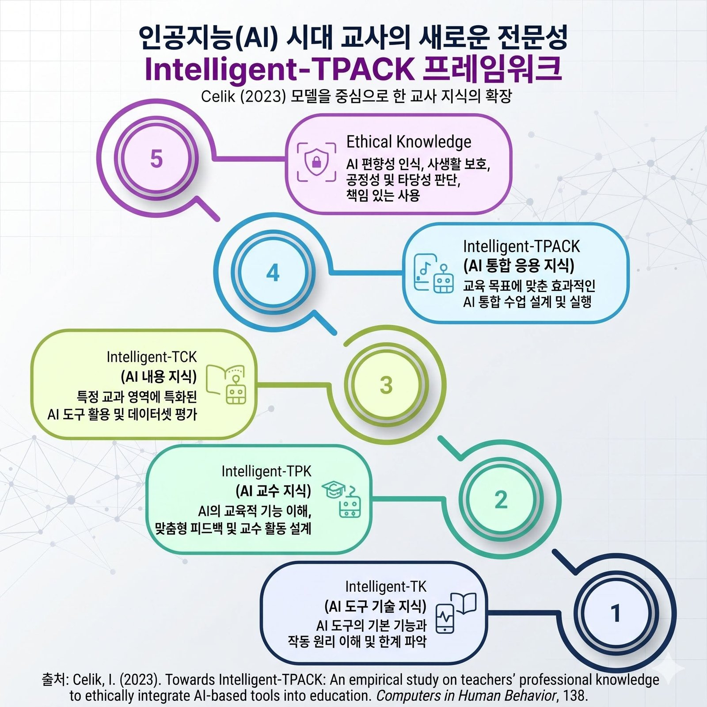

기존 TPACK 프레임워크가 AI 시대 교사의 새로운 지식 요구와 윤리적 측면을 온전히 담아내지 못하는 한계를 어떻게 해결할 수 있을까?

Celik(2023)의 Intelligent-TPACK 모델은 효과적이고도 윤리적인 AI 통합 방안을 모색하여 소개하고 있다.

> 전체 글: [AI-TPACK은 교사에게 인공지능 윤리적 통합 지식을 어떻게 제시하는가?](/post/ai-tpack-guide-for-teachers/)

<figure>

<figcaption>Celik(2023) 모델을 중심으로 정리한 Intelligent-TPACK의 다섯 지식 영역.</figcaption>
</figure>

## 주요 구성 요소

(1) Intelligent-TK (AI 도구 기술 지식): AI 작동 원리, 기본 기능, 프롬프트 조작, 환각 등 한계 이해 역량

(2) Intelligent-TPK (AI 교수 지식): 맞춤형 피드백, 차별화 학습 설계, AI 의존성 평가 등 교육적 활용 및 설계 역량

(3) Intelligent-TCK (AI 내용 지식): 교과 특화 AI 도구 활용, 도메인 예시 생성, 데이터셋 품질 평가 역량

(4) Intelligent-TPACK (AI 통합 응용 지식): 학습 목표에 맞는 AI 도구 선정, 수업 설계, 비판적 사고 촉진 등 종합적 전문성

(5) Ethical Knowledge (윤리 지식): AI 편향성 인식, 학생 개인정보 보호, 공정성 판단, 책임 있는 AI 사용 모델링 역량

(6) Contextual Knowledge (XK): AI 기술 사용을 둘러싼 제도적, 윤리적, 사회적 맥락에 대한 이해

## 인사이트 및 시사점

(1) 교사 연수는 단순 AI 도구 사용법 그 이상으로 윤리적·메타인지적 영역을 균형 있게 다루어야 함

(2) 교육용 AI 설계 시 교사의 통제력과 감독 기능을 보장하는 인간-AI 협업 환경 제공이 필수적임

(3) Intelligent-TPACK 자가 진단을 통해 개인화된 교사 전문성 개발 로드맵 지원이 필요함

## 참고문헌

- Kharbach, M. AI-TPACK: The guide for teachers. Educators Technology.
- Celik, I. (2023). Towards Intelligent-TPACK. Computers in Human Behavior, 138.
- Mishra, P., Warr, M., & Islam, R. (2023). TPACK in the age of ChatGPT and Generative AI. JDLTE, 39(4), 235-251.
- Mishra, P., & Koehler, M. (2006). Technological Pedagogical Content Knowledge. TCR, 108(6), 1017–1054.

## 함께 보기

- [AI-TPACK은 교사에게 인공지능 윤리적 통합 지식을 어떻게 제시하는가?](/post/ai-tpack-guide-for-teachers/)
