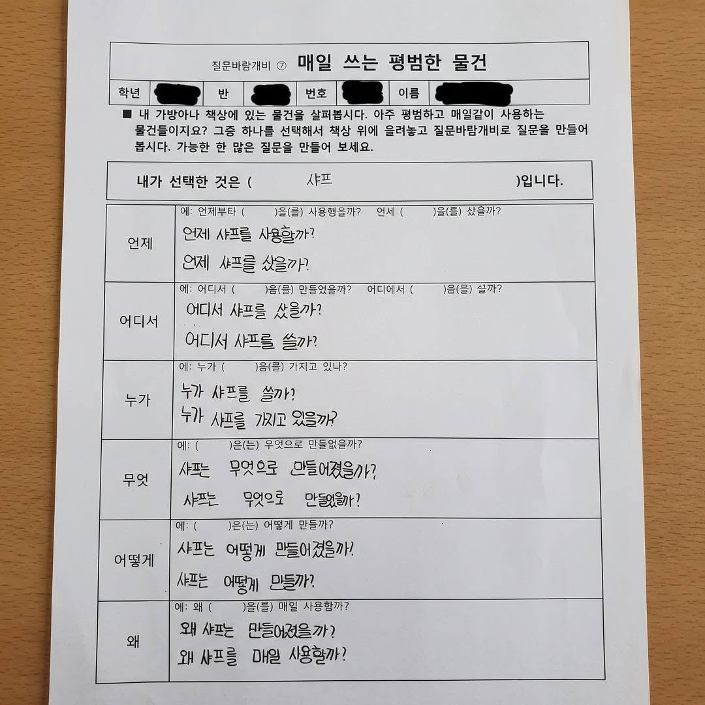
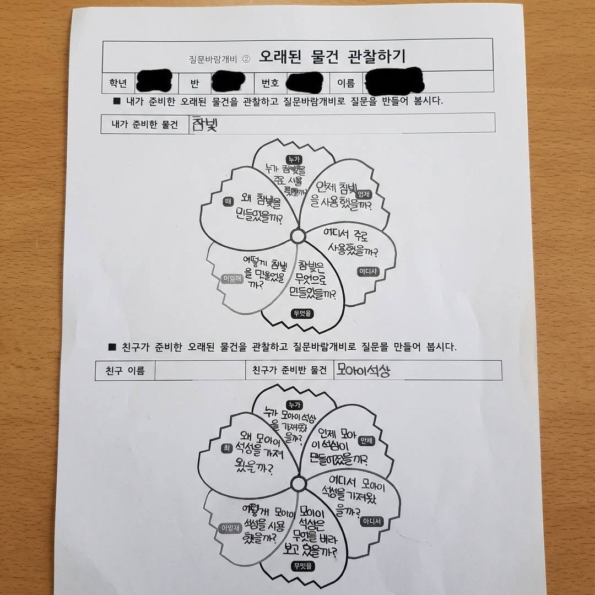
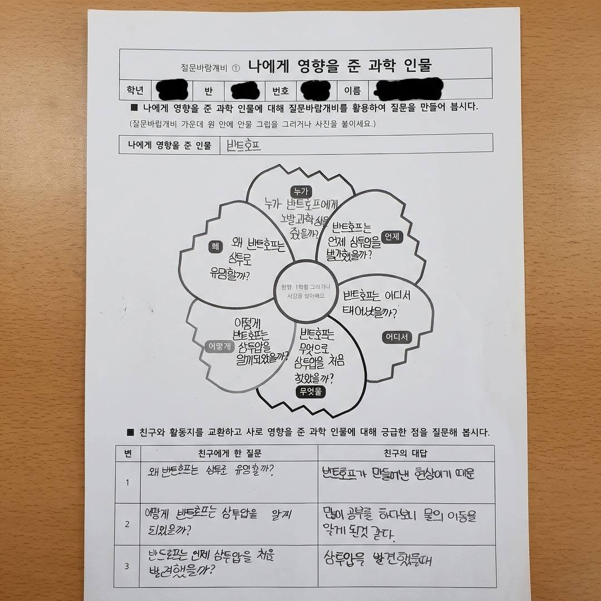

지난시간 니까요 질문도구를 통한 질문생성전략에 이어 5학년 아이들과 질문확장전략인 질문바람개비 활동을 진행했다. 일상 사물에서 시작해 오래된 물건, 과학 인물로 대상을 넓혀가며 걷은 활동지 속에서 멈춰 선 순간들을 기록해 둔다.

## 활동지 속에서 멈춰 선 순간들

(1) "샤프로 무슨 질문을 만들어요?" 하던 아이들. 6하원칙 생각틀을 명시적으로 쥐어주자 "어떻게 만들어졌을까?", "왜 매일 사용할까?"처럼 무심코 지나치던 사물에서 질문이 나오기 시작했다. 단순 질문 요구보다 구체적인 생각의 도구를 줄 때 사고가 움직인다.

<figure>

<figcaption>일상 사물 샤프로 만든 질문. 6하원칙 칸마다 질문을 채운다.</figcaption>
</figure>

(2) 샤프를 거쳐 참빗과 모아이석상으로 대상이 확대되니 질문의 깊이가 달라졌다. "모아이석상은 무엇을 바라보고 있을까?"처럼 외형 관찰을 넘어 대상이 품은 배경과 맥락을 탐구하는 질문으로 나아갔다.

<figure>

<figcaption>오래된 물건 관찰하기. 참빗과 모아이석상으로 대상을 넓혔다.</figcaption>
</figure>

(3) 과학자 반트호프 활동지에서 대다수가 "누구인가?", "언제 상을 탔나?"를 물을 때, 한 친구는 "어떻게 삼투압을 알게 되었을까?"를 물었다. 배경지식은 질문의 재료가 되어 질문의 깊이를 한층 더해준다. 여기서는 삼투압이라는 지식이 발견되는 탐구 과정을 추적하는 질문으로 이어졌다.

<figure>

<figcaption>나에게 영향을 준 과학 인물 반트호프. 친구와 질문과 대답을 주고받는 칸도 있다.</figcaption>
</figure>

(4) 바람개비 날개는 빽빽이 채워졌지만, 이 지식이 내 삶과 어떻게 연결되는지에 관한 정교화 질문은 아직 적었다. 아이가 무엇을 물었는지뿐만 아니라 무엇을 아직 묻지 못했는지를 읽어내는 것이 다음 수업을 설계하는 자료가 되겠다.

## 돌아가야 하는 것은 성찰의 바람

질문중심수업은 "알아서 질문해 봐"가 아니다. 교사의 구체적인 명시적 지도와 아이들의 반복적 성찰이 만날 때 깊어진다. 정말로 돌아가야 하는 것은 종이 바람개비가 아니라 질문을 통한 아이들의 성찰의 바람이어야 한다는 것.
